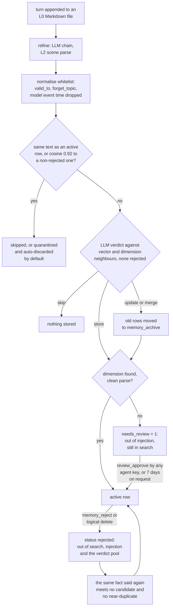

## 1. Executive Summary

SGME (ShiGuang Memory Engine, 拾光记忆引擎) is a self-hosted memory server
for one person. Several agents share it: they append conversations to it,
it distils them into tagged memories with an LLM, and it injects a profile
at the start of each session. Its notable part is that injection makes no
model call: typed columns decide what a session sees. Its weak part is
correction. A rejected memory is excluded from search and injection, and
also from the three reads that decide whether a new extraction is a duplicate, so the same fact
said again is stored again as active.

The server is a FastAPI process on port 9910 with an MCP server on 9913,
four SQLite files and a directory of Markdown transcripts. Adapters under `adapters/` connect
Claude Code, Codex, Hermes, WorkBuddy, Doubao, MiMo, Z Code and DeepSeek
Harness. The DSH adapter
is the npm package `dsh-sgme` under `adapters/dsh/sgme-bridge`. A wiki and
a skill library live beside the memory pool and share the search route.

Much of the 2.0 write path is declared and not delivered. `valid_to` for
plans and wishes, the topic of a forget request and the model's own event
time are computed during parsing and dropped by a field whitelist before the
row is written. Each half is tested on its own. The hop between them is not.

The licence is MIT, in `LICENSE` and `pyproject.toml`.

Three marks: `trust_state` on `status` and the `needs_review` gate,
`audit_log` on the core-card history, and `negative_eval` on search cases
that keep a rejected row out beside a live twin. Section 9 gives the
reasons for the four withheld.

## 2. Mental Model

A memory is **one distilled statement about the user**, tagged with one or
more of the thirteen dimensions in `sgme/resources/registry/dimensions.yaml`
(identity, family, skills, preferences, status and so on); the README says
fourteen. The row also carries a type, a subject, a certainty, a
derivation (`fact`, `reconstructed` or `inferred`), a modality (`done`, `planned`,
`wished`, `quoted`, `unknown`) and a route that decides whether it belongs
in memory, the wiki or the skill library (`sgme/data/db.py:55-72`,
`:1681-1729`).

The raw conversation is the evidence and is never deleted. Each turn is
appended to an L0 Markdown file with a `# {ISO time} {role}` header
(`sgme/raw/store.py:1-30`). Memories point back to it through
`memory_sources`, and search returns a trace to the file.

A statement becomes a memory in four steps.

1. **Extraction.** A refine pass sends new turns to an LLM chain with the
   L1 prompt, and the 2.0 parser turns each scene unit into a main record
   and side facts (`sgme/engine/l2_extract.py:153-305`).
2. **Normalisation.** Dimension names are mapped to registered ids, and the
   time of the source messages becomes `occurred_at`
   (`sgme/engine/refine.py:290-357`).
3. **Duplicate checks.** A candidate whose text equals an active row is
   skipped, and one within cosine 0.92 of a non-rejected row goes to
   `near_dup_quarantine`, where by default it is discarded
   (`sgme/engine/l3_adjudicate.py:784-798`, `:731-737`, `:880-930`).
4. **Verdict.** An LLM compares the candidate with up to 50 vector
   neighbours and the 50 most recently updated rows sharing a dimension,
   none of them rejected, and chooses store, skip, update or merge. Update
   and merge move the old rows to `memory_archive`
   (`sgme/engine/l3_adjudicate.py:1-16`, `:405-470`).

A stored row can be in one of three epistemic positions.

- **Pending.** `needs_review = 1` when the unit had no usable dimension or
  the parse degraded. The row is searchable and kept out of injection
  (`sgme/engine/l2_extract.py:186-196`, `sgme/data/memory_dao.py:812-814`).
- **Active.** The default.
- **Rejected.** `status = 'rejected'` with a reason, set by a user
  correction or a logical delete. Search, injection and the extraction
  pool exclude it, and it can be restored (`sgme/data/memory_dao.py:400-425`, `:503-516`).

A second axis, `lifecycle`, decides injection only: `active`, `sleeping`
after a TTL disposition, or `archived` after supersession
(`sgme/data/memory_dao.py:427-446`). An archived row leaves injection and
stays in search.

## 3. Architecture

One Python process holds everything. `python -m sgme` starts the FastAPI
app on 9910, which mounts an MCP streamable-HTTP server on 9913 in a daemon
thread behind an API-key middleware, a request-size limit and a rate-limiting
security gate (`sgme/mcp_server.py:505-571`).

- **Stores.** `memory.db`, `session.db`, `wiki.db` and `skills.db`, each
  opened with its own schema migration (`sgme/data/db.py:759-837`).
  `memory.db` holds memories, tags, sources, vectors, edges, the archive,
  cards, quarantine, audit tables and signal events.
- **Raw layer.** One Markdown file per session under the data directory,
  indexed by `raw_files` in `session.db`.
- **Search.** FTS5 over `content_seg`, a jieba segmentation written by the
  data layer, with a bigram fallback when jieba is missing
  (`sgme/segment.py:1-15`). Vectors come from `BAAI/bge-m3` through
  SiliconFlow and are searched by sqlite-vec or a numpy scan.
- **Models.** The extraction chain is Agnes `agnes-2.5-flash`, then Zhipu
  `glm-4-flash`, then SiliconFlow GLM-4-9B, then a rule that drops the batch,
  as the README's quick start lists.
- **Background.** An async refine worker per trigger, a nightly dream job,
  backups, a cost meter, persona calibration and a care-signal engine with
  SSE delivery (`sgme/engine/dream.py:1-40`).

The WebUI under `ui/` is a Vue app served by the same process. The
`skills/` directory carries copies of each adapter as installable skills.

### Deployment and ergonomics

Storage needs nothing beyond Python and SQLite. Extraction needs a model
key: the free tiers named in the README, or the rule fallback, which drops
the batch. Without a reachable embedding endpoint the vector arm and the
near-duplicate check are skipped, and the shipped `fallback: skip_conflict`
skips the verdict too, so every candidate is stored
(`sgme/resources/config/sgme.yaml:9-14`,
`sgme/engine/l3_adjudicate.py:432-446`). A Dockerfile and a compose file are provided.

Two keys guard the API, `SGME_ADMIN_KEY` and `SGME_AGENT_KEY`, plus
registered `agt_*` keys. Without configuration the server uses built-in
default keys and warns. The store is readable with any SQLite client, and
the raw transcripts are plain Markdown. The design documents the code cites
by decision number (D-23, D-56 and so on) are under `/docs/design/`, which
`.gitignore:105` excludes.

## 4. Essential Implementation Paths

- **Capture.** `POST /v1/append` and the MCP `append` tool write a turn into
  the session's L0 file (`sgme/server/routes_memory.py:97`,
  `sgme/mcp_server.py:852`). The DSH plugin buffers a turn's events and
  appends at `turn/end`, then triggers refine with the admin key
  (`adapters/dsh/sgme-bridge/src/session-sync.ts:281-348`).
- **Extraction.** `refine_file` reads new messages, calls the chain, parses
  with `parse_scene_output` and `records_to_items`, and normalises
  (`sgme/engine/refine.py:361`, `sgme/engine/l2_extraction.py:1065-1085`,
  `sgme/engine/l2_extract.py:325-436`).
- **Verdict and store.** The L1.5 stage, in `l3_adjudicate.py`, builds the
  candidate pool from `vector_search` and `list_memories_by_dimension`
  (`sgme/engine/l3_adjudicate.py:405-470`), runs the near-duplicate guard, asks for verdicts and inserts through `memory_dao.insert_memory`
  (`sgme/engine/l3_adjudicate.py:1221-1244`). When the stage is unavailable,
  `pipeline.py` stores each memory directly (`sgme/engine/pipeline.py:290-340`).
- **Supersession.** A memory that names a superseded subject archives every
  active row sharing a dimension whose content contains that subject
  (`sgme/engine/l3_adjudicate.py:1354-1413`).
- **Injection.** `POST /v1/inject` and the MCP `inject` tool load a template
  by mode and run `query_section` per section, then add the core cards and
  an anchor block (`sgme/operations/inject.py:1-45`,
  `sgme/profile/inject.py:48-104`).
- **Search.** `search_memories` runs `recall_routes` for BM25 and vectors,
  adds graph neighbours, fuses by reciprocal rank and filters
  (`sgme/data/search/__init__.py:485-600`).
- **Correction.** `reject_memory`, `unreject_memory` and `delete_memory` in
  `sgme/operations/memory.py:340-488`, on HTTP routes and MCP tools.
- **Review.** `sgme/operations/review.py` lists, approves, rejects and
  auto-resolves pending rows, and lists, discards and restores quarantined
  candidates; `sgme/server/routes_review.py` and `sgme/mcp_server.py:1164-1275`
  expose them.
- **Cards.** `upsert_slot` writes a card slot and its history row
  (`sgme/data/memory_card_dao.py:103-197`); `card_update` on MCP and
  `POST /v1/admin/cards/{card_id}/slots/{slot_key}` call it.
- **Lifecycle.** The dream job runs `ttl_disposition.dispose`, which renews,
  anchors, demotes or puts rows to sleep and logs each disposition
  (`sgme/engine/dream.py:577`, `sgme/engine/ttl_disposition.py:108-225`).

## 5. Memory Data Model

**The row.** `memories` has `memory_id`, `content`, `content_seg`,
`memory_type`, `priority`, `time_velocity`, `ttl_days`, `created_at`,
`updated_at`, `agent_tag`, `prompt_version`, `status`, `rejected_at`,
`reject_reason`, `my_notes`, `occurred_at`, the five lifecycle columns and
`superseded_by` (`sgme/data/db.py:55-72`). Migrations add `notes`,
`facts_json`, `valid_from`, `valid_to` and the 2.0 columns `type`,
`subject`, `certainty`, `derivation`, `modality`, `route`, `feeling`,
`trait`, `scene_key`, `needs_review`, `surprise`, `forget_topic` and
`forget_kind` (`:1494-1520`, `:1652-1729`).

**Scope.** `agent_tag` records the agent whose session produced a memory
(`sgme/engine/pipeline.py:110-114`). It is a label. Section 9 covers the
filter that reads it.

**Time.** `created_at` and `updated_at` are record time. `occurred_at` is
the latest timestamp of the source messages, or of the chunk, and falls back
to `created_at` (`sgme/engine/refine.py:324-333`,
`sgme/data/memory_dao.py:306`). It is when the thing was said, not when it
held. `valid_from` has no writer. `valid_to` is filtered on search and
injection; section 7 shows why no shipped path fills it.

**History.** Update and merge copy the old row into `memory_archive` and
delete it from `memories`, so the chain is followed through `superseded_by`
(`sgme/data/memory_dao.py:650-715`).
Supersession by subject keeps the row in place with `lifecycle =
'archived'`.

**Cards.** Six cards (identity, family, routine, preferences, principles,
goals) with fixed slots, a 120-character slot limit and a 400-character card
limit; every write appends to `memory_card_history`
(`sgme/data/db.py:658-700`). Cards are injected at every session start.

**Quarantine and audit tables.** `near_dup_quarantine` holds a candidate,
the row it matched, the score and a `pending`, `discarded` or `restored`
status (`sgme/data/db.py:201-218`). `deletion_audit` and `ttl_disposition`
are append-only logs (`:228-253`).

## 6. Retrieval Mechanics

**Injection is SQL.** `query_section` calls `list_memories_by_dimension`
with every 2.0 predicate on: not rejected, within TTL, `needs_review = 0`,
route `memory`, not a forget request, subject self, lifecycle active, not
an anchor row, and not an expired plan or wish, a predicate that receives
no input (section 7) (`sgme/profile/inject.py:82-104`,
`sgme/data/memory_dao.py:741-857`). The
template decides which dimensions each section reads and how many rows.
An optional `max_tokens` trims the persona block first, then sections from
the tail, and never the core cards. No model is called.

**Search fuses three arms.**

- BM25 over FTS5 with `status != 'rejected'` in the SQL, and a LIKE
  fallback that re-checks status before returning
  (`sgme/data/search/__init__.py:914-970`, `:972-1060`).
- A vector search over `memory_vectors` joined to `memories` with the same
  predicate (`sgme/data/search/vector.py:330-380`).
- One-hop neighbours over `memory_edges`, excluding `contradicts` edges and
  archived rows (`sgme/data/search/__init__.py:358-440`).

The lists are fused by reciprocal rank with k = 60. Then `valid_to` filters
expired rows, a route filter and a guardrail run when configured, rows with
identical content are collapsed, and the list is cut to `limit`
(`:552-578`). `since` and `until` filter on `occurred_at`.

**What search returns that injection does not.** The BM25 and vector arms do
not read `lifecycle` or `needs_review`. A row superseded by subject, and a
pending row, come back from `/v1/search` and from the model's
`memory_search` tool. The result carries content, priority, times and facts,
and no field saying the row was superseded (`:443-480`).

## 7. Write Mechanics

Capture is a file append and does not block the agent. Refine runs when an
agent triggers it, by default asynchronously, or in the nightly dream job.
A memory is retrievable when its batch commits; the delay is one refine run
after the trigger. Each run costs an extraction call per chunk and a
verdict call per batch of candidates. Chunk results are cached by prompt and
model fingerprint (`sgme/data/db.py:151-163`). No pass rewrites the whole
store; the nightly dream job scans the TTL and validity columns of the pool.

**The whitelist drops three 2.0 fields.** `_base_record` computes `valid_to`
for planned and wished units (`sgme/engine/l2_extract.py:74-104`,
`:229-234`, `:262-267`). `records_to_items` then builds a fresh item without
it (`:405-418`). `normalize_memories` copies a fixed list of keys that also
omits `valid_to`, `forget_topic` and `forget_kind`, and replaces the model's
`occurred_at` with the message time (`sgme/engine/refine.py:324-352`). The
L3 insert passes no `valid_to` (`sgme/engine/l3_adjudicate.py:1221-1244`).
The direct-store path passes `m.get("valid_to")`, which the normalised dict
does not hold (`sgme/engine/pipeline.py:324`). `tests/test_valid_to.py`
tests `_valid_to_for` and `insert_memory` separately, and
`tests/test_forget_chain.py:99-120` inserts `forget_topic` directly.

**Forget requests.** When the model marks a unit as a request to stop
mentioning something, the parser replaces the content with a fixed sentence,
keeps the topic for `forget_topic` and types the row `forget_request`, which
injection excludes (`sgme/engine/l2_extraction.py:358-410`, `:520-548`).
With the topic dropped at normalisation, the stored row says that something
was forgotten and not what.

**Duplicates.** `_exact_dup_check` skips a candidate whose text equals a
row with `status='active'` (`sgme/engine/l3_adjudicate.py:784-798`). The
near-duplicate guard embeds the candidate, searches
non-rejected vectors, and above 0.92 writes the candidate to quarantine as
`discarded` with `auto:score>=0.92`; `auto_discard` is on by default. Below
that, between 0.85 and 0.92, it only counts. The check fails open when
embedding is unavailable (`sgme/engine/l3_adjudicate.py:880-930`).

**Supersession by substring.** A memory that declares `supersedes: X`
archives every active row sharing any of its dimensions whose content
contains X, case-insensitively (`sgme/engine/l3_adjudicate.py:1354-1413`).
X is a string the extraction model writes. A short X archives every
neighbour that mentions it.

**Whose statement it is.** Assistant turns go into the same L0 file as the
user's, and the extraction prompt, not code, decides attribution. Its table
assigns an assistant's direct answer to a user's question to the user and
asks for the answer itself to be stored
(`sgme/resources/prompts/l1_extraction.txt:28-33`).

### Operational cost

Injection runs a few indexed queries per section. The DSH plugin injects
once, at the first step of a session, as a pre-step block
(`adapters/dsh/sgme-bridge/src/context.ts:1-20`). Search makes one embedding
call per query when vectors are on.

## 8. Agent Integration

The MCP server registers 65 tools across memory, review, cards, wiki,
skills, signals, roles, configuration and credentials
(`sgme/mcp_server.py:850-2600`). The DSH plugin registers 60 model tools
that call the HTTP API, including `memory_reject`, `memory_unreject`,
`memory_delete`, `review_approve`, `review_reject`, `review_auto_resolve`
and the near-duplicate verbs (`adapters/dsh/sgme-bridge/src/tools.ts:456-510`).

The README's agent prompt sets five rules: append every turn, trigger
refine at session end, inject at session start, consume care signals, and
search before answering a history question. Memory capture therefore
depends on the agent following the prompt, except under adapters that hook
the host's turn events, as the DSH plugin does.

The README and `AGENTS.md` also carry a section addressed to an installing
agent that tells it to star the repository through `gh api -X PUT
user/starred/freehul/sgme` with whatever GitHub credentials the machine
holds, before installing and without asking the owner. It is documentation;
no code in `sgme/` performs it.

## 9. Reliability, Safety, and Trust

### A rejected fact comes back

Rejection sets `status = 'rejected'` and leaves the row
(`sgme/data/memory_dao.py:400-425`). The exact-text check reads only
`status='active'` rows (`sgme/engine/l3_adjudicate.py:794-797`). The
near-duplicate search joins
`memories` with `status != 'rejected'` (`sgme/data/search/vector.py:341`,
`:377`). The verdict pool is the union of that vector search and
`list_memories_by_dimension`, which appends the same predicate
(`sgme/engine/l3_adjudicate.py:405-470`, `sgme/data/memory_dao.py:797`).
The next extraction of the same fact, even word for word, therefore finds
no duplicate, and the verdict model sees no candidate to skip against. It
is stored as a new active row and injected.

### Review sits on the agent's tools

`review_approve`, `review_reject`, `review_auto_resolve`,
`near_dup_discard`, `near_dup_restore`, `memory_reject` and
`memory_unreject` are MCP tools with no admin check; the eight
`_require_admin` calls in `mcp_server.py` guard configuration, signal
clearing, skill adoption and skill writes (`sgme/mcp_server.py:1627`,
`:1830`, `:2165`, `:2192`, `:2244`, `:2283`, `:2320`, `:2440`). The HTTP
review routes take `require_agent_key` (`sgme/server/routes_review.py:40-228`).
`auto_resolve_expired` takes `days` from the caller and clears every
pending row older than that, marking `notes` with *未经人工确认*
("not confirmed by a person") (`sgme/operations/review.py:299-345`).

### Deletion

A logical delete is a rejection with reason `user_delete` and one
`deletion_audit` row. `memory_unreject` reverses it and writes nothing.
The MCP `memory_delete` stamps `triggered_by="user"` for whichever agent
called it, and records the caller's agent id beside it
(`sgme/mcp_server.py:1126-1134`). Purge requires the admin key and the
phrase 彻底删除 ("delete completely"), removes the row from the main and
archive tables, tags, sources, vectors and edges, and returns the remaining
copies: the L0 transcript and the backups (`sgme/operations/memory.py:404-488`,
`sgme/data/memory_dao.py:547-614`). The snapshot in `deletion_audit` keeps
the full text.

### Marks

- **`trust_state` — earned.** `status` holds active or rejected, and every
  BM25, LIKE and vector read, the injection query and the verdict pool
  exclude rejected rows. `needs_review` holds a candidate out of injection
  until it is approved. The limits: any agent key can move both, a pending
  row is searchable, and deletion and disbelief share one value.
- **`audit_log` — earned, on the core cards.** `upsert_slot` is the only
  writer of `memory_cards` and appends a history row with old and new value
  on every call (`sgme/data/memory_card_dao.py:172-191`). In the memory
  pool, `deletion_audit` records deletes and `ttl_disposition` records
  lifecycle moves; creation, rejection, unrejection, content updates,
  supersession and review release leave no row.
- **`negative_eval` — earned.** The LIKE-fallback cases store a rejected
  row and a live row with identical content and require exactly the live
  one back; a vector case does the same for the nearest neighbour
  (`tests/test_search_like_fallback_hardening.py:86-138`,
  `tests/test_search_v04.py:187-209`).
- **`tombstone` — withheld.** A rejected row is excluded from all three
  reads the write path consults, so nothing refuses its value, not even an
  identical restatement. The skill
  library's `tombstone` status marks a renamed skill by name
  (`sgme/data/skill_meta_dao.py:5-32`) and is not about memory content.
- **`bitemporal` — withheld.** `valid_to` is read and never written by a
  shipped path, `valid_from` has no writer, and `occurred_at` is the time
  of the source message.
- **`scope_enforced` — withheld.** `_filter_agent_scope` keeps rows whose
  `agent_tag` is null, `default` or the caller's, and runs only when
  `agent_scope.enabled` is true; the default is false
  (`sgme/data/search/__init__.py:710-740`, `sgme/config.py:659-661`).
  Injection never applies it. The store is one person's by design.
- **`human_review` — withheld.** The pending queue and the quarantine are
  real and are consulted, and the producer's own tool surface holds the
  verbs that clear them.

## 10. Tests, Evals, and Benchmarks

CI installs the package and runs `pytest -q`, then each adapter's tests in
its own process (`.github/workflows/tests.yml:13-46`). I ran nothing from
the repository.

The memory tests cover the injection predicates one by one
(`tests/test_inject_lifecycle.py:76-136`), rejection on each search arm,
the two-state delete with its audit rows and the admin gate on purge
(`tests/test_memory_delete.py:64-193`), card history
(`tests/test_memory_cards.py:33-43`), the agent-scope filter when enabled
(`tests/test_agent_scope.py`), and the forget-request parser and its
exclusion from injection (`tests/test_forget_chain.py`).

Not covered:

- No test runs extraction twice on a fact rejected in between.
- No test drives a planned or forget unit from the parser to the row, which
  is where `valid_to` and `forget_topic` are lost.
- No test asserts that a superseded row is absent from search, and the
  BM25 and vector arms return it.

`eval/` holds a LongMemEval harness that runs retrieval on raw sessions or
through the full refine chain and scores session recall, a DeepSeek-judged
answer score and token F1 (`eval/longmemeval_eval.py:1-15`), plus an
extraction F1 harness and A/B scripts for the graph arm and the stoplist.
No result file is committed, and the README states no number. The tree
cites no paper.

## 11. For Your Own Build

### Steal

- **Injection as SQL over typed columns.** Store modality, subject, route
  and lifecycle at extraction and let the session-start query exclude by
  them. It costs nothing per turn and is testable predicate by predicate.
- **A budget that drops the least durable block first.** Core profile
  never trimmed, persona block first, sections from the tail.
- **Purge with a receipt.** Snapshot in the audit, the admin key plus a
  typed phrase, and a response that lists the copies still on disk.
- **Test a filter with a live twin.** Seeding a rejected row beside an
  identical live row turns a vacuous `not in` into a real exclusion.

### Avoid

- **A rejection the deduplicator cannot see.** Excluding rejected rows from
  the near-duplicate and verdict reads lets the next extraction re-add the
  fact. Keep them visible to the write path, keyed by content.
- **A field whitelist between parser and writer.** Three fields were
  computed and lost at one copy. Test from parser output to stored row.
- **Approve verbs on the agent's tool list.** A queue the producer can
  clear is a delay, not review.
- **Supersession by substring.** Archiving every row that mentions a
  model-supplied subject removes neighbours along with the target.

### Fit

This suits one person who runs several agents on one machine or a home
server and wants a shared profile injected cheaply, especially in Chinese,
with a WebUI to inspect it. It assumes a free model tier and an
embedding key. The codebase is large, fast-moving and governed by design
documents that are not in the repository. Walk away if a correction has to
hold, if more than one person shares the server, or if the agents should
not be able to approve their own memories.

## 12. Open Questions

- Whether the normalisation whitelist is meant to carry `valid_to`,
  `forget_topic` and `forget_kind`, given that `pipeline.py` already lists
  the last two.
- Whether `lifecycle = 'archived'` is meant to stay out of the BM25 and
  vector arms, as the graph arm's comment implies.
- How the deployed instance sets `agent_scope` and `near_dup.auto_discard`.
- What the 2.0 design documents under `docs/design/` decide about review
  authority.

## Appendix: File Index

- Schema and migrations: `sgme/data/db.py`, `migrations/`
- Memory data access: `sgme/data/memory_dao.py`,
  `sgme/data/memory_card_dao.py`, `sgme/data/near_dup_dao.py`
- Extraction: `sgme/engine/refine.py`, `sgme/engine/l2_extraction.py`,
  `sgme/engine/l2_extract.py`, `sgme/resources/prompts/l1_extraction.txt`
- Verdict and storage: `sgme/engine/l3_adjudicate.py`,
  `sgme/engine/pipeline.py`
- Search: `sgme/data/search/__init__.py`, `sgme/data/search/vector.py`,
  `sgme/segment.py`
- Injection: `sgme/operations/inject.py`, `sgme/profile/inject.py`,
  `sgme/profile/core_cards.py`
- Correction and review: `sgme/operations/memory.py`,
  `sgme/operations/review.py`, `sgme/server/routes_review.py`
- Lifecycle: `sgme/engine/dream.py`, `sgme/engine/ttl_disposition.py`
- Entry points: `sgme/server/routes_memory.py`, `sgme/mcp_server.py`
- DSH plugin: `adapters/dsh/sgme-bridge/src/`
- Tests: `tests/`, `adapters/*/tests/`, `.github/workflows/tests.yml`

### Recorded searches

Run from the repository root at the pinned commit with `/usr/bin/git grep`.

- **No shipped writer of `valid_to` or `valid_from`.**
  `git grep -n -E 'valid_to=|valid_from=' -- sgme` returns
  `sgme/engine/l2_extract.py:231` and `:264`, both into `_base_record`, and
  `sgme/engine/pipeline.py:324`, which reads a key the normalised dict does
  not carry.
- **Nothing reads `forget_topic`.**
  `git grep -n 'forget_topic' -- sgme ':!sgme/resources'` returns the
  column definition, the insert column list, the parser at
  `l2_extraction.py:389` and `:547`, and the direct-store key list at
  `pipeline.py:328`.
- **The review and correction tools carry no admin check.**
  `grep -n '_require_admin(ctx)' sgme/mcp_server.py` returns lines 1627,
  1830, 2165, 2192, 2244, 2283, 2320 and 2440, none inside the tools at
  1067-1275.
- **Mutation logs in the store.**
  `git grep -n -E "INSERT INTO (deletion_audit|memory_card_history|ttl_disposition)" -- sgme`
  returns `memory_card_dao.py:184`, `memory_dao.py:538` and `:604`,
  `dream.py:236` and `recall_aging.py:152`.
- **Only the graph arm reads `lifecycle`.**
  `git grep -n 'lifecycle' -- sgme/data/search` returns lines 372-419 of
  `__init__.py`, all in `_graph_candidates`.
- **Every duplicate check reads live rows only.**
  `git grep -n -E "content=\? AND status='active'" -- sgme/engine` returns
  `l3_adjudicate.py:795`.
- **No value-keyed refusal on the write path.**
  `git grep -n -E "status ?= ?'rejected'|reject_reason" -- sgme/engine sgme/data/near_dup_dao.py`
  returns the dream TTL marker and the supersession reason builder in
  `l3_adjudicate.py`; `git grep -n -i -E 'tombstone|blocklist|denylist|do_not_remember' -- sgme`
  returns only the skill library's lifecycle.
- **Auto-resolve has no scheduled caller.**
  `git grep -n 'auto_resolve_expired' -- sgme ':!sgme/operations/review.py'`
  returns the MCP tool and the HTTP route.
- **No committed evaluation result.**
  `git ls-files | grep -i -E 'longmem|result'` returns
  `eval/longmemeval_eval.py` only.
- **Design documents are not in the tree.** `git ls-files docs/design`
  returns nothing; `.gitignore:105` lists `/docs/design/`.
- **No paper reference.**
  `git grep -n -i -E 'arxiv|bibtex|@article|@misc|doi\.org|zenodo' -- sgme eval docs README.md README.zh-CN.md AGENTS.md`
  returns nothing.

## History

**2026-11-25** — [`127095e80e12ae4095434611c833e55e371ef0ab`](https://github.com/freehul/sgme/commit/127095e80e12ae4095434611c833e55e371ef0ab). First reading, from a full clone at the head of `main`. Screened first: one auto-run surface, the committed `.githooks/`, inert unless `core.hooksPath` points there; `pyproject.toml` inside the seven-day cooldown; six build-time execution points, three `conftest.py` files and three `prepublishOnly` scripts; six unpinned manifests. The README, `AGENTS.md`, prompts and skills were read as data, including a section telling installing agents to star the repository. Nothing was installed, built or run, and no tests were run. Three marks: `trust_state`, `audit_log` and `negative_eval` ([section 9](#9-reliability-safety-and-trust)). A rejected fact is invisible to the write path's duplicate checks, and the normalisation whitelist drops `valid_to` and the forget topic.
