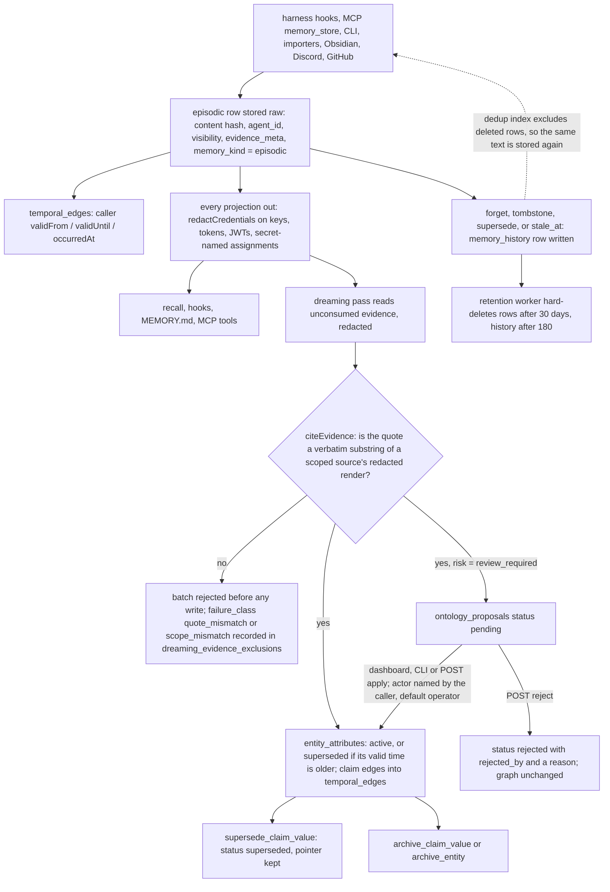

## 1. Executive Summary

Signet is a local memory daemon that sits underneath eleven coding harnesses — Claude Code, Codex, OpenCode, OpenClaw, Kimi Code, Hermes Agent, Pi, Oh My Pi, Gemini CLI, ForgeCode and Muse Code. It captures their transcripts into one SQLite store, derives a semantic entity graph from that store in background passes it calls *dreaming*, and serves recall back through MCP tools and session hooks. It also syncs the identity files those harnesses read (AGENTS.md, SOUL.md, USER.md, MEMORY.md) and keeps a separate encrypted secret store.

**The memory is its own, and the best part of it is a citation gate.** A dreaming pass may not write a claim without citing a quote, and `citeEvidence` resolves that quote against the immutable episodic store with `record.content.includes(requested.quote)` (`platform/daemon/src/pipeline/dreaming-operations.ts:118`). `validateRequestBeforeWrites` rejects the whole batch before any write when one citation does not resolve (`:768`, called at `:1022`). The lookup is scoped by `agent_id`, so a citation to another agent's evidence fails as a scope mismatch, and the text it compares against is the credential-redacted render the model was shown (`pipeline/dreaming-evidence.ts:361`). Two structural operations, `merge_aspects` and `rename_aspect`, apply with a reason and no quote; they reshape aspects and never write a claim value (`dreaming-operations.ts:409-431`).

**Two layers that deliberately do not merge.** An episodic row is primary evidence and is never edited by the pipeline; the semantic graph is derived and can be rebuilt. The MCP `memory_store` description tells the model so: a save is *"immutable episodic evidence"* and a structured payload *"is not applied to the graph from this tool"* (`platform/daemon/src/mcp/tools.ts:642`). Deleting an imported source purges the claim projections derived from it (`semantic-memory-projection.ts:3-59`). Re-indexing an edited source keeps its Dreaming claims and queues each one whose cited quote vanished for the next pass to re-check (`source-claim-review.ts:106-117`).

**Credentials are redacted on the way out, and nothing is withheld.** A single detector in `platform/core/src/credential-detection.ts` finds private keys, provider keys, JWTs, bearer tokens and secret-named assignments, and every prompt- and agent-facing projection passes through `redactCredentials` (`:80`). That covers recall, hooks, MEMORY.md, identity sync, MCP tools and Dreaming evidence. Stored memories and transcripts keep the raw text. The project's own specification lists classifying content as hostile or injected as a non-goal, after measuring its earlier heuristic ledger blocking 63 benign sessions out of 2,377.

**The weakest point is the published number.** The README badge claims 97.6% LongMemEval answer accuracy. The repository's own committed run ledger holds eleven 50-question runs scoring 34 to 45 correct, and the commit that removed ranking rules it calls tuned to LongMemEval questions left the headline in place. The mutation history is the second gap: it is purged after 180 days, so "why does the system believe this" has a horizon.

## 2. Mental Model

A memory is first a piece of **episodic evidence**: text an agent, a hook, a plugin or an importer handed over, stored with a content hash, an owning `agent_id`, a `visibility`, and optionally a canonical structured payload kept verbatim in `evidence_meta`. It is immediately retrievable and it is never rewritten by the pipeline. `memory_kind` labels it `episodic` by exclusion. Anything whose `source_type` is not one of the daemon's own derived outputs — `extract`, `aggregate-recall`, `session_end`, `checkpoint`, `dreaming` (`platform/core/src/memory-provenance.ts:1-7`) — is evidence.

Belief is a second layer built from the first. A dreaming pass reads episodic sources it has not consumed and emits operations from a closed vocabulary: entity, aspect, claim-value and link creation, claim setting and supersession, merges, renames, archives, `flag` and `decline_attention`. Claim operations must cite a verbatim quote; hygiene operations must cite an attention-flag id, and a flag is one-use. A claim value may carry `occurred_start`, `occurred_end`, `valid_from`, `valid_until` and `time_precision`, and a claim whose valid time is older than the active one for its slot is inserted already `superseded` (`ontology-proposals.ts:1356`). Beside that sits `epistemic_assertions`, recording *who said what, when*, and `ontology_contradictions`, which stores two competing claim values side by side with both provenance snapshots rather than picking a winner.

Death is three different things. An episodic row is soft-deleted (`is_deleted = 1`), superseded (`superseded_by`), or marked `stale_at`; one predicate excludes all three from delivery. A claim value is archived or superseded. A *source* can be purged, which deletes its derived claim projections. Nothing keyed on the rejected text stops it returning. The live uniqueness index is `WHERE content_hash IS NOT NULL AND is_deleted = 0` (`platform/core/src/migrations/080-document-scope-columns.ts:96-104`) and the dedup lookups filter `is_deleted = 0` (`platform/daemon/src/routes/memory-routes.ts:460`, `:481`). A sentence that was forgotten is accepted as a new memory the next time it is said, and the next dreaming pass may cite it again.

Control is hybrid and the split is explicit: the agent writes evidence and reads recall, the daemon derives belief, and a person may adjudicate the subset of graph operations the dreaming model itself marked `review_required` — which is also why no review mark follows from it.



## 3. Architecture

**One daemon, one database, mostly one owner.** `platform/daemon` is a Bun HTTP server on Hono with routes split across `routes/` (memory, ontology, hooks, sources, transcript import, inference, marketplace, secrets, board, telemetry). Writes go through a db-owner protocol with read, write, maintenance and verify lanes, absolute deadlines and a 10,000-unit work budget, so long reads cannot starve the event loop. The migration is incomplete and tracked: 146 call sites carry a `LEGACY_SYNC_DB_ACCESS` marker, ratcheted down by `scripts/legacy-sync-db-baseline.json`, and the `event-loop-contract.yml` workflow guards the ratchet. `platform/core` owns the schema: 171 migrations, an integrity audit table, and a `vec0` virtual table created inside a `try` so the store degrades to lexical-only when the sqlite-vec extension is absent (`platform/core/src/migrations/001-baseline.ts:84-90`).

**Embeddings and reranking are local by default.** The `native` provider loads `@huggingface/transformers` with `nomic-embed-text-v1.5` (`memory-config.ts:335`, `:385`); `ollama`, `llama-cpp`, `openai` and `none` are the alternatives. Reranking defaults to a local ONNX cross-encoder, `mixedbread-ai/mxbai-rerank-xsmall-v1` (`memory-config.ts:161`). `platform/native` is a napi-rs crate (`knn.rs`, `search.rs`, `vector.rs`, `normalization.rs`, `tokenizer.rs`) for the scoring hot path and the cross-encoder's tokenizer.

**Dreaming needs a model, and it may be one you already run.** `inference-provider-factory.ts` offers `anthropic`, `openrouter`, `ollama`, `llama-cpp`, `openai-compatible` and `acpx`. The last drives an existing agent — Claude Code, Codex, OpenCode or Kimi — over the Agent Client Protocol, so the dreaming pass can be executed by the coding agent the user already has rather than by a separate key.

### Deployment and ergonomics

A single installed binary plus a background daemon (launchd on macOS), one SQLite file, and a workspace directory holding the identity Markdown. A Docker image is published to ghcr, and its entrypoint writes `auth.mode: team` on first run (`deploy/docker/entrypoint.sh:9-13`). It runs fully local and offline: local embeddings, local FTS5, a local cross-encoder, and a local LLM through Ollama or llama.cpp for dreaming. Without any model, capture, recall and scoping still work; what stops is the semantic graph. No API key is required to store anything.

Usage telemetry to PostHog is off until the user turns it on (`memory-config.ts:210`, `platform/core/src/telemetry-consent.ts:4-9`); the npm `postinstall` sends one anonymous install count, which `SIGNET_TELEMETRY_OPTOUT` suppresses. The store is ordinary SQLite and repairable by hand; `repair-actions.ts` (3,292 lines) and a database-integrity worker exist for when it is not. The surface is large for an operator: a daemon, a dashboard, a tray app, a desktop Electron build, a browser extension, and eleven harness connectors.

## 4. Essential Implementation Paths

- **Capture.** Harness hooks post to `/api/hooks/session-start`, `/user-prompt-submit`, `/session-end`, `/session-checkpoint-extract` and `/pre-compaction` (`platform/daemon/src/routes/hooks-routes.ts:430-1305`), handled by `handleSessionStart`, `handleUserPromptSubmit`, `handlePreCompaction`, `handleSessionEnd` and `handleCheckpointExtract` (`platform/daemon/src/hooks.ts:611`, `:1545`, `:1299`, `:1892`, `:2147`). A transcript-capture worker and a recovery worker move harness JSONL into `session_transcripts` (`session-transcripts.ts:527`, `:610`).
- **Write.** `POST /api/memory/remember` (`routes/memory-routes.ts:1336`) validates, hashes, dedups within agent, project, scope and visibility (`:365-378`), writes the row through `txIngestEnvelope` (`transactions.ts:238`), and inserts explicit temporal edges through `txInsertMemoryTemporalEdges` (`memory-routes.ts:1839`, `:1871`, `:1905`). The MCP `memory_store` tool is the agent-facing door onto the same path.
- **Dreaming.** `dreaming-worker.ts` sweeps every 5 minutes (`CHECK_INTERVAL_MS` at `:179`), alternating content and hygiene passes. The model's capabilities are listed in `pipeline/dreaming-capabilities.ts:163-175` — `search_evidence`, `review_evidence`, `attention_list`, `zoom_history`, `validate_proposal` and `apply_ontology_ops` among them — and `dreaming-operations.ts` validates and applies. `dreaming_passes`, `dreaming_tool_calls`, `dreaming_attention`, `dreaming_evidence_consumption`, `dreaming_evidence_exclusions`, `dreaming_evidence_reviews` and `dreaming_history_nodes` record what each pass saw, did and refused.
- **Retrieval.** `hybridRecall` (`memory-search.ts:1889`) builds a filter clause, runs lexical, vector, traversal, hint, temporal and structured arms, re-reads candidates under the lifecycle predicate and scope clause (`:513-544`), fuses them, dampens, reranks, dedupes against what this session already saw, redacts credential spans, and bumps `access_count` on what it returned (`:2067-2077`).
- **Context assembly.** `handleSessionStart` returns a short stable banner from `buildSignetSystemPrompt` (`session-start-format.ts:83-86`) separately from a dynamic context block, with identity files selected by preset and budgeted per file (`platform/core/src/identity-spec.ts:107-145`); `context-budget.ts:54` truncates to fit.
- **Correction and forgetting.** `txModifyMemory`, `txForgetMemory`, `txSupersedeMemory`, `txRecoverMemory` (`transactions.ts:280`, `:506`, `:619`, `:734`), each writing a `memory_history` row; `POST /api/memory/forget` takes `mode: preview | execute` (`routes/memory-routes.ts:2925-2934`); `source-purge-tx.ts` and `purgeAttributeMemoryProjectionsInTx` remove a source and its derived claims; `pipeline/retention-worker.ts` sweeps every 6 hours.
- **Human adjudication.** `ontology_proposals` written by `createOntologyProposalsInTx` (`ontology-proposals.ts:2536`) from `ontology-extraction.ts:753` and `pipeline/dreaming-operations.ts:916`; applied or rejected through `routes/ontology-routes.ts:861-895`, `surfaces/dashboard/src/views/home.tsx:315-316` and `surfaces/cli/src/commands/ontology.ts:2166`, `:2188`.
- **Secrets.** `platform/core/src/secrets.ts` for the encrypted store and `secret_exec`, `secrets-keyring.ts` for the OS keychain, `platform/daemon/src/routes/secrets-routes.ts` for the API, `plugins/bundled/secrets.ts` for the plugin manifest and the MCP tools.

## 5. Memory Data Model

| Table | Holds |
| --- | --- |
| `memories` | `id`, `content`, `type`, `category`, `confidence`, `importance`, `tags`, `who`, `why`, `project`, `agent_id`, `visibility`, `scope`, `memory_kind`, `evidence_meta`, `content_hash`, `normalized_content`, `pinned`, `access_count`, `last_accessed`, `is_deleted`, `deleted_at`, `superseded_by`, `superseded_at`, `superseded_reason`, `stale_at`, `review_after`, `idempotency_key`, `version`, `vector_clock` |
| `memories_fts`, `embeddings`, `vec_embeddings` | FTS5 over content with a `porter unicode61` tokenizer, an embedding row per content hash, and a sqlite-vec `FLOAT[768]` table |
| `memories_cold` | a copy of each row the retention worker hard-deletes, content and hash included, read only by a repair statistics route |
| `memory_history` | `event`, `old_content`, `new_content`, `changed_by`, `reason`, `metadata`, `actor_type`, `session_id`, `request_id`; purged after 180 days |
| `entities`, `entity_aspects`, `entity_attributes`, `entity_dependencies`, `entity_aliases`, `entity_communities` | the derived graph: an attribute is a claim value with `kind`, `content`, `normalized_content`, `confidence`, `status`, `superseded_by`, `claim_key`, `group_key`, `proposal_id`, `proposal_evidence`, and the event and validity times of migration 164 |
| `epistemic_assertions` | source-attributed assertions with `predicate`, `speaker`, `asserted_at`, `evidence`, `status` (`active`/`archived`/`superseded`), `supersedes_assertion_id`, `archived_by`, `archive_reason` |
| `ontology_contradictions` | two competing claim values kept whole — both contents, confidences, scopes, visibilities, source pointers and evidence — with `detector IN ('lexical','semantic','manual')` and `status IN ('active','resolved')` |
| `ontology_proposals` | `operation`, `status IN ('pending','applied','rejected','failed')`, `payload`, `confidence`, `rationale`, `evidence`, `risk`, `applied_by`, `rejected_by` |
| `temporal_edges` | `facet IN ('captured','session','source','observed','occurred','valid')`, `start_at`, `end_at`, `confidence`, `provenance_json` |
| `memory_artifacts`, `memory_artifact_tombstones`, `memory_md_heads`, `memory_head_revisions` | the rebuildable MEMORY.md rolling window, its head revisions, and per-session removal records |
| `session_transcripts`, `session_summaries`, `session_checkpoints`, `session_memories`, `session_claims` | captured harness history and its per-session derivatives |
| `board_topics`, `board_threads`, `board_posts`, `board_reads`, `board_notices`, `cross_agent_message_wakes` | the cross-agent message board and wake events of migration 171 |
| `dreaming_*` | passes, tool calls, attention, surprisal, evidence consumption, exclusions, reviews, history nodes, runbook, failure backoff |

**Scoping is `agent_id` first.** Migration 043 adds an `agents` roster with a `read_policy` and a `policy_group`; `project` and a nullable `scope` column layer on top, the latter for benchmark and namespaced runs, defaulting to `m.scope IS NULL` so scoped rows stay out of ordinary recall (`memory-search-filters.ts:31`).

**Temporal fields split three ways.** `created_at`/`updated_at` are record time on the edge and on a claim, and a caller-supplied `createdAt` on a remembered row. `captured_at`, `started_at`, `ended_at` on artifacts and summaries are the session's own clock. `temporal_edges` and the claim timing columns carry explicit event and validity time, and `epistemic_assertions.asserted_at` carries utterance time beside the row's `created_at`.

## 6. Retrieval Mechanics

Lexical and vector hits are fused by reciprocal rank with k = 60 (`platform/daemon/src/recall-rank-fusion.ts:1`, applied at `memory-search.ts:2470`), after `rankPositions` drops rows below `min_score` on their raw scores. `top_k` defaults to 20 and `min_score` to 0.1 in code, or 0.3 where a configuration still carries the retired `search.alpha` and in the setup template (`memory-config.ts:444`). Hint, temporal, traversal and structured-evidence candidates enter through their own branches, and `selectPrimaryCandidates` reserves room for directly anchored hits inside the traversal budget. Graph traversal degrades explicitly: a timeout or failure sets a `degradation` of `graph_traversal_timeout` or `graph_traversal_failed` in the response meta (`memory-search.ts:1927-1947`, `:2056-2064`), and lexical truncation reports `fts_incomplete`.

**Two filters run before ranking.** The lifecycle predicate, `currentMemorySql`, is written once and called at eighteen sites outside tests: `AND m.is_deleted = 0 AND m.superseded_by IS NULL AND m.stale_at IS NULL` (`memory-search-filters.ts:141-142`). The scope clause is appended whenever an agent is known. Every result then passes through `redactCredentials` before it is returned. Nothing is dropped for its content.

**Recall is deduped per session.** `applyRecallDedupe` suppresses what this session already saw unless `includeRecalled` is set, in which case repeats come back marked `already_recalled`, and records the claim in `session_recall_events` with a context epoch that a session clear advances (`session-recall-dedupe.ts:220`, `:268`). A recall's result therefore depends on the session's history, not only on the query, and the dedupe fails open on error (`:235-242`).

**The ranking rules tuned to the benchmark are gone.** Commit 066653488 (5 October 2026) removed keyword expansions for baking and TV queries, a hand-written structured-path thesaurus with per-word weights, an anchor boost only those words could trigger, an advice-intent boost, a billing-path bonus, a ×1.6 boost for `## Preferences` rows, and transcript terms matching LongMemEval's assistant phrasing. Its message calls them *"rules written for specific benchmark questions"*, mostly from an April commit, and reports an unchanged offline replay on its 50-question sample.

**Failure modes.** Traversal can return candidates whose only link to the query is graph adjacency, which is why they are dampened. Access counts are bumped for what is returned rather than for what is read. The `visibility = 'archived'` predicate is centralised in `buildAgentScopeClause` for recall and the read routes and hand-written in seven other files, including the Dreaming evidence readers and the MEMORY.md head owner.

## 7. Write Mechanics

A `remember` is **synchronous and cheap**: validation, a content hash, a dedup lookup, one insert, optional temporal edges, and embedding queued to a worker. There is no LLM on the write path. A memory is retrievable by lexical search as soon as the call returns and by vector search once the embedding worker reaches it; `embedding-coverage.ts`, `embedding-health.ts` and the embedding-repair checkpoints of migrations 156 and 157 exist to measure and close that gap.

**Consolidation is a separate, budgeted pass.** The dreaming worker wakes every 5 minutes, checks whether there is unconsumed evidence or queued attention, and runs one bounded pass over the scopes that have work. It does not re-read the whole store: `dreaming_evidence_consumption` records a per-source delivered offset, and `dreaming_evidence_exclusions` holds sources it deliberately skipped with a `failure_class` from `incomplete_transcript | source_projection | scope_mismatch | quote_mismatch | unknown`, a retry count and a requeue timestamp. A claim whose text carries a relative time, or an ISO date with no timing field, is refused per operation. The token bill scales with the day's activity, except for hygiene passes over the attention queue, whose cost follows graph size.

**Correction is explicit and logged.** `POST /api/memory/forget` defaults to `mode: preview`, so the destructive call is the second one. `txSupersedeMemory` refuses a self-supersede and refuses a target in a different agent, project, scope or visibility (`transactions.ts:685-694`). Every one of these writes a `memory_history` row with an actor. Mutations can be frozen globally by a `pipelineV2.mutationsFrozen` kill switch that returns 503 on each mutation route.

**On the read path**, session start returns a short invariant banner and a separate dynamic context, and a second start for the same session returns a minimal stub rather than re-injecting (`hooks.ts:670-695`). Keeping the invariant text in one block ahead of the variable text is the shape that preserves a provider's prompt-prefix cache. Identity files are budgeted per file — 12,000 characters for AGENTS.md, 10,000 for MEMORY.md under the `openclaw` preset — and `applyTokenBudget` truncates the assembled injection.

**Nothing filters hostile input, at write time or at read time.** The evidence is stored as received, and the only transform on the way out is credential redaction. The consequence is in section 9.

## 8. Agent Integration

The MCP server registers 62 tools unconditionally (`platform/daemon/src/mcp/tools.ts:400-2330`). They group as memory (`memory_search`, `memory_store`, `memory_get`, `memory_list`, `memory_modify`, `memory_forget`, `memory_feedback`), recall and sources (`signet_recall`, `signet_source_search`, `signet_session_search`, `signet_save_note`), knowledge (`knowledge_expand`, `knowledge_tree`, `knowledge_list_claims`, `signet_explain_claim`, `knowledge_hygiene_report`, `apply_ontology_ops`), entities, cross-agent messaging and peer context (`agent_peers`, `agent_message_send`, `agent_message_inbox`, `agent_message_ack`, `agent_message_retry`, `agent_context_update`, `agent_session_inspect`), a message board (`board_list`, `board_read`, `board_post`, `board_update`), secrets (`secret_list`, `secret_exec`, `secret_exec_status`), and a code-graph family gated at call time.

**The model has a lot of agency over evidence and less over belief than it first appears.** It can store, modify and forget episodic rows freely. It can write a claim only through `apply_ontology_ops`, which enforces the citation gate, and it chooses per operation whether a cited claim lands in the review queue or applies at once, because the queue is entered only when the model sets `risk` to `review_required`.

**The session-start injection has a budget, and the delivery record is written after delivery rather than before it.** What the hook puts in front of the model is bounded by three limits rather than by the recall's own result cap — `sessionContinuityMaxEntries` (15), `sessionContinuityMaxTokens` (3,000) and `sessionContinuityEntryMaxTokens` (250), each configurable and clamped on read (`platform/daemon/src/hooks-config.ts:6-8`, `hooks.ts:987-994`). Three details make it more than a `slice`.

Predicted context is concatenated ahead of the recalled pool (`hooks.ts:965-967`), so a full pool cannot push the prediction feature out of the section invisibly, which is what a single budget over a merged list does to whichever source sorts last. If the rendered section does not survive the outer `maxInjectTokens` cap whole, it is re-rendered from an empty list rather than emitted in part (`:1215-1218`). And the per-session dedupe is split across that boundary: candidates are read without claiming, and `claimRecallItemsAsync` runs only on the memories in the final section, re-rendering if a concurrent request claimed one in between (`:1222-1241`). A memory is marked as already shown only once it was shown, so a truncated injection does not burn a row for the rest of the session.

The hook then logs `memoryCandidateCount`, `memoryCount`, `memoryOmittedCount`, `memoryClaimSuppressedCount`, `memoryTruncatedCount` and `memorySectionTokens` together (`hooks.ts:1245-1255`), so the gap between what recall found and what the model saw is recoverable from the daemon's log. It is not a field in the response, so the agent consuming the injection cannot see it.

**Agents can read each other, within the roster.** `agent_session_inspect` returns another session's transcript tail, capped at 5 messages and 4,000 characters, credential-redacted, and allowed when the target sits inside the viewer's roster audience (`cross-agent-inspect.ts:7-11`, `:265-269`). The board of migration 171 reuses the same read policy for visibility (`board.ts:202-209`) and pushes activity into hook notifications. Both inherit the recall path's binding: in `local` auth mode the viewer is whichever agent the request names.

**Injection is by hook where a harness has them and by plugin where it does not.** Claude Code, Kimi Code, ForgeCode and Muse Code get hooks plus MCP; OpenCode, OpenClaw and Codex get native plugins; Hermes gets a memory-provider plugin; Pi and Oh My Pi get extensions; Gemini CLI gets MCP plus GEMINI.md sync. `libs/connector-base` and `libs/sdk` are the shared surface, and `integrations/openclaw/memory-adapter/src/index.ts` (2,193 lines, with a 2,438-line test file beside it) is the most complete example of adapting the daemon to a foreign memory interface. `signet sync` is local: it re-registers connectors and tightens permissions on key-bearing files, and sends nothing anywhere.

## 9. Reliability, Safety, and Trust

**Secret storage is built well.** Values live in `<workspace>/.secrets/secrets.enc`, mode `0600` in a `0700` directory, each encrypted individually with libsodium `crypto_secretbox` and a random nonce (`platform/core/src/secrets.ts:438-447`). The 256-bit master key is generated with `randomBytes(32)` (`:386`) and stored in the OS keychain under service `ai.signet.secrets` with a per-workspace account (`secrets-keyring.ts:51`, `:73-75`). Where the host has no keychain the store falls back to a key derived from the machine id (`getLegacyMasterKey`, `secrets.ts:280-286`), says so with a `.degraded-warning` marker and reports `status: "degraded"`; a host whose keychain is merely unavailable refuses writes instead (`:399-404`). There is no secrets table in SQLite and no API, CLI or MCP verb that returns a value: `GET /api/secrets` returns names, and the only way to use one is `secret_exec`.

**`secret_exec` keeps values out of argv and out of the shell.** It resolves values into a child process's `env`, never argv, and rejects shell metacharacters (`secrets.ts:929-936`, `:998`). Output passes a streaming redactor before it is returned to the caller (`:966-986`), and the resolved map is blanked on exit.

**Credentials are redacted on output and stored raw.** The detector in `platform/core/src/credential-detection.ts` finds PEM private keys, AWS, GitHub, OpenAI, Anthropic, Stripe, Slack, Google, GitLab and npm key shapes, JWTs, bearer tokens, and secret-named assignments whose value has a digit (`:3`, `:26-49`). `redactCredentials` replaces each span with `[redacted credential]` on recall, hooks, MEMORY.md, identity sync, MCP tools, Dreaming evidence and peer inspection. Checkpoint digests are redacted before they are stored (`session-checkpoints.ts:67`). Remembered memories, captured transcripts and embedding inputs are not, so with the `openai` embedding provider a stored credential is sent to the embedding API (`memory-routes.ts:1670`). The git-sync route pushes allowlisted workspace files to the user's own remote with no credential scan; `.secrets` and the database are on its explicit deny list (`platform/core/src/gitignore.ts:9`, `:72-73`).

**There is no prompt-injection defence at the memory layer, by stated design.** The project's specification lists classifying content as hostile, injected or unsafe as a non-goal, and nothing is withheld for content. The MCP `memory_store` description tells the model that *"only clean content is eligible for ordinary recall/search and Dreaming"* (`mcp/tools.ts:642`), which describes a filter the code does not have.

**Scope holds on the read paths and is not bound to a caller.** `buildAgentScopeClause` is real SQL on every `hybridRecall` arm and every memory read route, and the tests for it cannot pass vacuously. But `shouldEnforceScope` returns false when `authMode === 'local'`, which is the default (`platform/daemon/src/auth/config.ts:29`), so `resolveScopedAgentId` accepts whatever agent id the request names, and `agentId=all` lists every agent's memories. On a single-user machine that is the correct trade; in `team` or `hybrid` mode, which the Docker image starts in, claims bind it. One reader does not apply the clause on the memory row: session-start traversal hydration selects memories by id under the lifecycle predicate alone and relies on the ids having come from the agent's own entities (`memory-candidates.ts:119-170`).

**Withheld marks, stated once.**

`audit_log` — no. `memory_history` is appended inside `txModifyMemory`, `txForgetMemory`, `txSupersedeMemory` and `txRecoverMemory` with an actor and the old and new content, and no production statement updates a row. Two production paths delete them. The retention worker drops every history row older than 180 days on its 6-hourly sweep, with no setting that reaches it (`pipeline/retention-worker.ts:53`, `:312`). Purging an agent deletes every prior history row of its memories and leaves one content-free `purged` row each (`agent-removal.ts:23`, `:160`, `:166`), which a committed test asserts. A time-based prune is the case that fails the mark under [memini](../memini/), and "why does the system believe this" has a 180-day horizon here.

`tombstone` — no. The repository has a table called `memory_artifact_tombstones` and a route called `/tombstone`, and neither is the mechanism. The table is keyed `(agent_id, session_token)` with `removed_paths`, a record of what the MEMORY.md rolling window dropped so a privacy removal survives re-index; the route calls `txForgetMemory` with `force: true`, a soft delete. Nothing is keyed on the rejected *value*: the unique index excludes deleted rows and the dedup lookups filter `is_deleted = 0`. The retention worker copies a hard-deleted row, hash included, into `memories_cold` (`retention-worker.ts:228`), and only a repair statistics route reads that table. A user who says "forget that" and then discusses the same fact again gets it stored, and a later dreaming pass may cite the new row and re-assert the claim. The nearest value-keyed check, `existingReviewProposalId` (`pipeline/dreaming-operations.ts:824-843`), dedupes a re-proposal only when payload and evidence JSON are identical, and only on the review path.

`trust_state` — no. `entity_attributes.status` is `active | superseded | archived | deleted`, a free-text column with no CHECK constraint, and every graph read filters `status = 'active'`. `epistemic_assertions.status` is `active | archived | superseded`, lifecycle rather than belief, and its `predicate` enum types the speech act rather than the system's stance. An edited source raises a `contested_claim` attention row for the next dreaming pass and leaves the claim `active` (`source-claim-review.ts:83-117`). No field says *recorded but not believed*, and nothing on the recall path reads one.

**The ontology proposal queue fails `human_review` at both ends.** The queue itself is well built: a `review_required` operation is written to `ontology_proposals` with `status='pending'`, its payload, confidence, rationale, risk and evidence, and a committed test asserts that rejecting a pending proposal mutates no graph state (`ontology-proposals.test.ts:641`). What enters it is the model's choice. `risk` is a bare `z.string().nullable().optional()` on the operation contract (`pipeline/dreaming-operation-contract.ts:153`), `reviewOnly` is computed from `operation.risk === "review_required"` (`pipeline/dreaming-operations.ts:1095`), and the instruction to emit that value lives in the dreaming prompt (`pipeline/dreaming.ts:989`, `:1109`). The one deterministic route in runs the other way: a merge whose sources are pinned or type-mismatched is `blocked`, and `force` *downgrades* it to `review_required` (`ontology-proposals.ts:2981`).

What leaves the queue is an unverified name. `POST /api/ontology/proposals/:id/apply` and `/reject` set `applied_by`/`rejected_by` from `readString(body, "actor") ?? c.req.header("x-signet-actor") ?? "operator"` (`routes/ontology-routes.ts:870`, `:888`), so the recorded approver is whatever the caller typed, defaulting to the word *operator*; that same name is carried onto the claim memory's `who` and history rows. A queue the producer fills by choosing a string and empties by supplying another is a surface a person may use, not a gate they hold.

**Declared and unwired: the memory review queue.** `GET /api/memory/review-queue` (`routes/memory-routes.ts:1178-1200`) selects `memory_history` rows `WHERE h.event IN ('DEDUP', 'REVIEW_NEEDED', 'BLOCKED_DESTRUCTIVE')`. No production code writes any of the three: producers write `updated`, `deleted`, `superseded`, `recovered`, `merged`, `rederived`, `none`, `archived` and `purged`. The one test that calls the route plants a `REVIEW_NEEDED` row by hand to prove its agent scope (`routes/memory-routes-read-scope.test.ts:259`, `:343`). Neither queue carries a review mark, for different reasons: this one has no producer, and the ontology queue has a producer and a resolver the model can be.

## 10. Tests, Evals, and Benchmarks

600 `*.test.ts` files holding 195,230 lines and about 6,450 cases, with 20 `.test.tsx` and 9 `.test.mjs` files beside them; most of the cases are in the daemon package. I ran none of it.

**CI runs the whole suite.** `.github/workflows/pr-baseline.yml:58-59` runs `bun run test` on every pull request and every push to main, which is `test:workspace` (`package.json:67-68`): a build and then `bun test` over every workspace through a hermetic runner. It covers 619 test files out of 629, plus 2 through the docs package's search test; seven agent-coordination evals and one benchmarking-skill test sit outside it. Every test file the marks rest on runs there.

**The marks rest on tests that cannot pass vacuously.** `memory-search.test.ts:2388-2425` writes the identical string `"agent-isolation-marker recall content"` under `agent-a` and `agent-b`, recalls as `agent-a`, asserts `toEqual(["mem-agent-a"])`, and then asserts the access counters are exactly `{mem-agent-a: 1, mem-agent-b: 0}` — the excluded row was not merely filtered from the output, it was never read. `memory-candidates.test.ts:96-108` asks `fetchTraversalCandidates` for five ids, asserts `toHaveLength(3)`, names each survivor's score and asserts `byId.has("memory-deleted")` and `byId.has("memory-superseded")` are both false. `hooks-recall.test.ts:903-908` pairs a `not.toContain` with a positive `toContain` and an explicit `expect(body.meta?.noHits).toBeFalse()`. `routes/memory-routes-read-scope.test.ts` seeds an archived row beside two live ones (`:139`) and asserts recall returns exactly the live pair (`:446`). The archived row is excluded by implication: no assertion names it.

**Two nearby tests read better than they assert, and a reader picking evidence should skip them.** `memory-similar-lifecycle.test.ts:123-165` has four `not.toContain` lines for deleted, superseded, stale and aggregate rows under `expect(ids).toHaveLength(0)` at `:160`, with no positive control; the sibling case at `:212-230` is the one with teeth. `memory-search.test.ts:2277-2307` seeds a live control row but queries a marker that does not match it, so an empty result passes the soft-delete exclusion silently.

**Twelve tests report green having asserted nothing, and in CI they always do.** `synthesis-worker.test.ts` opens twelve of its fourteen cases with `if (!DB_AVAILABLE) { console.warn("SKIP: real DB not available"); return; }` — a pass, not a skip. `DB_AVAILABLE` looks for a database under the home directory, and the hermetic runner gives each run an empty `HOME`. `scripts/native-embedding-runtime-smoke.test.ts:285` is the counter-example: it throws *"native binary not found"* rather than returning green.

**The benchmark headline is not backed by the repository's own runs.** The README badge and headline say 97.6% LongMemEval answer accuracy (`README.md:13`, `:147`), repeated in four translated READMEs, the marketing site and `web/docs/src/content/docs/benchmarking.md:17-20`, which points at `docs/BENCHMARKING-PROGRESS.md`. That document opens *"This is a development progress log, not a publishable benchmark claim"* and its largest denominator is 12. A second ledger, `.agents/skills/benchmarking/results/ledger.jsonl`, records 24 runs. Eleven use a 50-question proportional sample of the 500, and they score 34 to 45 correct; the best is 45 correct out of 50 with a thinking answer model. No run in either file reaches 97.6%.

The figure first appears on 21 April 2026, two days after the commit that 066653488 names as the main source of the benchmark-specific ranking rules it removed. No per-question result is committed: `memorybench/.gitignore:5` ignores `/data/`, the dataset is fetched from HuggingFace at run time (`memorybench/src/benchmarks/longmemeval/index.ts:15`, `:111`), and the RunPod run kit copies its evidence to a directory outside the repository. The harness computes accuracy, Hit@K, MRR and NDCG and gates on none of them.

**No paper.** A case-sensitive search over `README.md`, `docs/` and `web/docs/` for `arxiv|bibtex|@article|@misc|CITATION|doi.org` finds a research-tracking reference to [arxiv:2601.07372](https://arxiv.org/abs/2601.07372) in `docs/specs/dependencies.yaml` and `docs/specs/INDEX.md` as an input to a predictor design, and nothing else; there is no `CITATION.cff`.

## 11. For Your Own Build

### Steal

- **Validate a citation against the store, before the batch writes.** Have the consolidation model return `{quote, source_ref}` per operation, resolve the ref in the same scope the write targets, check the quote is a verbatim substring of the text the model was shown, and reject the whole batch on the first failure. Then record *why* it failed — `quote_mismatch`, `scope_mismatch`, `source_projection`, `incomplete_transcript` — so the failures are a queue you can retry rather than a log line.
- **Keep evidence immutable and make belief a projection.** Label rows as primary or derived, never let the pipeline edit a primary row, and make source deletion reach the derived rows. When a source is edited instead of deleted, keep the derived claims and queue the ones whose quote no longer appears for re-checking.
- **Order claims by valid time, and test that write order cannot win.** A late-arriving older fact should land superseded; one test that inserts the newer fact first and the older one second pins it.
- **Store contradictions whole instead of resolving them.** Both contents, both confidences, both provenance snapshots, a detector name and a resolution reason, with the attribute ids as soft links so the observation outlives the claim it was about.
- **Redact credentials at one choke point on the way out.** One detector, one function, called on every projection that reaches a prompt or an agent; the stored evidence stays inspectable.
- **Make a destructive bulk operation take `mode: preview | execute`.** Two calls, the first of which shows exactly which rows match.

### Avoid

- **Publishing a headline your own ledger does not reach.** A badge is a claim; a committed per-question output file is evidence. When the committed runs top out at 90%, the 97.6% figure needs a source or a retraction.
- **A consumer whose producer was never written.** Three event names in one `IN` clause and nowhere else in production is an endpoint that returns empty forever; a test that plants its own rows proves the route, not the queue.
- **Letting a suite report PASS when its dependency is absent.** An early `return` inside a test is a pass, and a hermetic CI runner makes the dependency absent every time. Use the runner's skip, or throw.
- **Redacting at delivery and calling the store clean.** Transcripts, memories and embedding inputs hold the raw credential, and anything that reads the database or the embedding provider's logs sees it.

### Fit

This is the heaviest system a single developer can reasonably run. If you work across three or four agents and the fragmentation of context between them is the actual pain, Signet is aimed at that, and the eleven-harness plumbing is most of what you are buying. The citation gate and the immutable evidence layer mean the derived graph is disposable, which is the property that makes a background consolidation pass safe to let run unattended. If you use one harness on one project, this is several services, a 171-migration schema and a dreaming model's token bill to solve a problem a much smaller store would solve. Walk away if you need a memory layer you can fully audit in an afternoon, a mutation history that outlives six months, or transcripts that never sit unredacted in a local database.

## 12. Open Questions

- What the dreaming pass costs per day on a real store. `.agents/skills/benchmarking/references/full-runs.md` models cost per million history tokens and one ledger row records about 471 minutes of dreaming for 50 benchmark questions, but no figure describes a live store, and nothing in the tree bounds the attention queue against corpus size.
- Where the 97.6% figure comes from. It predates every committed run larger than 12 questions, and every larger committed run scores lower.
- Whether `entity_attributes.status` was intended to carry a candidate state; the column has a free-text default of `'active'` with no CHECK constraint, unlike every later status column in the schema.

## Appendix: File Index

- Schema: `platform/core/src/migrations/` (001 baseline, 002 pipeline-v2, 019 knowledge-structure, 028 lossless retention, 033 scope, 043 agents, 051 MEMORY.md lineage, 056 and 080 content hash, 067 proposals, 071 assertions, 076 temporal edges, 094 memory kind, 127 contradictions, 163 retire content safety, 164 claim event time, 171 agent wake and message board), `platform/core/src/database.ts`, `fts-schema.ts`.
- Write and correction: `platform/daemon/src/transactions.ts`, `routes/memory-routes.ts`, `temporal-edges.ts`, `source-purge-tx.ts`, `source-claim-review.ts`, `semantic-memory-projection.ts`, `agent-removal.ts`, `pipeline/retention-worker.ts`.
- Retrieval: `platform/daemon/src/memory-search.ts`, `memory-search-filters.ts`, `recall-rank-fusion.ts`, `memory-candidates.ts`, `memory-access-scope.ts`, `request-scope.ts`, `temporal-recall.ts`, `session-recall-dedupe.ts`, `pipeline/graph-traversal.ts`, `pipeline/structured-evidence.ts`.
- Context assembly: `platform/daemon/src/hooks.ts`, `hooks-config.ts`, `session-start-format.ts`, `context-budget.ts`, `subagent-context.ts`, `platform/core/src/identity.ts`, `identity-spec.ts`.
- Dreaming: `platform/daemon/src/pipeline/dreaming.ts`, `dreaming-worker.ts`, `dreaming-operations.ts`, `dreaming-operation-contract.ts`, `dreaming-evidence.ts`, `dreaming-evidence-retry.ts`, `dreaming-capabilities.ts`, `platform/daemon/src/ontology-proposals.ts`, `ontology-extraction.ts`, `ontology-contradictions.ts`, `ontology-assertions.ts`.
- Credentials and secrets: `platform/core/src/credential-detection.ts`, `platform/core/src/secrets.ts`, `secrets-keyring.ts`, `platform/daemon/src/routes/secrets-routes.ts`, `plugins/bundled/secrets.ts`, `platform/core/src/gitignore.ts`, `platform/core/src/telemetry-consent.ts`.
- Integration: `platform/daemon/src/mcp/tools.ts`, `routes/hooks-routes.ts`, `routes/ontology-routes.ts`, `routes/board-routes.ts`, `board.ts`, `cross-agent-inspect.ts`, `libs/sdk/`, `libs/connector-base/`, `integrations/*/connector/`, `integrations/openclaw/memory-adapter/`, `deploy/docker/`.
- Tests and benchmarks: `platform/daemon/src/memory-search.test.ts`, `memory-candidates.test.ts`, `hooks-recall.test.ts`, `routes/memory-routes-read-scope.test.ts`, `ontology-proposals.test.ts`, `transactions.test.ts`, `agent-removal.test.ts`, `memory-similar-lifecycle.test.ts`, `synthesis-worker.test.ts`, `secrets.test.ts`, `memorybench/`, `docs/BENCHMARKING-PROGRESS.md`, `.agents/skills/benchmarking/results/ledger.jsonl`, `.github/workflows/`.

**Searches recorded for the negative claims**

Run from the repository root with `/usr/bin/git`.

```sh
git grep -n -e REVIEW_NEEDED -e BLOCKED_DESTRUCTIVE -e "'DEDUP'" -- '*.ts' ':!*/dist/*'        # memory-routes.ts:1190 and one test fixture (memory-routes-read-scope.test.ts:259); no producer
git grep -n -i 'INSERT INTO memory_history' -- '*.ts' ':!*.test.ts' ':!*/dist/*'                  # 7 writers: database.ts:288, transactions.ts:205, memory-routes.ts:4041, db-owner-maintenance.ts:1134, vector-repair-owner.ts:295, agent-removal.ts:79, migrations/168:39
git grep -n -E 'event: "[a-z]+"' -- platform/daemon/src/transactions.ts                            # updated, deleted, superseded, recovered
git grep -n -E 'historyRetentionMs|memory_history' -- platform/daemon/src/pipeline/retention-worker.ts platform/daemon/src/agent-removal.ts   # 180-day purge at :53, :312; agent purge at :23, :160
git grep -n -i -E 'CREATE (VIRTUAL )?TABLE[^(]*secret' -- platform/core/src/migrations             # 0: no secrets table in SQLite
git grep -n -i -E 'redact|scrub|credential' -- platform/daemon/src/transcript-capture-worker.ts platform/daemon/src/transcript-import-commit.ts platform/daemon/src/session-transcripts.ts platform/daemon/src/transactions.ts   # 0: transcripts and memories are stored unredacted
git grep -n -E 'findCredentialSpans|redactCredentials' -- platform/daemon/src/routes/git-sync.ts    # 0: no credential scan before a git push
git grep -n -e scanMemoryContent -e 'memory_content_safety' -- 'platform/daemon/src/*.ts'            # 0: the content-safety ledger is gone from the daemon
git grep -n "getSecret(" -- platform/daemon/src/routes/secrets-routes.ts                             # only the 1Password/Bitwarden backend tokens; no route returns a user secret
git grep -n 'txInsertMemoryTemporalEdges(' -- platform/daemon/src ':!*.test.ts'                      # two producers: memory-routes.ts:1839, :1871, :1905 and ontology-proposals.ts:1040
git grep -n -e 'applyOntologyProposal' -e 'rejectOntologyProposal' -- '*.ts' '*.tsx' ':!*/dist/*'   # routes ontology-routes.ts:867, :885 and dashboard home.tsx:315-316, besides tests
git grep -n -E 'run: bun run test$' -- .github/workflows                                             # pr-baseline.yml:59, the whole workspace suite
git grep -n -E 'arxiv|bibtex|@article|@misc|CITATION|doi\.org' -- README.md docs web/docs            # one arXiv id, the Engram paper, in docs/specs/dependencies.yaml and docs/specs/INDEX.md only
git ls-files | /usr/bin/grep -c -i 'citation.cff'                                                    # 0
git grep -l questionId -- '*.json' '*.jsonl' '*.csv'                                                  # 0: no per-question benchmark result committed; memorybench/.gitignore:5 ignores /data/
git grep -n '97\.6%' -- '*.md' '*.astro' '*.ts'                                                       # README.md:13, :147, four translated READMEs, benchmarking.md:17; the marketing page splits the figure across markup; no data file
```

## History

**2026-11-11** — re-pinned to [`131a90d972957d4a92d7be18722ce4e0ad8c38f6`](https://github.com/Signet-AI/signetai/commit/131a90d972957d4a92d7be18722ce4e0ad8c38f6), 1,055 commits on, version 1.0.1. **`audit_log` is withdrawn; three marks stand.** The 180-day history purge it named was already a prune that fails the mark, and agent purge now deletes history too ([section 9](#9-reliability-safety-and-trust)). The content-safety ledger was replaced by credential redaction on output, so the injection paragraphs and the `trust_state` near-miss are rewritten. Corrected in the system's favour: CI has run the whole suite since 27 September, and archived-row exclusion was tested. Against it: the committed benchmark ledger peaks at 45 correct out of 50. `bitemporal` gained a Dreaming producer and a valid-time test. The old census described 088e02e; it was reproduced there first. Screened again; nothing installed or run.

**2026-09-19** — re-pinned to [`11e4720c07107caf7fdd57a685eca24e8a82e654`](https://github.com/Signet-AI/signetai/commit/11e4720c07107caf7fdd57a685eca24e8a82e654), five commits and 66 files on. **`human_review` is withdrawn; four marks stand.** The ontology proposal queue is unchanged and still does what the report describes, including the committed test that a rejection mutates no graph state. The withdrawal is about its two ends. What enters it is the model's choice — `risk` is an unconstrained `z.string()` on the operation contract, `reviewOnly` keys off `operation.risk === "review_required"`, and the instruction to emit that value is a paragraph of the dreaming prompt — while the one deterministic path into the queue runs backwards, a `force` argument downgrading a blocked merge to a review. What leaves it is an unverified string: the apply and reject routes record `actor` from the request body or an `x-signet-actor` header, defaulting to the literal `"operator"`. The previous record's own closing clause — *"the queue is a surface a person may use, not one the pipeline forces them through"* — is the finding. Section 9 now carries the reasoning beside the unwired `/api/memory/review-queue`, and the two queues are described as failing the same mark from opposite ends: one with no writer, one with no actor check. `bitemporal`, `scope_enforced`, `audit_log` and `negative_eval` re-verified. Screened again first; nothing installed or run.

**2026-09-16** — [`8cc644d8df5325759325a9abd9bdb62cf097e468`](https://github.com/Signet-AI/signetai/commit/8cc644d8df5325759325a9abd9bdb62cf097e468) — re-read after 41 commits, version 0.226.6. Thirteen of the sixteen anchored files were byte-identical at both commits, including every file behind `bitemporal`, `audit_log` and `human_review` and the temporal-edges migration; no migration was added. All five marks hold. The three that moved were re-read: `buildAgentScopeClause` is still the single scope predicate and is still bound conditionally, with `shouldEnforceScope` still returning false in the default `local` auth mode, so the mark's stated limit is unchanged. The change worth recording is in section 8 — the session-start hook grew a real injection budget, an all-or-nothing rule for the continuity section, and a claim-after-delivery ordering for the per-session dedupe. One negative claim was re-checked rather than carried: the report says no GitHub Actions workflow runs the cited test files, and the repository has 22 workflows including one whose step reads `bun test` with no path. It is a folded scalar that continues onto four explicit file arguments, none of them a memory-search, memory-candidates or hooks-recall suite, so the claim stands. Test-file anchors in `memory-search.test.ts` moved and were re-derived from the case names. Re-screened at this commit from a full clone: one auto-run surface, five build-time execution paths, 31 floating versions, and 37 manifests genuinely inside the cooldown — the first reading's 44 was a depth-1 artefact. Nothing was installed, built or run.

**2026-09-12** — [`088e02e22d42142a12f133cb58ca1a0d48a201fe`](https://github.com/Signet-AI/signetai/commit/088e02e22d42142a12f133cb58ca1a0d48a201fe) — first reading. Screened with `scripts/screen_repo.py` before any file was opened: one auto-run surface (a committed `.githooks/` with `commit-msg` and `pre-commit`, inert until `core.hooksPath` points at it, which the root `prepare` script would do on an install), no `.gitattributes` filter, five build-time execution paths (`postinstall`, two `prepublishOnly`, a `prepare`, and `platform/native/build.rs`), 44 manifests reading as inside the seven-day cooldown because the depth-1 clone dates every file to the pin, and 31 unpinned surfaces in web, dashboard and template tooling; `AGENTS.md` and `CLAUDE.md` read as data. Nothing was installed, built or run.
