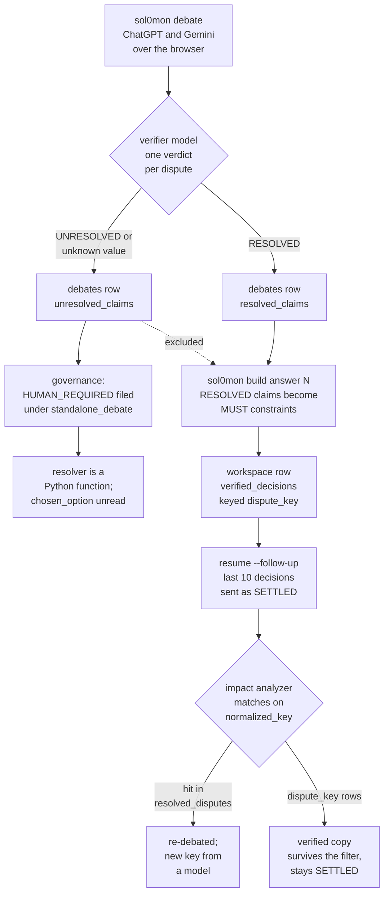

## 1. Executive Summary

Sol0mon puts one question to ChatGPT and Gemini through their websites,
extracts the points they disagree on, debates each one and has a separate
verifier model grade it. The results persist as architecture decisions, which
a coding agent later receives as constraints it must honour. The notable part
is the verdict: each disputed claim is stored as `RESOLVED`, `UNRESOLVED` or
`EQUIVALENT`, and one canonical reader lets only resolved claims become build
constraints. The weak part is correction. On every workspace the shipped CLI
can reach, the follow-up path looks decisions up under a key the build wrote
under another name, so a decision a follow-up contradicts stays settled.

The second weakness is the human channel. A question the governor cannot settle
waits in a SQLite queue and blocks the build, but the only resolver is a Python
function no shipped command calls. The person's chosen option is written and
never read, so their answer reaches memory only if they retype it as a
follow-up question.

There is no licence. The README says none has been selected
(`README.md:9`, `:180-182`) and the repository carries no LICENSE file, so the
code is all rights reserved by default: readable, not reusable. One mark,
`trust_state`, is earned, by the verifier verdict and its reader.

## 2. Mental Model

A memory is a **decision about a dispute**. A dispute is a point where the two
debating models' answers conflict, given a `normalized_key` by a validator model
(`_eval_validate`, `debate_engine.py:238`; key fallback at `:609-610`). After
bounded debate rounds, `verify_all_disputes` sends every dispute to a verifier
model, which returns per dispute a status, a confidence, a finding naming the
winner and a list of `rejected_options` (`verification_engine.py:187-224`). The
status is clamped to the three legal values with `UNRESOLVED` as the default
(`:425-427`). Records are filed into three buckets (`:513-524`).

Resolved and equivalent claims are settled. Unresolved claims go to governance,
which ends each one as a verified decision, a verified tradeoff or
`HUMAN_REQUIRED` (`debate_engine.py:950-982`). The whole result, both models'
final text included, is appended as one row to `debates`
(`answer_memory.py:230-313`). A debate whose verification score is under 90
with unresolved claims is stored too, with `[FAILED VERIFICATION]` as its
synthesis (`debate_engine.py:1026-1036`).

A stored verdict never changes. No code path updates a claim inside
`verification_result`; the one `UPDATE` on `debates` merges four execution keys
into that blob (`answer_memory.py:486-587`). A later contradiction is a new
row, linked by `parent_answer_id` when it came through a workspace.

Beliefs change in the **workspace**, a second store. A workspace row holds
`verified_decisions`, `verified_tradeoffs` and `resolved_disputes` as JSON
lists (`workspace_manager.py:315-341`). Membership in `verified_decisions` is
the belief. A follow-up question removes the decisions it affects from those
lists and re-debates them (`workspace_debate_engine.py:194-251`). If the
re-debate resolves, a decision returns under whatever key the validator model
gives the reopened text. If it deadlocks, the decision is gone
(`:281-308`). Nothing records which value it replaced, and nothing marks the
old value rejected.

## 3. Architecture

All paths below are under `Sol0mon/` unless they name the root.

The repository holds two copies of one Python application. `Sol0mon-Windows/`
differs from `Sol0mon/` in three files: `implementation_executor.py` runs
pytest through `sys.executable` rather than `python3`
(`Sol0mon-Windows/implementation_executor.py:88`, `:109`), the warm-up
self-check in `tests/test_debate_warmup.py` uses `tempfile` instead of
`/tmp`, and the README is rewritten. Everything here was read in `Sol0mon/`.

**Debate.** `chat_session.py` attaches Playwright to a Chrome the user started
with `--remote-debugging-port=9222` and signed in to ChatGPT and Gemini
(`chat_session.py:76`). `gpt_worker.py` and `gemini_worker.py` drive the two
sites. `debate_engine.py` runs warm-up rounds, conflict extraction and up to 15
rounds per dispute against a 92% consensus threshold (`debate_engine.py:43-44`).

**Verification and governance.** `provider_router.generate`
(`provider_router.py:293`) sends verifier and governance prompts to Cerebras,
Groq, OpenRouter or a local Ollama, keyed from `.env`.

**Stores.** `answer_memory.db` holds the `debates` table. `database/workspaces.db`
holds `workspaces` and `unified_human_decisions`. Both paths are relative to the
process's working directory (`answer_memory.py:5`; `workspace_manager.py:31`;
`human_decision_store.py:39`). A build also writes `answer.json`,
`decisions.json` and `build_state.json` under `workspaces/<id>/`
(`build_pipeline.py:132-157`).

**Build.** `build_pipeline.run_build_pipeline` resurrects an answer, generates a
specification through another debate, plans stages and runs
`opencode run --auto --dir <working_dir>` as a subprocess
(`coding_agents/opencode_agent.py:5`), with bounded repair. `build_finalizer.py`
then reconciles the answer row and registers the workspace in SQL.

### Deployment and ergonomics

An operator needs Python 3.12, Chrome with a dedicated signed-in profile, ChatGPT
and Gemini accounts, and either a verifier API key or a running Ollama. The
debate cannot run offline or headless without those sessions. `requirements.txt`
pins 85 packages exactly, LangChain, LangGraph, Playwright and three provider
SDKs among them. No installer exists beyond the README's venv steps. The stores
are plain SQLite with JSON in TEXT columns and are repairable with `sqlite3`.
Running the CLI from a different directory opens two new, empty stores.

## 4. Essential Implementation Paths

- **CLI.** `sol0mon_cli.py:351-410` registers `debate`, `build answer <id>`,
  `resume [workspace_id] [--follow-up]` and `status`.
- **Debate write.** `_cmd_debate` calls `pipeline_runner.execute(args.prompt)`
  with no memory ids (`sol0mon_cli.py:58`); `execute` runs `DebateEngine.run`
  (`pipeline_runner.py:22-41`). `_synthesize_and_return` computes the synthesis,
  the execution decision and a deterministic human answer, then calls
  `memory.save_debate` (`debate_engine.py:1154-1220`).
- **Verdict.** `verify_all_disputes` (`verification_engine.py:226-552`);
  `_persist_rejected_options` keeps the model's list or derives one from the
  finding (`:114-126`).
- **Prior-debate context.** `AnswerMemory.build_context` renders prior rows'
  `decision_summary` and `[STATUS] key: decision` lines
  (`answer_memory.py:589-632`), prepended when `memory_ids` is passed
  (`debate_engine.py:427-434`). No CLI command passes `memory_ids`.
- **Resurrection.** `build answer N` reaches `answer_selector.select_answer`
  (`answer_selector.py:54-78`) and `answer_loader.get_answer_by_id`, which shapes
  the row and derives `verified_decisions` from `resolved_claims` only
  (`answer_loader.py:32-97`). `_source_result_from_answer` sets
  `human_required` to `[]` (`build_pipeline.py:72-80`).
  `_create_workspace_from_answer` writes `decisions.json` (`:132-157`).
- **Constraints.** `build_prompt_generator.extract_constraints` frames each
  verified decision as an immutable rule (`build_prompt_generator.py:121-137`);
  `build_spec_engine` renders winners through `decision_model.decision_records`
  (`build_spec_engine.py:200-225`; `decision_model.py:496-514`).
- **Finalizer.** `update_build_result` merges the effective execution verdict
  into the answer row (`answer_memory.py:486-587`; `build_finalizer.py:309-317`).
  `upsert_build_workspace` writes the SQL workspace row from `decisions.json`
  (`build_finalizer.py:395-408`; `workspace_manager.py:586-750`).
- **Follow-up.** `resume <ws> --follow-up` reaches
  `workspace_orchestrator.follow_up_workspace`, which starts
  `WorkspaceDebateEngine.resume_workspace` in a thread
  (`workspace_resume_ui.py:418-447`; `workspace_orchestrator.py:158-186`;
  `workspace_debate_engine.py:141-465`).
- **Human queue.** `enqueue_human_decision` calls `HumanDecisionStore.create`
  (`human_decision_store.py:123-179`); the build gate reads `load_pending`
  (`build_pipeline.py:287-299`); `resume` reports `blocked_pending_humans`
  (`resume.py:217-225`).
- **Repair memory.** `RepairMemory` records attempts and blacklists a failed
  `(strategy, files, failure signature)` fingerprint (`repair_memory.py:322-340`).
  Its only constructor calls are in `NativeValidationEngine`
  (`validation_engine.py:1494-1503`), which no shipped path builds.

## 5. Memory Data Model

**`debates`** (`answer_memory.py:43-133`): `id`, `created_at`, `question`,
`gpt_final`, `gemini_final`, `synthesized_answer`, `consensus_score`,
`conflict_severity`, `conflict_points`, and by migration `resolved_decisions`,
`decision_summary`, `validated_disputes`, `verification_result`,
`parent_answer_id`, `workspace_id` and `human_answer`. The comment above the
schema says *"Drop raw gpt_final/gemini_final transcript columns"*
(`:38`). Both columns stay `NOT NULL`, and `save_debate` writes them. The
project's `docs/memory_requirements.md` says memory is *"NOT to store debate
transcripts"*.

`resolved_decisions` is a compact per-dispute list with `status` of
`resolved`, `unresolved` or `unverified`, and `decision`, `winner`, `rationale`
and `finding` all filled from the same finding text (`answer_memory.py:164-221`).

**`workspaces`** (`workspace_manager.py:315-341`): one row per workspace, every
list a JSON TEXT column. `save_workspace` rewrites all of them on every call
(`:460-560`). `architecture_constraints` is filled from prior debates when a
workspace is created with `memory_ids` (`:392-440`), and no module outside
`workspace_manager.py` reads it.

**`unified_human_decisions`** (`human_decision_store.py:96-107`):
`(workspace_id, decision_id)` key, the full decision as JSON, `resolved`,
`chosen_option`, `resolved_at`, `priority`.

**Keys.** A dispute's identity is `normalized_key`, chosen by a model. Two
writers name it differently: the debate engine writes `normalized_key`
(`workspace_debate_engine.py:354-389`), and `_to_verified_decisions` writes
`dispute_key` (`answer_loader.py:56-71`), which is what a build-registered
workspace stores.

**Time.** `created_at` on each row, `updated_at` on workspaces, `resolved_at` on
human decisions. No validity interval exists.

**Scope.** The workspace is the partition. The answer table is global and read
by integer id. Human decisions carry `workspace_id` and every read filters on
it (`human_decision_store.py:311-370`). The plain debate path files its human
decisions under the literal id `standalone_debate` (`debate_engine.py:345`).

## 6. Retrieval Mechanics

Retrieval is by key, never by relevance. `build answer N` loads row `N`. A
follow-up loads one workspace row and builds two injections from it:

- `get_constraint_context` takes the last ten `verified_decisions`, prints
  `[normalized_key]: decision` for each, and ends *"The above decisions are
  SETTLED from prior interactions. Do not contradict them."*
  (`workspace_manager.py:249-259`);
- per reopened or new dispute, an `ArchitectureMemory` built from the same list
  injects up to `MAX_CONSTRAINTS` decisions by priority weight
  (`workspace_debate_engine.py:261-289`; `debate_engine.py:143-160`).

For a build-registered workspace every decision has an empty `normalized_key`.
The constraint context then prints `[]: <finding>`, and the `ArchitectureMemory`
keys all of them under `""`, so only the last survives the loop
(`workspace_debate_engine.py:262-271`).

`search_debates` matches `LIKE` on four columns (`answer_memory.py:413-455`).
Its only caller is `answer_loader.search_answers`, which nothing outside tests
calls. It escapes `%` and `_` with backslashes, under a comment calling this a
security measure. The query has no `ESCAPE` clause, so SQLite reads each
backslash literally. A query containing `_`, such as any normalized key, then
matches only text with a backslash in that position.

`build_context` caps prior-debate context at 8,000 characters by keeping the
tail (`debate_engine.py:45`, `:431-433`). It is unreachable from the CLI.

## 7. Write Mechanics

Every write is a side effect of a pipeline stage, and no model or agent is
handed a memory tool. The debating models are web chat sessions with no tool
surface into Sol0mon. The verifier and governor return JSON that the engine
validates and stores. The coding agent receives constraints as prompt text.

**Debate rows** are append-only apart from the finalizer's merge. A save happens
once per completed or failed debate, after synthesis.

**Workspace rows** come from two writers on CLI paths: the finalizer's upsert
after a build, and `save_workspace` during a follow-up. `add_verified_decision`
dedups by `normalized_key`, and appends every decision that has none
(`workspace_manager.py:218-225`). A follow-up stores a dispute the verifier
resolved with `decision = d.dispute_text`, the dispute's description, rather
than the finding that names the winner (`workspace_debate_engine.py:384-389`).

**The finalizer's upsert replaces the decision state.** It writes
`verified_decisions` and `resolved_disputes` from `decisions.json` and every
other list from its defaults, `impact_audit_trail` included
(`workspace_manager.py:643-700`). `resume.py:665-705` runs the finalizer again
after a resumed build. A follow-up's reopenings on a build workspace, and its
audit trail, are overwritten by the next resumed build of that workspace.

**Execution verdict.** The comment at `debate_engine.py:1181-1184` calls the
saved execution decision *"immutable on disk"*. `update_build_result` replaces
it with the effective post-override verdict and keeps no prior value
(`answer_memory.py:546-574`).

**Human decisions.** `create` upserts by `decision_id`, or by semantic key
among unresolved rows only (`human_decision_store.py:181-207`). A question
already answered is therefore queued again as a new pending row when governance
raises it next time. `save_pending` deletes the workspace's pending rows and
re-inserts the given list (`:396-420`).

**Deletion.** `delete_debate`, `delete_workspace` and `HumanDecisionStore.delete`
exist. Each has no caller outside self-checks and tests.

### Operational cost

The debate is the expensive, blocking part: two browser sessions, warm-up
rounds, up to 15 rounds per dispute and a verifier call per batch, all inline in
the CLI process. The memory write itself is one SQLite insert at the end. A
debate is retrievable by id as soon as `save_debate` returns. No background pass
reads or rewrites the stores. A follow-up injects at most ten decisions plus the
original prompt, ahead of the follow-up text, into a fresh browser message.

## 8. Agent Integration

There is no MCP server, SDK or hook. Sol0mon is the orchestrator, and the
models it orchestrates are given no verb over memory. The coding agent is
OpenCode run with `--auto` in the build workspace's directory, and it has a
general shell.

The CLI has four commands and no memory command: no list, search, delete,
reopen or resolve. A user picks prior work by answer id for `build` and from a
numbered page of recent workspaces for `resume` (`workspace_resume_ui.py:288`).
The project's engineering spec documents the workspace API,
`resolve_human_requirement` included, as Python calls
(`docs/sol0mon_engineering_spec.md:4415-4428`).

Adapting it means replacing the browser workers. The decision model,
`decision_records` and the impact analyzer are pure functions over dicts and
would lift out cleanly.

## 9. Reliability, Safety, and Trust

### The follow-up cannot find a built workspace's decisions

`sol0mon resume` lists SQL workspace rows, and on CLI paths only the build
finalizer writes them. The decisions in those rows come from
`_to_verified_decisions` and are keyed `dispute_key`. The follow-up path reads
`normalized_key` everywhere a verified decision is matched. That covers the
impact analyzer's gather (`workspace_impact_analyzer.py:101-130`, which falls
back to `dispute_key` for tradeoffs only, at `:117`), the removal filter
(`workspace_debate_engine.py:243-250`), `reopen_dispute` (`:483-506`) and the
constraint context. The analyzer can still hit the dispute through
`resolved_disputes`, which the finalizer fills from `resolved_decisions`, keyed
`normalized_key`. The removal then drops the `resolved_disputes` entry and
leaves the `verified_decisions` copy in place.

The decision a follow-up contradicts therefore stays in `verified_decisions`.
It is injected as settled into that follow-up's prompt and into every later
one. No test runs a follow-up against a finalizer-written row: the
`resume_workspace` tests build their workspaces in memory, and those that seed
decisions key them `normalized_key`.

### Every follow-up opens by sending the decision it reopens as settled

On any workspace, `constraint_context` is computed at
`workspace_debate_engine.py:181`, before the impact analysis at `:194` and the
removal at `:243`. The first prompt of the follow-up therefore lists the
decision under *"Do not contradict them"*, beside a follow-up that contradicts
it (`:205-218`). The per-dispute injections exclude it, because the
`ArchitectureMemory` is built after the removal.

### A reopened decision loses its identity

A reopened dispute re-enters as text, `[REOPENED] <decision>` plus context
(`workspace_debate_engine.py:552-584`). `_build_dispute_queue` sends that text
to the validator model, which may classify it `EQUIVALENT`, score it under 70,
or give it a new `normalized_key` (`debate_engine.py:592-619`). A decision can
therefore leave the workspace with no replacement, or return under a key the
next follow-up does not associate with the original.

### Governance's verdict does not reach the build

When the verifier leaves a claim unresolved and governance then settles it as a
verified decision, the outcome is recorded on the dispute inside
`validated_disputes`. Neither `debate_engine.py` nor `governance.py` writes
`resolved_claims`, so the claim stays in `unresolved_claims`. Resurrection reads
only the verifier's buckets, so the build treats a governance-settled decision
as unresolved and never offers it as a constraint.

### The person's answer has no reader

Governance writes `HUMAN_REQUIRED` items to the queue, and the build gate refuses
to run while any is pending for its workspace (`build_pipeline.py:287-299`).
Resolution goes through `HumanDecisionStore.resolve`, which sets `resolved`,
`chosen_option` and `resolved_at` (`human_decision_store.py:240-273`). No
production module reads `chosen_option` or `resolved_list`. The spec's
documented flow is to call `resolve_human_requirement` and then submit a
follow-up that states the choice in prose
(`docs/sol0mon_engineering_spec.md:4425-4428`).

The gate also misses the source debate's own questions. A standalone debate
files them under `standalone_debate` (`debate_engine.py:345`), and resurrection
sets `human_required` to `[]` (`build_pipeline.py:77`), so
`aggregate_human_decisions` never runs for a resurrected build (`:1143-1145`).
A persisted `STOP_HUMAN_REQUIRED` verdict passes the pre-workspace gate by
design (`build_pipeline.py:84-88`; `execution_decision.py:499-501`). In this
reading the build workspace's queue is filled only by repair exhaustion
(`implementation_executor.py:220-245`; `staged_executor.py:174-206`).

### Failed verification is a resurrectable answer

A `[FAILED VERIFICATION]` row carries `conflict_severity = FAILED_VERIFICATION`,
and no reader branches on that value. `build answer N` on such a row builds from
its resolved claims and recomputes an execution decision from the prompt,
because the row stores none.

### Provenance and injection

Both models' answers come from web pages and are stored whole. A dispute's text
and the verifier's finding are model output, passed into later prompts and,
through `extract_constraints`, into the coding agent's prompt as rules it must
honour. Nothing screens stored text for instructions. The XML-like delimiters
in `build_context` and the follow-up prompt are the only separation.

### Marks

One is carried.

- **`trust_state`** — earned by the verdict and its reader. The verifier's
  status is discrete, clamped fail-closed, and stored per dispute.
  `decision_records`, which every renderer and the spec go through, admits only
  `RESOLVED` claims. `_to_verified_decisions` does the same for the
  constraints, and unresolved claims compute `STOP_UNRESOLVED_DISPUTES`
  (`execution_decision.py:333-346`). The limits: the verdict is a model's and
  fixed at write, so a stored claim cannot move from resolved to rejected. The
  workspace's notion of belief is list membership, not a field.
- **`tombstone`** — withheld. `rejected_options` is keyed on the option's
  value, but it is consulted only to render and validate the same answer
  (`decision_renderer.py:836`, `:967`; `validation.py:147-160`). No later debate,
  follow-up or extraction reads it. The repair blacklist is keyed on a
  fingerprint of the repair and consulted before re-applying one, and it is
  test-only (section 4).
- **`bitemporal`** — withheld; only record times exist.
- **`scope_enforced`** — withheld. The memory proper is partitioned by
  workspace row and the answer table is global; the `workspace_id` predicate
  sits on the human queue, which holds questions rather than beliefs.
- **`audit_log`** — withheld. `impact_audit_trail` and `research_audit_trail`
  are JSON arrays inside the row, rewritten by every save. They omit the decision
  values that changed and the removal `reopen_dispute` makes, and the finalizer
  resets them.
- **`human_review`** — withheld on both ends. The resolver has no entrypoint a
  person reaches without writing Python, and its output has no reader.
- **`negative_eval`** — withheld; see section 10.

## 10. Tests, Evals, and Benchmarks

I did not run any test. `tests/` holds 52 pytest files with 721 test functions,
and 17 `test_*.py` scripts sit at the root. `run_all_tests.py` runs 16 of the
`tests/` files, six root scripts and `test_suite.py` as subprocesses, not
through pytest. It reports a missing file or a 120-second timeout as `SKIP` and
returns success for both (`run_all_tests.py:66-78`). The other 36 `tests/`
files, `test_human_decision_store.py`, `test_repair_memory.py` and
`test_workspace_impact_analysis.py` among them, run only under pytest. No CI
configuration is committed.

**Tests that need state the repository does not ship.**
`tests/test_answer55_regression.py` and `tests/test_build_answer_55_e2e.py`
resurrect answer 55 from the real `answer_memory.db`
(`tests/test_answer55_regression.py:24-25`). `.gitignore` excludes `*.db`, and
no database is committed. On a fresh clone the resurrection returns an error and
those tests fail rather than skip.

**The strongest memory test** is
`test_resume_workspace_only_affected_redebated`
(`tests/test_workspace_impact_analysis.py:335-394`). After the follow-up
*"Assume PostgreSQL cannot be used."*, it asserts that `database_choice` and
`storage_strategy` are absent from `verified_decisions` and `resolved_disputes`,
while `provider_routing` and `deployment_model` are present in the same sets. It
also checks the audit entry. The case is populated and cannot pass on an empty
result.

`negative_eval` is withheld anyway. The assertion is on stored state after a
write, not on what any read returns. The prompt the same run sent, which listed
`database_choice` as settled, is not checked. The fixture uses the
`normalized_key` shape that the CLI-reachable workspaces do not have. The
answer-55 assertions that rejected options are never recommended run against a
stubbed spec and the uncommitted database. The human-queue case asserting `db`
absent after `save_pending` (`tests/test_human_decision_store.py:151-167`) is
populated but concerns a work queue, not memory.

There is no retrieval evaluation and no benchmark. No paper is associated with
the project, and the README links no hosted result.

## 11. For Your Own Build

### Steal

- **Grade each disagreement separately and store the grade beside the claim.**
  A per-dispute `RESOLVED`/`UNRESOLVED` verdict with a finding and the rejected
  options makes "the models agreed" an inspectable record.
- **Clamp an unknown verdict to the withholding state.** Anything the grader
  returns outside the vocabulary becomes `UNRESOLVED`, so a malformed reply
  cannot promote a claim.
- **Route every consumer through one reader.** `decision_records` is the only
  sanctioned way to read decisions, and it encodes the status filter once.
- **Reopen by impact, not by rerun.** A deterministic token and dependency pass
  that picks which prior decisions a follow-up touches keeps the rest stable and
  costs no model call.

### Avoid

- **Two writers naming one key differently.** When a projection writes
  `dispute_key` and the consumer reads `normalized_key`, every lookup silently
  misses. Normalise identity at the store boundary, and test the round trip
  through the real writer.
- **Assembling the prompt before applying the correction.** Compute the
  constraint context after removals, or the model is told to honour the decision
  it is being asked to reconsider.
- **Letting a model re-key a decision on reopen.** Carry the original key
  through the re-debate, or correction loses track of what it corrected.
- **A second verdict that never updates the first.** When a later stage settles
  what an earlier one left open, write the result where the readers look.
- **A review queue whose answer is discarded.** If the person's choice only
  unblocks a gate, the system has asked for a decision and kept none of it.

### Fit

This is a research harness for one person who wants two frontier chat products
argued against each other before committing to an architecture, and who will
drive it from a terminal with a signed-in browser beside it. It is not a memory
system to adopt. The stores serve one pipeline, the browser workers are fragile
by construction, and nothing about the CLI is meant for another program to call.
The code is all rights reserved, so the ideas can be borrowed and the files
cannot. Walk away if decisions must be correctable: the correction path the
shipped CLI reaches does not remove what it reopens.

## 12. Open Questions

- Whether any workspace in the author's own database was created through
  `submit_workspace`, the only writer of debate-native workspaces, and from what
  entrypoint.
- How often the validator model drops or re-keys a reopened dispute in practice.
- Whether the human-resolution flow is used at all, given it needs a Python
  call and a retyped follow-up.
- Whether the answer-55 suite passes on the author's machine, and against which
  database contents.

## Appendix: File Index

- Answer store: `answer_memory.py`, `answer_loader.py`, `answer_selector.py`
- Verdict and decision model: `verification_engine.py`, `governance.py`,
  `decision_model.py`, `decision_renderer.py`, `validation.py`
- Debate: `debate_engine.py`, `conflict_extractor.py`, `chat_session.py`,
  `gpt_worker.py`, `gemini_worker.py`, `provider_router.py`
- Workspaces and follow-ups: `workspace_manager.py`,
  `workspace_debate_engine.py`, `workspace_impact_analyzer.py`,
  `workspace_orchestrator.py`, `workspace_resume_ui.py`, `workspace_knowledge.py`
- Human queue: `human_decision_store.py`, `human_decision_queue.py`,
  `human_decision_manager.py`
- Build: `build_pipeline.py`, `build_prompt_generator.py`, `build_spec_engine.py`,
  `build_finalizer.py`, `execution_decision.py`, `resume.py`,
  `implementation_executor.py`, `staged_executor.py`
- Unwired: `repair_memory.py` with `validation_engine.NativeValidationEngine`,
  `artifacts.ArtifactStore`, `sol0mon_graph.py`, `pipeline_scheduler.py`
- CLI and tests: `sol0mon_cli.py`, `run_all_tests.py`, `tests/conftest.py`,
  `tests/test_workspace_impact_analysis.py`, `tests/test_human_decision_store.py`,
  `tests/test_answer55_regression.py`, `tests/test_execution_decision_v2.py`

### Recorded searches

Run from the repository root at the pinned commit with `/usr/bin/git grep`;
`:!` pathspecs exclude tests.

- **No production resolver of a human decision.**
  `git grep -n -E 'resolve_human_requirement|resolve_human_decision|resolve_human_item|hdm\.resolve' -- 'Sol0mon/*.py' ':!Sol0mon/tests' ':!Sol0mon/test_*'`
  returns the definitions, two `suggested_action` strings, and self-check
  lines in `human_decision_queue.py` and `workspace_manager.py`.
- **No reader of the chosen option.**
  `git grep -n -E 'chosen_option|resolved_list|load_resolved' -- 'Sol0mon/*.py' ':!Sol0mon/tests' ':!Sol0mon/test_*'`
  returns the store, the queue, the manager shim, the orchestrator's return
  dict and self-checks.
- **No CLI path passes memory ids.**
  `git grep -n -E 'memory_ids' -- Sol0mon/sol0mon_cli.py Sol0mon/workspace_resume_ui.py`
  returns nothing; the same pattern matches `Sol0mon/pipeline_runner.py` five
  times.
- **The workspace model never reads `dispute_key`.**
  `git grep -n -E 'dispute_key' -- Sol0mon/workspace_manager.py` returns
  nothing; in `Sol0mon/workspace_impact_analyzer.py` it matches the tradeoff
  line `:117` only.
- **No SQL workspace writer on the debate path.**
  `git grep -n -E 'workspace_mgr|workspace_manager' -- Sol0mon/debate_engine.py Sol0mon/pipeline_runner.py`
  returns nothing.
- **Governance never writes the verifier's buckets.**
  `git grep -n -E 'resolved_claims' -- Sol0mon/debate_engine.py Sol0mon/governance.py`
  returns two reads of `unresolved_claims`, `debate_engine.py:867` and `:992`.
- **Rejected options are not read across debates.**
  `git grep -n -E 'rejected_options' -- Sol0mon/debate_engine.py Sol0mon/workspace_debate_engine.py Sol0mon/workspace_manager.py Sol0mon/conflict_extractor.py Sol0mon/answer_loader.py`
  returns nothing; `Sol0mon/decision_model.py` matches 21 times.
- **No reader of the failed-verification marker.**
  `git grep -n -E 'FAILED_VERIFICATION' -- 'Sol0mon/*.py' ':!Sol0mon/tests' ':!Sol0mon/test_*'`
  returns the two writers, `debate_engine.py:1032` and
  `workspace_debate_engine.py:875`.
- **No `ESCAPE` clause on the LIKE search.**
  `git grep -n -i -E 'escape' -- Sol0mon/answer_memory.py` returns the comment
  at `:417` only.
- **Repair memory is test-only.**
  `git grep -n -E 'NativeValidationEngine\(|get_validation_engine\(' -- 'Sol0mon/*.py'`
  returns `tests/` files and `validation_engine.py`'s own definition and
  self-check below its `__main__` at `:1962`.
- **The artifact store has no caller.**
  `git grep -n -E 'ArtifactStore' -- 'Sol0mon/*.py' ':!Sol0mon/tests'` returns
  `artifacts.py` only.
- **No shipped delete.**
  `git grep -n -E 'delete_debate|delete_workspace\(|store\.delete\(' -- 'Sol0mon/*.py' ':!Sol0mon/tests' ':!Sol0mon/test_*'`
  returns definitions, `HumanDecisionQueue.delete_decision` (called from
  `test_suite.py:759` only) and self-checks.
- **`architecture_constraints` has no reader outside its module.**
  `git grep -n -E 'architecture_constraints' -- 'Sol0mon/*.py' ':!Sol0mon/tests' ':!Sol0mon/test_*'`
  matches `Sol0mon/workspace_manager.py` only.
- **No validity time.**
  `git grep -n -i -E 'valid_from|valid_to|valid_until|effective_at|occurred_at|event_time' -- 'Sol0mon/*.py'`
  returns nothing; `created_at` matches `Sol0mon/answer_memory.py` ten times.
- **No committed database or CI.**
  `git ls-files | grep -E '\.(db|sqlite3?)$'` and
  `git ls-files | grep -E '^\.github|\.ya?ml$'` both return nothing.
- **No paper.**
  `git grep -n -i -E 'arxiv\.org/abs|bibtex|@article|@misc|doi\.org' -- .`
  returns nothing.

## History

**2026-11-03** — [`2bd65e33d973b8357843e7ce95999976845fe9ec`](https://github.com/sh1618112233/Sol0mon/commit/2bd65e33d973b8357843e7ce95999976845fe9ec). First reading, from a full clone at the head of `main`. Screened first: no auto-run surface, an execution point on pytest collection in each copy's `tests/conftest.py`, nothing unpinned and nothing inside the seven-day cooldown. No licence: the README says none has been selected. Nothing installed, built or run. One mark, `trust_state`, for the verifier's per-dispute verdict and the resolved-only reader; `human_review` and `negative_eval` withheld ([section 9](#9-reliability-safety-and-trust)).
