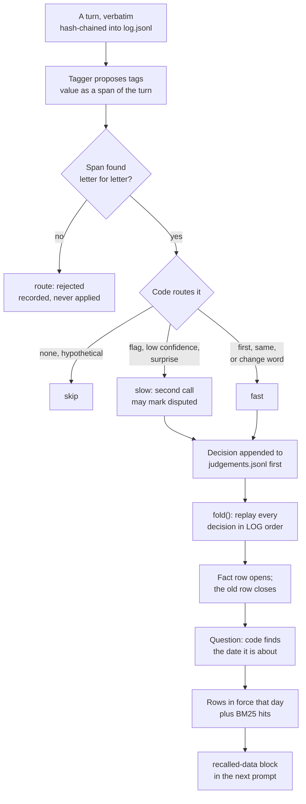

## 1. Executive Summary

Spookling Memory is a local memory server for Claude Code and Codex. It keeps every turn word for word in an append-only log, has a cheap tagger model point at facts and events in the user's own words, and replays the tagger's recorded rulings into fact rows that carry both a validity interval and a recording interval. Its strongest idea is that nothing a model says is ever the store: the log and the judgement log are the only durable records, and every view is rebuilt from them by code. Its weakest point is the prompt hook, which injects recalled lines on every prompt that shares any keyword with the store, with no bar for relevance.

It carries `bitemporal`, `audit_log` and `negative_eval`. The fact schema holds a validity interval and a transaction interval as separate columns, and triggers allow only insert and close. Every triage, ruling, compaction and reset is appended to `judgements.jsonl` before it changes anything, and facts are a pure fold of that file. A committed test asserts that later versions of a fact stay out of a question about an earlier date.

**Licence.** The `LICENSE` file grants nothing beyond reading and running: *"published for reading and for running the Spookling Memory plugin as distributed. No other use, copying, modification or redistribution is permitted without written permission"*. A reader may not reuse any mechanism described here as code, and a contributor may not run a modified copy. `package.json` says `"UNLICENSED"`, which agrees. The README calls the algorithm public and says the benchmark harness and result files are in a private repository, so the numbers it publishes cannot be checked from this tree.

The design aims at a personal assistant first and a coding agent second. The seed vocabulary is phone, car, partner and dentist (`core/triage.py:15-47`), `SUBJECT` is the constant `"user"` (`core/facts.py:11`), and the entity linker reads "my sister Rachel" (`core/entities.py:5-14`). The coding-agent parts are the hooks, the survivor block that re-injects rules after compaction, and the share tools.

## 2. Mental Model

A memory is a turn. Everything else is a reading of turns that code can redo.

A turn enters `log.jsonl` with a SHA-256 of its agent, session, index, role, timestamp and text, and is never changed; a repeated turn is a no-op and an altered one fails the load (`server/spookling_memory/store.py:65-75`). A tagger model reads the user's turns of a session and proposes tags: a label, a key, and the value, old value and time phrase as spans of the turn. Code then decides what each tag becomes (`core/sleep.py:98-139`):

- **Rejected.** A value not found verbatim in the turn, an unknown label, a missing key. The tag is recorded with `route: "rejected"` and its reason, and nothing applies it.
- **Skip.** The label `none` or `hypothetical`.
- **Slow.** A trigger phrase in the sentence: a correction, "no longer", a rule word, a hypothetical or a past reference. Also an explicit date, a time more than 30 days back or in the future, or confidence under `tau = 0.8`. Also a value that repeats a stored one beside a different number, a return to an earlier value, or a new value without a change word (`core/sleep.py:38-75`).
- **Fast.** A first value, the same value again, or a change with a change word.

A fast tag applies at once. A slow tag waits for a second model call that sees the turn, the proposal, the reason it was flagged and the attribute's history, and returns an operation with a `disputed` flag (`core/triage.py:154-165`, `core/sleep.py:141-156`). Applying a decision opens a row and, for a change, closes the row it replaces. A fact therefore has three states: open (true from a date to forever), closed in valid time (true for an interval that ended), and superseded in transaction time (a row that a later recording replaced). It dies only by being closed; nothing deletes a row (`core/facts.py:15-32`).

`disputed` is a label, not a state. The schema docstring says it *"never hides or blocks a row"* (`core/facts.py:1`), and the reader sees it as `; disputed` beside the line (`core/recall.py:480`).

Beside facts sit two other derived kinds. Events are things that happened once, with when they happened kept apart from when they were said. Keepers are user sentences that a regex classifies as a rule, decision, failed attempt, open item, value, path, name or date (`core/compact.py:20-101`), copied verbatim when the harness compacts a session.

A reset is a ruling, not a deletion: it closes every open fact at time T, marks earlier events as before the reset and unpins earlier rules, and an undo appends the reverse (`server/spookling_memory/reset.py:93-130`).

Memory is background-managed. The agent can call `memory_retrieve`, but the model never writes a memory itself: the tagger proposes and code disposes.

## 3. Architecture

One Python process per memory folder serves an HTTP API, the hook endpoints and the MCP tools' backend on `127.0.0.1:7447` (`server/spookling_memory/api.py:21`). It takes an exclusive `flock` on `.memory/lock`, so a second server on the same folder fails to open (`store.py:106-137`). The hook scripts are Node files that POST the hook's stdin to the server and print its reply; with the server down they print nothing and exit within the connect timeout (`hooks/user-prompt-submit.js:7-8`).

The durable state is two JSONL files appended with `fsync` (`store.py:98-103`, `store.py:189-193`). At start the server replays them into a `SpooklingMemory` whose `Log` and `Facts` are SQLite databases in a temporary directory with `synchronous=OFF` (`core/log.py:49-55`). Those databases are caches: the triggers that refuse `UPDATE` and `DELETE` on `log` and `decisions` (`core/log.py:11-20`) protect the in-memory copy, not the files. The files are protected by being append-only in code and by the hash check at load.

Search is `rank_bm25` over units of one user turn plus the assistant replies that follow it (`core/recall.py:119-172`), Snowball-stemmed. Embeddings (`BAAI/bge-small-en-v1.5`) and the cross-encoder (`BAAI/bge-reranker-base`) need the `vectors` extra, which pulls in `sentence-transformers` (`server/pyproject.toml`). The installer runs `uv sync` without it, so a default install searches by keyword only and `vectors.available()` reports why (`core/vectors.py:24-32`).

Optional cloud: after `spookling login`, the Stop hook uploads cleaned, secret-masked turns to `api.spookling.com`, and the `team_sessions` and `team_session` MCP tools read what colleagues shared. That server is not in this tree.

### Deployment and ergonomics

- **What has to run:** the local server under `uv` (Python 3.12) and Node 18 for the hooks. No database service.
- **Offline:** recall works offline. Tagging needs a model: an OpenRouter key (a router model plus the Jev decider), an Anthropic key (Haiku 4.5), or a logged-in `codex` CLI. Without one, turns are logged and searchable but no facts are extracted, and `pending.json` records how far tagging got (`store.py:195-209`).
- **API key to store anything:** no. The log is written before any model call.
- **Install:** `npx spookling init`, a wizard that copies the server into `~/.spookling-memory/<version>/`, runs `uv sync`, starts the server and merges three hooks and an MCP entry into the harness config, backing up each file first.
- **Repairable by hand:** yes. Both records are JSONL and every view is derived. A hand edit to a turn fails the next load by design.

## 4. Essential Implementation Paths

**Capture.** Claude Code's Stop hook POSTs to `/v1/hook/stop`; the API replies at once and runs the work as a background task (`api.py:143-144`). `hooks.log_transcript` parses the transcript JSONL, masks secrets in each capped turn (`hooks.py:63-91`) and calls `Store.ingest`, which appends to the log and then calls `SpooklingMemory.sleep()` (`store.py:300-330`, `core/__init__.py:178-185`).

**Extraction.** `sleep.light` batches a session's user turns under 6,000 characters per call (`core/sleep.py:15`, `:159-193`), calls `triage.judge`, records each tag with `mem.record(triage_decision(...))` and applies the fast ones (`core/sleep.py:183-185`). `sleep.full` then rules on the slow ones, through Jev or a second tagger call, and records each ruling (`core/sleep.py:301-323`).

**Consolidation.** `sleep.rebuild` folds every decision into a fresh `Facts` (`core/sleep.py:287-299`, `:326-331`), runs `Facts.check()`, which raises `IntegrityError` on overlapping believed rows (`core/facts.py:170-173`), and rebuilds events, the alias vocabulary, the profile page and the `Search` index.

**Retrieval.** The UserPromptSubmit hook POSTs the raw prompt; `hooks.handle` calls `Store.retrieve(prompt)` (`hooks.py:296-302`). `Store.retrieve` settles owed work, then answers from the after-reset view when a reset is active (`store.py:337-348`). `SpooklingMemory.context` assembles the head, the kept lines and `recall()` (`core/__init__.py:262-282`).

**Context assembly.** `recall()` resolves the date the question is about (`date_in`), collects fact lines in force on it (`fact_lines`, `core/recall.py:484`), searches and optionally reranks, adds a code-written `<timeline>` and time block, fits turn units into the budget with `pick()`, labels stale fact lines and wraps everything in `<recalled-data>` (`core/recall.py:711-779`). `hooks.cap` cuts the result to 10,000 characters (`hooks.py:14`, `:71`).

**Compaction.** PreCompact POSTs to `/v1/hook/pre-compact`; `Store.compact` extracts keepers from the session, records a `compact` decision holding them and returns the `<invariant>` block (`store.py:362-375`). `invariant_block` puts rules first and fills up to 40 lines with the newest decisions, failed attempts and open items (`core/__init__.py:22`, `:232-246`). That block heads every later prompt's context.

**Correction.** A user's correction or retraction goes through the slow path and closes a row. `memory_reset` and `POST /v1/reset` append a reset ruling; `reset/undo` appends its reverse.

**Integration.** `server/spookling_memory/mcp.py` exposes `memory_retrieve`, `memory_ingest`, `memory_compact`, `memory_reset`, `memory_export`, `memory_import`, `memory_stats`, the team tools, the share tools and `memory_delete`, which removes uploaded sessions from the cloud behind an elicitation dialog and leaves `.memory/` untouched (`mcp.py:373-399`, `cli/src/delete.js:1-3`).

**Tests.** `server/tests/test_spookling_adapter.py` (1,295 lines) covers routing, the verbatim check, folding, recall and dates; `test_reset.py`, `test_portability.py`, `test_timeline.py` and `test_mcp_safety.py` cover their names.

## 5. Memory Data Model

`log`: `seq`, `event_hash`, `agent`, `session_id`, `turn_index`, `role`, `ts`, `text` (`core/log.py:11-14`). `decisions`: a JSON body keyed by `decision_id` and pointing at the turn it came from by `event_hash` (`core/log.py:15-16`). The decision body is the provenance record: its `step` (`triage`, `resolve`, `event`, `event_resolve`, `compact`, `reset`, `reset_undo`), the raw tag, the verbatim spans, the route and flags, the writer and the facts it saw (`core/sleep.py:100-138`).

`facts` (`core/facts.py:15-32`): `subject`, `attribute`, `item`, `value` with `value_kind` `value` or `none`, `valid_from` and `valid_to` with a `from_precision`, `recorded_at` and `superseded_at`, `source_event`, `decision_id`, `confidence`, `writer`, `status` (`ok` or `disputed`) and `kind`. `CHECK (valid_from < valid_to)` and `CHECK (recorded_at < superseded_at)` hold, a partial unique index allows one open value per key, and three triggers allow nothing but an insert or a single close of `superseded_at`. `MULTI_VALUED` keys (allergy, language, child, sibling) are keyed by item.

Scoping is physical. A project's `.memory/` is its memory; `--scope user` puts one `.memory/` in the home folder for every project. No column on any table names a project, repository or user, and `SUBJECT` is the constant `"user"`.

Episodic and semantic are separated: turns are episodic, facts semantic, events episodic with two times, keepers verbatim sentences by kind. There is no TTL, no pin other than the invariant block, and no delete.

## 6. Retrieval Mechanics

The question's date comes first. `date_in` resolves "in mid-December 2024", "since I moved" or nothing (now), using the fact table and the event store as anchors (`core/recall.py:402-455`). Fact rows in force on that date become lines like `phone: Pixel 8 (true from on or before 23 Sep 2024 to 3 Apr 2025; in force on 15 Dec 2024`, and a value known to be later is labelled as such by `stale()` (`core/recall.py:527`).

`Search.search` fuses BM25 over turn units, optional exact-cosine embeddings, BM25 over events and the event PageRank lists by weighted RRF with `k = 60`, filters by the question's time window and falls back to unfiltered when the window empties the list (`core/recall.py:305-332`). Turn units are indexed with the cue words of the fact keys their text mentions, so a turn about "the Civic" is found by "car" (`core/recall.py:151-152`). `diversify` caps units per fact key (`core/recall.py:952`).

The cross-encoder, when installed, scores the first 60 candidates against the original question. In the default `rerank_mode="order"` it only reorders them; the cut to `rerank_k = 8` happens only in `"top"` mode (`core/recall.py:744-749`, `core/__init__.py:41-42`). The README's "a reranker keeps the best eight snippets" describes the non-default mode.

`pick()` fills a token budget of 1,500 by default, 9,000 for aggregation questions, with each hit and up to two neighbouring turns, at most 16 per session (`core/recall.py:910`, `core/__init__.py:36-38`). Counting and date arithmetic go into a time block that code computes and that is never trimmed (`core/recall.py:582`).

`recall()` returns `"Nothing on record about this."` only when there are no fact lines and no hits (`core/recall.py:753-754`). Any BM25 term overlap is a hit. On the hook path that means a prompt sharing one stemmed content word with any past turn gets a `<recalled-data>` block, in addition to the `<invariant>` block that rides on every prompt. No score threshold sits between search and injection: `git grep -n -E 'threshold|min_score|relevance' -- server/spookling_memory/hooks.py server/spookling_memory/core/recall.py` matches nothing.

The bar exists and the hook does not read it. `recall()` sets `strong` when a fact line was shown or a hit holds at least half the question's idf-weighted terms (`STRONG = 0.5`, `core/recall.py:29`, `:753`), `retrieve()` returns it beside the context for *"the runner's re-ask"* (`core/__init__.py:257-260`), and a test asserts it is false for an unrelated question (`server/tests/test_spookling_adapter.py:1273-1280`). The prompt hook takes `["context"]` and injects whatever it holds (`hooks.py:298`); `strong` reaches only `memory_retrieve` and `POST /v1/retrieve` callers.

The search also does not know which session is asking. `Store.retrieve` takes no session (`store.py:337`), so a prompt can be given turns from its own conversation, which are already in the context window.

## 7. Write Mechanics

Writes are background. The Stop hook returns before tagging starts (`api.py:143-144`). A turn is searchable as soon as the next question settles the views, because `Store._settle` rebuilds from the log even when the model is unavailable (`store.py:221-236`). Facts and events need the tagger: a few seconds per batch for the API taggers, several seconds per call for `codex exec`, by the README's account.

The tagger is asked for spans, and `verbatim()` checks each one against the turn. A value the model completed from a stored value is accepted only as a `mention` and flagged (`core/sleep.py:107-112`). A tag whose value is not in the turn is rejected and recorded with the reason; the test asserts that a hallucinated "Tesla" is never stored (`server/tests/test_spookling_adapter.py:218`).

Only user turns are tagged (`core/sleep.py:171`). An assistant's statement never becomes a fact, though it is searchable as part of a turn unit.

Deduplication is by identity: a repeated turn is one log entry, a decision is idempotent by id, and a keeper sentence already kept is skipped. Conflict handling is the routing above: a value that contradicts the open row without a change word goes to the slow path as a `surprise`.

Nothing local is forgotten. A reset hides without deleting, the README lists a purge command as planned, and `memory_delete` and `spookling delete` act on the cloud copy only.

### Operational cost

- **Blocking.** The Stop path does not block the agent. The prompt path can: when tagging is owed and the model is reachable, `Store._settle` runs `full()`, model calls included, under the store lock before answering (`store.py:221-232`). The hook waits up to 15 seconds and then gives the prompt nothing (`hooks/user-prompt-submit.js:8`).
- **Whole-store passes.** Any new turn makes the next question rebuild facts from every decision, every event and the BM25 index over every unit (`core/__init__.py:208-213`, `core/sleep.py:326-331`). The cost scales with the store, not with the day's activity.
- **Tagging tokens.** Every user turn is tagged once. The README reports about 105,000 tagger tokens per 115,000-token history.
- **Per turn read.** The invariant block (up to 40 lines) plus recall up to the 10,000-character cap, every prompt with a keyword hit. It is injected through `additionalContext`, so it rides with the user message and does not disturb the cached prefix before it.

## 8. Agent Integration

Claude Code gets three hooks and an MCP server; Codex gets one hook script for its events and the MCP server in `config.toml`. Injection is automatic. The model can also call `memory_retrieve` for the full block and `memory_reset`; it cannot write a memory directly. `memory_ingest` exists for clients without hooks.

Compaction is handled: PreCompact copies the session's keepers out, and the `<invariant>` block puts them back on every prompt afterwards. In this tree it is put back on every prompt from the start, not only after a compaction.

Team sharing asks before it acts. `memory_share` and `memory_autoshare` open an MCP elicitation dialog naming the session and org, and do nothing when the client cannot show one (`server/spookling_memory/mcp.py:212-271`); `test_mcp_safety.py` covers the decline, cancel and no-elicitation paths. Colleague text is never injected by a hook: it reaches the model only through the team tools, wrapped as quoted data.

Adapting to another agent means writing a hook that POSTs its transcript to `/v1/hook/stop` and its prompt to `/v1/hook/user-prompt-submit`. The Codex script is the worked example.

## 9. Reliability, Safety, and Trust

**Provenance** is complete for facts. Every row names its `source_event` and `decision_id`, and every decision names the turn and the writer. `fold()` is pure, so the same files give the same facts (`core/sleep.py:287-299`).

**Fabrication** is bounded by the span check. A tagger cannot store a value that is not in the user's words. It can still store a real span under the wrong key or label, and a slow-path ruling below the gate stands as `disputed`, which the reader sees and nothing filters.

**Prompt injection** into memory runs through the user's own turns, which are logged and searched verbatim. Before a turn is logged, `clean()` removes wrapped blocks such as pasted content, fenced code and log-like noise lines (`hooks.py:84-96`), so a wrapped paste is neither stored nor tagged. The prompt hook, by contrast, sends the raw prompt to search, paste included (`hooks.py:297-298`). Recalled lines are wrapped in `<recalled-data>` with no instruction to treat them as data.

**Secrets** are masked by pattern before a turn is logged and again before upload (`hooks.py:63-91`). A secret in another shape is stored in an append-only file that nothing can purge.

**Concurrency** is one process per folder by file lock, and one `RLock` inside it. Model calls happen under that lock (`store.py:304`, `:340`).

**Integrity.** A rebuild that finds two believed values for one key on one day raises `IntegrityError` before the new facts replace the old ones (`core/sleep.py:329-331`). As I read `Store._settle`, the next settle raises again, and the hook answers with no recall (`api.py:148`) until the judgement log is repaired by hand. No surface lets a person adjudicate which value is right.

**Uncertainty** is represented in time, not in belief: `from_precision` carries a month-exact date as a range, and the time block reports a range of days rather than a guessed day. Belief has one state.

**Capability marks.** `bitemporal` is earned by the two intervals and by `Facts.in_force` and `Facts.at`, which read valid time against current transaction time (`core/facts.py:116-124`). Record time is the turn's log timestamp, `tx_of(e.ts, …)` (`core/sleep.py:20-23`): the hooks stamp it on arrival, and `memory_ingest` takes it from the caller, so an imported history records each fact at the time it was said (`store.py:320`, `mcp.py:61-63`). The time the server judged a tag is the decision's `created` field (`core/sleep.py:103`), which no fact query reads. `audit_log` is earned by `judgements.jsonl`. Every model decision and every reset enters the decision table before it applies (`core/sleep.py:183-185`), and `Store._flush` appends the new ones to the file with `fsync` when the pass ends, including after a failed model call (`store.py:189-193`, `:326-333`). `negative_eval` is earned below.

Withheld: `trust_state`, because `disputed` is shown and never filtered (`core/facts.py:1`). `tombstone`, because a rejected tag records a failed extraction, not a value the user rejected, and nothing consults it when the same value is proposed again; a retraction closes a row and a later assertion opens a new one. `scope_enforced`, because the boundary is a folder, with no key on a record and no predicate on a query. `human_review`, because reset and the integrity stop act on everything at once and no surface shows a person a memory to accept or reject.

## 10. Tests, Evals, and Benchmarks

The Python suite has 256 test functions and the Node suite 360 cases; CI runs both on push (`.github/workflows/ci.yml:24-27`). I ran neither.

`test_recall_shows_the_version_in_force_on_the_date` stores three phone values over time, asks about December 2024, and asserts both that the Pixel 8 line is present and that `"iPhone 16"` and `"Fairphone"` are absent (`server/tests/test_spookling_adapter.py:232-237`). The positive assertion in the same test means the negative one cannot pass on an empty result, which is what `negative_eval` asks. A second case asserts that with `rerank_k=1` in top mode the lower-ranked unit is absent while the best is present (`:700`).

The verbatim check, the routing table, the fold and the integrity check each have direct tests. The relevance of what the hook injects to a coding prompt has none: no test feeds an unrelated prompt and asserts that nothing is injected.

One assertion cannot fail. `test_v2_dense_rrf_finds_a_unit_bm25_cannot` checks the keyword-only store with an expression that ends `or True` (`server/tests/test_spookling_adapter.py:687`), so the half of the name saying BM25 cannot find the unit is never asserted; the dense half is. The embedder and reranker never run in CI, which sets `SPOOKLING_LOCAL_MODELS: "0"` (`.github/workflows/ci.yml:16`). The vector and rerank tests run against monkeypatched stand-ins that count words.

The README publishes four results. On a generated suite of 106 changing-fact questions it reports 103 right against 37 for keyword search. It reports LoCoMo 82.0% against 77.8% on 239 sampled questions, LongMemEval 81.5% against 82.6% at a third of the tokens, and 42 right on 44 rule questions after compaction. It says the harness, the pass marks and the result files are in a private repository, and names the build (6.0, re-scored with decision rule v2.1). No harness, dataset or result file is in this tree: `git grep -l -i -E 'longmemeval|locomo' -- ':!README.md'` finds only two code comments. No paper is cited for the system itself; the README cites papers it builds on by name, without identifiers for most.

## 11. For Your Own Build

### Steal

**Make the model's output a decision record, not the store.** Append each extraction and ruling, with the turn it came from and the facts it saw, before applying it, and build the fact table as a pure fold of those records. A rebuild then reproduces the store, a bad tagger version can be found by its `version` field, and nothing a model said is lost or silently overwritten.

**Make the extractor point, and check the pointer.** Ask for spans of the source text and reject any that do not occur in it. It removes a class of invented values at the cost of a string search.

**Put the bitemporal rules in the schema.** Check constraints on both intervals, a partial unique index for one open value, and triggers that allow only insert and a single close make the invariants hold whatever the code above does.

**Compute dates and counts in code and hand the reader the result.** A time block that states the range is cheaper and more reliable than asking the reader to do the arithmetic.

### Avoid

**Do not inject on keyword overlap alone.** A BM25 hit says a word is shared, not that the memory bears on the request. A hook that injects whenever search returns anything puts something in front of almost every prompt and teaches the reader to ignore it. Put a calibrated bar, or a cross-encoder with an absolute threshold, between search and injection, and test the silent case. This tree already computes one, `strong`, and the hook does not read it.

**Do not search the asking session's own turns.** Pass the session to retrieval and exclude what the context window already holds.

**Do not ship the mechanism your benchmarks used as an optional extra.** If the published numbers depend on embeddings and a reranker, the default install should have them, or the documentation should say which numbers it reproduces.

**Do not make an append-only log the only place secrets can land without a purge.**

### Fit

It fits a single user who wants an assistant to keep dated personal facts straight over months, and who values being able to reproduce exactly why the assistant believes something. For a coding agent the evidence is thinner: the extraction schema is about people's lives, the injection has no relevance bar, and nothing scopes memory to a repository inside a shared folder. The licence rules out building on it; read it as a design to re-implement.

## 12. Open Questions

- What fraction of real coding prompts receive a `<recalled-data>` block, and how many of those blocks bear on the prompt? Nothing in the tree measures it.
- Do the published benchmark numbers use the `vectors` extra? The README's table of who runs what calls the scorers optional and not installed by default.
- How long does the first prompt after a long session wait while owed tagging runs under the lock?
- What does the hosted team service enforce on org membership and unsharing? It is outside the tree.

## Appendix: File Index

| File | Role |
| --- | --- |
| `server/spookling_memory/core/log.py` | The log and decision tables, append-only triggers, event hash |
| `server/spookling_memory/core/facts.py` | Bitemporal fact schema, apply, close, in-force reads, integrity check |
| `server/spookling_memory/core/triage.py` | Tagger prompts, seed vocabulary, trigger phrases |
| `server/spookling_memory/core/sleep.py` | Routing, decisions, light and full passes, fold, rebuild |
| `server/spookling_memory/core/recall.py` | Search, RRF fusion, date resolution, fact lines, time block, assembly |
| `server/spookling_memory/core/compact.py` | Keeper classification and extraction |
| `server/spookling_memory/core/__init__.py` | `SpooklingMemory`, invariant block, context |
| `server/spookling_memory/store.py` | The folder: replay, append with fsync, lock, settle, retrieve, compact, reset |
| `server/spookling_memory/reset.py` | Reset and undo rulings, after-reset view |
| `server/spookling_memory/hooks.py` | Transcript parsing, secret masking, hook handler, cap |
| `server/spookling_memory/api.py`, `mcp.py` | HTTP API and MCP tools |
| `hooks/*.js`, `cli/src/*.js` | Hook scripts, installer, team upload and share |
| `server/tests/test_spookling_adapter.py` | Routing, verbatim, fold, recall tests |

### Recorded searches

Run with `git grep` in a full clone at the pinned commit.

- `git grep -n -i -E 'forget|purge|tombstone' -- server cli/src hooks` — credential and feed helpers in the CLI, one comment in `cli/src/team.js:214` and one test sentence; nothing that removes or tombstones a memory. Control: `git grep -c -i 'retract' -- server/spookling_memory` matches in `core/facts.py` and `core/jev.py`.
- `git grep -n -E 'def memory_delete|^// Delete' -- server/spookling_memory cli/src` — `mcp.py:374` and `cli/src/delete.js:1`, both on uploaded sessions; the file header says local memory *"is never touched"*.
- `git grep -n -w 'strong' -- server/spookling_memory/api.py server/spookling_memory/hooks.py server/spookling_memory/store.py server/spookling_memory/mcp.py hooks cli/src` — only the `memory_retrieve` docstring at `mcp.py:56`. Control: the same search on `server/spookling_memory/core/__init__.py` matches `:257` and `:260`.
- `git grep -n -E ' or True' -- server/tests cli/test` — one match, `server/tests/test_spookling_adapter.py:687`.
- `git grep -n -E 'threshold|min_score|relevance' -- server/spookling_memory/hooks.py server/spookling_memory/core/recall.py` — nothing. Control: `git grep -n 'tau' -- server/spookling_memory/core/sleep.py` matches the routing gate.
- `git grep -n -E 'project|repo|cwd' -- server/spookling_memory/core/recall.py` — nothing.
- `git grep -n -- '--extra' -- cli/src` — nothing; the installer does not install the `vectors` extra.
- `git grep -l -i -E 'longmemeval|locomo' -- ':!README.md'` — `core/entities.py` and `core/recall.py`, both comments.
- `git grep -n -i -E 'arxiv|bibtex|CITATION'` — vendor citations in `README.md:568` and MCP elicitation identifiers; no `CITATION.cff`.
- `git grep -c -E '^def test_' -- server/tests` — 256 in total; `git grep -c -E '^test\(|^  test\(' -- cli/test` — 360.

## History

**2026-11-18** — [`d362ec0a3f1dd68f87b912800d662e61d5ba063e`](https://github.com/Spookling/spookling-memory/commit/d362ec0a3f1dd68f87b912800d662e61d5ba063e) — first reading, at the 0.2.2 release merge, written by the Spookling team about its own system. Screened first: the hook scripts and `server/tests/conftest.py` are the execution surfaces, and `uv.lock` was unchanged for eight days. Nothing installed or run.
