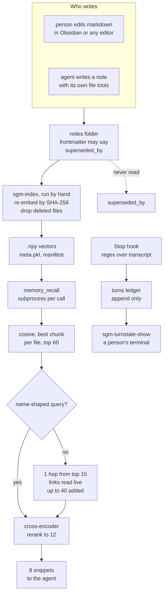

## 1. Executive Summary

sqlite-graph-memory is a recall layer for coding agents over a folder of markdown
notes. Dense retrieval finds entry points, one hop along the user's own
`[[wikilinks]]` adds neighbours, and a cross-encoder decides what survives. The
design question it is built to answer is whether the hop earns its place, and its
committed bench answers no on that vault, which the project publishes. The weak
point is correction: a note that declares itself replaced is retrieved first
anyway, and the per-turn ledger the Stop hook writes reaches no recall path.

The memory is whatever the user wrote. Nothing extracts, summarises or rewrites
it, and the only machine-written store is the ledger, which only a terminal
viewer reads. That makes it a small, auditable retrieval pipeline rather than a
memory system with a lifecycle. No capability mark is earned. The near-misses
are a supersession field present in the bench vault that no reader consults and
two indexer tests that keep material out of the index rather than out of a
result.

## 2. Mental Model

A memory is a **note**: a markdown file under the folder `sgm-index` was pointed
at, minus dot-files, dot-directories and Syncthing conflict copies
(`index_notes.py:83-99`). It is chunked into 1,200-character windows with 200
characters of overlap, each embedded with the `passage:` prefix. A chunk keeps
the note's path, its file stem as title, the first 600 characters as snippet
and a frontmatter `date` (`index_notes.py:124-139`).

There is no state machine. A note becomes retrievable when the indexer embeds
it, and stops being retrievable when the indexer next runs after the file is
deleted (`index_notes.py:219-225`). Between those two runs, an edited note is
retrieved with its old snippet and its new links, because the graph hop reads
the live file (`brain_ask.py:140-146`) while text comes from the pickled index.

Nothing is verified, ranked by trust or superseded. The bench vault encodes
supersession the way an Obsidian user would, `status: superseded` and
`superseded_by: "[[decision-2025-08-16-heron-deadline]]"` in frontmatter
(`bench/vault/decision-2025-02-07-heron-deadline.md:6-7`). The indexer reads only
`date` from frontmatter (`index_notes.py:70-72`), so both decisions are equal
candidates and the reranker picks between them on wording.

The second store is the **turns ledger**. After every assistant turn a Claude
Code Stop hook parses the new transcript bytes and appends one row: last user
ask, assistant text, files written, tools, commands and lines matching a
bilingual decision regex (`turnstate_hook.py:51-55`, `:131-235`). It is a record
of what happened, so nothing in it can turn out to be false. It is read by
`sgm-turnstate-show` and by nothing the agent calls.

## 3. Architecture

Everything is Python 3.9+ in `src/sqlite_graph_memory/`, with numpy as the only
base dependency. The models need an extra: `[lite]` runs both on ONNX Runtime,
and `[embeddings]` brings torch (`pyproject.toml:42-69`).

- **Indexer.** `sgm-index <dir>` writes `_brain_e5.npy`, `_brain_e5_meta.pkl`
  and `_brain_e5_manifest.json` into `BRAIN_INDEX_DIR` (`index_notes.py:158-252`).
  The manifest fingerprints the chunking settings and the model name, and a
  mismatch forces a full rebuild (`:119-121`, `:187-188`).
- **Recall.** `sgm-ask` loads the whole matrix and computes one dot product per
  chunk per query (`brain_ask.py:216-220`). There is no ANN index and no
  vector table in SQLite.
- **MCP server.** `sgm-mcp`, or `sqlite-graph-memory` under `uvx`, is a
  stdlib JSON-RPC loop with one tool. Each call spawns `brain_ask.py` in a
  child process with a 180-second default deadline, so a model crash kills the
  child and not the server (`mcp_server.py:26-29`, `:98-172`).
- **SQLite.** `turns` and `ab_recall` are created on first write
  (`turnstate_hook.py:119-128`, `brain_ask.py:509-522`). `schema.sql` documents
  both and says it is not a migration (`schema.sql:1-4`). A third table,
  `gold_eval`, is appended by `eval/run_eval.py --sqlite` (`run_eval.py:224-245`).

The README calls this "one SQLite file" (`README.md:15`). The vectors and chunk
list are numpy and pickle files beside it. The two tables share a file only when
both processes see the same `TURNSTATE_DB`. The hook defaults to
`~/.claude/turnstate/turnstate.db` (`turnstate_hook.py:29-38`). `brain_ask`
defaults to `./turnstate.db` in its working directory (`brain_ask.py:36`).

### Deployment and ergonomics

Nothing has to run between calls. Install is one `uvx` line pinned to Python
3.12, because onnxruntime has no wheels for 3.14 on an Intel Mac
(`README.md:23-31`). The first index run downloads `intfloat/multilingual-e5-base`
and the reranker from the Hugging Face Hub at the repository's default branch
with no revision pin (`onnx_backend.py:27-49`). After that it runs offline on CPU,
and no API key is used anywhere. The notes stay human-readable and are the
source of truth; the index is disposable and rebuilds from them. Indexing
stores each note's path as given on the command line (`index_notes.py:203`), and
nothing resolves it, so a relative path is valid only in the directory it was
indexed from.

## 4. Essential Implementation Paths

- **Capture into the index.** `build_index` (`index_notes.py:158-252`) lists
  notes, takes size and mtime as a fast path and SHA-256 as truth
  (`:201-214`), keeps rows of unchanged notes, re-chunks new and changed ones
  (`:227-232`), and writes the three files in sequence with no temporary file
  or rename (`:246-249`).
- **Recall.** `main` (`brain_ask.py:434-566`): `load_index` (`:155-159`),
  `query_sims` (`:216-220`), `retrieve_candidates` keeping the best chunk per
  path to 60 files (`:223-231`), `expand_1hop` (`:305-332`), `rerank_candidates`
  on title plus snippet (`:335-340`).
- **Entity gate.** `looks_like_entity` returns true for a query of at most five
  tokens holding a capitalised or CamelCase word, a snake_case token or one of
  six tool names, and the hop is then skipped (`brain_ask.py:109-133`, `:545-548`).
- **PageRank lane.** Off unless `SGM_PPR=1` or `--ppr`. `ppr_file_order` seeds
  personalized PageRank with the dense hits (`ppr.py:156-189`), and
  `fuse_after_rerank` fuses it with the reranker order by RRF, leaving the first
  five positions untouched (`ppr.py:205-234`). It is never applied under `--ab`
  (`brain_ask.py:476-477`).
- **Context assembly.** In `--ask` mode the top eight hits are written as a
  header and the 600-character snippet each, to `BRAIN_ANSWER_OUT`
  (`brain_ask.py:552-566`). The MCP server points that variable at a temporary
  file and returns its contents (`mcp_server.py:132-162`).
- **A/B telemetry.** `--ab`, or MCP mode `ab`, reranks both pools and inserts one
  `ab_recall` row with the counts and promoted titles, swallowing any error
  (`brain_ask.py:490-522`).
- **Ledger.** `turnstate_hook.main` (`turnstate_hook.py:131-235`), viewer
  `turnstate_show.main` (`turnstate_show.py:33-89`).
- **Correction and deletion.** Edit or delete the markdown, then rerun
  `sgm-index`. There is no other path.

## 5. Memory Data Model

A chunk's metadata is exactly `{path, title, snippet, date}`
(`index_notes.py:136-137`). The manifest maps each path to
`{size, mtime, hash}` (`:214`). There is no id beyond the path, no version, no
source agent and no timestamp of indexing.

`turns` has `session_id`, wall-clock `ts`, `cwd`, `project` (the basename of
`cwd`), clipped `ask` and `summary`, four JSON arrays, and `evidence` with
`byte_start` and `byte_end` pointing back into the transcript the row was
derived from (`schema.sql:8-23`). The evidence pointer is the one piece of
provenance in the system. `ab_recall` holds a query and three counts per A/B
run (`schema.sql:30-39`).

Scope does not exist on the note index. Isolation is by directory: one
`BRAIN_INDEX_DIR` per vault. The ledger's `session_id` and `project` are filtered
only by the viewer's `--session` flag (`turnstate_show.py:66-67`).

The only temporal field on a note is the frontmatter `date`, shown in the
context bundle header and used nowhere in ranking (`brain_ask.py:556`).
`docs/bitemporal.md` and `BITEMPORAL.md` specify `valid_from`, `valid_to` and
`observed_at` for a materialized edge table that the package does not have.

## 6. Retrieval Mechanics

Retrieval is a fixed pipeline with no query rewriting: e5 `query:` prefix,
exact cosine over every chunk, deduplicate to one chunk per file, then the
optional hop, then the reranker. The hop follows **outgoing** links only from
the top 15 files. It resolves each target by file stem, preferring exact
vault-relative paths over suffix matches, adds the neighbour's best chunk for
this query, and stops at 40 (`brain_ask.py:273-302`, `:305-332`). Any exception
in the hop returns an empty list and recall proceeds on vector hits alone
(`:329-331`).

The MCP tool defaults to `associative`, which is `--graph --ask`, so the entity
gate applies; `direct` is `--ask`; `ab` returns the comparison table
(`mcp_server.py:120-130`). The agent receives at most eight snippets of 600
characters with headers, roughly 5 KB, on every call.

The package has three readers of the link graph, and they parse targets two ways. The hop
and `sgm-stats` normalise `[[folder/note]]` and `[[note.md]]` through
`_normalize_target` (`brain_ask.py:234-239`, `vault_stats.py:73`). The PageRank
lane looks a target up as `tgt.strip().lower()` against file stems
(`ppr.py:144`), so a folder-qualified or `.md`-suffixed link is no edge there.
Its graph cache key also hashes a `sha` field that the indexer never writes
(`ppr.py:106-114`), so the key covers paths only. The cache lives one process,
and each MCP call is a fresh process.

Each hop reads the neighbour's file from the path stored at index time
(`brain_ask.py:142`). The MCP server starts the child in its own working
directory (`mcp_server.py:140-148`). An index built from `sgm-index ./notes`, the
form the README's three-command quickstart uses (`README.md:96-98`), therefore
resolves no file from a server started in another directory. `_links_in` returns an empty
list on the failed read (`brain_ask.py:142-143`), and associative recall
degrades to vector recall with no message.

## 7. Write Mechanics

The system writes no memory of its own. A note is written by a person in an
editor, or by an agent through whatever file tool its harness gives it; no MCP
verb writes. The indexer is a derivation, re-run by hand. Its incremental path
re-embeds only notes whose hash changed and drops rows of deleted files, so a
re-run after one edit embeds one note (`index_notes.py:216-232`). There is no
deduplication across notes, no consolidation and no conflict handling: two notes
that disagree are both candidates.

The ledger is the only automatic write. It is deterministic and costs no
tokens. It reads at most 4 MB of new transcript per turn and skips the turn
outright when more has arrived (`turnstate_hook.py:151-153`). It records the
offset before it inserts the row (`:160`), so a failed insert loses that turn
rather than retrying it. Commands are stored clipped to 200 characters with no
redaction of secrets in them (`:189-192`). No code updates, prunes or deletes a
ledger row.

### Operational cost

Nothing blocks the agent on a write. A note is retrievable after the next
`sgm-index` run and not before; the package schedules none, and the README
describes a nightly rebuild in the maintainer's own setup (`README.md:153`).
Each recall loads the full matrix and both models in a fresh process. The
README reports 7.0 seconds per MCP recall on the bench vault with ONNX and 33.8
with torch on one machine (`README.md:84-86`); I did not measure it. The Stop
hook is one file read and one SQLite insert per turn. No pass rewrites the
store. The index writes are three sequential overwrites, so a recall that starts
between them can load a matrix and a chunk list of different lengths.

## 8. Agent Integration

The agent has one verb, `memory_recall(query, mode)` (`mcp_server.py:67-95`). It
cannot save, correct or forget through the server. Retrieval is tool-mediated;
nothing injects context at session start. Installation snippets exist for Claude
Code, Cursor, VS Code and Codex (`README.md:37-79`). `server.json` registers
the package in the MCP Registry as a `uvx` launch of
`sqlite-graph-memory[lite]==0.3.6`.

The Stop hook is opt-in: `examples/claude-code-stop-hook.json` is a snippet for
`~/.claude/settings.json` that runs `sgm-turnstate-hook` with a 20-second
timeout, and nothing in the repository installs it. The hook prints nothing on
any path, so it cannot steer Claude Code's control flow. Its crash guard does not
travel with it, though. The module catches every exception and exits 0 only
under `if __name__ == "__main__"` (`turnstate_hook.py:238-243`). The console
script the snippet names is `sqlite_graph_memory.turnstate_hook:main`
(`pyproject.toml:81`), which calls `main` directly. Malformed stdin or a locked
database then exits 1 with a traceback, which Claude Code reports as a
non-blocking hook error.

## 9. Reliability, Safety, and Trust

### The replaced decision wins

On the six bench questions asking for a project's current deadline, both
committed sqlite-graph-memory result files rank the superseded decision first
and cite it, in graph and in vector mode. I recomputed this from
`bench/results/sqlite-graph-memory.json` and `sqlite-graph-memory-vector.json`
against the vault's `superseded_by` fields without running the project's code.
The old note is first in 6 of 6, both decisions are in the top five in 6 of 6,
and the answer is correct in 0 of 6. The extractor keeps the first note on an
overlap tie (`bench/adapters/_extract.py:49-53`), so the cited value is the
higher-ranked one. The committed BM25 row cites the replacement in all six.

The fix is in the tree, in the wrong directory. The TangleClaw reference adapter
stores frontmatter `status` and `superseded_by` in a `notes_meta` table and
promotes an active successor over a superseded hit
(`bench/adapters/tangleclaw.py:20-24`, `:106-136`). `src/` holds no reader of
either field.

### Correction is a file operation

A person corrects memory by editing the note, which is authoritative and
immediate in the vault and invisible to recall until the next index run. A
deleted note keeps returning its old snippet until then. No record says what
changed, when or by whom; the vault's own git history, if it has one, is the
only audit. The ledger records the paths an agent wrote through `Write` or
`Edit`, not the change, and records nothing a person does.

### What enters the store

Notes are the user's own writing, so prompt injection reaches memory only
through a note someone wrote or an agent was told to write. The ledger stores
assistant text and shell commands verbatim, clipped, under `~/.claude/turnstate/`
with no retention. `load_index` unpickles `_brain_e5_meta.pkl`
(`brain_ask.py:157`), so anyone who can write the index directory can run code in
the next recall.

### Marks

None is carried.

- **`tombstone`** — no rejected value is recorded; deletion is file removal.
- **`trust_state`** — `status: superseded` exists in the bench vault's
  frontmatter and no code under `src/` reads it.
- **`bitemporal`** — the one note-level time is a frontmatter `date` used for
  display; validity windows are a design note.
- **`scope_enforced`** — the note index has no scope key. The ledger's
  `session_id` filter is a viewer option a person types, not a boundary on any
  read the agent makes.
- **`audit_log`** — `turns` is append-only, but it records agent turns, not
  mutations of the note store. Re-indexing writes no record.
- **`human_review`** — the person authors notes directly. Editing is authoring,
  and no memory waits for anyone.
- **`negative_eval`** — see section 10.

## 10. Tests, Evals, and Benchmarks

The suite is 202 pytest functions in 22 files. CI runs it on Python 3.9 to 3.13
and then reruns `tests/test_eval.py` with `EVAL_MUTANT=1`, which makes nDCG
return 1.0, and fails the build if that run stays green
(`.github/workflows/tests.yml:38-47`). I did not run the suite.

Coverage is strongest on the indexer and the MCP transport. Fourteen cases in
`test_incremental_index.py` pin hashing, the fast path, deletion and the
forced-rebuild conditions. `test_turnstate_hook.py:93-126` asserts exit code 0 on
bad input and a missing transcript. Both cases run `python -m
sqlite_graph_memory.turnstate_hook`, which takes the guarded path, and neither
runs the console script the hook snippet installs. `tests/test_ppr.py` has no
folder-qualified link.

`negative_eval` is withheld because no case asserts on a retrieval result. Two
come close and both are populated:

- `test_index_notes_dotfiles.py:54-59` asserts `.drafts/inside.md` is not
  enumerated while `ok.md` is;
- `test_incremental_index.py:129-145` asserts a deleted note's rows are gone
  while two others remain.

Both keep material out of the index rather than out of what recall returns. A
`retrieve_candidates` call over the rebuilt index, with a query that matched
the deleted note before, would close the gap.

**memory-bench v0.1** is the project's own: 202 generated notes, 91 questions in
seven classes, 22 of them unanswerable (`bench/README.md:9-27`). Each result
file carries every per-question output, and `validate.py` rescores it with the
shared scorer and rejects any claimed number that differs
(`bench/validate.py:41-62`, `bench/bench_core.py:105-170`, `:181`). I recomputed
recall@5 from the committed outputs with my own script. It matches the files:
0.8478 in graph mode and 0.8841 vector-only over 69 answerable questions. Graph
mode gains on `bridge` (1.00 against 0.97) and loses on `paraphrase` (0.50
against 0.80). The answers come from an extractive adapter, so answer metrics
measure `_extract.py` as much as the library.

The `reproduce` job reruns both sqlite-graph-memory rows from a clean index and
allows no per-question change (`validate.py:175-197`). Its hosted run on
[`e4f31b9ae5c1dea6ceb5838d3a0ccb80a1737f06`](https://github.com/tonydzi/sqlite-graph-memory/commit/e4f31b9ae5c1dea6ceb5838d3a0ccb80a1737f06),
whose `src/` and `bench/` trees equal the pin's, reports both jobs successful. I
read the job conclusions, not the logs. The result files are labelled 0.3.0 and
dated 10 October 2026; the package at the pin is 0.3.6.

The paper is a Zenodo preprint of 7 September 2026,
[DOI 10.5281/zenodo.22639718](https://doi.org/10.5281/zenodo.22639718). Its
abstract reports a production A/B over 10 logged queries, in which the hop
changed the top 12 in five, and names the stratified evaluation protocol as the
contribution. I read the abstract and metadata, not the PDF. The README's
home-vault table and rejected-swap list (`README.md:409-475`) come from a
private corpus and are claims, not artifacts in the tree.

## 11. For Your Own Build

### Steal

- **Use the links people have written as the graph, and read them live.** No
  extraction pass, no edge table to keep in sync, and an edit to a link reaches
  the next query without a rebuild.
- **Let the graph propose and the reranker decide.** Neighbours enter the same
  pool as vector hits, so a hop that drags in noise is buried rather than
  promoted.
- **Make a benchmark row an output file, not a number.** Ranked ids, answer and
  quotes per question, rescored in CI and rerun from a clean index with zero
  tolerance per question, leave a typed-in figure nowhere to go.
- **Gate the metric with a mutant.** A CI step that breaks nDCG on purpose and
  fails if the suite stays green proves the suite reads the metric.
- **Run the model in a child process per call.** A segfault or out-of-memory
  becomes a tool error instead of a dead server.

### Avoid

- **Asking the corpus to declare supersession and then not reading it.** A
  frontmatter field the user maintains is the cheapest correction signal
  there is; a ranker that ignores it returns the replaced value with
  confidence.
- **Testing the guarded wrapper instead of the shipped entry point.** A
  console script that calls `main` skips everything under `__main__`.
- **Storing paths as typed.** Resolve at write time, or every reader that runs
  in another directory silently sees nothing.
- **Three parsers for one link syntax.** A fix that lands in two of them leaves
  the third disagreeing about what an edge is.

### Fit

This suits one person with a large, carefully linked Obsidian vault who wants
an agent to read it and is content to keep writing it by hand. It needs no
service and little maintenance, and its bench makes the graph's value something
to measure on your own notes. Walk away if the agent must remember on its own,
if old decisions sit beside new ones without being deleted, or if more than one
person or project shares a machine. The package has no write path, no
supersession and no scope.

## 12. Open Questions

- Whether the maintainer's home pipeline, with superseded-note demotion behind a
  flag, closes the 6 of 6 on this vault; the README says that code is not
  published.
- How often a relative-path index meets a server started in another directory
  in practice, and whether `sgm-doctor` should check for it.
- Whether the `ab_recall` rows are queried anywhere outside the tree; no code in
  it reads them.
- Recall latency on a 28,000-note index, which the README cites and the tree
  cannot reproduce.

## Appendix: File Index

- Storage and schema: `src/sqlite_graph_memory/schema.sql`,
  `index_notes.py` (`build_index`)
- Retrieval: `brain_ask.py`, `ppr.py`, `onnx_backend.py`
- MCP: `mcp_server.py`, `server.json`, `examples/mcp-config.json`
- Ledger: `turnstate_hook.py`, `turnstate_show.py`,
  `examples/claude-code-stop-hook.json`
- Graph health and install checks: `vault_stats.py`, `doctor.py`
- Bench: `bench/bench_core.py`, `bench/validate.py`, `bench/adapters/`,
  `bench/results/`, `bench/questions.jsonl`, `bench/make_vault.py`
- Eval: `eval/build_gold.py`, `eval/run_eval.py`, `eval/run_ablation.py`
- Tests: `tests/`, `.github/workflows/tests.yml`, `.github/workflows/bench.yml`

### Recorded searches

Run from the repository root at the pinned commit with `/usr/bin/git grep`.

- **No reader of supersession or validity in the package.**
  `git grep -n -i -E 'valid_?(from|to)|observed_at|as_of|superseded|status:' -- src eval/run_eval.py bench/adapters/sgm.py`
  returns nothing; `git grep -n -i superseded_by -- bench/adapters` matches
  `tangleclaw.py` nine times.
- **The ledger is read only by the viewer.**
  `git grep -n -E 'from turns|FROM turns' -- src` returns `turnstate_show.py`
  only; `INSERT INTO turns` matches `turnstate_hook.py:230`.
- **Nothing reads `ab_recall`.** `git grep -n ab_recall -- src eval` returns the
  create and insert in `brain_ask.py`, the schema and comments.
- **No delete, prune or retention.**
  `git grep -n -i -E 'delete from|drop table|vacuum|unlink|retention|prune' -- src`
  returns two temporary-file unlinks and a docstring.
- **No atomic index write.**
  `git grep -n -E 'os\.replace|os\.rename|\.replace\(|tmp' -- src/sqlite_graph_memory/index_notes.py`
  returns nothing; the same pattern over `mcp_server.py` matches its temporary
  answer file.
- **No path resolution at index time.**
  `git grep -n -E 'resolve\(\)|is_absolute|abspath|absolute\(\)' -- src`
  returns `doctor.py` messages and `mcp_server.py:30` only.
- **One link normaliser, two callers.**
  `git grep -n -E '_normalize_target|_resolve_target_chunks' -- src` returns
  `brain_ask.py` and `vault_stats.py`, not `ppr.py`.
- **No redaction in the hook.**
  `git grep -n -i -E 'redact|secret|token|password' -- src/sqlite_graph_memory/turnstate_hook.py`
  returns the docstring's "0 LLM tokens" only.
- **No scheduler.** `git grep -n -i -E 'watch|inotify|watchdog|cron|schedule' -- src`
  returns a comment in `brain_ask.py` and the `vault_stats.py` docstring.
- **No entity lane.** `git grep -n -i entity -- src` returns
  `looks_like_entity`, `ENTITY_TOOLS` and the gate's comments only.

## History

**2026-11-05** — [`a22da114bb714b75281ae86b0bd8c3ece274ec8c`](https://github.com/tonydzi/sqlite-graph-memory/commit/a22da114bb714b75281ae86b0bd8c3ece274ec8c). First reading, from a full clone, 52 commits past the nominated [`378baf0c5d3a91b0dddad231339ec7084dfcb045`](https://github.com/tonydzi/sqlite-graph-memory/commit/378baf0c5d3a91b0dddad231339ec7084dfcb045); incremental indexing, the PageRank lane, the ONNX backend and the TangleClaw bench adapter landed between them. Screened first: one auto-run surface, `server.json` launching the PyPI package through `uvx`; `pyproject.toml` inside the seven-day cooldown; three unpinned surfaces. The Stop hook is an example snippet, not registered in the tree. MIT, no rider. Nothing installed, built or run; the bench figures were recomputed from committed outputs. No marks: nothing reads the declared supersession, and no case asserts on a result ([section 9](#9-reliability-safety-and-trust)).
