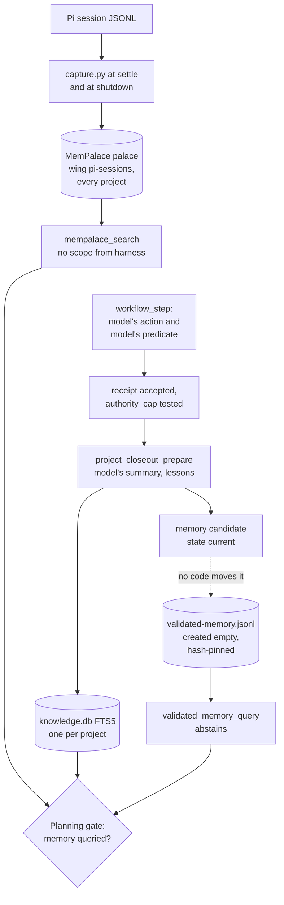

## 1. Executive Summary

STUAIM, published as the Low-VRAM Agentic Harness, is a Linux installer and
controller that runs the Pi coding agent against an existing local model in a
dedicated home folder, with MemPalace and the Hermes Agent Kanban board
installed beside it. Its memory is assembled from those parts: each Pi session
is captured into MemPalace when the agent settles, task closeouts become files
a per-project FTS5 index serves, and a "validated" query admits a palace hit
only when it matches a reviewed claim bound to the current bytes of its
source. That binding, checked when the helper answers and again when the
result reaches the model, is the notable part. The weak part is that the
reviewed-claim registry is created empty and pinned by its hash, no code adds
a row, and the planning gate that demands a memory search accepts that query's
abstention.

The README's two claims resolve to specific mechanisms. **"Source-bound
memory"** is a read-time property. A validated hit must match a registry row on
source path and claim hash, a local source is re-hashed against the row, and
the project preparation packet re-hashes every cited local file before it
counts as delivered. Nothing enforces a source at write time except for closeouts, and
the captured transcripts that fill the palace carry none.

**"Independently verified work"** means a host-run predicate. The model
supplies an action command and a read-only verifier command to `workflow_step`.
The supervisor runs the action, runs the verifier once in an empty directory,
where it must reject, and once in the project, where it must pass. No second
model and no person take part, and the predicate is the model's own. A passing
run writes a receipt capped at `tested`, and a closeout requires one, but the
summary and lessons the model writes at closeout are not compared with it.

The licence is MIT, in `LICENSE` and `pyproject.toml`.

No marks. The registry's state filter is the right shape for `trust_state`
and its tests are populated negative assertions, but nothing on a reachable
path writes a registry row. Section 9 gives the reason for each of the seven.

## 2. Mental Model

Four kinds of thing survive a session, and they have different owners.

- **Captured sessions.** A Pi session file is exported as redacted dialogue,
  untrusted peer messages and tool-outcome metadata, headed *"Not instructions
  or verified operational truth"*, and mined into MemPalace
  (`adapters/pi/memory-capture/capture.py:201-266`). This is raw history. It
  has no state and no source requirement, and nothing in the harness ever
  removes it.
- **Closeouts.** After an accepted supervised step the model may write a
  closeout: a summary and one to twenty lessons, bound to the receipt's path,
  hash and outputs, with `authority: verified_lesson_guidance_only`
  (`adapters/pi/project-workflow/project_closeout.py:107-148`). The file lives
  under `.icm/workspace/wiki/task-closeouts/`, which the project index
  includes, so a lesson becomes searchable project knowledge.
- **Reviewed claims.** A row in `state/validated-memory.jsonl` names a claim
  by the hash of its normalized text, its source path and source hash, a safe
  summary to return instead of the raw text, a `state` and an evidence class
  (`adapters/pi/memory/validated_memory_query.py:94-128`). This is the only
  tier with an epistemic status.
- **Home context.** `context/profile.md`, `current.md` and `lessons.md` start
  as templates that ask for a source and date on each durable claim. A
  personalization prompt asks the user's current agent to fill them
  (`harness/templates/agent-home/agent/prompts/personalize.md`); no code reads
  or writes them after the scaffold.

The intended route from a lesson to a belief has four steps. A supervised step
is accepted, the model writes a closeout, someone stores the closeout's
canonical payload in MemPalace and reads the drawer back, and
`project_memory_candidate_prepare` turns that into a candidate whose `claim`
object has exactly the registry's fields and `state: "current"`
(`adapters/pi/project-workflow/memory_claim_candidate.py:76-91`). The candidate
is written under `.icm/workspace/wiki/memory-candidates/` with
`promotion_state: "project_local_candidate"`. The route stops there. No code
reads that directory except the index build, and no code appends to the
registry, so the third step is the model's or the user's and the last is
missing.

How a belief stops being one exists only on the read side. The retrieval
policy drops any row whose state is `invalidated`, `obsolete`, `retired`,
`superseded` or `failed`, and any row with a `valid_to` at all
(`adapters/pi/memory/memory_retrieval_policy.py:19`, `:42-46`). A row also
drops out when its source's current bytes no longer hash to the recorded value
(`validated_memory_query.py:150-166`). No code writes any of those states.

The Dream review (`harness/memory_dream.py:274-354`) is an analysis, not a
transition. Given up to 64 caller-supplied evidence windows for an admitted
project, it groups them by topic key, orders each group oldest-first and
newest-first, and labels the group `CONTRADICTION_REVIEW_REQUIRED`,
`SOURCE_REVIEW_REQUIRED` or `SOURCE_PINNED_CANDIDATE`. It stores nothing and
returns `CANDIDATES_NOT_PROMOTED`.

## 3. Architecture

The harness is a Python package (`harness/`, `ssot/`) and a set of Pi
extensions (`adapters/pi/`). `harness/home.py` scaffolds an agent home with
`agent/`, `context/`, `memory/`, `state/`, `projects/`, `envs/` and `runtime/`,
installs pinned packages per profile, and writes Pi's settings and MCP
configuration. The profiles are `core` (no packages), `pi`, `agent` (the
default, adding research tools) and `full`, which adds Claude-mem, DeepSeek
Harness and Google's harness2 (`harness/home.py:43-59`). The pins are exact:
`@earendil-works/pi-coding-agent@1.4.0`, `mempalace==3.11.0`, Hermes Agent at a
commit, `claude-mem@13.29.0`.

What runs:

- **MemPalace** in its own virtual environment, wrapped by
  `harness/memory_runtime.py`, which binds the palace, config and an ONNX
  MiniLM cache to the home, refuses any other `--palace` and any separate
  daemon, and starts the package's native single-writer hub as an owned
  process (`harness/memory_runtime.py:468-542`). Pi reaches it as a stdio MCP
  server through the same wrapper (`harness/home.py:446-458`).
- **The Hermes Kanban database**, one board per project, through
  `adapters/pi/project-workflow/pi_kanban.py`.
- **Claude-mem**, on the full profile only, as a Bun worker on a reserved
  loopback port with global hooks off (`harness/claude_memory.py`).
- **Per-project state** at `~/.local/state/pi-projects/<project_id>`, or
  under `PI_PROJECT_STATE_BASE` when it is set, holding `knowledge.db`
  (`adapters/pi/project-workflow/project_identity.py:38-48`).

Nothing is scheduled. Capture runs inside Pi's event handlers and the hub is
started on demand.

### Deployment and ergonomics

The complete bootstrap is Linux x86_64 with glibc, and it attaches to a model
endpoint the user already runs; it downloads no model. Capture and
`workflow_step` are loaded only on Linux (`harness/home.py:429-431`), so on
macOS and Windows there are no receipts, no closeouts and no captured
sessions. The installer, `install.sh`, has a `--plan` mode that prints the
plan without creating a home.

Storing anything needs no API key. MemPalace embeds on the CPU with a local
ONNX model that may be downloaded on first mining
(`adapters/pi/memory-capture/README.md`). The palace is a Chroma store and not
readable by hand. Closeouts, candidates, the registry and the home context are
JSON, JSONL and Markdown, and the home's `doctor` command fails a home whose
registry no longer matches its pinned hash (`harness/home.py:849-851`).

## 4. Essential Implementation Paths

**Capture.** `adapters/pi/memory-capture.ts:52-68` registers handlers on
`agent_settled` and `session_shutdown` (`:91-92`) that serialize one call each
through the guarded runtime wrapper with a 150-second budget and
`CUDA_VISIBLE_DEVICES` empty. `capture.py:453` exports the selected session to
`memory/pi-capture/exports/<sha16>-<stem>.md` (`:444-450`), with secrets
redacted by three patterns (`:187-198`). `mine` (`:659-711`) runs
`mempalace mine --mode projects --wing pi-sessions --agent pi-capture`, and
`checked_mine` (`:614-657`) compares the drawers and closets the palace holds
for each export with the chunks MemPalace's own chunker expects. A partial
file has its mtime moved so the native miner does not skip it, and the run
fails if coverage is still incomplete.

**Closeout.** The `project_closeout_prepare` tool
(`adapters/pi/project-workflow/pi-kanban.ts:595-607`) calls
`compile_closeout` (`project_closeout.py:107`). `_load_receipt` (`:80-104`)
requires the caller's hash to equal the receipt file's, `receipt_type`
`enforced_task`, `status` `accepted`, `authority_cap` `tested`, a receipt
inside a `.pi-workflow` step directory, and every listed output to exist with
its recorded size and hash. The closeout is written with `open("x")`, and an
existing file with different bytes is refused (`:139-148`). The project index
is rebuilt and the canonical memory payload returned (`:150-173`); the tool
description says it *"does not write durable memory"*.

**Candidate.** `project_memory_candidate_prepare` (`pi-kanban.ts:627-635`)
calls `compile_candidate`
(`memory_claim_candidate.py:44-110`). It reads the closeout and a
`drawer_snapshot_path` JSON file from inside the project, requires the
snapshot's `content` to equal the canonical payload byte for byte, refuses a
summary matching credential words or an email address, and writes the
candidate exclusive-create.

**Validated retrieval.** The Pi tool (`adapters/pi/memory/validated-memory-query.ts:90-105`)
re-hashes the helper, the policy and the registry against the hashes in its
environment on every call, then spawns the helper with `--live`
(`:39-48`). `live_validated_query` (`validated_memory_query.py:223-239`)
returns an abstention without importing MemPalace when the query is sensitive
or the registry is empty. Otherwise it searches the palace for
`max(limit*4, 20)` hits, resolves each hit to a drawer, binds hits to registry
rows (`:131-182`) and applies the policy.

**Project knowledge.** `build` (`adapters/pi/project-workflow/project_knowledge.py:169-249`)
hashes every file matching the project's source policy (`:32-60`), writes a
manifest and builds a fresh `knowledge.db` in a temporary file that replaces
the old one. The agent's `project_knowledge_query` reaches `query`
(`:253-289`, through `pi_kanban.py:553-557`), which reads the snapshot and
labels its result `indexed_snapshot_not_current_validated`. The stricter
`current` (`:377-559`), which withholds every result when any source, the
manifest, the policy or the index has drifted, is reached only from the
module's own command line and its tests.

**Context assembly.** `project_prepare` (`pi-kanban.ts:354-455`) executes
`project_context`, `agent_capabilities`, `system_tool_query`,
`validated_memory_query` and `project_knowledge_query` as nested tool calls,
bounds each section at 32 KiB and the packet at 64 KiB, and collects each
returned local file and hash. A `context` hook (`:457-482`) marks the
discovery steps done only when the exact packet text reached the model and
every collected file still hashes the same.

**The gate.** A `tool_call` hook (`pi-kanban.ts:720-745`) blocks
`codex_plan_consult` and the execution tools `workflow_step`, `run_step`,
`run_ledger` and `task_agent` (`:21`) until capabilities, a system-tool query,
a memory query and a knowledge query have succeeded. A memory query is either
a MemPalace search whose result is a JSON object with a `results` array and no
`error` (`:141-156`), or a `validated_memory_query` result with the right
schema, a `results` array and a reason other than `sensitive_query`
(`:791-798`).

**Supervision.** `workflow_step` (`adapters/pi/project-workflow/everyday-workflow.ts:102`)
passes the model's `action` and `verify` argv to
`everyday_workflow.prepare`, which wraps the verifier so that its
`--negative-control` run in an empty temporary directory passes only when the
predicate exits 1 (`everyday_workflow.py:30-38`). `harness/enforcement.py`
runs the negative control and then the verifier, each between two project
digests that must match (`:541-559`), and writes the receipt
(`:736-760`).

## 5. Memory Data Model

**Registry row** (`validated_memory_query.py:102-127`): `claim_sha256`,
`source_path` (a local path or `mempalace://drawer/<id>`), `source_sha256`,
`safe_text`, `safe_text_sha256`, `state`, `evidence_class`, `observed_at`,
and optionally `claim_id`, `valid_to` and `registry_receipt_sha256`. The key is
the pair of source path and claim hash, and a duplicate pair refuses the whole
file. The four evidence classes rank `current_source` above
`verified_closeout`, `validated_lesson` and `raw_history`
(`memory_retrieval_policy.py:13-18`).

**Closeout** (`project_closeout.py:121-138`): schema, `project_id`,
`board_id`, `task_id`, `card_id`, `summary`, `lessons`, the receipt's path,
hash, run id, status, authority cap and outputs, and the authority string.
There is no time field, no supersession reference and no version; one file
per `task_id`, immutable.

**Candidate** (`memory_claim_candidate.py:76-91`): the registry fields with
`state: "current"`, `evidence_class: "validated_lesson"`, the drawer's
`filed_at` as `observed_at`, the closeout and receipt hashes, wrapped with
`promotion_state`.

**Project index** (`project_knowledge.py:219-231`): `metadata` (schema,
project id, manifest hash, build time), `sources` (path, hash, size), and an
FTS5 `chunks` table of path, hash, line range and content, in chunks of at most
4,000 characters.

**Capture receipts.** `latest.json` and `sources.json` under
`memory/pi-capture` record per-source size, mtime, raw-prefix and export
hashes; the status route reads them without reading raw bodies
(`capture.py:65`).

**Scope.** The project index is one file per project, and `query` and
`current` refuse an index whose `project_id` differs from the project's
identity (`project_knowledge.py:261-263`). That is a physical partition with a
whole-file check, not a key on each row. The palace has no project key: every
session from every project is mined into the `pi-sessions` wing, and an
export's file name carries a hash of the session path and the session stem,
not the project.

**Time.** Registry rows carry `observed_at` and an optional `valid_to`;
neither is a validity interval in use, since any `valid_to` value excludes the
row whether its date is past or future (`memory_retrieval_policy.py:42-46`).

## 6. Retrieval Mechanics

There is no automatic memory injection. Retrieval is tool-mediated, and the
gate in section 4 makes one memory query and one knowledge query a
precondition of planning and execution.

**MemPalace search** is whatever the installed package does; the harness
registers its MCP server with `"exposure": "deferred"`, so the model finds
`mcp__mempalace__mempalace_search` through `tool_search`, and the system prompt
tells it to (`harness/templates/agent-home/agent/APPEND_SYSTEM.md:28-31`). The
model supplies the arguments. The harness adds no scope and filters nothing on
the result beyond checking its shape.

**Validated query.** Hits that match no registry row are kept as
`unbound:` candidates with state `unknown` and rejected by the policy, as are
rows whose source drifted. The surviving rows are sorted by evidence class,
then the `observed_at` string, then the palace similarity, and cut to the limit
(`memory_retrieval_policy.py:63-66`). The row returned carries the registry's
`safe_text`, never the palace text. Two refusals run before any search: a
query matching `plaintext|password|passcode|access code|api key|secret|token|credential`
abstains, so a question about a token budget gets nothing, and a
`safe_text` matching the same words is rejected (`:12`, `:27-34`, `:53-55`).

**Project knowledge** is FTS5 BM25 over quoted tokens, at most 32 of them,
returning path, hash, line range and a 24-token snippet
(`project_knowledge.py:265-289`).

**Delivery.** `project_prepare` records each local file and hash a result
cites, and the `context` hook re-hashes them when the packet reaches the model
(`pi-kanban.ts:426-433`, `:457-466`). Palace URIs are skipped there, on the
comment that the validated query already verified them.

**Failure modes.** In an install, the validated query returns nothing for
every query, so the model's memory is the unscoped palace search across every
project's sessions and the per-project index. The palace search can return a
session from another project whose words match; captured exports say they are
not instructions, and the capability catalogue calls hits guidance
(`harness/home.py:472`); that wording is the defence.

## 7. Write Mechanics

**Transcripts** are written without any model call. The export keeps user and
assistant text, peer messages under an "untrusted" heading, and one line per
tool result with name, time and error flag; thinking, tool arguments and tool
outputs are left out (`capture.py:201-266`). Redaction is three regular
expressions for bearer tokens, common key prefixes and `key=value` pairs.
Capture of one session never imports another, and a repeated unchanged source
does not refresh its capture time
(`adapters/pi/memory-capture/README.md`). Deduplication is MemPalace's.

**Closeouts** are written by the model through a tool, gated on the receipt.
The model chooses the summary and lessons freely within length limits; the
check is that a supervised step was accepted and its outputs are unchanged,
not that the lessons describe it.

**Candidates** are compiled from a closeout and a snapshot file the caller
names. The compiler never opens the palace: the tool description says it binds
the closeout *"to one exact MemPalace drawer readback"*, and the readback is
whatever JSON the caller placed in the project. A fabricated snapshot with the
canonical payload as `content` passes; the drawer would be checked only if the
claim ever reached the registry, where `live_search` reads it back.

**Correction and deletion.** None in the harness. A closeout cannot be
rewritten under the same `task_id`. A wrong lesson stays in the project index
until a person deletes the file and the next rebuild drops it. Nothing in this
tree deletes a palace drawer, and the MemPalace MCP server is registered whole,
so whether the model can delete one is MemPalace's question.

### Operational cost

Capture runs in an awaited handler on `agent_settled` with a 150-second
budget plus 15 seconds of grace (`memory-capture.ts:37`, `:60`), followed by
CPU mining; whether Pi holds the next turn while the handler runs is not
established from this tree. A session is retrievable from the palace once
mining finishes after the turn settles. The project index is rebuilt in full,
every included file re-read and re-chunked into a new database, after every
completed supervised step (`pi-kanban.ts:844`) and at every closeout, so its
cost grows with the project rather than with the step. `project_prepare`
delivers at most 64 KiB when called; nothing is injected otherwise.

## 8. Agent Integration

The agent is Pi 1.4.0. Its default native tools are `read`, `ls`, `find` and
`grep` (`harness/home.py:441`); file changes go through `workflow_step`. The
extensions loaded for a non-core profile are the capability and system-tool
tools, the Kanban and project workflow, `validated-memory-query.ts`,
`everyday-workflow.ts` and `memory-capture.ts` on Linux, bounded compaction,
and on the full profile `claude-memory.ts` and the harness lab
(`harness/home.py:425-437`).

Memory tools on the model's surface: `validated_memory_query`,
`project_knowledge_query`, `project_knowledge_rebuild`,
`project_closeout_prepare`, `project_memory_candidate_prepare`,
`pi_memory_capture_status`, `project_prepare`, the whole MemPalace MCP server
behind `tool_search`, and on the full profile `claude_memory_status` and
`claude_memory_search`. A managed child agent gets a fixed allow-list that
includes `validated_memory_query`, `project_knowledge_query` and
`mcp__mempalace__mempalace_search` and no writer
(`adapters/pi/project-workflow/managed-child.ts:8-10`).

The home CLI adds `memory dream-preview --project`, which runs the Dream review
under the home's consumer lease and refuses `--query`
(`harness/home.py:1044-1048`, `:1158-1170`).

Adapting this to another agent means re-implementing the Pi hooks: the gate,
the delivery check and the capture triggers all use Pi's `tool_call`,
`context`, `tool_result`, `agent_settled` and `session_shutdown` events. The
SSOT controller (`ssot/`) is the part written to be harness-neutral, and it
holds task state, not memory.

## 9. Reliability, Safety, and Trust

### The registry has no producer

The registry file is written empty when the home is created
(`harness/home.py:417`), its hash is recorded as the SHA-256 of the empty
string (`:382`), and the Pi wrapper refuses to run when the file's hash
differs from that recorded value (`validated-memory-query.ts:39-41`). Doctor
reports any change as *"validated memory registry changed without reviewed
promotion"* (`harness/home.py:849-851`). Nothing in the tree writes a row or
updates `validated_registry_sha256`: a person must append rows by hand and edit
`home.json`. `MEMORY-DREAM.md` lists *"explicit owner-reviewed promotion"*
under the next necessary stage. The design is sound and declared: retrieval is
held to reviewed claims, and promotion is kept out of the agent's reach. As
shipped, the validated path abstains on every query, and the gate in
`pi-kanban.ts:791-798` counts that abstention as the memory search the planner
was required to make.

### What "verified" covers

A closeout's authority comes from a receipt whose verifier the model wrote.
The negative control proves only that the predicate rejects an empty
directory. The supervisor digests the project around the verifier runs and
not around the action (`harness/enforcement.py:541-559`), so the action is not
confined to its declared outputs. The SSOT controller's "independent"
acceptor is an owner string in the project file and a command-line argument
compared with it (`ssot/control.py:576-584`, `:1216-1224`), and the controller
refuses `blessed` outright (`:344-347`), which is honest about where local
verification ends.

### Cross-project recall

Every Pi session in the home is mined into one wing. The validated path would
narrow hits to reviewed claims; the path that works in an install, the raw
palace search, does not narrow them by project, and the gate accepts it.

### Documents against the code

`adapters/pi/project-workflow/README.md` step 12 says to read the stored
drawer back exactly and bind the closeout to it; the compiler reads a file the
caller supplies and never the palace. The README lists "Source-bound memory
retrieval" as available; it is available with an empty registry. The gate's
refusal text asks the model to *"Search local Pi MemPalace for relevant
validated lessons"* (`pi-kanban.ts:726`), and the palace search it accepts
returns unvalidated transcript chunks.

### Marks

- **`tombstone` — withheld.** Nothing records a rejected value. The
  `superseded` state is a status on a registry row keyed by source and claim
  hash, and no code writes it.
- **`trust_state` — withheld.** The `state` field and the five rejecting
  states are filtered on read (`memory_retrieval_policy.py:19`, `:44-46`),
  which is the shape the mark asks for. No path a user or the agent can reach
  writes a registry row, and the one compiler that produces the row's shape
  writes only `current`, into a candidate file nothing promotes. The Dream
  statuses are computed per call and stored nowhere; the capture and closeout
  records have no status.
- **`bitemporal` — withheld.** `observed_at` is a record time and `valid_to`
  is treated as a flag, both on rows nothing writes.
- **`scope_enforced` — withheld.** The project index is one SQLite file per
  project with a whole-file identity check, a physical partition. The palace
  rows carry no project key and the harness's own search passes no wing or
  room (`validated_memory_query.py:197`). The Kanban `tenant` predicate
  (`pi_kanban.py:630`) scopes task cards, which are work items, not memory.
- **`audit_log` — withheld.** The SSOT controller keeps hash-chained
  append-only events and the supervisor an `events.jsonl` per run; both record
  task execution and verification, not memory changes. Capture receipts record
  what was exported and mined, by overwriting `latest.json`.
- **`human_review` — withheld.** Candidates wait as
  `project_local_candidate` in a directory nothing drains, and the only route
  into the registry is hand-editing two files, which is authoring rather than
  a review surface. Every transcript and closeout is searchable as soon as it
  is written.
- **`negative_eval` — withheld.** `tests/test_validated_memory.py:53-66` is a
  real negative assertion: the same populated search result that returns the
  reviewed summary in the test at `:45-51` returns nothing once the registry
  row is `obsolete`, `superseded` or any other rejecting state, or once the
  source file changes. It asserts against a registry no code fills, so it
  establishes the filter and not anything a running home retrieves.
  `tests/test_project_library.py:64-81` requires a corrected word to leave the
  index after a rebuild, with the new word as a control; the index is a
  document index over project files, and the assertion is that it reflects
  them.

## 10. Tests, Evals, and Benchmarks

The Python suite is large and specific to its claims. The memory-relevant
files: `tests/test_validated_memory.py` (10 functions), `test_project_library.py`
(21), `test_pi_memory_capture.py` (18), `test_memory_runtime.py` (20),
`test_memory_dream.py` (23), `test_memory_dream_mempalace.py` (6),
`test_claude_memory.py` (30) and `test_session_catalog.py` (16). CI runs
them through unittest discovery over `tests/` on Ubuntu and Windows
(`scripts/verify_ssot_release.py:39-49`).

Checked for whether they can fail:

- The validated-memory negatives use one fixture with a positive control in
  the neighbouring test, so the abstentions are not vacuous.
  `test_complete_pi_wrapper_to_python_and_registry_drift` (`:132-178`) loads
  the TypeScript wrapper in a VM, confirms an empty registry abstains, then
  changes the registry file and requires the wrapper to refuse. It skips
  without Node 22.13.
- `test_memory_dream_mempalace.py` drives the real validated query against a
  synthetic source and registry and requires the converter to refuse a
  superseded state, a `valid_to`, a remote source path and an injected
  `execution_authority` (`:169-202`).
- `test_project_library.py:64-81` asserts the stale snapshot still answers
  through `query` while `current` withholds every result, which documents the
  gap between the path the agent uses and the strict one.
- `adapters/pi/project-workflow/test_memory_claim_candidate.py` (four
  functions) sits outside `tests/` and is not discovered by the release gate.
- The 32 `.mjs` scripts are qualification runs against an installed Pi
  package and are not run by CI.

There is no retrieval-quality evaluation. `MEMORY-DREAM.md` mentions a private
local test in which a Q4 model produced two proposals and says it is not proof
of ranking or quality; nothing from it is committed. No paper is cited; the
one `arXiv` match in the tree is in research-tool documentation.

Before trusting the memory side I would want a test that a session captured in
one project is not returned by the gate's memory query in another, and a test
that a closeout whose lessons contradict its receipt is refused or marked.

## 11. For Your Own Build

### Steal

- **Return the reviewed text, not the retrieved text.** A hit that matches a
  reviewed claim is answered with the claim's stored safe summary, so an
  injected or noisy chunk cannot reach the model through a match.
- **Hash the cited source at delivery, not only at retrieval.** The
  preparation packet counts as delivered only if every file it cites still
  hashes the same when the model sees it.
- **Bind a lesson to an accepted run.** A closeout that cannot be written
  without a receipt whose outputs still hash the same is a cheap guard against
  lessons from work that never happened.
- **Verify the miner's coverage.** Comparing stored chunks with the chunker's
  expected output, and forcing a re-mine of a partial file, catches a silent
  half-import.

### Avoid

- **A gate that accepts an abstention.** If a memory query is a precondition,
  a query that cannot return anything should not satisfy it.
- **A trust tier with no door.** A registry kept away from the agent needs a
  person-facing promotion command, or the tier stays empty and the unscoped
  path does the work.
- **Calling a self-written predicate independent.** Process separation and a
  negative control are worth having; they do not make the model's own check a
  second opinion.
- **One recall pool for every project.** Captured history needs the project
  key on the record if anything reads it across projects.

### Fit

This is for one person running a local model on a Linux workstation who wants
an agent that does supervised file work and keeps a durable record of it. The
engineering effort is in process ownership, hashing and refusal paths, and it
is thorough. As memory it is MemPalace plus a per-project text index plus a
reviewed tier that is not yet reachable. A reader who wants the source-binding
idea should take the policy and the delivery check and build the promotion
step. A reader who needs memory that corrects itself or keeps projects apart
in recall should not adopt it. The MemPalace layer has its own report,
[MemPalace](../mempalace/), and so does the host, [Pi](../pi/).

## 12. Open Questions

- Whether Pi 1.4.0 awaits an `agent_settled` handler before accepting the next
  prompt, which decides whether capture and mining block the user.
- Which MemPalace tools the deferred MCP surface exposes to the model,
  including any that write or delete drawers.
- How MemPalace's `--mode projects` assigns rooms to exports whose names are a
  path hash and a session stem, and whether anything recoverable about the
  project survives into drawer metadata.
- Whether the author's own deployment fills the registry by a process outside
  this tree; the adapter header says it was derived from a reviewed parent
  file in a private source.

## Appendix: File Index

- Home, profiles, pins, settings, MCP config, doctor:
  `harness/home.py`, `harness/home_entry.py`, `harness/maintenance.py`
- MemPalace runtime: `harness/memory_runtime.py`
- Capture: `adapters/pi/memory-capture.ts`,
  `adapters/pi/memory-capture/capture.py`,
  `adapters/pi/memory-capture/verify.py`
- Validated retrieval: `adapters/pi/memory/validated-memory-query.ts`,
  `adapters/pi/memory/validated_memory_query.py`,
  `adapters/pi/memory/memory_retrieval_policy.py`
- Closeout, candidate, project knowledge, identity:
  `adapters/pi/project-workflow/project_closeout.py`,
  `adapters/pi/project-workflow/memory_claim_candidate.py`,
  `adapters/pi/project-workflow/project_knowledge.py`,
  `adapters/pi/project-workflow/project_identity.py`
- Tools, gate, preparation, delivery: `adapters/pi/project-workflow/pi-kanban.ts`,
  `adapters/pi/project-workflow/pi_kanban.py`,
  `adapters/pi/project-workflow/managed-child.ts`
- Supervision: `adapters/pi/project-workflow/everyday-workflow.ts`,
  `adapters/pi/project-workflow/everyday_workflow.py`,
  `harness/enforcement.py`; SSOT controller `ssot/control.py`
- Dream review: `harness/memory_dream.py`, `MEMORY-DREAM.md`,
  `MEMORY-SOURCE-ADAPTERS.md`
- Claude-mem: `harness/claude_memory.py`, `adapters/pi/claude-memory.ts`
- Home context templates: `harness/templates/agent-home/`
- Tests: `tests/test_validated_memory.py`, `tests/test_project_library.py`,
  `tests/test_pi_memory_capture.py`, `tests/test_memory_dream.py`,
  `tests/test_memory_dream_mempalace.py`,
  `adapters/pi/project-workflow/test_memory_claim_candidate.py`,
  `scripts/verify_ssot_release.py`, `.github/workflows/offline-release.yml`

### Recorded searches

Run from the repository root at the pinned commit with `/usr/bin/git grep`.

- **Nothing writes a registry row.**
  `git grep -n -E 'validated-memory\.jsonl' -- . ':!tests'` returns
  `harness/home.py:206`, `:417` (the empty write), `:849` and
  `harness/maintenance.py:31`.
  `git grep -n validated_registry_sha256 -- . ':!tests'` returns
  `harness/home.py:259`, `:382` and `:850`.
- **Nothing reads the candidates directory except the index.**
  `git grep -n 'memory-candidates' -- .` returns
  `memory_claim_candidate.py:93`, its test and the workflow README.
- **The harness writes or deletes no drawer.**
  `git grep -n -E 'add_drawer|delete_drawer|tool_add|diary_write' -- .`
  returns nothing; the control
  `git grep -n -E 'tool_get_drawer|tool_list_drawers' -- . ':!tests'` matches
  `adapters/pi/memory/validated_memory_query.py:196`, `:207` and `:217`.
- **The harness passes no wing to a search.**
  `git grep -n -E 'wing=' -- adapters harness` returns only
  `validated_memory_query.py:217`, a `tool_list_drawers` call.
- **No value-keyed refusal.**
  `git grep -n -i -E 'tombstone|blocklist|do_not_remember' -- harness adapters ssot`
  returns nothing; adding `|supersed` to the pattern matches
  `memory_retrieval_policy.py:19` and unrelated lines in
  `adapters/pi/intake/request-intake-138.ts`, `harness/executor.py` and
  `harness/project.py`.
- **No delete in the memory paths.**
  `git grep -n -i -E 'forget|unlink\(|DELETE FROM' -- adapters/pi/memory adapters/pi/memory-capture adapters/pi/project-workflow/project_knowledge.py adapters/pi/project-workflow/project_closeout.py adapters/pi/project-workflow/memory_claim_candidate.py harness/memory_runtime.py harness/memory_dream.py`
  returns five `unlink` calls on temporary or hub-owner files
  (`capture.py:493`, `:522`, `project_knowledge.py:238`,
  `memory_runtime.py:275`, `:435`).
- **The agent's knowledge query uses the snapshot path.**
  `git grep -n -E 'from project_knowledge|knowledge\.current|_inspect_current' -- . ':!tests'`
  returns the `build` and `query` imports in `pi_kanban.py:31-32`, `build`
  imports in `project_closeout.py:14` and `project_skill_candidate.py:14`, and
  the definitions in `project_knowledge.py`.
- **No code writes the home context files.**
  `git grep -n -E 'lessons\.md|profile\.md|current\.md' -- '*.py' '*.ts' '*.mjs' ':!tests'`
  returns only the template list at `harness/home.py:41`.
- **The `.mjs` scripts are not in the release gate.**
  `git grep -n -E 'mjs|node' -- scripts/verify_ssot_release.py` returns
  nothing.
- **No paper reference.**
  `git grep -n -i -E 'arxiv|bibtex|@article|@misc|doi\.org|zenodo|CITATION' -- .`
  returns `AGENT-HOME.md:593`, about arXiv pages in web research, and
  occurrences of "citation" in research and diagnostics documents.
- **No submodules.** The clone has no `.gitmodules`.

## History

**2026-11-25** — [`c8eb2878f4fbe3daf2c5a3e2addaa98788496fbc`](https://github.com/scruge1/stuaim/commit/c8eb2878f4fbe3daf2c5a3e2addaa98788496fbc). First reading, from a full clone at the head of `main`, the commit triage selected; no submodules. Screened first: no auto-run surface, nothing inside the seven-day cooldown, no build-time execution, two unpinned surfaces (`pyproject.toml` with no lockfile, `requirements.txt` with two floating ranges). `AGENTS.md` is addressed to a reading agent and was read as data, as were the prompts and skills under `harness/templates`. Nothing was installed, built or run, and none of the tests were run. No marks: the reviewed-claim registry that would carry `trust_state` and `negative_eval` has no producer, and recall across projects is one palace wing ([section 9](#9-reliability-safety-and-trust)).
