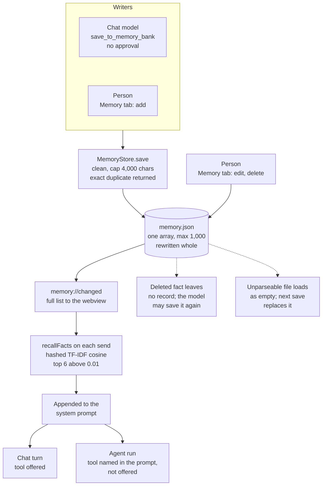

## 1. Executive Summary

Studio for Janas is a Tauri desktop client for the Janas-LLM inference engine
and llama.cpp, with chat, an agent mode and MCP tools. Its memory is one JSON
file of one-line facts that the chat model writes through a tool. What is
notable is how little there is: two source files, no second model call and no
database. What is weak is that a model write needs no approval, in the same
turns that carry fetched web pages and tool output.

Recall runs in the webview on every send. The user's message and each fact
become hashed bag-of-words vectors with TF-IDF weights, and up to six facts
above a cosine of 0.01 are appended to the system prompt. The tokenizer keeps
ASCII letters and digits only, so a fact written in another script is stored
and never recalled.

A person can add, edit and delete facts in a Memory tab. The model can only
add. A deleted fact leaves no record, and nothing stops the model saving it
again.

The store is durable against a crash during a write and not against a bad
file: a `memory.json` that fails to parse loads as an empty bank, and the next
save replaces it. The chat store beside it keeps a previous version of each
chat; the memory bank keeps none.

The licence is GPL-3.0-only.

No mark is earned. Section 9 gives the reason for each of the seven.

## 2. Mental Model

A memory is **one line of text the model decided was worth keeping**. The
record is an id, the text, a creation time and a source of `user` or `model`
(`src-tauri/src/memory.rs:25-32`).

A fact becomes a belief the moment it is written. The system prompt tells the
model to call `save_to_memory_bank` *"proactively, without asking permission"*
(`src/lib/prompts.ts:13`), and the streaming loop executes the call directly
(`src-tauri/src/engine.rs:1729-1758`). There is no candidate state and no
confirmation. On the next send the fact is eligible for recall.

A fact stops being a belief in one way: a person deletes or rewrites it in the
Memory tab. The row is filtered out of the array and the file is rewritten
(`src-tauri/src/memory.rs:148-160`). The model has no verb for either.

The source field records who wrote the fact and plays no further part. No read
path, in Rust or in the webview, consults it.

## 3. Architecture

Everything runs in one desktop process. The Rust side owns the file: at
startup `MemoryStore::load` reads `memory.json` from the app data directory
into a vector behind an `RwLock` (`src-tauri/src/main.rs:383`,
`src-tauri/src/memory.rs:47-56`). Five Tauri commands expose list, save,
update, delete and clear (`src-tauri/src/main.rs:170-220`, registered at
`:452-456`).

The webview owns retrieval. `useMemory` loads the list, subscribes to a
`memory://changed` event that carries the full list after every change, and
`recallFacts` ranks it in TypeScript (`src/lib/memory.ts:64-85`, `:140-147`).
No embedding model, vector index or sidecar is involved.

The inference engine is a separate local process, `janas-server` or a
llama.cpp server, reached over an OpenAI-compatible stream. It is downloaded at
setup and is not in the tree.

### Deployment and ergonomics

There is nothing to stand up beyond the app. The bank is a human-readable JSON
array that can be opened in an editor. It has no export, import or backup of
its own, and the chat store's backup file does not include it:
`src-tauri/src/chat_store.rs` does not reference the memory bank.

## 4. Essential Implementation Paths

- **Record and store.** `src-tauri/src/memory.rs`: `MemoryFact` `:25-32`, caps
  `:22-23`, `save` `:65-112`, `update` `:114-146`, `delete` `:148-160`, `clear`
  `:162-170`, `persist` `:172-182`, load-time cleaning `:194-220`.
- **Model write.** `src-tauri/src/engine.rs`: the tool definition
  `:1669-1690`, the bounded loop `:599-615` and `:791-812`, the handler
  `:1729-1758`, the bounds `:1101-1102`.
- **Person write.** `src-tauri/src/main.rs:170-220` and the Memory tab,
  `src/components/chat/SessionsRail.tsx:394-520`.
- **Recall.** `src/lib/memory.ts:18-85`, called from
  `src/components/chat/ChatView.tsx:464-472`.
- **Instruction to the model.** `src/lib/prompts.ts:12-15`.
- **Agent mode.** `src/components/chat/ChatView.tsx:543-552`,
  `src/hooks/useChat.ts:1183-1188`, `src-tauri/src/agent.rs:2501-2509`.

## 5. Memory Data Model

One type, four fields:

| Field | Written by | Read by |
| --- | --- | --- |
| `id` | `save`, a UUID | update and delete by id |
| `text` | `save`, `update` | recall, the Memory tab |
| `created_at` | `save` | nothing |
| `source` | `save`: `user` from the command, `model` from the tool | nothing |

`update` replaces the text and keeps the other three fields
(`src-tauri/src/memory.rs:140-143`), so a model-written fact a person has
rewritten still says `model`.

Text is cleaned on the way in: control characters are dropped and all
whitespace, newlines included, collapses to single spaces (`:185-192`). A fact
is therefore one line. The limits are 4,000 characters per fact and 1,000
facts (`:22-23`). A full bank refuses the save with a message asking for a
stale fact to be deleted (`:91-95`); nothing evicts.

New facts go to the front of the array (`:104`), which is the order the Memory
tab shows.

Two other things in the app are called memory and are outside this model. Agent
mode compacts older steps of a run into an `<agent_memory>` message
(`src-tauri/src/agent.rs:2372-2404`); that is context-window management inside
one run. Chat history is a per-chat JSON store with previous-version backups.

## 6. Retrieval Mechanics

Recall is one function over the whole bank, run in the webview each time
options are built for a send (`src/components/chat/ChatView.tsx:464`).

1. **Tokenize.** Lower-case, replace every run of characters outside
   `a-z0-9_./-` with a space, and drop one-character tokens
   (`src/lib/memory.ts:18-24`).
2. **Weight.** An IDF table is built from the facts alone. A query token no
   fact contains gets weight 1 (`:49-62`, `:36`).
3. **Embed.** Each token is hashed with FNV-1a into one of 512 slots and adds
   its IDF, times 1.4 when longer than five characters. The vector is
   normalised (`:26-47`).
4. **Rank.** Cosine against every fact, sorted, cut at a score above 0.01 and
   at six facts (`:72-84`).

The query is the text of the message being sent. A regenerate uses the
preceding message's content and an edit uses the edited text
(`src/components/chat/ChatView.tsx:597`, `:612`). Earlier turns do not enter
the query.

The block is appended after the fixed prompt and the user's own system prompt
under the heading *"Facts you remember about this project. Use them when
relevant, and ignore any that no longer apply"* (`:465-472`). Facts are
included in full. The context fitter trims history and never the system
prompt; when the system prompt and the message together exceed the budget it
refuses the send with an error (`src/lib/contextBudget.ts:155-170`).

Three properties follow from the code and were not measured:

- **Scripts other than ASCII are invisible.** Accented letters, Cyrillic and
  CJK characters are separators in step 1. A fact with no ASCII token of two or
  more characters embeds to the zero vector and scores 0 against every query.
- **The threshold admits almost any overlap.** There is no stop-word list, so
  one shared common word gives a positive cosine. Six slots fill on shared
  function words when nothing better matches.
- **Vectors are recomputed on every send.** All facts are re-embedded per
  call; at the 1,000-fact cap that is 1,000 passes over 512 floats in the UI
  thread.

## 7. Write Mechanics

**The model's write.** Every chat completion request carries the
`save_to_memory_bank` tool first in its tool list, ahead of any MCP tools
(`src-tauri/src/engine.rs:612`, `:1669-1690`). When the stream ends with tool
calls, `run_tools` takes up to eight, parses each argument object, and for this
tool calls `tool_result_json`, which saves with source `model`
(`:1706`, `:1729-1758`, `src-tauri/src/memory.rs:225-238`). A new fact emits
`memory://changed`. The result goes back to the model as a tool message, the
loop runs another completion, and it stops after six tool rounds
(`src-tauri/src/engine.rs:1101-1102`).

An MCP tool call in the same loop pauses for the user's approval unless its
server is set to auto-approve (`:1759-1775`). The memory save has no such
pause.

**The person's write.** The Memory tab's input calls the `save_to_memory_bank`
command, which saves with source `user` (`src-tauri/src/main.rs:178-190`).

**Duplicates.** `save` returns the existing fact when the cleaned text matches
one already stored, compared with `eq_ignore_ascii_case` (`:82-90`). A
paraphrase is a new fact. The prompt asks the model not to save what is
already in the memory context, and that context holds at most six recalled
facts.

**Persistence.** Every change clones the vector, serialises it to
`memory.json.tmp`, renames it over the file and only then swaps the in-memory
copy (`:103-106`, `:172-182`). The temporary file is not synced before the
rename.

### Operational cost

A write blocks the turn for one file rewrite and costs one extra completion,
because the model must be called again after its tool result. A saved fact is
retrievable on the next send. There is no background pass of any kind.

## 8. Agent Integration

The only integration is the app's own chat loop. There is no MCP server, HTTP
route or CLI for the bank.

**Chat mode** sends the fixed prompt, the user's prompt and the recalled block
as the system message, and offers the tool.

**Agent mode** sends the same combined text as *additional user instructions*,
clipped to 8,000 characters (`src/components/chat/ChatView.tsx:543-552`,
`src-tauri/src/agent.rs:2501-2509`). That text includes the paragraph telling
the model it has a `save_to_memory_bank` tool. The agent's tool set does not
contain it: `src-tauri/src/agent.rs` and `src-tauri/src/agent/` have no
occurrence of the name, and an unrecognised tool name returns
`Unknown tool` to the model (`src-tauri/src/agent.rs:3343`). An agent run
reads memory and cannot write it.

Because the block sits in the system message and changes with each query, the
first message of the request differs from turn to turn whenever the recalled
set differs. A local engine that reuses a cached prefix has to re-evaluate the
conversation from the top on those turns.

## 9. Reliability, Safety, and Trust

### A write no one approves, beside untrusted text

The turn that offers the save tool can also carry fetched web pages and MCP
tool results. The fixed prompt tells the model to treat tool output as data
(`src/lib/prompts.ts:19`). That is a request to the model. Nothing in code
separates a fact the user stated from one a page asked the model to remember,
and both are stored with source `model`. A stored fact then enters the system
prompt of later chats, including agent runs that hold file and shell tools.

### An unreadable file becomes an empty bank

`load` maps a read error or a parse error to an empty vector
(`src-tauri/src/memory.rs:48-51`). The interface then shows no facts, and the
first save writes a one-fact array over the old file. The chat store keeps the
previous on-disk version before replacing a chat
(`src-tauri/src/chat_store.rs:148-151`); the bank has no equivalent.

### Deletion is complete and does not hold

Delete removes the element and rewrites the file, so the text is gone from the
store. Nothing records that it was rejected. If the same statement comes up
again in conversation the model is instructed to save it, and the duplicate
check compares only against facts still present.

### A control that changes nothing

The engine panel has a *Cache eviction* select, LRU or LFU, captioned
*"Eviction applies to the studio's local memory index (recalled facts)"*
(`src/components/chat/EnginePanel.tsx:464-480`). The preference is declared
with a default and never read (`src/hooks/useEnginePreferences.ts:16`,
`src/types.ts:466`). The bank has no eviction; a full bank refuses writes.

The `clear` path is the same shape in reverse: the store method, the command
and the hook exist (`src/lib/memory.ts:204-212`), and no component calls it.

### Marks

- **`human_review` — withheld.** The Memory tab lets a person rewrite or
  delete a fact after it has been stored and used. No fact waits in a state for
  a person. Editing after the fact is authoring.
- **`trust_state` — withheld.** `source` is the only candidate. It has two
  values, one writer each, and no reader.
- **`tombstone` — withheld.** A deleted fact leaves no value-keyed record.
- **`scope_enforced` — withheld.** The record has no scope field. Chats carry a
  workspace root and an MCP server scope, and neither file of the bank reads
  them.
- **`audit_log` — withheld.** A change rewrites the file; no event is appended
  anywhere.
- **`bitemporal` — withheld.** `created_at` is the only time, and nothing
  reads it.
- **`negative_eval` — withheld.** No test calls `recallFacts`.

## 10. Tests, Evals, and Benchmarks

I ran none of the suites. The counts are from reading.

The bank's Rust tests are four, in `src-tauri/src/memory.rs:253-300`: save,
case-insensitive duplicate and reload; update and delete; rejection of empty
text and unknown ids; and the tool result for a good and an empty fact. Each
uses a temporary file. One test in `src-tauri/src/engine.rs:2180-2193`
reassembles a streamed `save_to_memory_bank` call from fragments.

Nothing tests recall. `recallFacts` appears in its definition and its one call
site, and the two Vitest files cover chat sessions and MCP scope. Nothing
tests the load of a malformed file, the 1,000-fact cap, or the tool handler in
`run_tools`.

The agent end-to-end file and the dual-engine harness do not mention the bank.
There is no CI workflow in the tree, no benchmark and no paper reference.

## 11. For Your Own Build

### Steal

- **Return tool errors as tool results.** A malformed argument, an empty fact
  or a full bank comes back to the model as `{"ok": false, "error": …}` and
  the stream continues (`src-tauri/src/memory.rs:222-238`,
  `src-tauri/src/engine.rs:1754-1757`).
- **Swap the in-memory copy after the file is written.** `save`, `update` and
  `delete` build the next vector, persist it, then assign it, so a failed write
  leaves memory and disk agreeing.
- **Broadcast the whole list on change.** At this size, sending the full array
  on one event removes any need to reconcile the interface with the store.

### Avoid

- **Treating a parse failure as an empty store.** Move the unreadable file
  aside and say so before accepting a write.
- **An unapproved write in a turn that reads untrusted text.** The same loop
  already has an approval gate for MCP tools.
- **A tokenizer that defines words as ASCII.** It decides which users have
  recall at all.
- **Telling the model about a tool the current mode does not offer.**
- **A setting whose caption names a mechanism that does not exist.**

### Fit

This suits a single person on one machine who wants a chat client to remember
a few dozen preferences and is willing to prune the list by hand. The whole
design is two files a reader can hold in their head, and that is its value as
a reference: it is close to the minimum that persists, recalls and can be
corrected.

It does not suit anyone who lets the model browse or call tools against
content they do not control, who writes in a non-Latin script, or who needs a
forgotten fact to stay forgotten. Each of those needs a mechanism this design
has no place for: a write gate, a different tokenizer, a record of
rejection.

## 12. Open Questions

- Whether small local models call the save tool on injected text in practice.
  The code permits it; no test or transcript in the tree shows it either way.
- How often the 0.01 threshold fills the block with facts that share only
  common words. A recall test with a populated bank would settle it.
- Whether the eviction preference and the uncalled `clear` are remnants or
  work not yet wired. The changelog does not mention either.

## Appendix: File Index

| Path | Role |
| --- | --- |
| `src-tauri/src/memory.rs` | The record, the store, the tool result, four tests |
| `src/lib/memory.ts` | Tokenizer, hashed TF-IDF recall, the `useMemory` hook, a one-time migration from `localStorage` |
| `src-tauri/src/engine.rs` | Tool definition, bounded tool loop, the save handler |
| `src-tauri/src/main.rs` | Load at startup, five commands |
| `src/lib/prompts.ts` | The fixed prompt naming the tool |
| `src/components/chat/ChatView.tsx` | Recall call and prompt assembly |
| `src/components/chat/SessionsRail.tsx` | The Memory tab |
| `src/components/chat/EnginePanel.tsx` | The eviction select |
| `src-tauri/src/agent.rs` | Agent prompt assembly, run compaction |
| `src/lib/contextBudget.ts` | Context fitting |

### Recorded searches

Run from the repository root at the pinned commit with `/usr/bin/git grep`.

- **Agent mode has no memory tool.**
  `git grep -n -E 'save_to_memory_bank|MemoryStore' -- src-tauri/src/agent.rs src-tauri/src/agent`
  returns nothing; the same pattern matches `src-tauri/src/engine.rs:1673`.
- **One caller of recall.** `git grep -n 'recallFacts' -- .` returns the
  import and call in `src/components/chat/ChatView.tsx:26` and `:464` and the
  definition at `src/lib/memory.ts:64`.
- **The eviction preference is not read.**
  `git grep -n 'eviction' -- src src-tauri` returns the select in
  `src/components/chat/EnginePanel.tsx:467` and `:469`, the default in
  `src/hooks/useEnginePreferences.ts:16` and the type in `src/types.ts:466`.
- **No component clears the bank.**
  `git grep -n -E 'memoryClear|memory\.clear' -- src` returns
  `src/lib/api.ts:171` and `src/lib/memory.ts:206`.
- **Nothing reads the source field.**
  `git grep -n -E '\.source' -- src/lib/memory.ts src/components/chat/SessionsRail.tsx src/components/chat/ChatView.tsx`
  returns nothing; `git grep -n 'source' -- src-tauri/src/memory.rs` matches
  the field at `:31`, the `save` parameter and its assignment at `:65` and
  `:101`, and the load-time copy at `:215`.
- **No rejection record.**
  `git grep -n -i -E 'tombstone|forgotten|blocklist|rejected' -- src-tauri/src/memory.rs src/lib/memory.ts`
  returns nothing; `git grep -n -i 'forget' -- src/components/chat/SessionsRail.tsx`
  matches the delete button's label.
- **No scope key in the bank.**
  `git grep -n -E 'workspace|session_id|chat_id|conversation' -- src-tauri/src/memory.rs src/lib/memory.ts`
  returns nothing; `git grep -n 'workspace' -- src/hooks/useChat.ts` matches.
- **Tests and harnesses do not touch the bank.**
  `git grep -n -i 'memory' -- src-tauri/src/agent/e2e.rs src-tauri/src/dual_engine_harness.rs src-tauri/harness src/lib/chatSessions.test.ts src/lib/mcpScope.test.ts`
  returns nothing.
- **The chat store does not include the bank.**
  `git grep -n -i 'memory' -- src-tauri/src/chat_store.rs` returns one comment
  at `:22` about process memory.
- **No CI workflow.** `git ls-files .github` returns nothing.
- **No paper reference.**
  `git grep -n -i -E 'arxiv|bibtex|@article|@misc|doi\.org|zenodo' -- . ':!package-lock.json' ':!src-tauri/Cargo.lock'`
  returns nothing; `git grep -n -i 'citation' -- README.md` matches two lines
  about web citations.

## History

**2026-11-24** — [`af1c8a9f29debc0d1cb53c7791b454057e111267`](https://github.com/adonaiongaia/Studio-for-Janas/commit/af1c8a9f29debc0d1cb53c7791b454057e111267). First reading, from a full clone at the head of `main`. Screened first: no auto-run surface, both manifests and both lockfiles inside the seven-day cooldown, one `build.rs`, and floating ranges in `package.json` under a lockfile. Prompts and docs were read as data. Nothing was installed, built or run. No mark is earned ([section 9](#9-reliability-safety-and-trust)). A model save needs no approval, an unparseable `memory.json` loads as empty, and recall tokenizes ASCII only.
