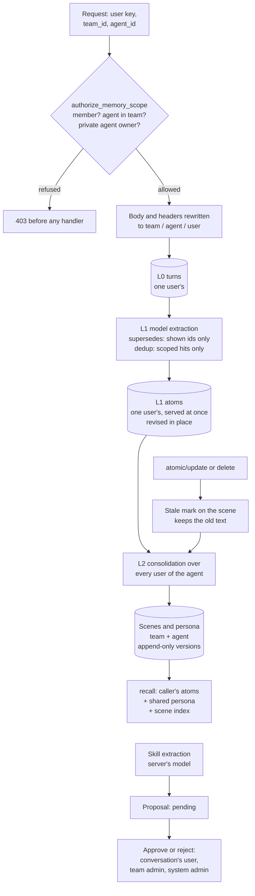

## 1. Executive Summary

TeamAgentMemory, which calls itself AgentMemory, is a self-hosted Rust
server that gives a team's coding agents one long-term memory. It captures
each conversation, has a model distil it into facts, scenes and a persona in
the background, and injects what is relevant before every prompt. What is
notable is the authorization layer: one middleware turns a user key into a
resolved team, agent and user, and every read filters on that triple in SQL.
What is weak is correction: a revised fact overwrites its row, no record of
memory mutations is kept, and a deleted fact's text stays in the scene
history it was distilled into.

The layered design and much of the API (`atomic/update`, `scenario/write`,
`core/write`, `recall`) follow
[TencentDB Agent Memory](../tencentdb-agent-memory/), which the README
credits as the source of the ideas while stating that no code is taken from
it (`README.md:330`). Two differences matter. A caller here cannot assert its
own scope, which there it could. And the append-only mutation journal that
earns the TencentDB report its `audit_log` mark has no counterpart in this
tree.

Departments are separate databases. Inside one, conversations and facts
belong to one user, while scenes and the persona belong to the agent and are
shared by every member who uses it. The README states the trade-off: a shared
agent's scenes and persona *"mix everyone's facts"*.

**Licence.** The licence changed twice in sixteen days, and six released tags
keep a use-restricted one. Commit `5817f65` (21 October 2026) moved the server
from MIT to BSL 1.1, whose Additional Use Grant limits an organisation's
production use to *"no more than one (1) Department and no more than ten (10)
Members"*. Commit `56f7c7d` (4 November 2026) relicensed it from 0.5.3 under
Apache-2.0. A reader who checks out any tag from `v0.4.0` to `v0.5.2` gets the
BSL text, and `COMMERCIAL.md` says the shipped text is what counts. At this
pin the tree agrees with itself: `LICENSE`, `NOTICE` and `Cargo.toml` say
Apache-2.0, and `crates/memory-client/` and `clients/` each carry an MIT
`LICENSE`.

Three marks are earned: `scope_enforced` and `negative_eval` on the data
plane, and `human_review` on extracted skill changes. Section 9 gives the
reason for each of the four withheld.

## 2. Mental Model

A memory starts as a **conversation turn (L0)**, stored verbatim after
client-side and server-side secret redaction. It becomes a **belief** when the
L1 pass has a model extract an atom from it: a short fact typed `episodic`,
`persona` or `instruction`, with a priority and the ids of the messages it
came from. An atom is served by recall as soon as it is stored. Nothing marks
it as provisional.

Atoms feed two shared layers per team and agent. **Scenes (L2)** are up to 15
Markdown documents a model maintains from new atoms, each recording which
atoms it was built from. The **persona (L3)** is a model summary of the
scenes. Both are append-only versions, and recall injects the persona and an
index of the scenes.

An atom stops being what it was in four ways:

- **A later turn supersedes it.** Extraction is shown the session's ten
  newest episodic atoms and may name some as out of date; the new text
  replaces the old in place and the version increments
  (`crates/memory-application/src/pipeline/l1.rs:215-219`, `:364-414`).
- **Deduplication merges it.** A model compares new atoms with up to five
  scoped hybrid hits each and answers store, update, merge or skip; a merge
  rewrites the first target and deletes the rest (`:302-361`).
- **A person edits or deletes it** through `atomic/update` or
  `atomic/delete`.
- **Its agent is archived**, which clears every layer for every user
  (`crates/memory-application/src/meta/agents.rs:247-263`).

When an atom placed in a scene is rewritten or deleted, the scene is marked
stale and the mark keeps the old text, so the next L2 run is told what to
remove. Until then the scene keeps serving it. Old scene versions keep it
for good.

Skills take a separate path. With `require_approval` on, the default, a
model's proposed skill change waits as a `Pending` proposal until a person
applies or rejects it, and expires after 30 days.

## 3. Architecture

Six crates in a layered workspace: `memory-domain` (policies),
`memory-application` (use cases and ports), `memory-infrastructure` (SQLite,
Postgres, Redis, the OpenAI-compatible and CLI model clients),
`memory-gateway` (the axum `/v3` API), `memory-server` (configuration and
wiring) and `memory-client` (the `amem` CLI and its redaction crate).
`panel/` is a Hono backend with a React front end.

**Persistence.** SQLite is the default: `<data_dir>/departments/<id>/memory.db`,
one file per department, opened lazily through an LRU pool
(`crates/memory-infrastructure/src/sqlite/db.rs:92-161`). FTS5 indexes
conversations, atoms and skills over CJK bigrams and Latin words; sqlite-vec
indexes atom embeddings when it loads. PostgreSQL is the scale-out option:
one schema per department, named from a hash of its id, with `tsvector`
columns and a pgvector HNSW index
(`crates/memory-infrastructure/src/postgres/db.rs:1-10`). Redis is optional
and holds the job queue, locks and pipeline state.

**Background work** runs in the server process: L1, L2 and L3 jobs, an
embedding backfill for atoms stored without a vector, skill extraction, a
dead-letter sweeper and proposal expiry. A failed job retries and then
dead-letters; the Panel lists dead letters and a system admin can redrive
them.

**Model calls** go to any OpenAI-compatible endpoint, or to a local CLI
(`claude`, `codex`, `agy`) run as a subprocess. The core image bundles the
`claude` and `agy` CLIs.

### Deployment and ergonomics

`./install.sh` asks for a storage backend, a coordination backend, a model
and an exposure mode, writes `.env` with mode 600, starts Docker Compose and
creates the first admin. The minimum is one container with SQLite and a
model endpoint. Embeddings are optional; without them recall is keyword
only. A model is required for anything past L0: without one, turns are
stored and nothing is distilled.

The SQLite files can be inspected by hand. The server refuses to bind a
non-loopback address without `AGENT_MEMORY_API_KEY`
(`crates/memory-server/src/config.rs:846-850`). On loopback with no key, the
operator routes, `department/destroy` among them, are open to any local
process (`crates/memory-gateway/src/router.rs:26-56`).

## 4. Essential Implementation Paths

- **Authorization.** `crates/memory-gateway/src/authz.rs:81-151`
  (`authorize`), `crates/memory-domain/src/meta/memory_access.rs:48-98`
  (`authorize_memory_scope`) and `:108-141` (`authorize_proposal_review`);
  the trust zones in `crates/memory-gateway/src/router.rs:338-413`.
- **Capture.** `crates/memory-gateway/src/handlers/memory.rs:106`
  (`conversation_add`) and `:650` (`session_add`); the client side in
  `crates/memory-client/src/capture.rs` and `hooks.rs:350-426`.
- **L1.** `crates/memory-application/src/pipeline/l1.rs`: `extract`
  `:117-165`, `to_atoms` `:190-238`, `reconcile_and_store` `:242-298`,
  `dedup` `:302-361`, `merge_into_targets` `:364-414`, `store` `:418`.
- **L2 and L3.** `crates/memory-application/src/pipeline/l2.rs` and `l3.rs`;
  scene-atom links and stale marks in
  `crates/memory-infrastructure/src/sqlite/scene_links.rs`.
- **Storage.** Schema in
  `crates/memory-infrastructure/src/sqlite/schema.rs:10-125`; reads and
  writes in `sqlite/memory_store.rs` (`atom_where` `:380`, `upsert_filtered`
  `:411-470`, `keyword_search` `:540`, `vector_search` `:576`, `knn_search`
  `:724`, `delete_atoms` `:799`); the Postgres equivalents beside them.
- **Recall.** `crates/memory-application/src/memory/recall.rs:96-191`,
  `search.rs:38-82` (hybrid and fallback), RRF in
  `crates/memory-domain/src/retrieval.rs:41`.
- **Skills.** `crates/memory-application/src/skill/service.rs` (CRUD;
  visibility at `:445-473`) and `skill/extraction.rs` (proposals at
  `:530-559`, `decide` at `:682-757`).

## 5. Memory Data Model

The department database holds the memory tables
(`crates/memory-infrastructure/src/sqlite/schema.rs:10-82`):

- `conversations`: id, `team_id`, `agent_id`, `user_id`, `task_id`,
  `session_id`, role, content, `timestamp_ms` (the client's) and
  `recorded_at_ms` (the server's), version.
- `atoms`: the same four scope columns, `atom_type`, content, `background`
  (the scene name extraction gave it), priority, `source_ids`, version,
  `created_at_ms`, `updated_at_ms` and an embedding. No status column.
- `scenes` and `scene_versions`: one row per scene keyed on team and agent,
  and one row per version with `op` (`create`, `update`, `merge`, `retire`),
  slug, summary, heat, body, parents and author. `persona_versions` has the
  same shape for L3.
- `scene_atoms`: which atom each scene version holds, with the atom's user
  and a state; at most one current scene per atom.
- `scene_stale`: why a scene may be out of date, with the atom, a reason, the
  atom's text before the change and an attempt count.

Beside them sit the metadata tables (users, digested keys, teams, members,
agents with an owner and a `visibility`), the skills tables with a head flag
and one row per version, the skill extraction tasks that carry proposals in
their `candidates` document, `generation_logs` with the ids each pipeline run
read and wrote, and redaction rules.

**Scope.** Every L0 and L1 row carries team, agent and user; scenes, persona
and skills carry team and agent. `task_id` is stored and filterable and is
not an isolation boundary (`crates/memory-domain/src/scope.rs:53-61`).

**Time.** `conversations` keeps the client's message time beside the
server's record time. Atoms keep creation and update times only, and a
revision replaces the row (`INSERT OR REPLACE`,
`crates/memory-infrastructure/src/sqlite/memory_store.rs:435-454`), so the
version number is the only trace of an atom's history outside a stale mark.

## 6. Retrieval Mechanics

`recall` strips any block an earlier recall injected from the query, then
runs the configured strategy over the caller's atoms
(`crates/memory-application/src/memory/recall.rs:110-148`).

**Hybrid** is the default. FTS5 BM25 (`ts_rank_cd` on Postgres) and vector
search each return three times the limit, keyword scores are normalised to
the best hit, and the two lists are fused by reciprocal rank with k = 60
(`search.rs:38-82`, `:120-146`). Without an embedder, or when embedding
fails, the mode degrades to keyword only. sqlite-vec applies the scope inside
the KNN scan and the join back to `atoms` re-checks it, so nearer neighbours
from another scope cannot crowd out the caller's (`memory_store.rs:720-757`).

**The score threshold does not apply to hybrid results.** The comment reads
*"Hybrid ranks are already a consensus"*, and the code returns the top
results whatever their score; a corpus no larger than the limit returns
everything (`recall.rs:174-189`). Every prompt therefore receives up to five
atoms, related or not.

The result has two blocks. Atoms go into `<relevant-memories>`, prepended to
the user turn. The persona and a scene index (filename, summary, heat,
update time) go into `<user-persona>` and `<scene-navigation>`, appended to
the system context, each with a note that it is data and not instructions.
Any `<` in stored text that could open a tag is escaped at output, including
one followed by zero-width or bidi characters (`:219-235`).

Per-memory and total character caps exist and default to 0, which means
unbounded (`crates/memory-server/src/config.rs:419-430`). The Claude Code
hook trims to 9,500 characters for the host's limit and sends the
system-context block every 20 prompts by default.

## 7. Write Mechanics

**Capture.** At Stop, the `amem` hooks read the host's transcript, redact
secrets on the client, and post new turns to `conversation/add` and
tool-heavy turns to `skill/conversation/add`. When the server is unreachable
the turns wait in a local queue. The server redacts again under the rules
for every team, the team and the user before storing.

**L1 extraction.** A new session runs L1 after 1, 2 and 4 rounds, then every
5, or after 600 seconds idle. The model sees the new messages, the previous
scene name and the session's newest episodic atoms, and returns memories
grouped by scene. A memory below its type's minimum priority is dropped, and
at most 20 are kept per run.

**Two places where model output names existing rows, and both are fenced.**
A `supersedes` id is kept only if it was among the atoms the model was shown
(`l1.rs:215-219`). A dedup target id is kept only if it was among the scoped
candidates (`:352-357`). `merge_into_targets` loads each target by id with no
scope check (`:373`), so those two filters are what keeps an invented id from
rewriting another user's atom.

**L2 and L3.** L2 waits 90 seconds after L1 and at least 900 seconds since its
last run, with a sweep every 3,600 seconds. It is given the new atoms, up to
ten stale scenes and the current scene list, and returns operations. It may
create one scene per run, up to 15 in all, and an operation whose body is
empty or `[DELETED]` is skipped (`l2.rs:359-365`). L3 regenerates the persona
on a cold start, every 50 new memories, or when L2 asks.

**API writes.** A member may update or delete their own atoms, delete their
own conversations, and write the agent's scenes and persona. Each write is
redacted.

### Operational cost

The agent never blocks on a model: capture is an HTTP post, and extraction
runs in a job. A fact is retrievable once its L1 job completes, which is
within one round of the threshold or ten minutes after a session goes idle,
plus model latency. L2 lags L1 by at least 90 seconds. No pass rereads the
whole store: L2 works from new atoms and stale marks, and the embedding
backfill reads only atoms missing a vector. Recall adds one embedding call
per prompt when vectors are on.

## 8. Agent Integration

The agent's reach is deliberately small. Hooks recall on each prompt and
capture at Stop for Claude Code, Codex and Antigravity. The `amem mcp`
server exposes one tool, `memory_recall`
(`crates/memory-client/src/mcp.rs:15-29`), and the Hermes provider one,
`agentmemory_search`. No shipped client writes a memory directly, reads a
skill or touches a proposal; skills are reached over HTTP and through the
Panel.

The client holds the user key, department, team and agent in its config or,
for the MCP server, in environment variables
(`clients/claude-code/.mcp.json`). The user id is never sent: the server
derives it from the key.

## 9. Reliability, Safety, and Trust

### Scope is decided once, before the handler

`require_user` reads the body, takes the requested team, agent and user from
it or from headers, and calls `authorize_memory_scope` with the caller loaded
from the key (`crates/memory-gateway/src/authz.rs:81-121`). The policy refuses
an agent outside the team, even for a system admin, then a non-member or
removed member, an archived agent, and another member's private agent unless
the caller is a team admin. `user_id` defaults to the caller, and a member
naming anyone else is refused (`memory_access.rs:53-98`). The middleware then
writes the resolved values back into the body and the `x-memory-*` headers,
so a handler reading either sees only the authorized scope
(`authz.rs:123-144`).

Three limits:

- **System admins skip the membership and role checks**, and may read or
  write any user's conversations and facts by naming them. The
  collaboration guide says so.
- **Read and write are classified and not used.** `action_for` sorts paths by
  suffix, and `role_allows` returns `on_self` for every role and action
  (`memory_access.rs:37-39`). Any member who may read an agent's shared
  persona may also overwrite it through `core/write`. The Panel's admin-only
  list is the Panel's own rule; Core accepts the call.
- **The shared layers are a designed leak.** L2 reads every user's atoms for
  the agent and writes scenes every member reads. `scene_atom_view` hides
  other users' atoms and counts them.

`stats/overview` returns department-wide counts to any member
(`crates/memory-gateway/src/handlers/ops.rs:310-320`). It carries no content.

### Correction leaves text behind

A deletion reaches the derived layer by marking. `delete_atoms` copies each
doomed atom's text, redacted under the current rules, into a `scene_stale`
row before it deletes the atom (`memory_store.rs:799-845`). The next L2 run is
shown the mark and rewrites the scene. The design propagates a delete that a
consolidation pass could not otherwise see, and it has two costs.

Until L2 runs, the scene body still states the deleted fact and is served.
After it runs, earlier `scene_versions` rows still hold it, and nothing
deletes a scene version short of clearing the whole agent. A mark L2 fails to
clear within its attempts stays for a person, and recall serves the scene in
the meantime, since `scene_heads` filters on `op <> 'retire'` and nothing
else.

### Marks

- **`scope_enforced` — earned.** Team, agent and user are stored on every L0
  and L1 row and applied in SQL on keyword, vector and KNN reads, resolved
  from the key.
- **`negative_eval` — earned.** Three committed tests require another
  scope's rows to be absent from a populated result, two of them with exact
  lists.
- **`human_review` — earned, on skills.** The server's model proposes; a
  person authenticated by key decides; `decided_by` is set from that key; the
  agent's declared tools carry no verb; and the skill routes serve only what
  was applied. The conversation's own user may approve alone, so one member's
  procedure can enter a team-wide skill list on that member's word, and the
  key that approves sits in the agent's environment.
- **`audit_log` — withheld.** The audit table records refused credentials,
  lockouts and keys issued outside the Panel
  (`crates/memory-application/src/ports/audit.rs:15-22`). Memory mutations
  have no record: atoms are replaced in place, a delete leaves only a stale
  mark, and `generation_logs` names the ids a pipeline run touched, not API
  edits or what changed. Scene and persona versions are a history of the
  object.
- **`trust_state` — withheld.** Atoms carry no status. Proposal states live
  on a queue item, not on a served memory, and stale marks withhold nothing.
- **`tombstone` — withheld.** Nothing is keyed on a rejected value. A stale
  mark keeps the deleted text and is cleared when L2 resolves it; a rejected
  proposal is keyed on its task and index, so the same change can be
  proposed again.
- **`bitemporal` — withheld.** The client's message time and the server's
  record time sit on L0 turns; atoms, the beliefs, have record times only.

## 10. Tests, Evals, and Benchmarks

I ran none of the suites. The counts are from reading.

The end-to-end suite spawns the server with a fake model endpoint and drives
it over HTTP: distillation through every layer, scene versions across merges,
escaping in recall, the private-agent rule, redaction on every write path,
skill proposals, department destruction, dead letters, supersession and
credential throttling. `a_private_agent_is_its_owners` checks that eight
routes refuse a second member, and that the owner's skill id is absent from
that member's list and search while a team admin's list contains it
(`crates/memory-server/tests/e2e.rs:606-771`).
`other_users_cannot_read_or_change_foreign_data` checks that a non-member
gets 403 on recall and skill reads (`:2358-2428`).

The store tests carry the two exact negatives.
`other_scopes_are_never_returned_even_when_nearer` inserts 120 nearer vectors
in three foreign scopes and requires the result to be `["alice-2", "alice-1"]`
(`crates/memory-infrastructure/tests/sqlite_vec.rs:150-201`); its guard
asserts that sqlite-vec loaded rather than skipping. The conversation test
stores one sentence for alice and for bob and requires one hit, `m1`
(`sqlite_stores.rs:75-118`).

The Postgres and Redis suites, and two end-to-end cases, return early with
`eprintln!("skipping: ...")` when their URL is unset. `ci.yml` starts both
services and sets both URLs, so they run in CI and pass without asserting
anything on a machine that has neither.

There is no retrieval-quality evaluation, no benchmark and no paper
reference in the tree. Tests worth adding: a deleted atom absent from recall
and from its scene after L2; a scene or persona write by a member who is not
the owner of a shared agent; a supersedes or dedup id from another scope
being dropped.

## 11. For Your Own Build

### Steal

- **Resolve the scope once and rewrite the request.** A middleware that
  replaces the caller's team, agent and user with the authorized ones, in the
  body and in the headers, leaves no handler able to read an unauthorized
  value.
- **Put scope inside the vector scan, then re-check it.** Filtering after an
  over-fetch loses the caller's rows when other scopes are nearer, and the
  test that proves it is cheap to write.
- **Fence every id a model returns against the ids it was shown.** Both
  supersession and dedup do it here, and the loader beneath them has no scope
  check.
- **Tell the derived layer what was removed.** A stale mark carrying the old
  text lets a consolidation pass delete a fact it cannot otherwise see.
- **Escape at output, not at storage.** Stored text stays as written, and no
  stored text can close the block it is injected in.

### Avoid

- **Revising beliefs in place with no record.** A version counter with no
  prior value cannot say what was believed before.
- **An append-only derived layer under a delete.** A scene history that keeps
  every version keeps every deleted fact that reached it.
- **A relevance threshold one mode skips.** Fusion returns ranks, and a rank
  always has a first place.
- **Computing read and write and checking neither.** Use the action or drop
  it, so the next reader does not assume it is enforced.

### Fit

This fits a team that wants coding agents to share what they learn, runs its
own model endpoint, and accepts that the shared scenes and persona carry
paraphrases of every member's facts. The authorization is the strongest part
and will stand up to a security review. The operating cost is low for what it
does: one container and SQLite to start.

It does not fit a reader who must show what the memory believed on an earlier
date, or make a fact disappear. Atoms are overwritten, deleted text survives in scene
versions, and the only audit is of credentials. A deployment where a member's
facts must not reach colleagues in any form needs one private agent per
person, which the README offers and which gives up the shared layer.

## 12. Open Questions

- Should a stale scene be withheld from recall, or flagged in the navigation,
  until L2 or a person resolves it?
- Is self-approval by the conversation's user intended for team-visible
  agents, where an approved skill reaches every member?
- Which client is meant to read skills? No shipped client calls a skill read
  route.
- Is `role_allows` meant to gain per-action rules, given that the Panel
  already treats persona and scene writes as admin-only?

## Appendix: File Index

| Path | Role |
| --- | --- |
| `crates/memory-gateway/src/authz.rs` | The data-plane authorization middleware |
| `crates/memory-domain/src/meta/memory_access.rs` | Scope and proposal-review policies |
| `crates/memory-gateway/src/router.rs` | Routes and trust zones |
| `crates/memory-infrastructure/src/sqlite/schema.rs` | Department schema |
| `crates/memory-infrastructure/src/sqlite/memory_store.rs` | L0 to L3 storage, search and delete |
| `crates/memory-infrastructure/src/sqlite/db.rs` | One database per department |
| `crates/memory-infrastructure/src/postgres/db.rs` | One schema per department |
| `crates/memory-application/src/pipeline/l1.rs` | Extraction, supersession, dedup |
| `crates/memory-application/src/pipeline/l2.rs` | Scene consolidation and stale marks |
| `crates/memory-application/src/memory/recall.rs` | Recall assembly and escaping |
| `crates/memory-application/src/memory/search.rs` | Hybrid search and fallback |
| `crates/memory-application/src/skill/extraction.rs` | Skill proposals and decisions |
| `crates/memory-application/src/audit.rs` | Credential throttling and audit |
| `crates/memory-client/src/mcp.rs` | The one-tool MCP server |
| `crates/memory-server/tests/e2e.rs` | End-to-end suite |
| `crates/memory-infrastructure/tests/sqlite_vec.rs` | KNN scope test |

### Recorded searches

Run from the repository root at the pinned commit with `git grep`.

- **The audit log records credential events only.**
  `git grep -n -E 'AuditKind::[A-Z]' -- crates ':!*tests*'` returns
  `CredentialRejected`, `SourceLocked` and `KeyIssued`, in
  `crates/memory-application/src/audit.rs` and
  `crates/memory-gateway/src/handlers/meta.rs:649`.
- **Nothing deletes a generation log.**
  `git grep -n -E 'generation_logs|generation_refs' -- crates` piped to
  `grep -i -E 'delete|truncate|drop'` returns nothing;
  `git grep -n -E 'INSERT INTO generation_logs' -- crates` matches
  `crates/memory-infrastructure/src/sqlite/pipeline_store.rs:476`.
- **Recall does not consult stale marks.**
  `git grep -n -E 'stale' -- crates/memory-application/src/memory/recall.rs`
  returns nothing; the same pattern matches 17 lines of
  `crates/memory-application/src/memory/service.rs`.
- **"Tombstone" names a skipped L2 operation.**
  `git grep -n -i 'tombstone' -- crates` returns `is_tombstone` in
  `crates/memory-domain/src/profile.rs:522`, its test, and its use at
  `crates/memory-application/src/pipeline/l2.rs:363`.
- **No shipped client reads a skill.**
  `git grep -n -E 'skill/' -- crates/memory-client clients` returns only
  `skill/conversation/add`, in `crates/memory-client/src/capture.rs`.
- **One tool per agent surface.**
  `git grep -n -E '"name": "' -- crates/memory-client/src/mcp.rs` returns
  `memory_recall` and the server name;
  `git grep -n 'agentmemory_search' -- clients/hermes` returns the Hermes
  tool.
- **The role rule ignores the action.**
  `git grep -n -A3 'fn role_allows' -- crates/memory-domain/src/meta/memory_access.rs`
  shows the body `on_self`.
- **No paper reference.**
  `git grep -n -i -E 'arxiv|bibtex|@article|@misc|doi\.org|CITATION' -- . ':!panel/package-lock.json'`
  returns nothing; `git grep -n -i 'tencentdb' -- README.md` matches line 330.

## History

**2026-11-24** — [`ef0cf52e2c39367f2ebbe1f7efc08115b2d6ff20`](https://github.com/hsuanshao/TeamAgentMemory/commit/ef0cf52e2c39367f2ebbe1f7efc08115b2d6ff20). First reading, from a full clone at the head of `main`. Screened first: five auto-run surfaces, all the Claude Code plugin — `.claude-plugin/marketplace.json`, `clients/claude-code/.claude-plugin/plugin.json`, `clients/claude-code/.mcp.json` (starts `amem mcp`) and `clients/claude-code/hooks/` with its `hooks.json` (runs `amem` on SessionStart, UserPromptSubmit and Stop); nothing inside the seven-day cooldown; no build-time execution; three unpinned panel manifests, two without a lockfile; no submodules. Docs were read as data. Nothing was installed, built or run, and the test counts were not run. Three marks: `scope_enforced`, `human_review` and `negative_eval` ([section 9](#9-reliability-safety-and-trust)).
