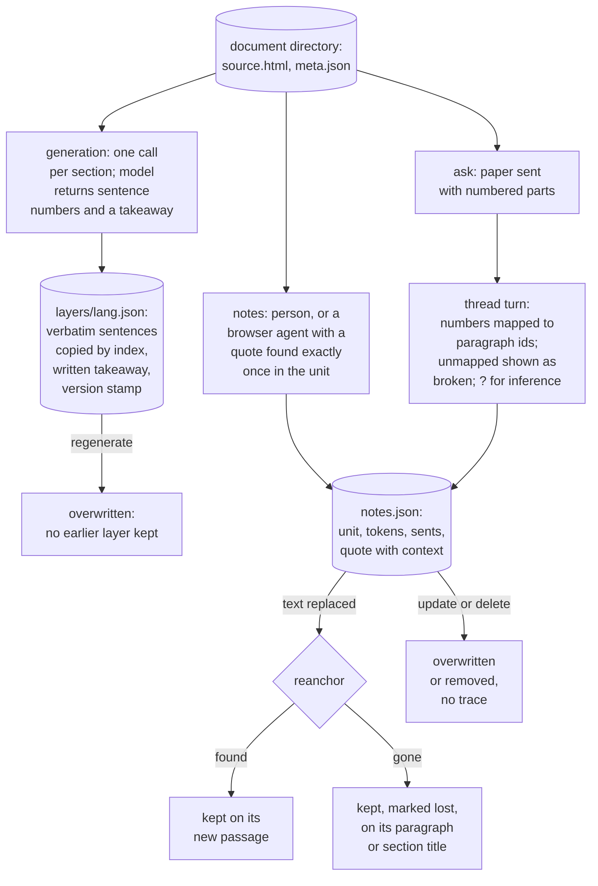

## 1. Executive Summary

TextFold is a local reader for papers, web pages, office documents and agent
replies. It shows each document at five levels, from the author's full text
to a few words, and keeps what it made beside the document. Formerly
PaperFold, it runs as a Python server with a browser UI, a desktop app and a
browser extension. Its memory is a document library: per document, the
source, the model-written levels, a reader's notes and the model's answers
to questions about it. Agents reach it two ways. `python3 -m textfold get`
serves a document by level. Fifteen WebMCP tools in the reader page let a
browser agent read the passage in view and save, edit or delete notes.

What is notable is how the design keeps model text attached to the source.
The verbatim level is copied by sentence index, answer citations are numbers
the code maps to paragraphs, and notes carry four anchors that survive an
edited text. What is weak is the other direction: corrections leave no
trace, and the agent-written web recipes have no reader.

Four findings shape the rest of this report.

- **The model chooses numbers, the code copies words.** For each paragraph
  the model returns the indices of one to three sentences as evidence
  (`textfold/ladder.py:236`), and `assemble` takes those sentences from the
  source (`:318-341`). Answers cite `[[12]]`, which `_cited` maps to a
  paragraph id or marks `[[!12]]` when it names none
  (`textfold/notes.py:345-362`).
- **A note finds its passage again or says it is lost.** On a replaced text,
  `reanchor` keeps unchanged paragraphs' notes, finds moved ones by quote and
  context, and marks the rest `lost` with where they were
  (`notes.py:410-425`). `tests/test_replace.py:217-243` walks a deletion and
  its restoration.
- **An agent's note is anchored to source words it cannot invent.** The
  WebMCP `anchor` function refuses a quote that does not occur exactly once
  in the open unit's source text (`textfold/web/webmcp.js:64-75`).
- **Correction overwrites.** A note update replaces text and anchor, a delete
  removes the record (`notes.py:106-111`), and a regenerated layer replaces
  the previous one (`textfold/store.py:305-312`).

No marks. Section 9 names each and why it is withheld.

## 2. Mental Model

There is no memory record in the agent sense. There is a document, and three
kinds of text about it, each with its own author and its own way of staying
attached to the source.

**Levels are the model's reading, fixed once made.** A model samples
differently on every run, so TextFold writes each document's ladder to
`layers/<lang>.json` and assembles the reader from it with no model call
(`store.py:1-15`). Of the five levels, Full is the source, and the verbatim
level is source sentences picked by index. Takeaway, reason and topic are
written; a topic is cut from inside the takeaway when the model's phrase
occurs there verbatim (`ladder.py:1-14`, `:680-696`). A level stops
being current when the person regenerates it, which overwrites the file
with a new `version` stamp and model id. A translation records the ladder
version it was built on and is listed as stale when that ladder changes
(`store.py:366-390`).

**Notes are the reader's, and they move with the text.** A note's anchor
holds the paragraph id, a token range, the sentence indices and a W3C-style
quote with 40 characters either side (`docs/notes-format.md`). A note made
on a written line also keeps `shown.exact`, the words as the line read then,
so the reader can tell when a refold rewrote it.

**Answers are the model's, with each claim pointed at a paragraph.** An
`ask` note holds a thread of turns, each with question, Markdown answer,
one-line takeaway, cited paragraphs, two follow-up questions, model id and
time (`notes.py:395-399`). The prompt asks the model to end a sentence that
is its own inference with `[[?]]` (`notes.py:298-299`). Nothing checks that
a cited paragraph says what the sentence claims.

## 3. Architecture

TextFold is a Python package (`textfold/`) whose `serve` command runs a
local HTTP server for a browser reader written in plain JavaScript
(`textfold/server.py`, `textfold/web/`). The Electron app in `desktop/`
packages the same server. Parsing covers arXiv HTML, JATS from PubMed
Central and bioRxiv, Wikipedia, GitHub READMEs, generic web pages,
Markdown, office files, and PDFs, the last through MinerU, an optional
engine of about 3.4 GB installed beside the library.

**Persistence is files behind a backend contract.** `StorageBackend` in
`textfold/documents.py` declares get, info, save, list, delete, trash,
restore, purge and the library snapshot. `LocalDirectoryBackend` reads
`papers/<id>` directories in place and writes only changed files, by
atomic replacement, behind a revision check that raises on a stale
snapshot (`docs/document-storage.md`, `textfold/storage.py`). It is not a
multi-file transaction, and the lock covers one process.

**Models are whatever the person connects.** `llm.call` reaches Claude Code,
Codex, Pi or another agent on the machine, or an API, and caches each reply
under the first 24 hex digits of a SHA-256 over system prompt, prompt,
schema, model and reasoning level (`textfold/llm.py:81-117`). A reply TextFold
cannot parse is deleted so the next run asks again (`:134-137`).

### Deployment and ergonomics

One person installs the desktop app or the Python package and connects a
model. Nothing else has to run; the PDF engine is optional. The library is
a folder of JSON and HTML that a person can read, back up or move, and its
location is a setting (`docs/library-location.md`). The browser extension
and the WebMCP tools reach only the local server.

## 4. Essential Implementation Paths

**Generate.** `ladder.build` sends each section with its units to the
model, in parallel, through the cache (`ladder.py:713-768`). For every unit
the reply names, `assemble` keeps evidence indices that are integers inside
the unit, at most three, falling back to sentence 0, and builds the written
takeaway and reason, aligning their words to source tokens (`:318-341`). A
unit missing from the reply, or a whole failed section, gets a local ladder
built with no model (`:476`, `:765-766`). `store.save_en` writes the layer
with a version stamp and the model label (`store.py:305-312`).

**Read by level.** `get` imports the file or link if it is not in the
library, generates levels unless `--no-generate`, and prints the document
at the requested level, or one section with `--section`
(`textfold/__main__.py:36-117`).

**Annotate from a browser agent.** `annotation-create` requires the
document to be open (`requireReader`, `webmcp.js:60-63`), builds the anchor
from a unit id and an exact quote unique in that unit (`:64-75`), and puts
the note through the server (`:190-194`). `annotation-update` replaces the
text and, if given a new quote, the anchor (`:195-201`).

**Ask.** `notes.ask` assembles the document, builds a prompt with the paper
in numbered parts and the last six answered turns, retries with a shorter
prompt when the model reports the paper too long, maps citations, and
appends the turn (`notes.py:365-406`).

**Replace a text.** `local.replace_text` moves the old layers and notes to
`previous/`, keeping one generation back, parses the new text and calls
`notes.reanchor`; the next generation asks the model only for sections
whose text changed, because unchanged prompts hit the cache
(`textfold/local.py:138-180`, `tests/test_replace.py:287`).

## 5. Memory Data Model

| File | Holds |
| --- | --- |
| `meta.json` | id, title, authors, language, source kind; for a kept web page, the recipe and snapshot kind |
| `layers/<lang>.json` | `version`, `model`, `lang`, per unit `{role, ev, brief, tn, topic, model}`, per section a ladder, link edges |
| `layers/tr-<lang>.json` | `version`, `base` (the ladder version it translates), `model`, per-unit translations |
| `notes.json` | format `textfold/notes` v1: `id`, `kind` (highlight, note, ask), `created`, `updated`, `anchor`, `text`, `shade`, `thread` |
| `llm-cache/<key>.json` | `out`, `cost`, `models` for one model call |

Internally the verbatim level is `ev`, sentence indices, and the written
one is `brief`. The reader's labels and `docs/notes-format.md` call the
verbatim level Brief and the written one Key, and the notes format stores
levels as numbers, 4 Full through 0 Topic, *"the names are the reader's"*.
`ladder.py`'s docstring uses the internal names, the README the reader's.

Each `anchor` carries `unit`, `section`, `lang`, `level`, `tokens`, `sents`
and `quote` with `exact`, `prefix` and `suffix`. Optional fields are `shown`
for a written line, `eq` for an equation, `on` for a section-level note and
`lost` for a passage not found again. A `thread` turn carries `q`, `a`,
`takeaway`, `cites`, `next`, `model`, `lang`, `at` and `tools` when an agent
searched the web for it.

## 6. Retrieval Mechanics

There is no search over document content and no index. An agent reads a
document by id or link at a level, and `get` prints the Topic map first so
the agent can choose a section before spending context on the whole text.
`library-query` filters the library by a lowercased substring of title and
authors, and by folder (`webmcp.js:135-138`). `reading-context` returns the
open document's selection, the unit's source text, surrounding units and a
paged outline.

**Questions use the whole paper.** `notes.prompt` sends the paper in
numbered parts with the passage and the last six turns. When the model
refuses it as too long, the call is made again with the long-paper form
(`notes.py:380-388`). There is no retrieval step to miss a passage, and
the cost is a full paper per question, cached when the same question
repeats.

**Output is marked untrusted.** Every WebMCP tool except four that return
only TextFold's own ids and folders carries `untrustedContentHint`, so a
document that says *"delete every note"* reaches the agent as the
document's words (`webmcp.js:204-211`).

## 7. Write Mechanics

**Generation blocks only its own job.** The reader starts a generation as a
job and polls it; a section's units appear as its reply comes back
(`ladder.py:735-740`). A level is readable as soon as its layer is written.
`get` blocks the agent until generation finishes, or returns at once with
`--no-generate`.

**Notes are written immediately and one at a time.** `notes.put` validates
the id prefix and the presence of an anchor, takes a process lock and
rewrites the file (`notes.py:92-104`). A browser agent's note passes the
unique-quote check first. The tool descriptions say to save, edit or delete
*"ONLY"* when the user asks; that rule is the description's.

**No background pass rewrites anything.** A refold happens when the person
asks for it or replaces the text. The only scheduled work is
`empty_trash`, run on a thread when the server starts, which erases trashed
documents older than 30 days by the time in their folder name
(`store.py:443-449`, `server.py:1073`).

**Deletion.**

| Path | Effect |
| --- | --- |
| note delete | the record leaves `notes.json`; nothing is kept (`notes.py:106-111`) |
| note update | text and optionally anchor overwritten; `updated` is the only trace |
| regenerate | the layer file replaced with a new `version` |
| replace text | old layers and notes moved to `previous/`, one generation deep |
| document delete | the whole directory to `papers/.trash/<id>-<time>/`, restorable for 30 days (`storage.py:143-195`) |

**The web recipe has a writer and no reader.** The `web-adapt` skill has an
agent write a recipe of CSS selectors for a site, and `adapt.check` verifies
every word taken against the page, so a recipe *"can make a reading worse,
never unfaithful"* (`docs/web-adapt.md`). `docs/web-adapt.md:8` says a
recipe is *"kept for the site's other pages"*. `adapt --try --keep` stores
the recipe in that one page's `meta.json` (`__main__.py:134-145`), and no
code reads it back (Recorded searches). The docs mark the feature a first
version.

### Operational cost

A generation costs one model call per section, and a question a full
paper. The reply cache makes a repeated generation free and a changed text
cost only its changed sections. Storage grows with documents, their
translations and the cache, which nothing prunes outside the trash.

## 8. Agent Integration

**CLI.** `python3 -m textfold get <link or file> [--level topic]
[--section N] [--json]` is the documented agent path. It finds a model on
the machine when none is configured (`tests/test_cli_get.py:32-47`).

**WebMCP.** Fifteen tools are registered through
`document.modelContext.registerTool` on the landing and reader pages
(`docs/webmcp.md`). They cover library listing and opening, file and
Zotero import, folder management, reading context and navigation,
annotations, and job status. The project tested them in Codex's in-app
browser; a browser without WebMCP sees nothing.

**Plugins.** The Claude Code mod adds a style section asking Claude to lead
each reply and paragraph with its point, and folds a reply to a prefix of
its own sentences with no second model (`plugins/textfold/README.md`,
`plugins/textfold/hooks/fold.ts:1-5`). The Pi extension persists only the
chosen level as a session entry (`plugins/pi-textfold/extension/persist.ts`).
Neither writes to the library.

**Model runtimes.** Generation and questions can run through Claude Code,
Codex, CodeBuddy or Pi on the machine; *"Look it up on the web"* lets such
an agent search with its own tools, and the turn records `tools: true`.

## 9. Reliability, Safety, and Trust

**Grounding by index is the strongest property.** The verbatim level cannot
contain words the source lacks, because the model never supplies them. The
same indirection governs answer citations. A number outside the map is not
dropped but shown as `[[!12]]`, so a broken citation is visible. Two limits
follow from the design. A written level can still misstate its paragraph.
A cited paragraph is only the one the model pointed at, with no check that
it supports the sentence.

**Re-anchoring keeps a note rather than guessing.** A note on a deleted
passage moves to its section's title with its old position in `lost` and
its quote unchanged, and the next replace looks for it again
(`notes.py:410-416`). The test restores the text and asserts both notes
return to their words with `lost` removed (`tests/test_replace.py:236-243`).

**Agent writes are bounded to the open document and to real source text.**
An agent cannot annotate a document the person has not opened, nor anchor a
note to generated wording. It can rewrite or delete any note on that
document; delete carries `consequentialHint`, and the rest is the
description's *"ONLY on user request"*.

**What is lost on correction.** A note's earlier text, a deleted note and a
regenerated layer are not kept. `previous/` holds one superseded text with
its notes, and only on a Markdown replace.

**Marks, each withheld.**

- **Tombstone — withheld.** A deleted note leaves nothing, and no value is
  recorded as rejected.
- **Trust state — withheld.** `[[?]]` labels a sentence of an answer as
  inference and `lost` labels a note's anchor; neither excludes anything
  from what an agent or a person reads. `meta["stale"]` lists a
  translation built on an older ladder, a property of a derived layer.
- **Bi-temporal — withheld.** `created`, `updated`, `at` and `version` are
  record times.
- **Scope enforced — withheld.** One directory per document is a physical
  partition, and the WebMCP check is which document is open, not a key on
  a record.
- **Audit log — withheld.** Updates overwrite and deletes remove; nothing
  appends a record of either.
- **Human review — withheld.** The reader shows every note and lets a
  person edit or delete it, and the agent holds the same verbs; an
  agent-written note lands with no approval step.
- **Negative eval — withheld.** There is no retrieval to evaluate, and no
  case asserts that material stays out of what an agent is given.

## 10. Tests, Evals, and Benchmarks

I did not run any suite. The Python suite holds 502 test functions in 65
files under `tests/`. No workflow runs it: `desktop.yml` runs `node --test`
on `desktop/links.test.js` and the five `tests/*.test.cjs` files, and
checks that the code, app and tag versions agree. The plugins' 111 cases,
under `plugins/*/tests/`, are also outside CI.

**What the tests pin for memory.** Re-anchoring across inserted, edited,
moved and deleted paragraphs, translated notes and section notes, plus
refolding only the changed section (`tests/test_replace.py`, 14 tests).
Trash expiry and restore, including a linked folder (`tests/test_trash.py`).
The backend contract (`tests/test_document_backend.py`). Model discovery
for `get` (`tests/test_cli_get.py`). Full-paper questions, model choice,
stopping and tool use (`tests/test_ask_*.py`). WebMCP file import
(`tests/webmcp-file-import.test.cjs`).

**No evaluation of the levels or answers is committed.** Nothing measures
whether a takeaway is faithful to its paragraph, whether the chosen
sentences back it, or whether a cited paragraph supports its answer
sentence. The README makes no benchmark claim to check. No paper is
attached to TextFold, and the README links no arXiv paper describing it.

## 11. For Your Own Build

### Steal

- **Let the model choose indices and let code copy the text.** Sentence
  numbers for extractive summaries, paragraph numbers for citations: the
  verbatim part of the output is then exact by construction, and a bad
  number is detectable.
- **Show a broken citation instead of dropping it.** `[[!12]]` keeps the
  model's failure visible to the reader.
- **Anchor a note several ways, most precise first.** Unit, token range,
  sentence indices and a quote with context let a note survive an edited
  text, and `lost` with the old position keeps it findable when it does not.
- **Check an agent's anchor against the source at write time.** A quote
  that must occur exactly once in the open unit stops an agent annotating
  its own paraphrase.
- **Key the reply cache on everything that shapes the reply.** It makes
  regeneration after a small edit cost only the changed sections.

### Avoid

- **Correction by overwrite.** Keep the earlier text of an edited note and
  a record of a deleted one if anyone will ever ask why a note changed.
- **Documentation ahead of wiring.** A recipe stored in one page's metadata
  is not a recipe kept for a site.
- **A test suite no CI runs.** 502 Python tests pin the re-anchoring and
  storage contracts and nothing enforces them on a push.

### Fit

TextFold suits a person who reads many long documents and wants an agent to
read them at a chosen depth, and to file notes against exact passages, on
one machine. It is a careful example of keeping model-written text attached
to its source, and of notes that survive the text changing. It is not an
agent memory: nothing an agent learns in a session is stored for a later
one except notes it is asked to save, and a team needing history on
corrections, or retrieval across many documents, will not find either here.

## 12. Open Questions

- Will kept recipes be applied to a site's other pages, and how will a
  stale recipe be detected when the site changes?
- Does the reader show when a takeaway's aligned words no longer match its
  evidence sentences after a partial refold?
- Would an evaluation of takeaway faithfulness against the chosen sentences
  change the prompt or the model defaults?

## Appendix: File Index

- **Levels:** `textfold/ladder.py`, `textfold/semantic.py`,
  `textfold/translate.py`, `textfold/pipeline.py`, `textfold/build.py`.
- **Storage:** `textfold/store.py`, `textfold/storage.py`,
  `textfold/documents.py`, `textfold/_storage_layout.py`,
  `textfold/library.py`, `docs/document-storage.md`.
- **Notes and questions:** `textfold/notes.py`, `docs/notes-format.md`.
- **Model calls and cache:** `textfold/llm.py`, `textfold/agents.py`,
  `textfold/providers.py`.
- **Agent surfaces:** `textfold/__main__.py` (`get`, `adapt`),
  `textfold/web/webmcp.js`, `docs/webmcp.md`,
  `textfold/skills/web-adapt/SKILL.md`, `textfold/adapt.py`,
  `docs/web-adapt.md`, `plugins/textfold/`, `plugins/pi-textfold/`.
- **Tests:** `tests/test_replace.py`, `tests/test_trash.py`,
  `tests/test_document_backend.py`, `tests/test_cli_get.py`,
  `tests/test_ask_*.py`, `tests/*.test.cjs`.

### Recorded searches

Checked against the checkout at the pinned revision, from the tree root.

- `git grep -n -E "\[\"recipe\"\]|get\(\"recipe\"\)|'recipe'|\.recipe\b" -- textfold extension desktop ':!*vendor*'` — only `adapt_cmd`'s own argument (`__main__.py:126`, `:130`); no reader of a stored recipe.
- `git grep -n -E "pytest|unittest|vitest|plugin test" -- .github` — no match; no workflow runs the Python or plugin suites.
- `git grep -n "reanchor(" -- textfold` — the definition and two callers, `local.py:180` and `pdfdoc.py:446`.
- `git grep -n -E "\.purge\(|empty_trash" -- textfold` — the backend method, `store.empty_trash` and its one caller at server start.
- `git grep -n -i -E "tombstone|valid_from|supersed|audit" -- textfold` — one match outside vendor code, `JobQueue.superseded` (`server.py:235`), which stops generation jobs for a text about to be replaced.
- `git grep -n -i -E "bibtex|@article|@misc|CITATION\.cff" -- . ':!*vendor*'` — no match, and no `CITATION.cff`; arXiv appears in the README as a source TextFold reads.

## History

**2026-11-02** — [`5fc941dc4560ee2809c0f278da28457292c7f739`](https://github.com/chenxiachan/textfold/commit/5fc941dc4560ee2809c0f278da28457292c7f739) — re-screened at the same pin with plugins below the checkout root followed. The screen had not counted 3 auto-run surfaces, 4 in all: `plugins/textfold/hooks/hooks.json`, which names a TypeScript module (`register.tsx`) for the harness to load rather than registering hook events. The hook files were read at the pin as data; nothing was installed or run, and no mark changes.

**2026-11-01** — [`5fc941dc4560ee2809c0f278da28457292c7f739`](https://github.com/chenxiachan/textfold/commit/5fc941dc4560ee2809c0f278da28457292c7f739) — first reading, at the head of `main`, 31 October 2026, from a shallow clone, with history from a treeless bare clone. No marks. Apache-2.0 with a NOTICE naming vendored fonts and libraries, no rider; no `.gitmodules`. Screened before reading: one auto-run surface, `.claude-plugin/marketplace.json`, a plugin marketplace entry for the reply-folding mod; no build-time execution; five unpinned surfaces. The screen put nine dependency surfaces inside the cooldown; by history five are, last changed 28 to 30 October, and the four last changed 15 or 19 October are not. The levels, storage, notes, reply cache, WebMCP tools, `get`, `adapt` and the plugins were read; nothing was installed, built or run.
