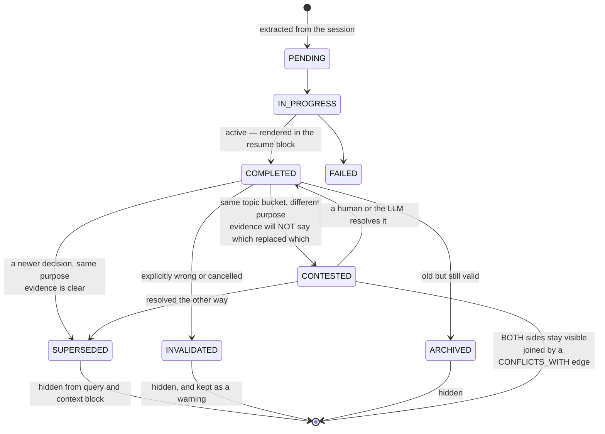

## 1. Executive Summary

TokenMizer is a session-memory proxy and library for coding agents — *"keep
your AI context alive across sessions"* — that extracts a typed graph from
the conversation and replays it, as a budgeted resume block, into the system
prompt of later turns.

**Its best mechanism is a status for not knowing.** The usual way to resolve a
contradiction is to pick: a newer decision supersedes an older one, the
old row is filtered out of retrieval, and the model never learns there was a
disagreement. TokenMizer's contradiction check asks whether the evidence supports
that call, and when it does not, marks **both** sides `CONTESTED`. The comment
explaining it states the problem plainly:

> Two decisions share a topic bucket (e.g. both "database") but don't share
> enough descriptive context to confidently call one a genuine replacement of the
> other (e.g. "Use PostgreSQL for primary user data" vs "Use SQLite for the local
> offline cache" — plausibly two independent, complementary choices, not a
> reversal). Rather than silently guessing and marking one SUPERSEDED —
> destroying it from resume context on possibly-wrong evidence — both sides are
> flagged CONTESTED and surfaced together so a human or the LLM can resolve the
> ambiguity explicitly.

And the crucial half: `CONTESTED` *"remains visible in query() and
to_context_block(), unlike SUPERSEDED/ARCHIVED/INVALIDATED"*. Three statuses hide
a node from search; this one deliberately does not, because the point is to put
the unresolved pair in front of whoever can settle it. The pair is joined by a
symmetric `CONFLICTS_WITH` edge, no transition is recorded for it
(`graph.py:604-626`), and a dedicated eight-case suite drives the distinction
from both directions — a same-purpose swap still supersedes, a bare technology
swap with no descriptive context still supersedes, and two decisions about
different purposes in one topic bucket do not.

**The second thing worth the visit is that it measures its own extraction.**
`tests/memory_accuracy/test_retention.py` runs a synthetic thirty-turn coding
session past the extractor with a hand-written ground truth — the tasks that were
completed, the decisions that were made, the files that were touched — and
asserts recall against it: `recall >= 0.4` for tasks, `>= 0.33` for decisions,
`>= 0.33` for files. Extraction quality is the load-bearing property of a memory
like this, and here it is measured in the suite against a ground truth someone
wrote by hand, with the thresholds at the floor rather than at an aspiration.
Beside it, `benchmarks/eval` scores precision as well as recall over fourteen
labelled sessions, six of them real transcripts, with a matcher documented to
stop a one-giant-label extractor winning recall.

**What the model is shown is a record, fenced.** A label or summary that reads as
an instruction to the model is refused before it becomes a node, and secrets are
redacted from what is stored (`graph.py:359-378`). Everything conversation-derived
that reaches a system prompt — the resume block, the windowing bridge, the
preference block — goes inside a delimiter with a preamble saying it is a record,
the delimiter scrubbed from the content (`security/fencing.py`). The module says
in its own words that this is one layer and not a solution to prompt injection.

Four marks: `trust_state`, `scope_enforced`, `audit_log` and `negative_eval`.
`tombstone` and `bitemporal` are withheld, each a near miss stated in section 9;
`human_review` has no surface.

## 2. Mental Model

A memory is a typed node in a session graph with a lifecycle status, and the
status is genuinely epistemic rather than merely administrative. `COMPLETED` is
active and shown in the resume. `SUPERSEDED` is *"replaced by newer decision —
kept in history"*. `INVALIDATED` is *"explicitly wrong/cancelled — kept as
warning"*. `ARCHIVED` is *"old but valid, not relevant now"*. Each of the three
is a different reason for the same outcome in search, and keeping them distinct is
what lets `INVALIDATED` mean something a single `active` boolean cannot: this was
wrong, we know it was wrong, and the resume says so — up to two invalidated
decisions ride every resume as `[DO NOT USE] <label>` (`context_block.py:220-228`).

Supersession, when it happens, is not just an edge. A `DecisionTransition`
records *"the full story of why one decision replaced another… what triggered
the change, why the old decision was wrong, what evidence caused the switch, and
how confident we are now"*, and its docstring notes that it lives in a separate
SQLite table *"so it survives graph pruning and is queryable independently"*.
A correction record usually stores the fact of a replacement; this one stores
the argument for it, puts it where the garbage collector cannot reach, and reads
it back: the resume's *Changes* line is the three most recent transitions, each
`'old' → 'new' — reason` (`context_block.py:190-200`, `types.py:171-188`).



## 3. Architecture

SQLite, with nodes and edges plus a separate `decision_transitions` table, and
a per-project graph cache in front. `safe_init_db` deletes a corrupt database
file and reinitialises rather than failing, and there is a `tests/chaos/`
directory holding `test_recovery.py` — a system that expects its own storage to
break and tests what happens next.

`_schema_version` sits on the graph with the comment *"increment when storage
format changes"*, and `_processed_hashes` deduplicates ingestion so replaying a
session does not double-extract it.

The proxy (`api/app.py`) sits between a client and its provider. Per turn it
extracts in a worker thread, ranks the graph against the question, appends the
fenced context block and, when enabled, the preference block, and past a token
threshold replaces older turns with the resume block. A local-only mode
(`core/privacy.py`) refuses to start on a remote provider and wraps name
resolution and `connect()` so a host the operator did not list is refused
before a packet leaves.

## 4. Essential Implementation Paths

- `tokenmizer/graph_memory/graph.py` (1,789) — nodes, edges, `add_node` with its
  injection refusal, redaction, dedup and contradiction check, `query`,
  `query_at_time`, the supersession path and `get_transitions`.
- `tokenmizer/graph_memory/hybrid_extractor.py` (2,230) and `patterns.py`
  (2,283) — extraction; `domains.py` adds research, ops and product phrasings.
- `tokenmizer/graph_memory/context_block.py` (375) — the resume block.
- `tokenmizer/graph_memory/decision_tracker.py` (771) — the matching heuristics.
- `tokenmizer/graph_memory/persistence.py` (769) — the schema,
  `persist_transition`, pruning survival.
- `tokenmizer/graph_memory/pruning.py` (230) — decay, archiving and the cap.
- `tokenmizer/graph_memory/summary.py` (170) — summary nodes for constraints in
  windowed-out turns.
- `tokenmizer/graph_memory/cross_session.py` (79) — opt-in recall across a
  principal's sessions.
- `tokenmizer/preferences.py` (296) — the per-principal preference store.
- `tokenmizer/security/{ownership,fencing,redaction}.py` — the principal, the
  fence and the redactors.

## 5. Memory Data Model

Fifteen node types — `TASK`, `FILE`, `DECISION`, `ERROR`, `CONCEPT`,
`DEPENDENCY`, `API`, `PROJECT`, `AGENT`, a v4 group of `ENVIRONMENT`, `GOAL`,
`TEST`, `ENDPOINT`, `SCHEMA`, and `SUMMARY` — and eight edge types including
`SUPERSEDES`, `CONFLICTS_WITH`, `BLOCKS` and `FIXES`.

The v4 additions are the tell that this taxonomy grew from use: `ENDPOINT` and
`SCHEMA` are what a coding session accumulates. `SUMMARY` holds what the
ontology has no node for — *"Keep the bundle under 500KB"*, *"we cannot use
anything AGPL"* — selected from turns windowing is about to drop by a hard
signal (a number with a unit, a constraint verb, a prohibition) and only when no
existing node represents it (`summary.py`).

A node's id is the first twelve hex digits of a SHA-1 over its type and its
lower-cased, stripped label (`graph.py:342-344`), so a node is keyed on its
value. A re-add of the same normalized label lands on the existing node and may
only move its status forward along `_STATUS_RANK`, where `INVALIDATED` ranks
highest and `SUPERSEDED` next (`graph.py:93-118`); a near-duplicate decision is
folded into the existing one by `_is_same_decision` under the same rule
(`:397-432`). `ERROR` is the one type whose latest mention wins in either
direction.

A preference is a row of `(principal, key, value, updated_at)`, at most 160
characters, twelve per principal with the oldest dropped first
(`preferences.py:79-88`, `:169-206`). It is stored only when the sentence matches
a signal pattern and none of the exclusions — secrets, environment variables,
project-specific asides — and the feature is off by default.

Every clock is a record clock; section 6 gives the one field named otherwise.

## 6. Retrieval Mechanics

`query()` scores the live graph and skips `INACTIVE_STATUSES`
(`graph.py:1604-1607`). `to_context_block()` renders the resume in a fixed order
under a token budget: in-progress tasks, recent completed ones, up to six live
decisions with their rationale, contested pairs, the three latest transitions,
pending tasks, files, environment, open errors, summary notes, and up to two
invalidated decisions as warnings. A comment at `graph.py:1646` records a fixed
bug — *"was calling query() which excludes SUPERSEDED nodes"* — from a path that
needed the hidden ones, which is the ordinary cost of expressing exclusion as a
filter every reader has to remember.

The path that needed them is `query_at_time`, which answers the question its
docstring gives as *"What did we decide last Tuesday?"* by scanning every node
and keeping those whose interval covers the instant — `valid_from <= at_time`
and `valid_until` either zero or later. That is the right shape, and the
interval is half-built. `valid_until` has one producer, `graph.py:738`, which
stamps `time.time()` on the old node at the moment of supersession. `valid_from`
is assigned only by its `field(default_factory=time.time)` default, so it holds
the instant the node was created, and `created_at` beside it holds the same
instant.

The declaration and the use disagree about what that field is, in the same tree.
`types.py:102` comments `valid_from` as *"when this fact became true"*; the
docstring inside `query_at_time` says *"when the node was created (always
set)"* (`graph.py:1650`). The second one is what the code does. So the query
answers what the system had recorded by a past instant, not what was true at it,
and the two coincide only because nothing can say otherwise.

**Scope is a claimed session, and the claim is where the key is applied.** A
principal is derived from the presented credential by `principal_for_key`
(`tokenmizer/security/ownership.py`), a session is claimed by the first principal
that writes to it, and `verify_session_access`
(`tokenmizer/api/routes_graph.py:51-98`) checks the claim before any
session-scoped route answers. Three details make it more than a permission check.
It **claims only on write methods**, so a GET for a session that was never
created falls through to its ordinary empty response instead of staking a claim
as a side effect. It **fails closed twice** — 503 when no principal was
established, 503 again when the ownership store is unreachable. And it answers
**404 rather than 403**, with the reason written down: confirming that a session
exists but belongs to someone else turns the endpoint into a session-name oracle.
`tests/unit/test_audit_fixes.py::test_cross_principal_access_is_denied_over_http`
asserts the refusal over HTTP rather than against a helper.

Inside a graph there is no scope key, which is coherent for a per-session tool:
the session is the unit, and the key is applied where the session is handed out.

**Cross-session recall reads through the same key.** With
`graph_checkpoint.cross_session_recall` on — off by default — the proxy scores
the current graph and up to five of the principal's other sessions in one pool
and tags each borrowed node `[from session …]` in the injected context. The
other sessions come from `OwnershipStore.sessions_for(principal)`
(`api/app.py:1094-1124`), whose docstring gives the reason: `graph_memory.db`
holds every principal's sessions in one file, *"so listing from there would show
one API key's sessions to another"*. `Memory`, which has no credential, falls
back to the shared `DEV_PRINCIPAL`, so separate local callers on one storage
directory see each other's sessions unless each passes its own principal. The
committed cases cover recall across two sessions, the cap, a failed load and the
feature being off by default; none asserts that another principal's session is
excluded with the feature on.

**Preferences read through it too.** With `preferences.enabled`, the proxy
records a preference from the user's turn and appends the principal's block,
fenced, after the context block (`api/app.py:1335-1348`). `GET /api/preferences`
returns the stored lines and the exact injected text; `DELETE` forgets one or
all.

## 7. Write Mechanics

The hybrid extractor runs over session messages with an ontology and a validator
in front of the graph. `add_node` refuses a label or summary that
`is_injection_text` flags, redacts the rest, dedups by the value-derived id, and
sends every new decision through `find_contradicting_decisions` before it lands;
non-fatal failures of that check are counted on the graph rather than swallowed
(`graph.py:253`, `:642`). LLM extraction, when enabled, runs on the configured
chat provider and model unless `extraction_model` pins another, rather than a
hard-coded cheaper model (`api/app.py:311-345`). The settings comment beside the
field (`config/settings.py:70`) describes the per-vendor auto-pick that the
docstring says was removed.

Redaction covers stored nodes and outgoing requests, including tool-call
arguments in the Anthropic, OpenAI-legacy and Gemini shapes
(`security/redaction.py`).

Background passes have their own correctness suites: `test_decay_idempotence.py`,
`test_compression_correctness.py`, `test_checkpoint_retention.py`. Testing that
a decay pass is *idempotent* is the property that decides whether running
consolidation twice is safe. Decay ages a superseded decision into `ARCHIVED`
thirty days after its supersession (`pruning.py:49-64`). Once the graph passes
200 nodes, `prune` deletes candidates outright: superseded and archived
decisions untouched for thirty days first, then, if that is not enough, any node
but a live decision, goal or schema in importance order, invalidated decisions
included (`pruning.py:135-228`, `graph.py:1009-1013`).

## 8. Agent Integration

A proxy that a client points its base URL at, a CLI, an MCP server, a Python
`Memory` class (`add`, `search`, `context`, `decisions`, `errors`, `why`) with
LangChain and LangGraph adapters, a dashboard and a graph visualiser. The memory
is aimed at coding sessions; domain packs add research, incident and product
phrasings to the same five shapes (`graph_memory/domains.py`), each with its own
labelled corpus.

## 9. Reliability, Safety, and Trust

**`trust_state` is earned comfortably** — nine discrete statuses, four of them
named in the `INACTIVE_STATUSES` frozenset that withholds a node from search,
one of which (`INVALIDATED`) means "known wrong, kept as a warning", and one of
which (`CONTESTED`) exists specifically to avoid asserting something the evidence
does not support.

The frozenset is consulted at three reads, which is what makes it a boundary
rather than a label: graph search skips those nodes as historical noise
(`graph_memory/graph.py:1604-1607`), the agent listing by type skips them before
sorting by importance (`agents/__init__.py:242-249`), and the checkpoint resume
builder skips them unless the caller names an explicit status set
(`checkpoints/manager.py:287-297`) — under a docstring giving the reason in one
line: *"Resuming with confidently-wrong context is worse than resuming with
none."* The relation linker draws edges between live nodes only, by the same set
(`graph.py:1048-1050`). Importance is the separate number and it orders what the
status has already admitted. The statuses are written in the graph itself —
`SUPERSEDED` at `graph.py:737`, both sides of a `CONTESTED` pair at `:623-624` —
with `decision_tracker.py` supplying the matching heuristics rather than the
assignment; pruning ages a `SUPERSEDED` node into `ARCHIVED` (`pruning.py:61`)
and the HTTP route writes `INVALIDATED` (`api/routes_graph.py:519,:536`).

**`audit_log` is earned on `decision_transitions`** — a named, separately-stored
record of every supersession carrying its trigger, its reason, its evidence and a
confidence change, written by `persist_transition`, outside the node and edge
JSON so that pruning cannot take it. It stores *the argument* for a replacement,
not only *that* a value was replaced. It is a record of supersessions and nothing
else: an invalidation through the HTTP route rewrites the node's status and
summary, a contested pair adds two edges, archiving and decay rewrite fields, and
a prune deletes the node, and none of them writes a row.

**Tombstone — withheld, on durability.** The value-keyed half is there: a
decision's id is a hash of its normalized label, a re-add may only move its
status forward, and `INVALIDATED` and `SUPERSEDED` outrank `COMPLETED`, so an
exact restatement of a dead decision lands on the dead node and stays dead;
`test_merge_does_not_resurrect_superseded` (`tests/unit/test_decision_tracker.py:138-149`)
asserts it for a near-duplicate after a supersession. The record that does the
refusing is the node itself, and `prune` deletes it — a superseded or archived
decision thirty days after its last touch, an invalidated one whenever the
age-based tier leaves the graph over its cap. After that the same label creates
a fresh `COMPLETED` node. The transition table survives the prune and nothing on
the write path reads it. A forgotten preference is a deleted row, so restating
it stores it again.

**`negative_eval` is earned on five committed cases, three of them on what the
model reads.** `tests/unit/test_graph.py::test_secrets_redacted_in_nodes`
drives an Anthropic-shaped key through the real `extract_from_messages` path and
asserts `sk-ant` appears in no node's label or summary — an assertion about what
reaches the graph. `test_contested_decisions.py::test_different_purpose_same_topic_does_not_supersede`
calls `find_contradicting_decisions` with a decision about a different purpose
inside the same topic bucket and asserts the older node's id is **not** among the
hits. `test_audit_fixes.py:108-131` builds a superseded, an invalidated and a live
decision, the dead two given the higher importance, and asserts the checkpoint
resume's key-decisions line carries the live one and neither dead one, while the
invalidated one still appears as a warning. `test_fencing.py:156-173` extracts
from a transcript whose decision line is an injection phrase and asserts the
phrase is absent from `to_context_block()` while the file it named is present.
`test_preferences.py:83-90` asserts one principal's preference reaches neither
the other's list nor its block.

What no case covers is a secret in `to_context_block()`: `test_security.py`
asserts the redactors on outgoing request content and on `redact_node` in
isolation. `test_decision_cache_async.py::test_superseded_decisions_excluded_from_resume`
is named for the absence of a superseded decision from `to_context_block()` and
asserts only that the new decision appears and that both nodes exist.

**Bitemporal — withheld.** `valid_from` has no producer but its default, so the
validity axis is the record axis under a second label (section 6).

**Human review — no surface.** Invalidation is an HTTP call a client makes, and
contested pairs are surfaced to *"a human or the LLM"* in the resume; nothing
holds a memory pending a decision.

## 10. Tests, Evals, and Benchmarks

1,470 test functions in 117 files, none run here, and the suite names say what they
guard: `memory_accuracy/test_retention`, `chaos/test_recovery`,
`test_contested_decisions`, `test_decay_idempotence`,
`test_compression_correctness`, `test_extractor_data_integrity`,
`test_checkpoint_retention`, `test_cache_scoping`, `test_concurrency`,
`test_fencing`, `test_preferences`, `test_privacy_local_only`,
`test_redaction_function_calls`.

The retention suite is the one to copy, described in §1. Its thresholds — 0.4
task recall, 0.33 decision recall, 0.33 file recall — are the floors CI holds
the extractor to on one synthetic session; the measurement of its accuracy is
the harness below.

`benchmarks/eval` is the second instrument. It runs the extractor over fourteen
labelled sessions and reports precision, recall and F1 per category, plus label
quality, using a matcher whose rules are written at the top of `metrics.py`:
coverage is measured over the ground-truth item's tokens so one enormous label
cannot win recall, precision uses the same relation reversed, and nothing is
fuzzier than word overlap — *"no embeddings, no LLM judge"*.

The README publishes
a macro F1 of 97%, split into 98% on synthetic sessions and 91% on the six real
ones, and says n=14 labelled by one person is a small sample. It reports
`query()` at recall@6 of 88% over 40 questions phrased the way a person asks
(`benchmarks/graph_retrieval`), the domain packs moving three hand-written
non-coding sessions from 11% to 93%, and input-cost replays through the proxy
(`benchmarks/savings`). Nothing here was run to check any of them. It also cites a
100-session comparison in a separate `tokenmizer-research` repository, which was
not read.

## 11. For Your Own Build

### Steal

- **Add a status for unresolved ambiguity, and keep it visible.** When your
  contradiction check cannot tell a replacement from a complementary choice,
  marking both `CONTESTED` and surfacing them together is strictly better than
  guessing — and inverting the visibility rule for that one status is what makes
  it useful rather than another way to hide something.
- **Store the argument for a correction, and show it.** Trigger, reason,
  evidence and confidence, in a table that survives pruning, turns "why does the
  system believe this now" into a query, and a one-line *old → new — reason* in
  the resume puts the answer in front of the model.
- **Warn with the rejected decision instead of hiding it.** `[DO NOT USE]` in the
  resume tells the model what not to re-propose.
- **Measure extraction recall against a hand-written ground truth.** A synthetic
  session and a list of what should have been captured is the only way anyone
  learns what fraction of a conversation their memory keeps.
- **Refuse to remember an instruction.** Text replayed into a system prompt for
  the life of a session is the durable form of prompt injection; checking a label
  before it becomes a node closes that door at the write.
- **Test that your decay pass is idempotent.** Running consolidation twice is a
  thing that happens, and it is worth asserting that it is safe.

### Avoid

- **Letting the cap delete the record that refuses.** A value-keyed id and a
  status that cannot move backwards stop a restatement only while the row
  exists; a prune that counts invalidated decisions as ordinary candidates
  removes the refusal along with the clutter.
- **Testing your redactor further than your rendering.** The predicate, the
  store and the outgoing request are covered; `to_context_block()`, assembled
  from the stored nodes by a separate renderer, is not.
- **A test named for an absence that asserts presence.**
  `test_superseded_decisions_excluded_from_resume` passes whether or not the
  superseded decision is in the resume.

### Fit

Take this if your memory is a coding session and your hardest problem is knowing
which of two plausible decisions is still in force. The status model and the
transition table are the parts to copy even if you never run the tool, and the
retention suite is the part to copy first.

Look elsewhere for multi-tenant or long-horizon personal memory: scope is a claimed
session per API-key principal, every clock is a record clock, a rejected decision
lasts as long as the pruner leaves its row, and the graph is built around one
project's session history.

## 12. Open Questions

- **How often does CONTESTED fire in real sessions?** The mechanism's value
  depends entirely on the contradiction check's precision, and the suite proves
  the rule works on constructed pairs rather than measuring the rate on real ones.
- **Who resolves a CONTESTED pair, in practice?** The resume shows it as
  *Conflicting (unresolved)*; nothing in the tree resolves one but a later
  supersession.
- **What is the recall on a captured session rather than the synthetic one?** The
  CI ground truth is thirty hand-written turns; the eval corpus holds six real
  transcripts labelled by one person.
- **Should an invalidated decision be prunable?** It is the only record that
  stops the same label returning as live.

## Appendix: File Index

| Path | Lines | What it holds |
| --- | --- | --- |
| `tokenmizer/graph_memory/graph.py` | 1,789 | Nodes, edges, `add_node`, query, supersession, contradiction check |
| `tokenmizer/graph_memory/hybrid_extractor.py`, `patterns.py`, `domains.py` | 2,230, 2,283, 289 | Extraction and its phrasings |
| `tokenmizer/graph_memory/context_block.py` | 375 | The resume block |
| `tokenmizer/graph_memory/decision_tracker.py` | 771 | Matching heuristics |
| `tokenmizer/graph_memory/validator.py` | 448 | Ontology validation |
| `tokenmizer/graph_memory/persistence.py` | 769 | Schema, `persist_transition`, prune survival |
| `tokenmizer/graph_memory/pruning.py` | 230 | Decay, archiving, the cap |
| `tokenmizer/graph_memory/summary.py` | 170 | Summary nodes from windowed-out turns |
| `tokenmizer/graph_memory/types.py` | 188 | Fifteen node types, nine statuses and the `INACTIVE_STATUSES` frozenset, eight edge types |
| `tokenmizer/graph_memory/cross_session.py` | 79 | Recall across one principal's sessions |
| `tokenmizer/preferences.py` | 296 | The per-principal preference store |
| `tokenmizer/security/ownership.py`, `fencing.py`, `redaction.py` | —, 131, — | The principal, the fence, the redactors |
| `tokenmizer/core/privacy.py` | 222 | Local-only mode |
| `tests/memory_accuracy/test_retention.py` | — | Ground-truth recall thresholds |
| `tests/unit/test_contested_decisions.py` | — | Eight cases on the ambiguity rule |
| `tests/unit/test_audit_fixes.py`, `test_fencing.py`, `test_preferences.py` | — | The resume, injection and cross-principal exclusion cases |
| `tests/chaos/test_recovery.py` | — | Storage corruption |
| `benchmarks/eval/` | — | Fourteen labelled sessions; precision, recall, F1 and label quality |

### Recorded searches

Run at the tree root of the pinned checkout with `git grep -n -E`.

```sh
git grep -n -E 'INACTIVE_STATUSES' -- tokenmizer                            # types.py:72, graph.py:1050,:1606, agents/__init__.py:247, checkpoints/manager.py:295: the readers
git grep -n -E 'status[[:space:]]*=[[:space:]]*NodeStatus|\.status = ' -- tokenmizer          # graph.py:623-624,:737, routes_graph.py:519,:536, pruning.py:61 write the dead and contested statuses; :392,:427,:461,:534 are the forward-only re-adds, :688,:1271 set COMPLETED
git grep -n -E 'persist_transition|DecisionTransition\(' -- tokenmizer      # graph.py:319-321 the wrapper, :751-764 its one caller, persistence.py:278 the loader: supersession is the one writer of the transition table
git grep -n -i -E 'decision_transitions' -- tokenmizer                     # persistence.py:219,:244,:274: create, insert, select; no delete
git grep -n -E 'valid_from' -- tokenmizer                                   # assigned only by the dataclass default at types.py:102
git grep -n -E 'del graph\._nodes|_nodes\.pop' -- tokenmizer                # pruning.py:221, persistence.py:440: the prune and the cross-process reconcile delete nodes
git grep -n -E 'sessions_for|query_across_sessions' -- tests               # test_cross_session_recall.py passes one caller's session list, test_sessions_endpoint.py:74 stubs it empty: no case with two principals and recall on
git grep -n -E 'assert .*not in .*(block|resume|ctx|context)' -- tests      # test_security.py:125,:235-236 are outgoing request blocks: no secret asserted absent from to_context_block()
```

## History

**2026-11-03** — [`6b26679c0812c95efff9213253b3d23ce20c0bbb`](https://github.com/Shweta-Mishra-ai/tokenmizer/commit/6b26679c0812c95efff9213253b3d23ce20c0bbb) — recorded searches re-run at the same pin. One recorded search uses `\b` or `\s` under `git grep -E`, which git built on macOS's regex library cannot match, so the part of its pattern using them matched nothing. It is rewritten with `-w` or POSIX classes and re-run. It returns what its annotation states, and no claim moves.

**2026-11-02** — [`6b26679c0812c95efff9213253b3d23ce20c0bbb`](https://github.com/Shweta-Mishra-ai/tokenmizer/commit/6b26679c0812c95efff9213253b3d23ce20c0bbb) — 42 commits on, releases 0.5.5 to 0.6.1. No mark moved. Added: an injection refusal at `add_node` and a fence around every replayed block, a per-principal preference store, summary nodes for windowed-out constraints, local-only mode ([section 1](#1-executive-summary), [section 6](#6-retrieval-mechanics)). `negative_eval` gains three cases on what the model reads ([section 9](#9-reliability-safety-and-trust)). Corrected, wrong at the previous pin too: a restatement of a dead decision meets the dead node, so `tombstone` is withheld on pruning, not on keying; `test_audit_fixes.py:108-131` already asserted dead decisions absent from the checkpoint resume; the resume reads transitions back; the `audit_log` record claimed every status transition where only supersessions are logged. Screened from a fresh clone: three publication manifests, `conftest.py`, nothing in the cooldown; nothing installed or run.

**2026-09-19** — [`028fc8cc3f6bd6412c40464297ad65caadf57a3e`](https://github.com/Shweta-Mishra-ai/tokenmizer/commit/028fc8cc3f6bd6412c40464297ad65caadf57a3e) — `trust_state` re-tested at an unchanged pin against the narrowed line. The mark holds and the record now carries anchors, which it had none of. `INACTIVE_STATUSES` (`tokenmizer/graph_memory/types.py:68-73`) is consulted at three reads rather than asserted once: graph search skips those nodes as historical noise (`graph.py:969-974`), the agent listing by type skips them before sorting by importance (`agents/__init__.py:210-218`), and the checkpoint resume builder skips them unless the caller names an explicit status set (`checkpoints/manager.py:287-297`). The separation the line asks for is clean: the status admits, importance orders what it admitted. One correction — the statuses are written in `graph.py` (`SUPERSEDED` at `:385`, both sides of a `CONTESTED` pair at `:444-445`), not in `decision_tracker.py`, which supplies the matching heuristics and the reasoning comments but makes no assignment; `pruning.py:61` ages a superseded node into archived and the HTTP route at `api/routes_graph.py:480` writes `INVALIDATED`. CONTESTED remains deliberately outside the excluded set, and the context block renders contested pairs by walking the `CONFLICTS_WITH` edges between them (`context_block.py:123-135`). Re-read from a fresh clone; nothing was installed and no suite was run.

**2026-09-15** — [`028fc8cc3f6bd6412c40464297ad65caadf57a3e`](https://github.com/Shweta-Mishra-ai/tokenmizer/commit/028fc8cc3f6bd6412c40464297ad65caadf57a3e) — 37 commits on, 2026-09-14. Screened before reading: three auto-run manifests, one build-time execution point, one unpinned range and one dependency surface inside the cooldown; nothing was installed and no test was run. The graph memory grew to seventeen modules: opt-in cross-session recall that reads only the sessions the ownership store lists for the caller's principal, community detection for the graph page, checkpoints that accept a transcript, LangChain and LangGraph adapters, and LLM extraction on the configured chat model. Section 6 now describes cross-session recall and its missing cross-principal case, section 10 the `benchmarks/eval` precision harness that was already present, and every cited line was re-checked (`graph.py:1013` and `:386`, `routes_graph.py:47-96`). The status model, transition table, retention thresholds and the two exclusion cases are unchanged. Four marks kept.

**2026-08-31** — [`8495e2598b8c11547c64e5dc1f19cd198d5e363d`](https://github.com/Shweta-Mishra-ai/tokenmizer/commit/8495e2598b8c11547c64e5dc1f19cd198d5e363d) — `negative_eval` resolved in favour of the mark, at the same pin. Two committed cases assert that particular material must not come back: `tests/unit/test_graph.py::test_secrets_redacted_in_nodes` (line 180) puts `sk-ant-api03-…` through the real `extract_from_messages` path and asserts `sk-ant` is in no node's label or summary, and `tests/unit/test_contested_decisions.py::test_different_purpose_same_topic_does_not_supersede` (line 35) asserts the older node's id is absent from `find_contradicting_decisions` hits when the two decisions serve different purposes in one topic bucket. Section 9 had reasoned only from `test_security.py`'s isolated redactor units, which alone would not reach the bar; the near-miss survives narrowed, since nothing asserts about `to_context_block()`'s output and nothing asserts an `INACTIVE_STATUSES` node is absent from a rendered resume. Section 9's status count is corrected to the nine `NodeStatus` members and the four in `INACTIVE_STATUSES`.

**2026-08-19** — [`8495e2598b8c11547c64e5dc1f19cd198d5e363d`](https://github.com/Shweta-Mishra-ai/tokenmizer/commit/8495e2598b8c11547c64e5dc1f19cd198d5e363d) — re-read at the same commit: `HEAD` is the pinned revision, so nothing upstream moved and this entry is about what a second reading of the same tree found. Four corrections and one added mark, all of them the atlas's own errors rather than the project's.

**`negative_eval` is awarded.** `tests/unit/test_graph.py::test_secrets_redacted_in_nodes` drives an Anthropic-shaped key through the real `extract_from_messages` path and asserts `sk-ant` appears in no node's label or summary, and `test_contested_decisions.py` asserts a decision about a different purpose in the same topic bucket is not returned as a contradiction. Both are committed cases that particular material must not come back; the previous reading credited the retention suite's recall floors and did not look for the exclusion assertions beside them.

**The temporal layer was in the verdict and not in the report.** `content/verdicts.md` already closed on *"every clock is a record clock"*; the report itself named no clock at all, so the claim stood in the atlas with nothing behind it a reader could check. `query_at_time` answers a point-in-time question by walking `valid_from` / `valid_until`, and the interval is half-built: `valid_until` is stamped at supersession by `graph.py:379`, while **`valid_from` has no producer anywhere in the repository** and therefore always equals the creation instant that `created_at` already holds. `types.py:98` calls it *"when this fact became true"* and the `query_at_time` docstring calls it *"when the node was created"*; the second is what the code does. Section 6 now carries the mechanism and the producer check behind that verdict line, and the reason the bi-temporal mark stays withheld.

**Two cited line numbers were wrong when published.** The fixed-bug comment is at `graph.py:832`, not 744, which is a synonym table; `verify_session_access` spans `routes_graph.py:46-94`, not 44-90. Neither was carried forward from the earlier pin — both files postdate it — so they were mis-cited at the reading that introduced them, and re-verifying every cited line is the check that catches it.

**The frontmatter disagreed with itself.** `memory_unit` said eight statuses where `trust` said nine; `NodeStatus` defines nine. And the *Avoid* bullet claiming the redactor's output is untested was too broad: the predicate and the store are both covered, and only the rendered `to_context_block()` is not.

Screened again at this commit: three auto-run manifests — `.mcp.json`, the MCP registry `server.json`, and a Claude Code plugin manifest — one dependency surface inside the seven-day cooldown, one unpinned range, and a `conftest.py` executing on collection. Nothing was installed and no test was run. The commit named in the 30 July entry below is not reachable from a fresh clone of the default branch.

**2026-08-18** — [`8495e2598b8c11547c64e5dc1f19cd198d5e363d`](https://github.com/Shweta-Mishra-ai/tokenmizer/commit/8495e2598b8c11547c64e5dc1f19cd198d5e363d) — re-read seventeen commits on, and the scope finding is the one that moved. `scope_enforced` is awarded: `tokenmizer/security/ownership.py` derives a principal from the credential, claims a session for it, and `verify_session_access` refuses a foreign principal on every session-scoped route. The previous reading withheld the mark on the ground that a graph carries no scope key inside it, which is still true and is no longer the whole question — the rubric asks for a stored scope key applied on the read path, and the claim is applied there. The module header describes the hole it closes: `session_id` came from the URL, clients choose it themselves in the chat request body, and authentication proved only that a caller held the deployment key.

The status vocabulary grew a `MODIFIED` alias for `SUPERSEDED` and, more usefully, an `INACTIVE_STATUSES` frozenset, so the excluded set is one constant rather than comparisons repeated at each read; the matrix row and section 6 say nine and four rather than eight and three. `patterns.py` (827 lines) and `filelock.py` (254) are new, `persistence.py` gained 703 lines and `hybrid_extractor.py` was substantially rewritten; the extraction and decision mechanisms this report describes survive those changes. Every mark now carries an evidence record. The screen reported three auto-run manifests — a `.mcp.json` pointing at the local package, the MCP registry `server.json` and a Claude Code plugin manifest, all publication metadata — plus a `conftest.py` executing on collection; nothing was installed and no test was run.

**2026-07-30** — [`ed7860e626ccc5c67fdf28c5cd12532ba337aeee`](https://github.com/Shweta-Mishra-ai/tokenmizer/commit/ed7860e626ccc5c67fdf28c5cd12532ba337aeee) — first reading.
