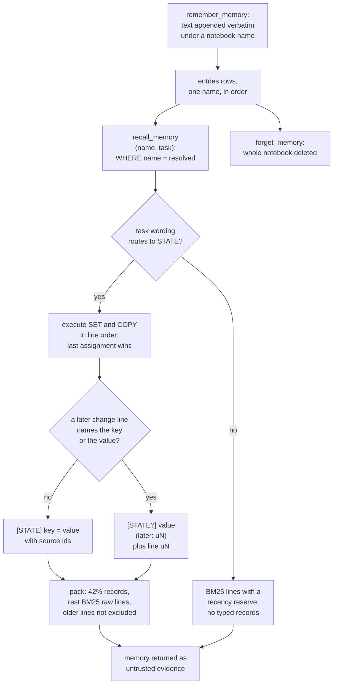

## 1. Executive Summary

TOMC Memory is a local, CPU-only context preparer with a small notebook store,
from Zipeng Wu. A stdio MCP server, a Claude Code plugin and a Codex skill let an
assistant save text to a named notebook in one SQLite file and recall it in a
later chat, compiled for the task it is asked. The same compiler shrinks pasted
history on demand.

What is notable is where belief is computed. Nothing is extracted at write time:
the notebook keeps the user's text verbatim. At recall a deterministic parser
reads `key = value` and `key: value` lines in order, so the last assignment wins,
and a later line announcing a change marks the value `STATE?` and travels with it.
No model is called anywhere on that path, and the published stale-value
benchmark recomputes exactly from its committed rows.

What is weak is that the guarantee depends on wording. The typed compile runs
only when the task reads as a state question, superseded raw lines are not
excluded from the evidence, and `forget_memory` matches saved contexts by the
exact name a recall was given.

**Licence.** MIT, in `LICENSE` and `plugins/claude-code/LICENSE`, agreeing with
`pyproject.toml`, `plugin.json` and `CITATION.cff`. The grant covers the code and
not the evidence behind the paper's numbers: `DATA_PROVENANCE.md` says the
evidence dataset and the full paper repository *are not mirrored*, so the BEAM
results for 100K to 1M arrive as aggregates, and the 10M follow-up as per-question
scores with answer hashes. The same file says the copied manuscript figures keep
the marks of the providers they name, which the project does not relicense.

## 2. Mental Model

A memory is a **notebook entry**: whatever text or message list the agent was
told to keep, stored exactly as given, in arrival order under a name
(`src/tomc/store.py:82-99`). There is no fact table. A belief exists only for the
duration of a recall, as a compiled record over the whole notebook.

The compiler segments the notebook into source lines with ids such as `u12` and
asks a rule router what the task wants. A task containing `current`, `latest`,
`final value`, a trailing `now` or a Chinese equivalent routes to STATE
(`src/tomc/routing.py:12-15`, `:26`). STATE executes every parsed `SET` and `COPY`
operation in line order, so the newest assignment of a key is the value
(`src/tomc/_vendor/reference.py:155-169`). `B copies A` takes A's value at that
point and unions both lines' sources.

Doubt is computed, not stored. `refine_records` collects unparsed lines that
match a change vocabulary (`switched`, `scratch that`, `no longer`, `改成` and
several dozen more), and attaches the latest one after a record's last source
that names its key or value. An undo after that key's last change, or a switch
naming a new value when the task asks about this key, also counts. The record
becomes `STATE?` with `(later: uN)` in its value, and line `uN` is packed under
it (`src/tomc/strategies/latest.py:62-71`, `:293-332`, `:386-391`).

A memory stops existing only when its whole notebook is forgotten or everything
is erased. There is no per-entry delete, no edit and no status. A correction is
another appended line, and whether it wins depends on the parser reading it.

## 3. Architecture

The package is pure Python with no required dependencies; the MCP server needs
the `mcp` extra pinned at 1.30.0 (`pyproject.toml:13-17`). Everything lives in one
SQLite file, `~/.tomc/memory.sqlite3` or `TOMC_MEMORY_PATH`, created owner-only
and opened with `secure_delete=ON` (`src/tomc/store.py:18-24`,
`src/tomc/privacy.py:114-147`). Clients that point at the same path share it.

The MCP server runs over stdio only and exits when its parent dies
(`src/tomc/mcp_server.py:623-674`). At start a daemon thread prunes saved
contexts past the retention limit and redacts once any saved before redaction
existed (`src/tomc/context_library.py:115-136`). The Claude Code plugin is a
manifest and an `.mcp.json` that runs `uv run --locked` on a vendored copy of the
package; it registers no hooks (`plugins/claude-code/.mcp.json`).

Two other surfaces share the database. A Qt desktop companion, about 8,000 lines,
shows usage, a pet and the saved-context library. An optional Windows request
gateway points Codex and Claude Code at `127.0.0.1` and replaces eligible old
history in their requests. It saves each prepared request as a context snapshot
while *Save context records* is on, which is the default
(`src/tomc/request_gateway.py:352-360`, `src/tomc/session_store.py:153`). That
gateway is context-window management of the live session, and this report reads
it only where it writes the snapshot table.

### Deployment and ergonomics

Nothing has to run besides the client: no service, no GPU, no API key. Install is
a Claude Code marketplace command or a pip install from a clone. The store is
ordinary SQLite and a notebook's payload is JSON a person can read and repair.

The clone is 272 MB and the code is a small part of it. Launch videos and GIFs
under `launch/media/` are 83 MB, the companion's pet images under
`src/tomc/data/` 27 MB, `assets/` 11 MB, and the pack holds 125 MB of history.

## 4. Essential Implementation Paths

- **Write.** `remember_memory` calls `MemoryStore.remember`, which parses the
  content as text, JSON or JSONL messages, takes `BEGIN IMMEDIATE`, resolves the
  name and inserts one row unless the notebook's last row is byte-identical
  (`src/tomc/mcp_server.py:451-464`, `src/tomc/store.py:82-99`).
- **Name resolution.** `_name` strips and NFC-normalises; `_resolve` scans every
  stored name and returns an exact match, else the oldest case-insensitive one
  (`src/tomc/store.py:49-76`).
- **Recall.** `recall` reads the resolved notebook's rows in id order and hands
  the messages to `prepare_context` with `adaptive=False`
  (`src/tomc/store.py:101-118`).
- **Budget and route.** Without a budget, 80% of a notebook up to 10K estimated
  tokens is kept, sliding to 60% at 1M, floor 1,024, so only a notebook under
  1,024 tokens comes back whole (`src/tomc/easy.py:35-51`, `:116-117`).
  `hybrid_route` picks `tomc_raw` for typed or explain-style tasks and BM25 for
  the rest (`src/tomc/routing.py:48-56`).
- **Compile.** `TOMCStrategy.compress` runs the kernel uncapped, then
  `refine_records` puts the asked keys first, caps at 96 rows and flags doubt
  (`src/tomc/strategies/typed.py:31-47`, `src/tomc/strategies/latest.py:335-393`).
- **Pack.** Records take 42% of the budget, BM25-ranked raw lines the rest, with
  later lines first on a tie for state tasks (`src/tomc/strategies/typed.py:71`,
  `:97-112`).
- **Forget.** `forget` deletes the notebook's rows, then `delete_notebook` deletes
  saved contexts whose payload `notebook_name` equals the resolved name, then
  vacuums (`src/tomc/store.py:128-139`, `src/tomc/context_library.py:367-386`).
- **Erase.** `erase_all` empties eight text tables and keeps paused sessions'
  off switches and numeric totals (`src/tomc/privacy.py:169-220`).

## 5. Memory Data Model

`entries` has four columns: `id`, `name`, `payload` and `created`
(`src/tomc/store.py:36`). The payload is a JSON list of messages with role and
content. `created` is read only to report a notebook's last update; ordering
uses `id`. There is no type, status, confidence, source or validity column.

Typed records exist in memory during a compile. A `Record` has a type, one of
`STATE`, `PATH`, `EDGE` and `COUNT` or a doubt variant such as `STATE?`, plus a
key, a value and the source line ids it came from
(`src/tomc/_vendor/reference.py:48-58`). A `COPY` from an unset key yields the
literal value `<UNKNOWN>`.

Saved contexts are a second store. `tomc_context_snapshots` holds the compiled
memory and task, never the input, with host, session, notebook name, compiler
version and a SHA-256 over the canonical payload
(`src/tomc/context_library.py:21-36`, `:146-161`). Notebook text is stored
unredacted, which `SECURITY.md:43` says is deliberate; snapshot text is redacted
for common credential shapes before it is saved (`src/tomc/context_library.py:236`).

## 6. Retrieval Mechanics

Retrieval is lexical and deterministic. The kernel's evidence selection is an
MMR-style greedy pick over token overlap, exact identifiers and an operation bonus
for lines with `=`, `changed` or `copies`, expanded by one neighbour
(`src/tomc/_vendor/reference.py:90-126`). Raw lines are ranked by Okapi BM25 with
`k1=1.5, b=0.75` behind a 12% budget reserve for the latest lines
naming a task word and 4% for the latest change lines
(`src/tomc/strategies/baselines.py:21-22`, `:25-50`, `:109-115`).

The latest-value behaviour is a property of the STATE route. A task phrased
*"which framework do we use?"* has no state keyword, routes to BM25, and returns
both the old and the new assignment lines ranked by overlap, with the recency
reserve as the only bias toward the newer one (`src/tomc/routing.py:31-56`).

On the STATE route the raw half does not exclude superseded lines. Only the
change lines already shown under a `STATE?` record are removed from the raw
candidates (`src/tomc/strategies/typed.py:105`), so `framework = Flask` can be
packed as `[RAW u40]` below `[STATE] framework = Litestar <src:u97>`. The source
ids let a reader tell which is newer.

The result is capped per host: 50,000 characters for Claude and 20,000 otherwise,
or `TOMC_MCP_MAX_CHARS`, and the budget shrinks until the rendered memory fits
(`src/tomc/mcp_server.py:27-37`, `src/tomc/easy.py:112-131`). A repeat
`prepare_context` with `since_delivery_id` sends only the changed records,
tracked in process memory.

## 7. Write Mechanics

Writes happen only through `remember_memory`, and only `MemoryStore.remember`
inserts into `entries` (`src/tomc/store.py:98`). The tool description and the
server instructions tell the model to save only when the user asks
(`src/tomc/mcp_server.py:165-167`). Nothing checks that; a model that calls the
tool unprompted writes a notebook.

There is no extraction, deduplication beyond an immediate identical retry,
consolidation, contradiction handling or redaction on the write. Agent-written
text and user text are indistinguishable once stored, apart from the role field
in a message list.

### Operational cost

The write is one synchronous SQLite insert and the entry is recallable at once.
Recall re-reads and re-compiles the whole notebook every time, so its cost grows
with the notebook; no background pass touches notebooks. Injection is bounded by
the budget and the per-host character cap, and arrives as a tool result rather
than in a system prompt, so it does not disturb a provider's prefix cache.

## 8. Agent Integration

The MCP server registers twelve tools: `try_tomc`, `prepare_context`,
`remember_memory`, `recall_memory`, `list_memories`, `forget_memory`,
`erase_all_memory`, `get_status`, `get_usage_stats`, `list_contexts`,
`get_context` and `make_handoff` (`src/tomc/mcp_server.py:175-188`). Unknown
arguments are rejected by rebuilding each tool's argument model with
`extra="forbid"` (`:246-264`).

The model has full agency over notebooks: it chooses the name, writes, recalls and
forgets. `erase_all_memory` requires the literal `confirm="ERASE ALL"`, which
guards against a slip and not against the model (`:582-599`). Optional session
hooks register a host and session id so a paused conversation can refuse
preparation; they never read the transcript (`src/tomc/session_hook.py:1-6`).

Adapting it to another agent means pointing any MCP client at `tomc mcp`; the
Python API is `prepare_context(history, task)` with no dependencies.

## 9. Reliability, Safety, and Trust

### What a forget reaches

`forget_memory` deletes saved contexts only where the snapshot's
`notebook_name` equals the resolved stored name
(`src/tomc/context_library.py:376`). `recall_memory` records the name exactly as
the caller typed it (`src/tomc/mcp_server.py:479`). A recall of `PROJ` or `proj `
over the notebook `proj`, with saving on, stores a compiled copy of that notebook
that `forget("proj")` does not delete. It survives until the 30-day prune. Both
forget tests use the stored spelling (`tests/test_mcp.py:97`,
`tests/test_privacy.py:194`). This is a reading of the code; I did not run it.

### What the read paths filter

- **Recall** filters `entries` on the resolved name, and nothing else reads entry
  content (`src/tomc/store.py:111-113`).
- **Saved contexts** are listed and read by id with no notebook or session
  predicate (`src/tomc/context_library.py:392-418`). With the gateway on, they
  hold compressed conversations from every host session.

### Marks

- **`scope_enforced`** — awarded on the notebook name. It is a stored key on each
  entry and the predicate on every content read. It is a convenience boundary:
  the caller picks it, `list_memories` shows every name, and no principal stands
  behind it.
- **`negative_eval`** — awarded; see section 10.
- **`trust_state`** — withheld. `STATE?` is recomputed on every recall from the
  text and is never stored, and it labels a value rather than withholding it.
- **`tombstone`** — withheld. Forget deletes rows; nothing records a rejected
  value, and the same text can be saved again.
- **`bitemporal`** — withheld. Precedence is line order, and the only times are
  `created` and `created_utc`, both record time.
- **`audit_log`** — withheld. `preparation_receipts` logs preparations, not
  mutations, and no table records a remember or forget
  (`src/tomc/preparation_log.py:33-52`).
- **`human_review`** — withheld. Nothing waits; the agent's own tool writes the
  entry, and the desktop library edits saved contexts after the fact.

### Injection and privacy

Every result tells the model to treat memory as untrusted evidence, and handoff
prompts repeat it (`src/tomc/mcp_server.py:99-100`,
`src/tomc/context_library.py:37-41`). A notebook holding an instruction is
recalled with it. Deletion vacuums the file under `secure_delete`, and a test
reads the raw bytes after a forget to confirm the text is gone
(`tests/test_privacy.py:186-197`).

## 10. Tests, Evals, and Benchmarks

The suite has 680 pytest functions in 66 files. CI runs them, ruff, a security
scan and `make reproduce` on Ubuntu and macOS under Python 3.10 and 3.12, and
checks that `make reproduce` rewrites no tracked file (`.github/workflows/ci.yml:2-28`).
I ran none of it.

`negative_eval` rests on two populated cases:

- `tests/test_easy.py:85-100` saves `work` and `other`, recalls `work` after a
  restart, and asserts `drink = water` is in the prompt and `private other` is
  not. The same result carries the positive and the negative.
- `tests/test_mcp.py:58-75` does the same through a real stdio server in a new
  process: `unverified` from `parser` present, `secret` from `other` absent. The
  file skips without `mcp`; CI installs it.

The latest-value regressions use `assert_latest`, which requires the newest value
in the memory and every included `STATE` row for the key to contain it
(`tests/test_latest_value_regressions.py:62-66`). The second half passes when no
`STATE` row exists and does not inspect raw lines.

Two headline numbers recompute from committed artifacts. I read them with my own
script under `python3 -I`, outside the tree:

- **Stale values.** `benchmarks/stale/results_after.json` holds 864 rows, 144 per
  budget. Pass counts are 122/144 at 10%, 127/144 at 20%, 141/144 at 40% and
  144/144 from 60% and the default, matching the README's 85% and 100%. No row
  has an unflagged stale record; every failure is a missing latest value.
- **BEAM.** In `benchmarks/current_paper/beam_comparisons.csv`, TOMC's mean is
  higher in 18/18 reader-baseline cells at 500K and at 1M and in 17/18 at 100K,
  the loss being Flash against `light` by 2.8 points. In
  `benchmarks/beam_10m_20261010/paired_scores_10m.csv`, 3,596 valid pairs give
  18/18 at 10M. That is the README's 54/54 and 17/18.

The BEAM scores are LLM-judged, under a different protocol at 10M, and measure
compressed long-history QA rather than the notebook store. The stale-value suite
was written alongside the fixes, as the README says. The paper, *Task-Oriented
Memory Compilation*, is named in `CITATION.cff` with no arXiv id, and the README
says it is not public; I found no public copy.

## 11. For Your Own Build

### Steal

- **Keep the text, compile the belief.** Store what the user said verbatim and
  derive the value at read time with a deterministic pass. A parser fix then
  improves every old notebook without a migration.
- **Ship the doubt with its cause.** When a later line may have changed a value,
  emit the value flagged and the line beside it, so the reader resolves it with
  the evidence in hand.
- **Recompute the headline in CI.** Commit the per-row results and fail the build
  when `make reproduce` disagrees with them or rewrites a tracked file.

### Avoid

- **A guarantee gated on phrasing.** If latest-value precedence needs the word
  `current` in the task, a differently worded question gets plain retrieval.
- **Deleting derivatives by a raw label.** Key derived copies on the canonical
  identity the store resolves, not on the string the caller typed.
- **A negative half that passes empty.** Pair `all(...)` over the stale rows with
  an assertion that at least one row exists.

### Fit

This suits one person who wants a few project notebooks shared across Claude Code
and Codex on one machine, with nothing to run and no model cost. It is a context
preparer first, and the notebook is a log it re-reads. Walk away if you need
per-fact correction, deletion of one wrong entry, several users, or memory that
the system itself decides to keep.

## 12. Open Questions

- Whether `recall_memory` is meant to record the resolved notebook name on saved
  contexts, so that forget reaches them.
- Whether the STATE route is meant to cover tasks without a state keyword, given
  that notebooks are recalled for whatever the next task is.
- What the paper's ablation of the compilation step shows at 10M; the follow-up
  README says it was still running on 10 October 2026.

## Appendix: File Index

- Notebooks: `src/tomc/store.py`, `src/tomc/privacy.py`
- Compiler: `src/tomc/easy.py`, `src/tomc/compiler.py`, `src/tomc/routing.py`,
  `src/tomc/_vendor/reference.py`, `src/tomc/strategies/typed.py`,
  `src/tomc/strategies/latest.py`, `src/tomc/strategies/baselines.py`
- Saved contexts: `src/tomc/context_library.py`, `src/tomc/request_gateway.py`
- MCP and hooks: `src/tomc/mcp_server.py`, `src/tomc/session_hook.py`,
  `src/tomc/session_store.py`, `plugins/claude-code/.mcp.json`,
  `plugins/codex/skills/tomc-memory/SKILL.md`
- Tests: `tests/test_easy.py`, `tests/test_mcp.py`, `tests/test_privacy.py`,
  `tests/test_latest_value_regressions.py`
- Benchmarks: `benchmarks/stale/`, `benchmarks/current_paper/`,
  `benchmarks/beam_10m_20261010/`

### Recorded searches

Run from the repository root at the pinned commit with `/usr/bin/git grep`.

- **No vector arm.**
  `git grep -n -i -E 'embedding|cosine|faiss|sentence_transformers' -- src/tomc`
  returns nothing; `git grep -c -i 'bm25' -- src/tomc/strategies/baselines.py`
  counts 8.
- **No model call on the memory path.**
  `git grep -n -E 'adapters\.reader|APIReader' -- src scripts` matches the class
  definition and `scripts/replicate.py` only.
- **One writer of notebooks.** `git grep -n -E 'INSERT INTO entries' -- src`
  matches `src/tomc/store.py:98`; `git grep -n -E 'MemoryStore\(' -- src`
  matches `src/tomc/mcp_server.py:272` only.
- **No per-entry delete.**
  `git grep -n -E 'DELETE FROM entries|DELETE FROM \{table\}' -- src` matches the
  whole-notebook delete at `src/tomc/store.py:135` and the erase loop at
  `src/tomc/privacy.py:199`.
- **Notebook text is not redacted.** `git grep -n 'redact' -- src/tomc/store.py`
  returns nothing; `git grep -c 'redact(' -- src/tomc/context_library.py`
  counts 6.
- **Saved-context reads carry no notebook predicate.**
  `git grep -n 'notebook_name' -- src/tomc/context_library.py` matches the field
  list, validation, `save` and `delete_notebook` only.
- **No mutation log.**
  `git grep -n -i -E 'audit|mutation|event_log' -- src/tomc/store.py src/tomc/context_library.py`
  matches one docstring at `src/tomc/context_library.py:140`.
- **No validity time.**
  `git grep -n -w -i -E 'valid_from|valid_to|valid_at|valid_until|as_of|event_time' -- src/tomc`
  returns nothing; `git grep -n -w -E 'created_utc' -- src/tomc/context_library.py`
  matches.
- **Forget tests use the stored spelling.**
  `git grep -n -E 'deleted_snapshots' -- tests` matches
  `tests/test_mcp.py:97` and `tests/test_privacy.py:194`, both recalling under
  the name the notebook was saved with.
- **No published paper.**
  `git grep -n -i -E 'arxiv\.org/abs' -- CITATION.cff README.md docs/readers_and_agents.md`
  returns nothing, while `git grep -n -i 'arxiv' -- CITATION.cff` matches the
  line saying an identifier will be added. A web search for the exact title found
  no copy on 21 November 2026.

## History

**2026-11-21** — [`6595de4f50a0506347fb439b2fc8839fe1f73ad3`](https://github.com/ZipengWu365/TOMC/commit/6595de4f50a0506347fb439b2fc8839fe1f73ad3) — first reading, from a full clone of `main` after release v0.3.1, scoped to the notebook store, the compiler, the saved-context library, the MCP server and their tests and benchmarks; the gateway and desktop companion were read only where they write the shared database. Screened first: three auto-run surfaces, the Claude Code marketplace manifest, `plugin.json` and `.mcp.json`, acting only if a harness installs the plugin; three build-time execution points, a Makefile and two `setup.py` modules; one unpinned surface, `pyproject.toml`. MIT, no rider. Nothing installed, built or run; two benchmark tables recomputed from committed files with my own script. Two marks: `scope_enforced`, `negative_eval`.
