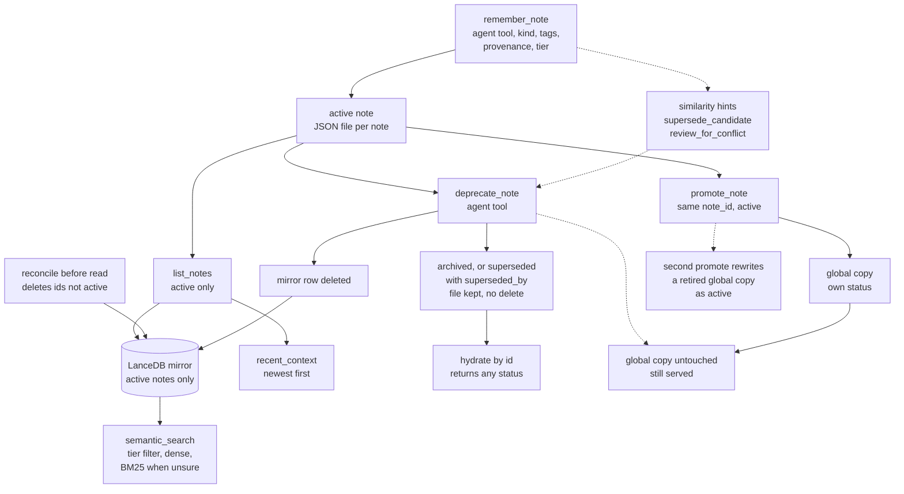

## 1. Executive Summary

Turbo Quant Memory is a local MCP server for coding agents: the agent writes
typed notes (decisions, lessons, patterns, session handoffs) that are stored as
JSON files per project, mirrored into LanceDB, and returned as short cards
from a hybrid dense and BM25 search. What is notable is a lifecycle status that
holds on every serving read because the writer deletes a retired note's index
row and a reconcile before each read deletes any stray, and fusion constants
whose sweeps and ceilings are written beside them. What is weak is that the
project boundary is a directory the model can step out of with
`select_project`, a promoted global copy outlives the deprecation of its
original, and no note can be deleted.

The name points at vector quantisation and the code does none. Vectors are
stored as the embedder returns them, no index is built over them, and
compression here means a 220-character card in place of a document
([section 10](#10-tests-evals-and-benchmarks) has the paper check).

A note is served from the moment `remember_note` returns. Writes are
synchronous, embed on a local ONNX model, and call no language model. The
response carries similarity hints that suggest superseding a near-duplicate,
and the decision is the agent's: `deprecate_note` retires the old note, and the
skill the installer copies into the agent's skill directories says to do it.

**Licence.** MIT in `LICENSE`, with `pyproject.toml` declaring the same and
shipping the file. The one component under other terms is the embedding model,
`sentence-transformers/paraphrase-multilingual-MiniLM-L12-v2` by default
(`src/turbo_memory_mcp/retrieval_index.py:28`), which `fastembed` downloads
from Hugging Face at first run; the tree does not state its licence. Nothing
in the grant restricts use.

Two marks are earned: `trust_state` on the note status and `negative_eval` on
the search tests. Section 9 gives the reasons for the five withheld.

## 2. Mental Model

A memory is **a note the agent decided to write**, typed by `kind` and placed
in a tier by it: `handoff` goes to `episodic`, every other kind to `durable`,
and indexed Markdown is `reference` (`src/turbo_memory_mcp/store.py:41-45`,
`:71-76`). The agent can override the tier on write. Default search reads
`durable` and `reference`, so a handoff is reachable through `recent_context`
or an explicit `tier_filter`.

Belief is binary and starts at once. A note is `active` when written and is
served by search, by `recent_context` and by hydration. It stops being believed
in one way: `deprecate_note` moves it to `archived`, or to `superseded` when a
replacement id is given, records `deprecated_at`, an optional reason and a
pointer to the replacement, and rewrites the same JSON file
(`store.py:545-596`). Nothing moves a note back, and nothing deletes one.

Who moves it is the agent. `remember_note`, `promote_note` and `deprecate_note`
are all MCP tools (`src/turbo_memory_mcp/server.py:511-578`), and the only
judgement offered is advisory: after a write, notes above a cosine of 0.78 come
back as `review_for_conflict`, and same-kind notes above 0.88 as
`supersede_candidate` (`server.py:1966-1968`, `:1971-2021`).

Two fields sound epistemic and are not. `provenance` is `human-explicit` or
`agent`, chosen by the agent in the tool call, and is a 0.06 ranking bonus and
a tie-break (`src/turbo_memory_mcp/retrieval.py:36`, `:232-239`, `:271-281`).
`confidence_state` on a search result is the similarity score bucketed at 0.72
and 0.52.

Global memory is a copy. `promote_note` writes the project note into
`global/notes` under the same `note_id`, active, with a `promoted_from` record
(`store.py:519-543`). From then on the two are separate records with separate
statuses.

## 3. Architecture

One Python package, `turbo-quant-memory`, with a stdio MCP server, a CLI and
no network service. `turbo-memory-mcp serve` is what every client registers.
The first process to start becomes the primary that owns the storage root; the
next ones become proxies that forward each call over a Unix socket with mode
`0600` and a 32-byte `multiprocessing` authkey kept in `.daemon.lock`
(`src/turbo_memory_mcp/daemon.py:1-16`), and a proxy promotes itself when the
primary dies.

Persistence is files under `~/.turbo-quant-memory` (`TQMEMORY_HOME` overrides):
per project a `manifest.json`, `notes/<id>.json`, `relations.json`, Markdown
roots, file manifests and blocks as JSON, a `retrieval/` LanceDB database, and
a `secrets/` vault with its audit file; `global/` holds the same for promoted
notes (`store.py:91-165`). Every JSON write goes through a temporary file and
`os.replace` (`store.py:1239-1255`). The LanceDB tables are derived: each read
reconciles them against the files, and the files are authoritative.

The project is resolved from the working tree: git remote, else path, else
`TQMEMORY_PROJECT_ID`, and `reconcile_project_identity` keeps a bucket when a
remote is added later (`store.py:1013-1086`).

Background work is three threads in the primary: a refresher that completes
index refreshes a search left over its budget
(`src/turbo_memory_mcp/refresher.py:1-11`), LanceDB optimisation at start and
every six hours (`src/turbo_memory_mcp/index_maintenance.py:18-19`), and, when
two or more sessions share a git working tree, a watcher that journals text
file versions to SQLite for `file_history` and `restore_file`.

### Deployment and ergonomics

`uv tool install turbo-quant-memory` and one `mcp add` line per client. No API
key and no external service; the first run downloads a 0.22 GB ONNX model, and
after that everything runs offline. The README's grep for HTTP client imports
in `src/` is a claim the reader can run. The notes are pretty-printed JSON a
person can read and edit; an edited note is re-embedded because the reconcile
compares `updated_at` (`server.py:3003-3024`). LanceDB keeps old table versions
for seven days, so the derived store grows between optimisations.

## 4. Essential Implementation Paths

- **Note schema and store.** `src/turbo_memory_mcp/store.py`: kinds, statuses,
  tiers and provenances `:27-52`, `write_project_note` `:356-385`,
  `write_global_note` `:387-420`, `list_notes` `:454-467`, `promote_note`
  `:519-543`, `deprecate_note` `:545-596`, `_build_note_record` `:853-897`,
  relations `:918-1009`, `normalize_provenance` `:1168-1180`.
- **MCP tools.** `src/turbo_memory_mcp/server.py`: `_memory_call` and the
  project selection it injects `:409-421`, `select_project` and
  `bind_project` `:467-495`, `remember_note` `:511-555`, `promote_note` and
  `deprecate_note` `:557-578`, `semantic_search` `:580-613`, `hydrate`
  `:615-624`, the secrets tools `:720-752`.
- **Write path.** `remember_note_impl` `server.py:2024-2117`; similarity hints
  `:1966-2021`; `promote_note_impl` `:2120-2139`; `deprecate_note_impl`
  `:2142-2183`; mirror sync and eviction `:2881-2914`.
- **Read path.** `semantic_search_impl` `server.py:2186-2225`;
  `src/turbo_memory_mcp/retrieval.py` `semantic_search` `:67-173`,
  `_query_scope` `:184-212`, scoring `:215-254`, decoration `:285-352`;
  `src/turbo_memory_mcp/retrieval_index.py` fusion constants `:63-136`,
  per-note sync `:333-361`, `search` `:442-505`, `_rrf_merge` `:1055-1113`,
  `mirror_note_record` `:1175-1201`; `recent_context_impl`
  `server.py:2252-2361`; `src/turbo_memory_mcp/hydration.py:21-55`.
- **Reconcile.** `_repair_project_retrieval_if_needed` `server.py:2988-3050`
  and the global variant `:3053-3081`.
- **Ingestion.** `src/turbo_memory_mcp/ingestion.py`, root confinement
  `:374-395`, ignore files `:465-518`.
- **Telemetry.** `src/turbo_memory_mcp/telemetry.py:66-123`;
  `_sum_raw_source_bytes` `server.py:3098-3119`.
- **Vault.** `src/turbo_memory_mcp/secrets/`; `get_secret_impl`
  `server.py:2456-2494`.

## 5. Memory Data Model

A note record (`store.py:878-897`) holds `note_id` (16 hex characters of a
UUID4), `scope`, `project_id`, `project_name`, `title`, `content`,
`note_kind`, `tier`, `provenance`, `tags`, `source_refs`, `source_kind`,
`note_status`, `created_at` and `updated_at`, plus `promoted_from` on a global
copy and `deprecated_at`, `deprecation_reason` and `superseded_by` on a retired
note. `updated_at` is always the time of the write; `created_at` is kept only by
promotion. Both are record times.

`normalize_note_status` refuses any value outside the three
(`store.py:1157-1165`). `normalize_provenance` never refuses: an unknown value
becomes `agent` (`:1168-1180`). The `remember_note` docstring offers the model
`external-tool` and `system` as provenances (`server.py:530-533`); both are
stored as `agent`.

Relations are `{source, target, type, created_at}` rows in one JSON list per
scope, deduplicated on the triple and removed by `unlink_entities`
(`store.py:960-994`). `source_refs` given as URIs become `references` relations
on write (`server.py:2074-2100`). Relations carry no status, so a superseded
note's links are still returned beside the notes that point at it.

The mirror row copies the note's text, kind, tier, tags, `project_id` and
`updated_at` and adds a vector (`retrieval_index.py:1175-1201`). Provenance and
status are not in it: search reads the JSON file for each candidate to learn
both (`retrieval.py:229-239`, `:316-336`).

The vault is separate: AES-256-GCM per project under a key from
`TQMEMORY_SECRETS_PASSPHRASE` or the OS keyring, never indexed, with an
append-only `audit.jsonl` of `set`, `get`, `list` and `delete`
(`src/turbo_memory_mcp/secrets/audit.py:1-56`).

## 6. Retrieval Mechanics

`semantic_search` reads the project mirror by default; `global` and `hybrid`
are opt-in (`src/turbo_memory_mcp/contracts.py:19`). Before the query it
refreshes stale Markdown within a budget, reconciles the mirror against the
active notes, and heals legacy columns (`server.py:2196-2208`).

The index search runs dense cosine with a `tier IN (...)` and optional
`source_kind IN (...)` filter (`retrieval_index.py:473-485`). When the top
dense hit scores at least 0.82, the dense list is returned and BM25 does not
run. Otherwise LanceDB's FTS runs with the same filter and the two lists are
fused by reciprocal rank at k = 60 with BM25 weighted 0.9, then cut to the
limit (`:487-505`, `:1055-1113`). If both are empty, a lexical scan over every
row fills in (`retrieval.py:387-408`).

The cut decides which rows survive, and the weight's own comment works out the
consequence: an FTS-only row can reach rank 8 at best, so *"a caller requesting
fewer than 8 results will never see an FTS-only hit no matter how exact the
lexical match"* (`retrieval_index.py:117-130`). `semantic_search` defaults to
a limit of 5 and passes `max(limit, 5)` to the index in project scope
(`server.py:584`, `retrieval.py:197-199`). So in the default call, with five or
more dense candidates, BM25 reorders rows the dense lane found and adds none. In
`hybrid` scope each lane asks for at least 10, which clears the ceiling.

The surviving rows are then rescored on a different scale, starting from the
similarity implied by the vector distance; an FTS-only row gets a synthetic
distance from its BM25 rank. Added to it are a lexical bonus up to 0.24, a
project bias of 0.15 in hybrid, 0.02 for Markdown, 0.06 for `human-explicit`
and a recency bonus that falls from 0.05 to zero over 30 days
(`retrieval.py:24-56`, `:215-254`). Each comment beside these
constants carries a sweep: the recency value peaks at 0.05 with an MRR gain the
comment calls noise, and the human bonus is called uncalibratable because seven
of 905 notes in the largest live corpus carry it.

A result is a card: a 220-character summary, up to three key points chosen by
query overlap, relations, tier, status and provenance (`retrieval.py:285-352`).
`hydrate` returns the full note or a Markdown block with one or two neighbours
on each side.

`recent_context` takes no query. It reads `list_notes`, which returns only
active notes, sorts by `updated_at`, and in `hybrid` fills the window with this
project's notes before global ones, dropping a global copy only when its
original already holds a slot (`server.py:2295-2335`). It includes the
episodic tier by default; that is its purpose.

## 7. Write Mechanics

`remember_note` refuses `scope="global"`, requires a non-empty title and
content and a known kind, writes the JSON, then upserts the mirror row for that
note (`server.py:2037-2062`). A failure in the mirror step returns a warning
and leaves the reconcile to repair it on the next read. There is no
deduplication: every call writes a new id. The similarity hints are computed
after the write against the mirror, which holds only active notes, so a
restatement of a superseded note gets no hint.

`index_paths` registers Markdown roots under the project root only, refuses
anything inside the vault, honours `.tqmemoryignore`, and replaces a file's
blocks when its checksum changes (`ingestion.py:374-395`). Blocks pending
mirroring are recorded in the file manifest in the same atomic write, so a run
that dies resumes (`store.py:630-635`).

Promotion copies; deprecation retires. Deprecating a project note leaves its
global copy active: no line in `deprecate_note` reads `promoted_from`, and the
tests in `tests/test_recent_context.py:177-211` rely on the copy surviving.
`write_global_note` checks nothing before writing (`store.py:387-420`), so
promoting a still-active original again rewrites a deprecated global copy as
`active` and drops its `deprecated_at`, reason and pointer.

No path deletes a note. A deprecated note's text stays in its JSON file, and
its vector stays in LanceDB's older table versions until optimisation prunes
them, seven days on (`index_maintenance.py:18`).

### Operational cost

The write blocks on one local embedding and a LanceDB upsert, and the note is
retrievable when the call returns. No language model runs anywhere in the
package. No background pass reads note content; the six-hourly job compacts
index files. A read costs one embedding and, below the gate, one FTS query,
plus one JSON file read per candidate for provenance and status. Injection is
bounded by the caller: at most 20 cards per search, and the optional
`SessionStart` hook asks `recent_context` for five lines after a compaction,
placed by Claude Code as additional context.

## 8. Agent Integration

Twenty-nine MCP tools in seven groups: write, read, projects, graph, hygiene,
vault and workspace. The agent saves, searches, hydrates, links, promotes and
deprecates explicitly; nothing captures from the conversation.
`turbo-memory-mcp skill install` copies a `SKILL.md` into `~/.agents/skills`
always, and into the Claude, Gemini, Kimi and Codex skill directories when
they exist (`src/turbo_memory_mcp/skill_install.py:35-43`). It tells the agent
to call `recent_context` first, to mark notes the user asked for as
`human-explicit`, and to write a replacement and deprecate the old note rather
than leave both active.

The model holds the project boundary. `list_projects` lists every bucket on the
machine and `select_project(project_id)` switches the connection to any of
them for every later call, the vault included: `_memory_call` injects the
selection into every tool except the project-management ones
(`server.py:409-421`, `:919-935`). The one stop is an explicit
`TQMEMORY_PROJECT_ID` in the client's configuration, which makes a different
selection fail.

## 9. Reliability, Safety, and Trust

### The status holds because the writer evicts

The search path has no status predicate. `semantic_search` queries the mirror
and only displays `note_status` (`retrieval.py:329`). What keeps a retired note
out is that it is never in the mirror: the per-note syncs skip inactive notes
(`retrieval_index.py:346`, `:358`), full syncs build from `list_notes`
(`:661-662`), `deprecate_note` deletes the row (`server.py:2174`,
`:2905-2914`), and the reconcile before each read deletes any mirrored id that
is not an active note (`:3013-3041`). `include_inactive=True` is passed by no
product code. A failed eviction is repaired on the next read rather than
served, and the cost is a scan of the notes directory per read.

### What the status does not cover

- **The global copy.** A project note and its promotion are two records. The
  agent that supersedes a decision in the project leaves the old decision
  served to every project that searches `global` or `hybrid`, unless it also
  calls `deprecate_note(scope="global")`. No hint says so.
- **Re-promotion.** Promoting the original again resets a retired global copy
  to active.
- **Hydration by id** returns any status, with the status in the payload.

### Provenance and injected content

`human-explicit` is the agent's word in a tool argument, and the bonus is
small by design. A note can carry any text the model writes, including text
read from a file or a web page; nothing labels or quarantines it. The README's
*"Human notes outrank agent notes"* describes a 0.06 additive bonus.

### Scope

The partition is real on disk and in LanceDB: each project has its own
directory and table, and no query mixes them except `hybrid`, which adds the
single global store. It is not a boundary against the model, which can select
any project and read its notes and, if the keyring holds that project's key,
its secrets. Global notes from every project share one table with no project
predicate, which is the design.

### Durability and concurrency

One primary owns the storage; proxies forward and fail over. A write lock per
project serialises tools in the primary (`server.py:1187-1211`); the README
says independent CLI writers are outside it. Corrupt note and block files are
skipped with a warning instead of failing the call (`store.py:442-510`).
Migrations snapshot the storage root before running
(`src/turbo_memory_mcp/migrations/snapshot.py`). Deletion is the gap: a user
who asks to forget a note has no tool for it.

### Marks

- **`trust_state` — earned.** `note_status` is a validated three-value field,
  moved by `deprecate_note`, and both serving reads withhold `archived` and
  `superseded`: search by eviction and reconcile, `recent_context` through
  `list_notes`. The state is the agent's to set; there is no candidate state
  and no way back.
- **`negative_eval` — earned.** A superseded note with the same title and tag
  as its replacement is required absent from an exact result list, an archived
  sibling from a one-item result, and a handoff from the default search beside
  a present lesson.
- **`scope_enforced` — withheld.** The mirror row stores `project_id` and no
  query filters on it; isolation is one table per project, a physical
  partition, and the model chooses which one.
- **`audit_log` — withheld.** Note mutations leave no event: deprecation
  rewrites the note in place and keeps only the latest state. The vault's
  `audit.jsonl` is append-only and records every set, get, list and delete of
  a secret, which is a credential store beside the memory rather than memory.
  The workspace journal records working-tree file versions.
- **`tombstone` — withheld.** A retired note is keyed by its id. The same text
  written again is a new active note, and the similarity hints cannot see the
  retired one.
- **`bitemporal` — withheld.** `created_at`, `updated_at` and `deprecated_at`
  are record times.
- **`human_review` — withheld.** Nothing waits. Every write, promotion and
  deprecation is an agent tool, and the migration runner's approval step
  concerns schema migrations.

## 10. Tests, Evals, and Benchmarks

I ran none of the suites. The counts are from reading. CI runs ruff, mypy and
pytest on three configurations (`.github/workflows/ci.yml`). Fourteen test files
patch `build_default_embedder`, the search tests among them, with a keyword
embedder, so they exercise the store, mirror and ranking code with
deterministic vectors and not the model.

The negative cases are non-vacuous. In
`tests/test_namespace_tools.py:193-223` the superseded note's title contains a
keyword the query shares, so a mirror that kept it would return it, and the
assertion is equality with a one-item list. `tests/test_semantic_search.py:185-212`
and the tier cases at `tests/test_namespace_tools.py:445-509` each pair the
absent item with a present one. `tests/test_storage.py:95-142` asserts the
retired note keeps its file and fields.

No test deprecates a promoted note and searches global, re-promotes over a
retired copy, or asserts that one project cannot select another. No test
checks that a BM25-only hit is reachable at the default limit.

**Benchmarks.** `benchmarks/latest.md` measures bytes returned by
`semantic_search` against opening every file behind the top five hits on 18
Markdown files of this repository: 83.79% average saving, 74.5% with one
hydration. `benchmarks/retrieval_quality_notes.md` runs queries built from
each gold note's own title over copies of live stores and says that this
inflates Hit@k; its delta isolates the recency bonus at about zero. The
README's 2,640,000 tokens saved is one developer's `server_info` counter,
computed as the full content of every returned note or block minus the card
bytes, divided by four (`telemetry.py:80-91`, `server.py:3098-3119`), so it
counts a hit the agent would never have opened as saved.

**Paper check.** The README and docs cite no paper; `git grep` for arXiv, DOI
and BibTeX returns nothing. `.planning/PROJECT.md:45` names TurboQuant
research from Google Research as the inspiration, with no link, and says the
project applies the idea to external context rather than the model. The paper
of that name, *TurboQuant: Online Vector Quantization with Near-optimal
Distortion Rate* ([arXiv:2504.19874](https://arxiv.org/abs/2504.19874),
submitted 28 April 2025), quantises vectors by a random rotation, a scalar
quantiser per coordinate, and a 1-bit QJL stage on the residual for inner
products. None of that is in the tree: no quantiser, no codebook, and no vector
index of any kind is created over the LanceDB tables. `TECHNICAL_SPEC.md:249`
lists *"claiming direct token quantization"* as a non-goal, and the project's
own `AUDIT_REPORT_v0.23.md:268` records that the name promises quantised
embeddings the code does not have.

## 11. For Your Own Build

### Steal

- **Evict on retire and reconcile before read.** A derived index that holds
  only believed rows needs no status predicate on any query, and a diff of id
  sets before each read turns a missed eviction into a repair instead of a
  leak.
- **Write the sweep beside the constant.** Each ranking constant here carries
  the values tried, the metric and the corpus, and the FTS weight's comment
  derives its own ceiling from the RRF arithmetic.
- **Keep the JSON authoritative and the index disposable.** Every index
  failure falls back to a rebuild from files a person can read.
- **Record pending index work in the same atomic write as the new checksum**,
  so an interrupted ingest resumes from the manifest.

### Avoid

- **A promotion that copies without a link back.** When a tier move makes a
  second record, retiring the first has to reach the second, or the
  correction stops at the tier it was made in.
- **A write path that rewrites without checking what is there.** An upsert on
  promotion silently undid a retirement.
- **A cut before a rescore on another scale.** Fusion chose the rows by RRF and
  the result orders them by distance and bonuses, so the limit passed to the
  fusion decides which lane can contribute at all.
- **A project switch on the model's tool surface** when the partition is
  meant to keep projects apart.

### Fit

This suits one developer on one machine who wants an agent to keep decisions
and lessons across sessions, with files they can open, no service to run and
no key to buy. The agent is the curator: it decides what to write, what to
retire and what to promote, and the system's job is to make retirement stick on
search. A reader who needs several people's or several clients' memory kept
apart should not rely on the project directories, which the model can cross.
A reader who needs forgetting, for privacy or for a user's request, should walk
away or add a delete: here a retired note stays on disk for good.

## 12. Open Questions

- Is the global copy meant to outlive its original's deprecation, or is that a
  gap? The tests rely on it as a way to make global-only notes.
- Does any client pin `TQMEMORY_PROJECT_ID` by default? The example client
  configurations would settle whether `select_project` is reachable in a
  typical install.
- Does LanceDB apply the tier filter before or after the vector top-k in the
  pinned version? After would let episodic rows crowd a filtered result list.
- How often does the dense gate fire on real queries? The constant's comment
  reports half of 40 targeted queries and none of 300 identifier queries.

## Appendix: File Index

| Path | Role |
| --- | --- |
| `src/turbo_memory_mcp/store.py` | Note, block, relation and manifest storage; promotion and deprecation |
| `src/turbo_memory_mcp/server.py` | The 29 MCP tools, write and read implementations, project selection, mirror sync and reconcile |
| `src/turbo_memory_mcp/retrieval.py` | Search orchestration, rescoring bonuses, cards |
| `src/turbo_memory_mcp/retrieval_index.py` | LanceDB mirror, embedder, dense gate, FTS lane, RRF |
| `src/turbo_memory_mcp/hydration.py` | Full note or block with neighbours |
| `src/turbo_memory_mcp/ingestion.py` | Markdown roots, confinement, ignore files |
| `src/turbo_memory_mcp/telemetry.py` | The token-savings counter |
| `src/turbo_memory_mcp/daemon.py` | Primary and proxy processes over an authenticated socket |
| `src/turbo_memory_mcp/index_maintenance.py` | Six-hourly LanceDB optimisation |
| `src/turbo_memory_mcp/secrets/audit.py` | The vault's append-only audit file |
| `src/turbo_memory_mcp/skill_install.py` | Where the skill is copied |
| `src/turbo_memory_mcp/skills/turbo-quant-memory/SKILL.md` | The operating manual given to the agent |
| `tests/test_namespace_tools.py` | Supersession and tier cases through the tool implementations and dispatcher |
| `tests/test_semantic_search.py` | Archived note left out of search |
| `tests/test_storage.py` | Deprecation keeps the record |
| `tests/test_recent_context.py` | Hybrid window and promoted copies |
| `benchmarks/latest.md`, `benchmarks/retrieval_quality_notes.md` | Committed byte-savings and notes-retrieval results |

### Recorded searches

Run from the repository root at the pinned commit with `/usr/bin/git grep`.

- **No product path reads inactive notes.**
  `git grep -n 'include_inactive=True' -- src` returns nothing;
  `git grep -n 'include_inactive' -- src` matches `store.py:454` and `:465`.
- **No note delete.**
  `git grep -n -E 'def (delete|forget|remove|purge)_note' -- src` returns
  nothing; `git grep -n -c 'def deprecate_note' -- src` counts two in
  `server.py` and one in `store.py`.
- **No validity time.**
  `git grep -n -E 'valid_from|valid_until|valid_to|event_at|occurred_at' -- src`
  returns nothing; `git grep -c created_at -- src/turbo_memory_mcp/store.py`
  counts ten.
- **No value-keyed block.**
  `git grep -n -i -E 'tombstone|blocklist|denylist' -- src` returns nothing;
  `git grep -c superseded -- src/turbo_memory_mcp/store.py` counts three.
- **Deprecation does not read the promotion record.**
  `git grep -n 'promoted_from' -- src/turbo_memory_mcp/store.py` returns the
  two write signatures, `promote_note` at `:523` and `:540`, and
  `_build_note_record` at `:866` and `:895-896`, none inside `deprecate_note`
  at `:545-596`.
- **No review queue.**
  `git grep -n -i -E 'approve|pending_review|needs_review' -- src` returns one
  docstring line about schema migrations in `migrations/runner.py:5`;
  `git grep -c -i 'review_for_conflict' -- src/turbo_memory_mcp/server.py`
  counts one.
- **The only audit writer is the vault's.**
  `git grep -n -E 'AuditLog\(' -- src` returns the secrets set, get, list and
  delete paths in `server.py` and `cli.py` and the vault's constructor.
- **No project predicate on a mirror query.**
  `git grep -n -E 'where\(|where_conditions\.append' -- src/turbo_memory_mcp/retrieval_index.py`
  returns the tier and source-kind conditions at `:476` and `:479`, a
  source-kind sample at `:578`, and the two lanes applying them at `:956` and
  `:980`.
- **No vector quantisation or vector index.**
  `git grep -n -i -E 'create_index|IVF|_PQ|num_sub_vectors|int8|float16' -- src`
  returns nothing; `git grep -n -c 'create_fts_index' -- src` matches
  `retrieval_index.py` and `index_maintenance.py`.
- **No paper reference.**
  `git grep -n -i -E 'arxiv|bibtex|doi\.org' -- .` returns nothing;
  `git grep -n -i 'turboquant' -- .planning` matches `PROJECT.md:5` and `:45`.

## History

**2026-11-26** — [`323a1a4c95ab7078346ef462fb103583db0a689b`](https://github.com/Lexus2016/turbo_quant_memory/commit/323a1a4c95ab7078346ef462fb103583db0a689b). First reading, from a full clone at the head of `main`, two commits past `d983ff7`, the commit triage selected. Screened first: one auto-run surface, `server.json`, an MCP manifest whose start command fetches the package with `uvx`, not run; nothing inside the seven-day cooldown; no build-time execution; nothing unpinned, `uv.lock` present. `AGENTS.md` and `CLAUDE.md` are addressed to agents and were read as data. Nothing was installed, built or run, and the 918 test functions were not run. Two marks: `trust_state` and `negative_eval` ([section 9](#9-reliability-safety-and-trust)).
