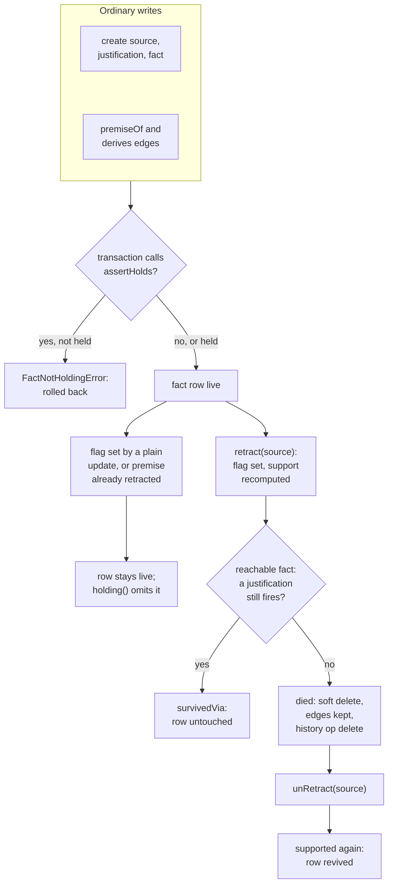

## 1. Executive Summary

TypeGraph is an embedded, typed knowledge-graph library for TypeScript from
Nicia AI. It stores Zod-validated nodes and edges in an existing SQLite or
PostgreSQL database and lists *"auditable agent memory, decision replay, and
bitemporal forensics"* first among its best fits (`README.md:43`). It is a
general graph library, and two of its subsystems are memory semantics the
library owns rather than the caller: bitemporal history, and a provenance
subpath that implements justification-based truth maintenance over ordinary
graph rows.

What is notable is retraction. A caller maps its own kinds onto sources,
justifications and facts, and `retract(source)` recomputes, in one
transaction, which facts reachable from that source still have a
justification whose premises all hold. It closes the rest as soft deletes that
keep every edge, and returns `died`, `survivedVia` with the firing
justifications, and `unaffected`. `unRetract` is the exact inverse. With
`history: true` both sides of the transition can be read back through recorded
time.

What is weak is that belief is enforced only where the caller asks for it. A
write that derives a fact from an already-retracted source commits as a live
row unless the transaction calls `assertHolds`. A belief close is the same
`deleted_at` a domain delete writes, in the row and in the history. There is
no agent surface: no tool, no extraction, no model call.

**Licence.** MIT, in `LICENSE` and `packages/typegraph/LICENSE`, which agree
with `"license": "MIT"` in `packages/typegraph/package.json`.
`CONTRIBUTING.md` licenses contributions under the same terms. No rider and no
component under other terms was found; the twelve LDBC SNB smoke CSVs under
`packages/benchmarks/fixtures/` carry no licence statement of their own.

## 2. Mental Model

The library holds whatever the caller defines; the memory claims sit in the
provenance subpath and in time. A **source** is a node with a boolean flag,
`retracted` by default (`src/provenance/config.ts:33-34`). A **justification**
is an AND rule: `premiseOf` edges point into it from sources or facts, and
`derives` edges point out to the facts it supports. A **fact** is any node of a
configured fact kind.

Belief is the least fixpoint of support. A justification fires when every
premise is in the support set; available sources seed the set, a fact enters
it when a firing justification derives it, and a required composition part
enters only while its whole is supported or live
(`src/provenance/support.ts:189-273`). A fact is **believed** when it is
supported and its row is live. A premise-less justification fires, which is
how an axiom is written. Unsupported cycles stay out; a cycle with a grounded
entry comes in.

Retraction moves rows, not labels. `runTransition` takes the graph's write
locks, flips the source flags, recomputes support, and selects the facts
reachable from the flipped sources that are now unsupported and still live
(`src/provenance/transition.ts:110-120`, `:231-297`). Each is closed through
the store's own delete path with delete-behaviour enforcement and composition
cascade turned off, so no edge moves (`:133-136`). Reachable facts that are
supported and tombstoned are revived. The set the close pass writes is the set
the report names, computed once.

A belief stops in two ways besides retraction. A source whose validity window
has ended stops supporting anything, because provenance reads follow current
validity (`src/provenance/support-read.ts:64-80`). And any caller can
soft-delete or hard-delete a fact like any other node.

## 3. Architecture

The package is the system: a library with subpath exports for the store,
backends, provenance, identity, graph merge, interchange and maintenance. It
runs in the caller's process against a database the caller already operates.
SQLite comes through better-sqlite3, libSQL or Turso, Cloudflare D1 and
Durable Objects, and bun:sqlite; PostgreSQL through node-postgres, postgres.js
or PGlite. Drizzle ORM renders the SQL.

Every graph shares one `nodes` and one `edges` table keyed by `graph_id`, with
`valid_from`, `valid_to`, `created_at`, `updated_at` and `deleted_at` on each
row (`src/backend/drizzle/schema/postgres.ts:140-198`). `history: true` adds
`recorded_nodes`, `recorded_edges`, a per-graph revision clock and an anchor
log (`:201-286`); it defaults to off
(`apps/docs/src/content/docs/schemas-stores.md:557`). Fulltext uses FTS5 on
SQLite and `tsvector` on PostgreSQL; vectors use sqlite-vec, pgvector or libSQL
native vectors. There is no daemon, worker or queue.

### Deployment and ergonomics

Adopting it costs a dependency and a schema: `npm install` beside Zod, Drizzle
and a driver, a graph definition in code, and `createStoreWithSchema` to
install the tables. It runs fully local and offline on a SQLite file. No API
key is needed to store anything, since embeddings arrive from the caller and
the library calls no model. The store is ordinary SQL rows with JSON `props`,
so it is inspectable by hand. Editing the recorded relations by hand is
unsupported, and a history-enabled store refuses raw `tx.sql`
(`src/store/history-store-backend.ts:8-13`).

## 4. Essential Implementation Paths

- **Configure.** `createRetractionCapability(store, config)` refuses a store
  without `history: true` and a configuration that leaves a required
  composition part outside the fact kinds (`src/provenance/scope.ts:41-57`,
  `src/provenance/config.ts:249-262`, `:211`). It returns `retract`,
  `retractMany`, `unRetract`, `unRetractMany`, `holding` and `assertHolds`
  (`src/provenance/index.ts:50-110`).
- **Transition.** `runTransition` locks, reads the source rows, loads the
  whole provenance graph once, computes support before and after the flip,
  and closes then reopens (`src/provenance/transition.ts:210-297`). Closes run
  first so a unique key can move between two affected facts (`:147-149`).
- **Support graph.** `loadSupportGraph` reads every current justification,
  every fact of the configured kinds including tombstones, every current
  `premiseOf` and `derives` edge and every current source
  (`src/provenance/support-read.ts:158-196`).
- **Believed set.** `holding()` loads the same graph and returns the believed
  fact keys, sorted (`src/provenance/holds.ts:84-103`).
- **Write guard.** `assertHolds(tx, facts)` takes the write locks, reads only
  the support closure behind the named facts, and throws one
  `FactNotHoldingError` naming every failure (`src/provenance/holds.ts:121-150`).
- **Valid time.** `resolveStampedValidityLowerBound` stores a stated
  `validFrom`, stores no lower bound for an explicit `null`, and otherwise
  stamps the write instant (`src/utils/date.ts:545-555`). Collection reads in
  `current` or `asOf` mode filter `deleted_at` and the window
  (`src/backend/drizzle/operations/collections.ts:26-53`).
- **Recorded time.** `flushNodes` closes the open recorded row for each touched
  id and inserts the after-image at the commit revision
  (`src/store/recorded-capture/flush.ts:166-197`).

## 5. Memory Data Model

A node row is `(graph_id, kind, id)` with JSON `props`, an integer `version`,
the validity window, and the three timestamps. An edge row adds endpoints and
an optional match identity. A recorded row copies all of that and adds
`history_id`, `recorded_from`, `recorded_to`, `op`, `schema_version`, `tx_id`
and `meta` (`src/backend/drizzle/schema/postgres.ts:201-256`). The writer fills
`op` from `create | update | delete` and writes `schema_version` and `tx_id`
as `NULL` and `meta` as the constant `{}`
(`src/store/recorded-capture/relations.ts:17`, `:62`, `:226-230`).

The provenance roles live in the caller's schema. The retracted flag is a
property the caller declares, usually `z.boolean().default(false)`, read by
`sourceRetractedState`, which treats a missing value as available and refuses a
non-boolean (`src/provenance/support.ts:101-119`). Nothing on a fact records
why it is closed: a belief close and a domain soft delete set the same
`deleted_at` and are both recorded with `op = 'delete'`.

Identity is a separate ledger. `assertSame(a, b)` and `assertDifferent(a, b)`
write assertions with their own validity windows. `assertSame` fails while a
current `different` assertion separates the two classes, and a database
`CHECK` on a derived separation relation backs that up
(`apps/docs/src/content/docs/identity.md:199-253`). Hard-deleting a node
removes every assertion touching it from the live ledger (`:206-209`).

Scope is the graph. `graph_id` is on every row and every query, and names a
graph definition sharing the tables. Tenancy is a caller property: the
multi-tenant example puts `tenantId` in each schema and filters on it, and the
graph documentation advises against using graphs for tenants
(`apps/docs/src/content/docs/multiple-graphs.md:22`).

## 6. Retrieval Mechanics

Retrieval is whatever the caller's code asks for. The query builder compiles
typed filters, projections, fixed and recursive traversal stages, aggregates
and set operations to one SQL statement where it can. `store.search` runs
fulltext, vector, or hybrid search fused by weighted reciprocal rank
(`src/backend/drizzle/operations/hybrid.ts:5`). There is no query rewriting,
reranker, token budget or context formatter.

Default reads are `current`: `deleted_at IS NULL` and the validity window
containing now (`src/backend/drizzle/operations/shared.ts:193-202`). So a fact
closed by retraction drops out of `find`, `getById`, traversal, and fulltext and
vector search, whose sidecar rows the close removes and the reopen restores
(`tests/provenance.test.ts:1068-1131`). `store.asOf(T)` moves the valid-time
instant. `store.asOfRecorded(anchor)` reads the recorded relations at a
revision, and the two chain. A recorded view answers point reads, the sealed
query builder, subgraphs and the graph algorithms, and refuses `find`,
`count`, search and vector predicates, because those indexes hold only the
present (`apps/docs/src/content/docs/queries/temporal.md:490-497`).

`holding()` is a separate read with its own answer. It recomputes support and
returns facts that are supported and live. A fact whose only source was
retracted by a plain update rather than by `retract()` is still returned by
`getById` and omitted by `holding()`.

## 7. Write Mechanics

Writes are synchronous transactions with no extraction, no deduplication by
similarity and no model call. A node or edge write validates against its Zod
schema, checks uniqueness and ontology constraints, writes the row and its
sidecars, and under `history: true` writes the recorded rows in the same
transaction. Raw SQL is refused on a history store, so every captured write
goes through this path.

A retraction blocks its caller for the whole transition. It loads the entire
provenance graph — every justification, every fact of the configured kinds
including tombstones, every premise and derive edge — into memory and computes
support twice (`src/provenance/transition.ts:252-284`). The cost grows with the
provenance graph rather than with the retracted source's reach. A closed or
reopened fact is readable as such once the transaction commits. No background
pass rewrites anything.

The source flag is ordinary data. `retract()` writes it through the
collection's `update` (`src/provenance/transition.ts:200-208`), and any other
`update` can write it too. Such a write changes support without closing
anything; the facts stay live until a later transition reaches them, and the
documentation says so (`apps/docs/src/content/docs/provenance.md:132-138`). A
new derivation from an already-retracted source also commits live
(`:229-234`). `assertHolds` is the guard for the second case and must be called
in each transaction that wants it (`:346-349`).

Deletion has two levels. `delete()` soft-deletes and `hardDelete()` removes the
row, its uniqueness entries and embeddings. Under `history: true` a hard delete
closes the open recorded row without inserting a successor, so the entity's
earlier rows stay readable at earlier anchors
(`src/store/recorded-capture/lineage.ts:60-63`,
`apps/docs/src/content/docs/identity.md:206-209`). The one path that deletes
recorded rows is `store.clear()`, which empties every relation of the graph
(`src/backend/graph-relations.ts:334-358`).

## 8. Agent Integration

There is none in the package. No MCP server, agent tool, prompt or hook is
defined, and nothing calls a model. An agent reaches TypeGraph through
application code that writes its conclusions as nodes and edges and calls
`retract` when a source turns out wrong. The documentation publishes
`llms.txt` and copy-paste instructions so a coding agent can write TypeGraph
code (`apps/docs/src/content/docs/llm-support.md`); that is help for an agent
using the library, not memory.

Two documented workflows are framed around agents. Graph extensions accept a
JSON schema a model proposes, which an operator approves before
`store.evolve()` commits it. Graph merge forks a store into working copies
that parallel writers edit and reconciles them with entity resolution and a
reviewable plan. Its durable-review example says *"Authentication and approval
policy remain application responsibilities"*
(`packages/typegraph/examples/27-durable-merge-review.ts:6`).

## 9. Reliability, Safety, and Trust

### What a retraction guarantees

Inside one transaction, under the schema-version fence and the per-graph write
lock, the flag flips, support is recomputed from one read, and the facts named
in `died` are exactly the facts closed (`src/provenance/transition.ts:99-120`,
`:238`). The close keeps every edge, so `unRetract` restores the same
neighbourhood. On PostgreSQL the lock serializes transitions with other
history writes and with `holding()`.

### What it does not guarantee

- **Belief at write time.** Only a transaction that calls `assertHolds` is
  checked. Every other write can leave a live fact with no firing
  justification, which the next transition reaching it will close and name in
  `died`.
- **A reason.** Nothing records who retracted a source or why. The recorded
  row for the flip is an `update` of the source, and the closed fact's row is
  a `delete`, the same as a domain delete.
- **Erasure.** `hardDelete` is documented for GDPR erasure
  (`apps/docs/src/content/docs/core-concepts.md:165-187`). On a history store
  the entity's earlier rows stay in the recorded relations, and only clearing
  the whole graph removes them.

### Marks

- **`bitemporal`** — awarded. Valid time is stated by the caller on every
  write path and defaults to the write instant only when absent; recorded time
  is a separate revision axis on separate relations; the two reads compose.
- **`audit_log`** — awarded on the recorded relations: a row per captured
  write classified `create`, `update` or `delete`, at a strictly monotonic
  revision, with content never edited. The record keeps no actor, a hard
  delete appears only as a closed interval, and capture is opt-in.
- **`negative_eval`** — awarded; see section 10.
- **`trust_state`** — withheld. The stored epistemic field is the source's
  retracted boolean, in the caller's schema, whose one reader is the support
  computation; ordinary reads return a retracted source like any node. A fact's
  belief is derived at each `holding()` and stored only as `deleted_at`, which
  a domain delete also writes.
- **`tombstone`** — withheld. A closed fact is a soft-deleted row, and a
  retracted source is a flag on a row. `assertDifferent` is the nearest
  thing: a durable refusal keyed on two node identities that stops a later
  `assertSame`, not on a value, and a hard delete of either node removes it.
- **`scope_enforced`** — withheld. `graph_id` partitions graph definitions and
  is on every predicate, but no user, agent or tenant key exists in the
  library; tenancy is a caller property and a caller filter.
- **`human_review`** — withheld. Schema proposals and merge plans wait for an
  approval the library does not attribute; there is no actor check, and no
  surface for memory content.

## 10. Tests, Evals, and Benchmarks

The package carries about 10,200 `it` and `test` cases in 438,495 lines. Shared
backend suites are registered into SQLite, libSQL, PGlite, node-postgres and
postgres.js lanes (`tests/backends/integration-registrations.ts:205`), and CI
runs unit shards, property tests, type tests, examples and a PostgreSQL job.
I ran none of it. The 26 files under `test-d/` and `type-smoke/` are tsd type
tests and consumer smoke checks: `test-d/provenance.test-d.ts` asserts the
types of the provenance API and executes no behaviour.

The behaviour of retraction is tested in
`tests/backends/integration/provenance.ts`, `tests/provenance.test.ts`,
`tests/provenance-composition.test.ts` and the property suites
`tests/property/provenance.test.ts` and `tests/property/provenance-laws.test.ts`.

`negative_eval` rests on two populated cases:

- `tests/backends/integration/provenance.ts:936-956` seeds a live fact and a
  closed one, then derives one fact from a live source and one from the
  retracted source inside a transaction; `holding(tx)` must equal exactly the
  held fact and the seeded live fact.
- `tests/backends/integration/provenance.ts:335-361` asserts that a retracted
  fact is gone from `getById` and from `asOfRecorded(after)` while
  `asOfRecorded(before)` returns it and its `derives` edge survives.

The fulltext and vector cases at `tests/provenance.test.ts:1068-1131` assert
the closed fact's absence with `every`, which an empty result also passes; the
positive reads before and after the retraction bracket them.
`tests/backends/integration/recorded-time.ts:2575-2596` checks that a row
stated valid from 1 January 2026 is absent at a valid instant before that and
present at it, at the same recorded anchor.

`packages/benchmarks` measures graph-database performance on LDBC SNB short
reads against named competitors; it is not a memory evaluation. The write-cost
figures in the release post, *"roughly 2.5–6×"* for a captured write, are
documentation claims with no committed run behind them here. No paper is
associated with the project; the post cites Doyle's 1979 JTMS and de Kleer's
1986 ATMS as the model it implements.

## 11. For Your Own Build

### Steal

- **Make retraction recompute support, not delete.** Store derivations as
  justification nodes with premise edges, and on a bad source close only the
  facts that lose every firing justification. Return died, survived-via and
  unaffected so the caller has the blast radius as data.
- **Close a belief without touching its edges.** A close that keeps the
  neighbourhood makes the inverse exact, and an unRetract becomes cheap.
- **Compute the closing set once.** Hand the same set to the writer and the
  report, so a row can never be closed without being named.
- **Guard the commit, not the read.** A check inside the writing transaction,
  under the same lock as retraction, avoids the race a separate read leaves.

### Avoid

- **Belief stored in the delete column.** When "not believed" and "deleted"
  are one timestamp, the history cannot say which happened. Give the close its
  own state or at least its own recorded operation.
- **An epistemic flag any write can set.** If the retracted flag is ordinary
  data, a plain update changes support without reconciling it; route the flag
  through the transition or reconcile on write.
- **Whole-graph recomputation per call.** Loading every justification and fact
  for each retraction and each `holding()` ties latency to the size of
  everything ever derived.
- **An erasure call that history outlives.** If a hard delete is the documented
  GDPR path, it should reach the history relations too.

### Fit

This fits a TypeScript team that already runs SQLite or PostgreSQL and wants
an agent's conclusions kept as typed graph data with a derivation behind each
one, and wants the ability to withdraw a source and see what falls. It suits
a fleet of agents writing into shared state where the risk is acting on a
conclusion whose evidence went bad. Walk away if you want memory an agent can
call: there is no tool, no extraction and no recall policy, so the memory layer
is the code you write on top. Walk away too if you need per-user isolation
from the library or a right to erase from history.

## 12. Open Questions

- Whether `holding()` is meant to stay a whole-graph recomputation at the
  sizes the release post has in mind, or whether an incremental support index
  is planned.
- Whether a belief close is meant to be distinguishable from a domain delete
  in the recorded relations, given that `tx_id` and `meta` exist and are
  written empty.
- How `hardDelete` on a history store is meant to meet the erasure use the
  core-concepts page names.

## Appendix: File Index

- Provenance: `src/provenance/index.ts`, `transition.ts`, `support.ts`,
  `support-read.ts`, `holds.ts`, `config.ts`, `locks.ts`, `scope.ts`
- Temporal and history: `src/core/temporal.ts`, `src/utils/date.ts`,
  `src/store/recorded-capture.ts`, `src/store/recorded-capture/flush.ts`,
  `relations.ts`, `lineage.ts`, `src/store/history-store-backend.ts`,
  `src/store/recorded-anchor-log.ts`
- Storage: `src/backend/drizzle/schema/postgres.ts`,
  `src/backend/drizzle/operations/collections.ts`, `shared.ts`, `clear.ts`,
  `src/backend/graph-relations.ts`
- Documentation: `README.md`, `apps/docs/src/content/docs/provenance.md`,
  `queries/temporal.md`, `identity.md`, `multiple-graphs.md`,
  `core-concepts.md`, `blog/truth-maintenance-for-agent-memory/index.mdx`
- Tests: `tests/backends/integration/provenance.ts`,
  `tests/provenance.test.ts`, `tests/backends/integration/recorded-time.ts`,
  `test-d/provenance.test-d.ts`

Paths under `src/`, `tests/` and `test-d/` are relative to `packages/typegraph/`.

### Recorded searches

Run from the repository root at the pinned commit with `/usr/bin/git grep`.

- **No agent tool surface in the package.**
  `git grep -n -i -E 'mcp|modelcontextprotocol' -- packages/typegraph/src packages/typegraph/package.json`
  returns nothing; the same pattern widened to `'mcp|llms\.txt'` over
  `apps/docs/src/content/docs/llm-support.md` matches lines 7 and 14.
- **No model call.**
  `git grep -n -i -E 'openai|anthropic|chat\.completions' -- packages/typegraph/src`
  matches only two comments in `src/core/embedding.ts`, lines 64 and 148.
- **No tenant, user or agent key in the library.**
  `git grep -n -w -E 'tenant_id|tenantId|user_id|userId|agent_id|agentId' -- packages/typegraph/src`
  matches one JSDoc example at `src/query/builder/query-builder.ts:2349`; the
  same pattern over `apps/docs/src/content/docs/examples/multi-tenant.md`
  matches the caller's `tenantId` at lines 24 and 53.
- **No statement deletes from the recorded node or edge relations.**
  `git grep -n -E 'DELETE FROM \$\{(schema\.)?recorded(Nodes|Edges)' -- packages/typegraph/src`
  returns nothing; `git grep -n -E 'DELETE FROM \$\{recordedAnchorsTable' -- packages/typegraph/src`
  matches `src/store/recorded-anchor-log.ts:386`. `store.clear()` reaches them
  through the generic statement in `src/backend/drizzle/operations/clear.ts:86`
  and the order in `src/backend/graph-relations.ts:334-358`.
- **The retracted flag is read only by the provenance subpath.**
  `git grep -l 'retractedField' -- packages/typegraph/src` lists
  `config.ts`, `holds.ts`, `support.ts`, `transition.ts` and `types.ts`, all
  under `src/provenance/`.
- **No paper.**
  `git grep -n -i -E 'arxiv|bibtex|@article|@misc|doi\.org' -- . ':!pnpm-lock.yaml'`
  matches only `server: "arXiv"` in `packages/typegraph/examples/08-custom-ontology.ts:354`,
  and the tree has no `CITATION.cff`.

## History

**2026-11-20** — [`3e927804a4e9833de01fde4059d8c0702300a763`](https://github.com/nicia-ai/typegraph/commit/3e927804a4e9833de01fde4059d8c0702300a763) — first reading, from a full clone of `main` at release 0.75.0, one commit past the triage pin `59934d5`. Scoped to the provenance subpath, valid and recorded time, deletion, graph scoping and their tests; the query compiler, graph merge, identity and interchange were read only where they bear on those. Screened first: no auto-run surface, no build-time execution, four dependency files inside the cooldown (three `package.json` files and `pnpm-lock.yaml`), six unpinned surfaces, and `AGENTS.md` and `CLAUDE.md` read as data. MIT, no rider. Nothing installed, built or run. Three marks: `bitemporal`, `audit_log`, `negative_eval`.
