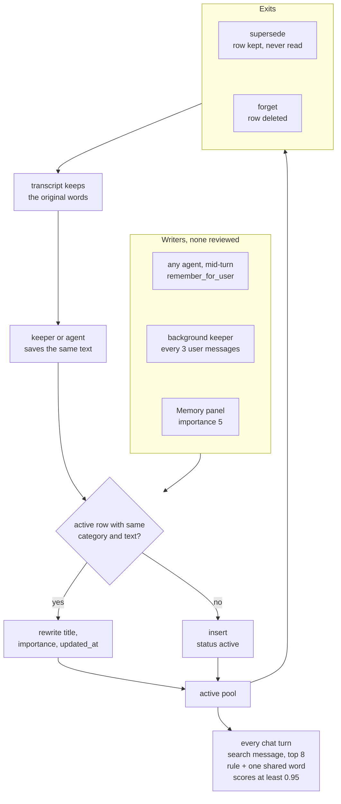

## 1. Executive Summary

Ultimate Assistant is a local desktop assistant for Windows and Linux that runs
a team of agents on whatever model account the user brings, through a separate
router called Herald. Its memory is one SQLite table of short rules,
preferences, context and episodes. Any agent writes it through an MCP server, a
background keeper reviews every third user message and writes more, and each
chat turn injects up to eight matches. Nothing sits between a model's sentence
and the next prompt: no candidate state, no review. A `rule` that shares one
word with the message scores at least 0.95, so model-written rules take the top
slots on almost every turn.

Correction is the strongest part, and it stops halfway. `supersede` keeps the
old row and takes it out of every search, and the embedding arm refuses
vectors from another model. But no API, panel or tool lists or searches
superseded rows, and the next `remember` of the same text inserts it again. Beside the store sit learned
skills: scripts an agent writes, which a later message runs with no agent loop
and no approval.

The licence is AGPL-3.0-or-later, so a modified copy offered over a network
must offer its source. The repository is a curated release mirror. `SOURCE.md`
says tests are excluded, and Herald, which hosts the MCP gateway the memory
server runs behind, is installed from pinned wheels outside this tree. No
capability mark is earned.

## 2. Mental Model

A memory is a row in `memories`: a category from `rule`, `preference`,
`context` and `episode`, a title, up to 4,000 characters of content, an
importance from 1 to 5, an optional source conversation and message id, three
timestamps, a status and an optional embedding (`memory_store.py:84-106`). The
categories differ in one place only: `rule` gets a score floor in retrieval
(`:310-311`).

Every write becomes a belief at once. `remember` collapses whitespace, then
looks for an **active** row of the same category whose lowercased content is
identical. If one exists it rewrites that row's title, importance, source and
`updated_at`; otherwise it inserts a new row whose status defaults to `active`
(`:186-238`). There is no candidate, pending or unverified state, and no step
that checks a claim before the next turn can retrieve it.

The state machine has three exits from `active`:

- **Superseded.** `supersede(old, new)` requires the replacement to exist and
  be active, then sets `status='superseded'` and `superseded_by`
  (`:328-338`). Every search and listing query filters on
  `status = 'active'`, so the row leaves retrieval and listing. No call moves it back.
- **Deleted.** `delete` removes the row; a trigger removes its FTS entry
  (`:340-343`, `:134-136`). Nothing records that it existed.
- **Overwritten.** `update` replaces category, title, content, importance and
  embedding in place, with no prior version kept (`:345-372`).

Who moves a memory: every agent (all six list `assistant_memory`), the
background keeper, and the user through the Memory panel, which can add, edit
and forget but not supersede. The prompt tells agents to save without being
asked and to supersede when the user's current words conflict with a memory
(`agents/core.md:14`). Retrieved memories enter the prompt as user context
under a note that saved rules and preferences may guide behaviour and that
current intent takes precedence (`web_ui.py:1564-1573`).

Three other things outlive a session. The transcript is the source record,
searchable by the agents' conversation tools. Each conversation has one
rolling summary. Learned skills are procedural memory, covered in section 8.
The `life/` package holds commitments, routines and nudges with deadlines the
clock acts on; it is task state and is kept out of this reading.

## 3. Architecture

The app is one FastAPI process, `web_ui.py`, bound to `127.0.0.1:8765`
(`web_ui.py:2609`, `:2628`). It serves the chat UI and a REST API behind an app
token, and holds one `MemoryStore` for its own reads and the panel's writes
(`:62`). Models are reached only through Herald, a separate router installed by
`setup.ps1` as two wheels pinned by SHA-256 in `herald.json`. The agents run
inside Herald, either on Herald's own harness or as a provider CLI in its own
agent loop.

The memory MCP server is `memory_tools.py`, a FastMCP stdio process. On first
use the app registers it with Herald as a project-scoped tool instance and
binds it to the assistant's part under the alias `assistant_memory`
(`assistant.py:126-131`, `:281-307`). Each agent is its own Herald part and
lists the aliases it sees in its front matter (`agents/__init__.py:38-41`). The
server opens the same database file the app does, by a path from the
environment (`memory_tools.py:16-18`).

Persistence is three SQLite files under
`%LOCALAPPDATA%\UltimateAssistant\data`, or `~/.ultimate-assistant/` when that
variable is unset: `memory.sqlite3`, `conversations.sqlite3` and
`tasks.sqlite3` (`settings.py:41-67`). Skills live as folders under the
settings directory with an `index.sqlite` of example embeddings
(`skills.py:11-13`). Retrieval is FTS5, or `LIKE` where the SQLite build lacks
it, plus optional cosine over vectors from a local Ollama embedding model.

Secondary devices run `ui_proxy.py`, which forwards their requests to the main
node's app through Herald, so every paired device reads and writes the one
store. `knowledge.py` reads a separate "College Assistant" FTS index read-only,
and chat injects up to five excerpts as untrusted reference data
(`knowledge.py:17-42`, `web_ui.py:1559-1563`).

### Deployment and ergonomics

Everything runs on one PC: Python 3.13, Herald, and a model account of any
kind — a provider CLI subscription, an API key or a local model. The memory
store needs no key and no service; the panel writes without a model, and
embeddings are off until the user names an Ollama model
(`web_ui.py:1143-1155`). Setup installs `requirements.txt`, whose 13
requirements float with `>=`. The store is one ordinary SQLite table a person
can open and repair. The FTS index is rebuilt from the table on every open, so
a hand edit is re-indexed on the next start (`memory_store.py:139-143`).

What this tree cannot show is Herald. The tool gateway that decides which part
sees `assistant_memory`, the harness that runs the agents, the models behind
`_ask_fast`, and the encrypted "worker memory" that `ORCHESTRATION.md:32-33`
describes are all in the `herald-release` wheels, which I did not download or
read. Every claim below about who can call a tool rests on the assistant's own
registration code, not on the gateway that enforces it.

## 4. Essential Implementation Paths

- **Schema and index.** `MemoryStore.__init__` creates `memories`, adds
  `superseded_by`, `embedding_model` and `embedding_dimension` by
  `ALTER TABLE`, and creates `memories_active` on `(status, importance DESC)`
  (`memory_store.py:77-107`). `_initialize_lexical_index` creates the FTS5
  table and three triggers, then deletes and repopulates the whole index
  (`:109-146`). Every SQL write to `memories` is in this file.
- **Agent write.** `remember_for_user` validates the category and calls
  `remember` with optional `source_conversation_id` and `source_message_id`
  (`memory_tools.py:28-47`). The chat turn tells the model those ids for the
  current turn in a turn note (`web_ui.py:1543-1545`).
- **Background write.** After a chat reply is stored, `_keep_memory_later`
  runs if memory tools are bound (`web_ui.py:1756-1757`). It counts user
  messages since the conversation's mark in `_memory_marks`, an in-process
  dict, and returns below three (`:239-254`). Otherwise it posts the new
  messages, cut to 1,500 characters each and 12,000 in all, as a task for the
  `companion` agent to `/api/agents/run` from a daemon thread (`:255-276`).
- **Panel write.** `POST`, `PUT` and `DELETE /api/memories` call `remember`,
  `update` and `delete` (`web_ui.py:1232-1261`); the form posts importance 5
  (`ui/index.html:1183`).
- **Retrieval.** `search` builds lexical candidates, loads every active
  embedded row of the configured model, scores, cuts to the limit and stamps
  `last_accessed_at` (`memory_store.py:248-326`).
- **Injection.** The chat turn calls `_memories.search(message, limit=8)`
  before routing (`web_ui.py:1421`) and appends the hits as a system message
  (`:1564-1573`). An agent run outside chat injects six, matched on its task
  text (`:1856-1860`).
- **Correction.** `update_assistant_memory`, `supersede_assistant_memory` and
  `forget_assistant_memory` (`memory_tools.py:50-84`) over `update`,
  `supersede` and `delete` (`memory_store.py:328-372`).
- **Conversation memory.** `compaction_batch` selects up to 50 messages or
  30,000 characters older than the 20 most recent
  (`conversation_store.py:124-152`). `_summarize_history` asks a model to fold
  them into the rolling summary with `[#id]` citations (`web_ui.py:470-500`),
  and `save_memory` overwrites it (`conversation_store.py:154-162`).
- **Skills.** `_distill_skill_later` asks the builder to save a skill after any
  tool-using turn (`web_ui.py:212-236`, `:1754-1755`); `_find_skill` and
  `_skill_turn` run a matched skill as the turn (`:284-344`).
- **Tests.** None for any path above; see section 10.

## 5. Memory Data Model

`memories` has `id` (a UUID4), `category`, `title`, `content`, `importance`,
`source_conversation_id`, `source_message_id`, `created_at`, `updated_at`,
`last_accessed_at`, `status` (default `active`), `embedding` as JSON text,
`superseded_by`, `embedding_model` and `embedding_dimension`
(`memory_store.py:84-105`). Content length, category and importance are
validated in the store and again on the HTTP models (`web_ui.py:662-670`).

**Scope.** There is no scope column. One database per OS user profile serves
every agent, every conversation and every paired device. That matches the
product, which is one person's assistant. Herald's project and part scoping
governs which tools an agent sees, not which rows it reads.

**Provenance.** The source ids are optional tool arguments. The model fills
them from a turn note, and `remember` keeps the old ids when a dedup call
passes none (`memory_store.py:217-218`). The embedding carries its model name
and dimension, set by the store from configuration rather than by the caller
(`:70-74`), and `_public_memory` strips both from API output (`:21`, `:65-67`).

**Time.** `created_at` and `updated_at` are record times; `updated_at` moves on
every dedup hit and edit. `last_accessed_at` is written on every retrieval hit
(`:320-325`) and read by nothing. There is no time at which a fact held.

**Versioning.** `superseded_by` names the replacement and is written by
`supersede` alone. It has no reader. `update` keeps no prior content.

**Separation.** Categories label the row, and only rules are treated
differently. Transcripts, conversation summaries, skills and the external
knowledge index are separate stores. The summary is one row per conversation,
holding `summary`, `through_message_id` and `updated_at`, overwritten on each
fold (`conversation_store.py:50-56`, `:154-162`).

## 6. Retrieval Mechanics

**Candidates.** The query's terms are every run of two or more word
characters, apostrophes or hyphens, casefolded (`memory_store.py:249`). The
lexical arm ORs the quoted terms in FTS5, joined to active rows, and falls back
to a `LIKE` per term (`:149-179`). The vector arm loads every active row with
an embedding from the configured model and a recorded dimension (`:258-262`).
Both sets are merged by id.

**Scoring.** For each candidate, `overlap` is the share of query terms present
as whole words in title and content. With a usable vector the score is
`0.62·cosine + 0.20·overlap + 0.13·importance/5 + 0.05·recency` against a
threshold of 0.28; without one it is
`0.68·overlap + 0.24·importance/5 + 0.08·recency` against 0.36
(`:304-309`). Recency is `1/(1 + age_days/180)` on `updated_at`. Ties break on
importance, then `updated_at`, then id (`:314-317`).

**The rule floor.** A `rule` scores at least 0.95 when `overlap` is non-zero or
its cosine is at least 0.25 (`:310-311`). Overlap counts any shared term,
two-letter words included, and the FTS5 table is created with the default
tokenizer and no stop list (`:118-121`). A rule
containing "the" or "my" is a candidate for any message containing that word,
and outranks every non-rule on it. With eight or more such rules, nothing but
rules reaches the chat prompt. A cosine of 0.25 is a low bar for most embedding
models, so with vectors on the floor applies to nearly every rule.

**Vector provenance.** A vector is compared only when its stored model equals
the configured one and its dimension equals the query's (`:288-292`). Changing
the embedding model therefore drops every old vector from the vector arm
instead of comparing incompatible spaces. Nothing re-embeds the old rows, so
they fall back to lexical matching until edited.

**Injection.** Chat injects the top eight as JSON with id, category, title,
content, importance, `updated_at` and the source ids (`web_ui.py:1564-1573`).
The MCP `search_assistant_memory` returns `_public_memory` rows, which drop
only `embedding_model` and `embedding_dimension`. With embeddings on, each hit
carries its whole vector as a JSON string into the model's context
(`memory_tools.py:21-25`, `memory_store.py:21`, `:65-67`).

**Failure modes.** Over-recall of rules, above. Near-duplicates: dedup is exact
text, so a keeper that rephrases a fact adds a second row and both match. And
one shared word lets an importance-5 panel memory pass the lexical threshold on
a long message, since importance and recency alone score 0.32 of the 0.36.

## 7. Write Mechanics

Writes happen three ways, with no extraction code in any of them: the model
decides what to save and in what words.

- **Hot path.** An agent calls `remember_for_user` mid-turn. The prompt asks it
  to save durable facts unprompted, to search before saving and to update
  rather than duplicate (`agents/core.md:14`). The tool description asks it to
  check with the user before saving inferred sensitive or uncertain details
  (`memory_tools.py:33`). Neither is enforced.
- **Keeper.** Every third user message in a conversation, a background
  companion run receives the new transcript and is told to search, then
  remember, update or supersede, keeping each memory to one or two sentences
  (`web_ui.py:256-265`). Its marks live in a process dict, so after a restart
  the next qualifying turn hands it the last 12,000 characters of the whole
  conversation again (`:240`, `:250-255`).
- **Panel.** The user adds, edits or forgets a row.

**Dedup and update.** The only consolidation is the exact-text match among
active rows of the same category. A hit rewrites importance with the new
call's value, so a keeper re-saving a panel memory at the default 3 lowers it
from 5 (`memory_store.py:214-227`). `update` takes any id and does not check
status, so an edit to a superseded row succeeds and stays invisible.

**Conflict.** Detection is the model's job. The supersede tool says not to
infer which of two conflicting memories is correct (`memory_tools.py:79`).
Two contradictory active rows are both retrieved.

**Agent-generated and hostile input.** The keeper reads assistant messages as
well as user ones, and an assistant reply can carry text from a web page, a
file or a tool. The prompts say such material is data, not instructions
(`agents/core.md:12`). No code checks what is saved, and a saved `rule` gets
the floor above.

### Operational cost

A hot-path write is a tool call inside the turn, plus one Ollama embedding call
with a 20-second timeout when vectors are on (`memory_store.py:35-49`). It is
retrievable on the next turn. A keeper write lands when a full agent run
finishes, under a 900-second request timeout, and only after three user
messages; the lag is that run's duration, likely seconds to minutes. Nothing
rewrites the whole store, but the MCP server constructs a new `MemoryStore` on
every tool call (`memory_tools.py:16-18`), and each construction deletes and
rebuilds the whole FTS index (`memory_store.py:139-143`).

Each chat turn runs one search, which loads and JSON-parses every embedded
active row and computes cosine in Python, so its cost grows with the store.
Injection is bounded at eight rows of at most 4,000 characters. The memory
block sits after the turn notes, and the turn notes carry a fresh
`activity_id` every turn (`web_ui.py:1556`, `:1620-1624`). Everything after the
first system message therefore differs per turn, which limits a provider's
prefix cache to that first message.

## 8. Agent Integration

All six agents list `assistant_memory`: companion, builder, operator, planner,
researcher and tutor (`agents/*.md:4`). Each therefore holds remember, update,
supersede, forget and search, plus `list_conversations`, `read_conversation`
and `search_conversations` (`memory_tools.py:92-115`). Builder and operator
also hold a shell and the filesystem, and the shared prompt grants
administrator authority on the user's devices (`agents/core.md:9`). The memory
database is a file in the user's profile, so the MCP verbs are not the only way
an agent can change it.

Context arrives automatically: up to eight memories, the time, the desktop's
window list, a list of other conversations by title, and open tasks for agents
that hold the task tool. A user's own
files under `<settings dir>/agents` override a base agent of the same name, and
`agent_tools` in `settings.json` adds tool aliases per agent
(`agents/__init__.py:77-107`).

**Learned skills** are the procedural half. After any turn in which an agent
used tools, `_distill_skill_later` asks the builder in the background whether
the work should become a skill (`web_ui.py:212-236`). `save_skill` writes a
PowerShell, Python or bash script with typed parameters and example phrasings,
and runs it at once if the agent supplies `test_parameters`
(`skill_tools.py:33-67`). A failed test run is reported to the agent and the
skill stays saved.

On a later message, `find` shortlists skills by embedding or
word overlap and asks a decision model or a fast model to confirm the match and
fill parameters (`skills.py:248-270`, `:436-460`). `_skill_turn` then runs the
script as the whole turn, with no agent loop, and adds the user's message as a
new example for that skill (`web_ui.py:317-335`).

Nothing a person sees stands between a saved script and its next run. The rule
against skills that send, delete or buy is prompt text (`agents/core.md:18`).
`created_by` exists in the definition and no caller passes it
(`skills.py:196`, `:213`). Teach mode records a user's demonstration with
password fields hidden, and an agent turns it into a skill the same way
(`teach_store.py:1-13`, `skill_tools.py:119-140`).

The memory server would be easy to adapt for another agent: it is a stdio
FastMCP module whose only dependency is a database path.

## 9. Reliability, Safety, and Trust

### A model's sentence becomes a standing instruction

The write path has no gate and the read path has a floor. An agent, or the
keeper reviewing a reply that quoted a web page, can save a `rule`. From then
on that rule is injected on every message that shares a word with it, ranked
above everything that is not a rule, under a note saying saved rules may guide
behaviour. The defences are prompts: the core prompt calls web pages and tool
output data, and the injection note says current intent wins. Nothing records
whether a rule came from the user's words or the model's.

### Correction keeps a record nobody reads

`supersede` is the right shape: the old row is kept, linked to its replacement
and removed from every search. But no route, tool or panel lists superseded
rows, `superseded_by` has no reader, and nothing records when or why the row
was retired. `remember` checks only active rows for a duplicate, so the
superseded text is accepted again as a new active row. Forget is a hard delete
with nothing left behind, and the transcript keeps the original words, which
the keeper and the conversation tools read.

### Deletion stops at the memory table

Forgetting a memory leaves it in the transcript, in the conversation summary if
a fold captured it, and in any skill built from the same turn. The README says
the transcript remains the source record (`README.md:184-195`). Clearing a
conversation deletes its messages, activity and summary and leaves its
memories (`conversation_store.py:218-222`).

### The app token

Every memory route requires `x-ultimate-assistant-token`, compared in constant
time (`web_ui.py:691-695`). The token is generated per process and written into
the HTML that `GET /` serves without authentication (`:54`, `:698-700`). It
stops a cross-origin page, which cannot read that response. It does not stop a
local process, including an agent with a shell, from fetching the page and
calling the API.

### Concurrency

The app and the MCP server open the same file with a 10-second busy timeout.
Dedup runs its `SELECT` before Python's `sqlite3` opens the implicit
transaction at the `INSERT`, so two processes saving the same text at the same
moment can both miss the other and write two rows (`memory_store.py:209-236`).
The `RLock` beside it serialises writers within one process only.

### Marks

None is carried.

- **`tombstone`** — `remember` deduplicates against `status = 'active'` only
  (`memory_store.py:210-213`). The text of a superseded row is inserted again
  as a new active row, and a deleted one leaves nothing to compare against. No
  write path reads a superseded or deleted value.
- **`trust_state`** — `status` has two values, `active` and `superseded`, and
  every search does filter on it. But every row enters `active` and is retrieved
  on the next turn. `superseded` is reached only by replacement, so it marks a
  position in a correction chain, not a judgement made before belief. There is
  no candidate state.
- **`bitemporal`** — `created_at`, `updated_at` and `last_accessed_at` are all
  record times.
- **`scope_enforced`** — no scope column exists; the boundary is the OS user
  profile, which is a physical partition.
- **`audit_log`** — no event table records memory mutations. `supersede` keeps
  the row and records neither time nor actor; `update` overwrites; `delete`
  removes. The preparation store's `context_revisions` keeps revisions of task
  contexts, which are task state.
- **`human_review`** — the Memory panel edits and deletes after the write has
  landed, and every agent holds the same verbs. No memory waits for a person.
- **`negative_eval`** — no test of any memory path is committed.

## 10. Tests, Evals, and Benchmarks

The tree has no Python tests. `apps/assistant/conftest.py` points
`HERALD_DATA_DIR` and `LOCALAPPDATA` at temporary directories and turns off
usage reporting for a pytest suite, and `SOURCE.md:9` says tests are excluded
from the published source. The only committed tests are seven Kotlin cases in
the Android companion: six for voice progress cues and one instrumented
bridge-transport test. None touches memory. I ran nothing.

The orchestration notes record "App regression: 32 passed" and a Herald
regression of 472 passing (`ORCHESTRATION.md:55`). Neither suite is in this
tree, so neither figure can be checked here.

`tools/decisions/route_bench.py` is a committed benchmark of pre-turn agent
routing. Its published results on Hugging Face
(`Krioasns/system1-decision-routing-bench`) score deciders on 62 prompts for
agent choice and whether a turn needs tools. The one prompt in it that names
memory is a routing case for the builder (`route_bench.py:41`). No paper is
associated with the project.

Before trusting the store I would want three cases: a superseded memory absent
from search while its replacement is present in the same result; a rule that
does not outrank a relevant preference on an unrelated message; and
`remember` of a superseded memory's text refused or flagged.

## 11. For Your Own Build

### Steal

- **Record the embedding model and dimension on every vector, and compare only
  like with like.** A model change then degrades to lexical recall instead of
  ranking against an incompatible space.
- **Keep the superseded row and link it to its replacement.** It is one column
  and it is what makes an audit or an undo possible later; add the reader the
  first time you add the writer.
- **Rebuild a derived index from the table on open, with triggers between
  opens.** Hand edits and interrupted migrations repair themselves.
- **Give the background reviewer a mark per conversation**, so it reads only
  what is new; persist the mark, or a restart replays the conversation into it.

### Avoid

- **A category that bypasses relevance.** A score floor on any overlap turns a
  category into a standing instruction; gate it on a real match, or inject a
  small fixed set of user-authored rules separately.
- **Dedup that consults only live rows.** It is the step that lets a corrected
  value back in; check the retired rows too, by value.
- **Returning storage columns from a model-facing tool.** A vector serialised
  as JSON is tokens the model pays for and cannot use.
- **Executable procedural memory with no person in the admission path.** A
  prompt rule about what a script may do is not a constraint on the script.

### Fit

This suits one person who wants an assistant that remembers preferences across
devices with no service to run, and who will read the Memory panel. The store
is small enough to read in an afternoon and repair by hand. Walk away if memory
must be correctable in the strong sense, if untrusted content passes through
conversations, or if you need to know who wrote a belief. The design trusts the
model at every write and gives rules a permanent place in the prompt. It is a
one-author project, public since 30 September 2026, whose tests are not
published.

## 12. Open Questions

- How Herald's gateway binds `assistant_memory` to each agent part, and whether
  a provider CLI running as its own instance keeps native memory files of its
  own.
- What the 32 app tests cover, and whether any exercise supersession or the
  rule floor.
- How many rules a real store accumulates, and how often rules fill all eight
  slots.
- Whether the keeper re-saves corrected or forgotten facts after a restart in
  practice.
- What the "worker memory" in Herald's encrypted vaults holds, and whether
  anything reads it back across sessions.

## Appendix: File Index

- Storage and schema: `apps/assistant/ultimate_assistant/memory_store.py`,
  `conversation_store.py`, `settings.py`
- Write path: `memory_tools.py`, `web_ui.py` (`_keep_memory_later`,
  `/api/memories`), `agents/core.md`
- Retrieval and injection: `memory_store.py` (`search`), `web_ui.py`
  (`_chat_turn`, `run_agent`), `knowledge.py`
- Background: `web_ui.py` (`_keep_memory_later`, `_distill_skill_later`,
  `_summarize_history`)
- MCP and registration: `memory_tools.py`, `assistant.py`
  (`_ensure_memory_tools`, `EVERY_AGENT_TOOLS`), `agents/__init__.py`,
  `agents/*.md`, `mcp-bundle.json`
- Procedural memory: `skills.py`, `skill_tools.py`, `teach.py`,
  `teach_store.py`
- UI: `ui/index.html` (`refreshMemories`)
- Task state, not read as memory: `life/`, `life_capture.py`, `task_store.py`
- Tests: `apps/assistant/conftest.py`, `companions/android/app/src/test/`,
  `companions/android/app/src/androidTest/`
- Docs: `SOURCE.md`, `apps/assistant/README.md`, `apps/assistant/ORCHESTRATION.md`,
  `tools/decisions/README.md`

### Recorded searches

Run from the repository root at the pinned commit with `/usr/bin/git`. `M` is
`apps/assistant/ultimate_assistant`.

- **No Python tests.** `git ls-files -- '*test*' '*Test*'` returns
  `apps/assistant/conftest.py` and the two Kotlin files;
  `git grep -n -E 'def test_' -- '*.py'` returns nothing.
- **No validity time.**
  `git grep -n -i -E 'valid_(from|to|until)|valid_at|event_time|occurred_at|expires_at' -- $M/memory_store.py $M/memory_tools.py`
  returns nothing; adding `|created_at` to the pattern matches two lines of
  `memory_store.py`.
- **No query selects a superseded row.**
  `git grep -n -w superseded -- '*.py' ':!apps/assistant/ultimate_assistant/life/'`
  returns the writer at `memory_store.py:336`, the tool's return key at
  `memory_tools.py:82`, and two unrelated tables in `canvas_feeds.py` and
  `phone/overlay_presentation.py`. `git grep -n -E 'superseded_by'` returns the
  migration and the writer.
- **`last_accessed_at` has no reader.** `git grep -n -E 'last_accessed_at'`
  returns the schema and the writer.
- **Every write to the table is in one file.**
  `git grep -n -E 'INSERT INTO memories|UPDATE memories|DELETE FROM memories' -- '*.py'`
  returns `memory_store.py` only, and the one `UPDATE` that sets `status`
  sets it to `superseded`.
- **No candidate state.**
  `git grep -n -i -E "'(pending|candidate|draft|unverified|rejected)'" -- $M/memory_store.py $M/memory_tools.py`
  returns nothing; `git grep -c -E "'active'" -- $M/memory_store.py` returns 9.
- **No scope key.**
  `git grep -n -i -E 'user_id|project_id|agent_id|tenant|scope|owner' -- $M/memory_store.py $M/memory_tools.py`
  returns nothing; `git grep -c -i -E 'category|importance' -- $M/memory_store.py`
  returns 29.
- **No mutation record.**
  `git grep -n -i -E 'audit|history|revision' -- $M/memory_store.py $M/memory_tools.py`
  returns the supersede docstring, the supersede tool description and the
  conversation-history reads.
- **Keeper marks are in-process.** `git grep -n -E '_memory_marks' -- '*.py'`
  returns three lines of `web_ui.py`: the dict, a read and an assignment.
- **No caller sets a skill's author.** `git grep -n -E 'created_by' -- '*.py'`
  returns the parameter and the assignment in `skills.py`.
- **No approval step for skills.**
  `git grep -n -i -E 'approv|confirm' -- $M/skills.py $M/skill_tools.py`
  returns one docstring, about a model confirming a match;
  `git grep -n -i -E 'skill' -- $M/ui/index.html` returns nothing, while
  `memor` matches 54 lines of the same file.
- **No re-embedding.** `git grep -n -i -E 'backfill|re-?embed' -- '*.py'`
  returns nothing; `git grep -c -i -E 'embed' -- '*.py'` matches many files.
- **No paper.**
  `git grep -n -i -E 'arxiv|bibtex|@article|@misc|doi\.org|citation'` returns a
  routing keyword list in `agents/dispatch.py` and a comment in
  `VoiceController.kt`; there is no `CITATION` file.

## History

**2026-11-03** — [`814a589acbe004f52ed2ffffb2c1afb539649bd8`](https://github.com/KianJRoss/UltimateAssistant-release/commit/814a589acbe004f52ed2ffffb2c1afb539649bd8). First reading, from a full clone at the head of `main` (2 November 2026, release 0.4.5). Screened first: no auto-run surface, `apps/assistant/conftest.py` executes on pytest collection, and two requirements files float (13 and 4 entries); nothing inside the cooldown, no agent-instruction file. AGPL-3.0-or-later, no rider. Herald is installed from pinned wheels and was not read. Nothing installed, built or run. No marks: dedup consults only active rows, `status` is a supersession lifecycle with no candidate state, and no memory test is committed ([section 9](#9-reliability-safety-and-trust)).
