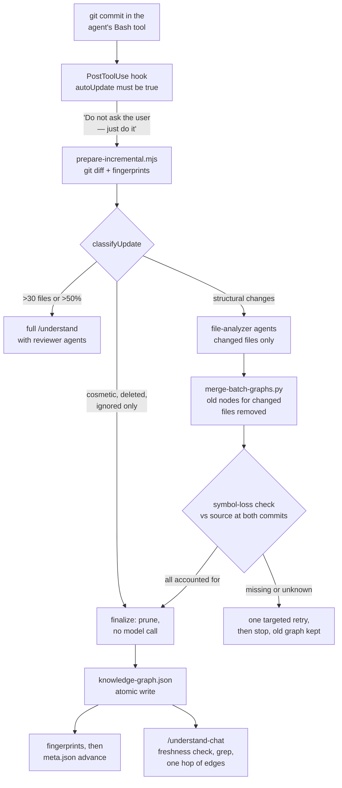

## 1. Executive Summary

Understand Anything is a Claude Code plugin, MIT-licensed, that turns a
repository into a knowledge graph an agent and a person can both read. A
multi-agent pipeline scans the project, has a model summarise every file,
function and class, adds edges for imports, calls and dependencies, groups the
nodes into architectural layers and writes a guided tour. All of it goes into
`.ua/knowledge-graph.json` beside the code. Later sessions answer questions
from that file with `/understand-chat` instead of re-reading the source, which
is what makes it memory: it survives the session, and every summary in it can
become wrong as the code changes.

What is notable is how it stays current. After a commit, a deterministic helper
diffs the analysed commit against `HEAD`, compares structural fingerprints and
classifies the change. Cosmetic, deleted, ignored and generated-only changes
cost no model call. Only files that changed structurally are re-analysed, and
the merged graph is checked symbol by symbol against the source before it may
replace the old one. A function that disappeared from the graph while its
source still defines it blocks the save. `meta.json` advances only after the
graph is written.

What is weak is everything above the structure. Summaries are model output that
nothing checks against the code, and incremental updates skip the two reviewer
agents a full run uses. The plugin's hooks tell the agent to perform the update
*"Do not ask the user for confirmation — just do it."* Nothing records what an
update changed, and the semantic search the dashboard mentions is declared and
never called. The project is young and busy, and its tests concentrate on the
update machinery.

## 2. Mental Model

A node is a belief about the code at one commit. It becomes stale when the code
moves and is replaced, not corrected, when its file is re-analysed.

1. **First analysis.** `/understand` scans the project, batches files, and
   dispatches `file-analyzer` agents that return nodes and edges per batch. A
   Python merge assembles them, an `assemble-reviewer` agent checks the whole
   graph, architecture and tour agents add layers and steps, and the result is
   saved with the commit hash in `meta.json`.
2. **Staleness.** The graph is stale when the project's files differ from the
   analysed commit. `/understand-chat` checks this itself with `git diff` limited
   to the project path, and warns before answering from a stale graph.
3. **Incremental update.** With `autoUpdate` on, a commit triggers a plan:
   `SKIP`, `PARTIAL_UPDATE`, `ARCHITECTURE_UPDATE` or `FULL_UPDATE`
   (`packages/core/src/change-classifier.ts:15-19`). Changed and deleted files'
   nodes are pruned, changed files are re-analysed, and the result is merged.
4. **The gate.** `validate-incremental-symbols.mjs` compares the candidate with
   the previous symbols and the source at both commits. A missing symbol the
   source still holds, or one it cannot classify, blocks publication. One
   targeted retry is allowed, then the update stops with the old graph intact.

## 3. Architecture

Nothing runs beside the agent. The plugin is markdown skills and agent
definitions, two hooks, Node helper scripts, one Python merge script, and a
`core` TypeScript package that holds the schema, tree-sitter extractors,
fingerprints, staleness and search. A React dashboard reads the same JSON and
serves it locally. The agent's own session does the work, so the cost is its
model calls and the user's tokens.

Storage is a directory per project: `.ua/`, or `.understand-anything/` for
projects analysed before the rename (`packages/core/src/persistence/index.ts:19-26`).
`saveGraph` rewrites absolute file paths to project-relative ones before writing,
so a developer's home directory is never stored in the graph (`:84-98`).

The plugin also analyses other inputs into the same graph shape: a
Karpathy-style markdown wiki (`/understand-knowledge`, with `claim`, `source` and
`contradicts`), business domains and flows (`/understand-domain`), and Figma
files. Those are separate graphs produced by the same pipeline style.

## 4. Essential Implementation Paths

- **Hooks:** `hooks/hooks.json` registers a `SessionStart` command that prints
  the stale-graph instruction when `autoUpdate` is true and the analysed commit
  is not `HEAD`. `hooks/post-tool-use-auto-update.mjs` matches
  `git (commit|merge|cherry-pick|rebase)` in a Bash command and returns the same
  instruction as `additionalContext` (`:3`, `:40-45`).
- **Plan:** `skills/understand/prepare-incremental.mjs`. It derives the changed,
  deleted and renamed files, prunes their nodes from the existing graph
  (`pruneExistingGraph`, `:422`), and clears scratch batches from a failed
  attempt *"so the merge cannot resurrect deleted nodes from stale output"*
  (`:527-530`).
- **Classification:** `classifyUpdate`
  (`packages/core/src/change-classifier.ts:21`).
- **Merge and gate:** `skills/understand/merge-batch-graphs.py`,
  `validate-incremental-symbols.mjs`, `prepare-symbol-retry.mjs`.
- **Save:** `skills/understand/finalize-incremental.mjs` writes the graph with
  `atomicWriteJson` (`:65`), then patches fingerprints, then advances
  `meta.json` (`:10-11`).
- **Read:** `skills/understand-chat/SKILL.md`; `packages/core/src/search.ts`
  (Fuse.js), used by the dashboard store (`packages/dashboard/src/store.ts:367`)
  and the plugin's context builder (`src/context-builder.ts:33`).

## 5. Memory Data Model

A `GraphNode` has `id`, `type` (27 kinds across code, infrastructure, domain,
knowledge and design), `name`, optional `filePath` and `lineRange`, a model-written
`summary`, `tags`, a `complexity` of simple, moderate or complex, and optional
metadata per kind (`packages/core/src/types.ts`). A `GraphEdge` has a source,
target, one of 38 types, a direction, an optional description and a weight.
Layers and tour steps reference node ids.

There is no status, confidence or provenance field on a node or edge, and no
record of which agent or commit produced a given summary beyond the graph-wide
`gitCommitHash`. `fingerprints.json` stores per-file structural signatures —
functions, classes and imports with hashes — and that is what decides whether a
file changed in a way that matters.

## 6. Retrieval Mechanics

The agent reads the graph with its own tools. `/understand-chat` tells it to
grep the JSON for the query's keywords in `name`, `summary` and `tags`, collect
matching node ids, grep the `edges` section for one hop around them, read the
layers, and answer from that subgraph. Before answering it runs the freshness
check, limited to the project with a `-- .` pathspec so a commit to a sibling
project in a monorepo does not mark the graph stale, and it ignores the `.ua/`
directory's own changes.

The dashboard and the plugin's context builder use Fuse.js over name (0.4),
tags (0.3), summary (0.2) and language notes (0.1), threshold 0.4, with
space-separated tokens joined as OR (`packages/core/src/search.ts:14-25`).
`SemanticSearchEngine` in `embedding-search.ts` ranks by cosine similarity over
supplied embeddings. It is exported and no code constructs it, and nothing in
the skills or agents produces embeddings; a comment in the dashboard store says
semantic mode will use it *"when embeddings are available"* (`:541`).

## 7. Write Mechanics

**Writes block the agent's own session.** There is no background worker. The
hooks inject an instruction, and the agent stops what it was doing to run the
update in the same session, spending its context and the user's tokens.

**Lag** is zero for a graph kept current by the hook and unbounded otherwise:
with `autoUpdate` off, which is the default until `/understand --auto-update`,
the graph stays at its analysed commit and only the chat skill's warning says
so.

**The whole graph is rewritten on every save**, atomically. An incremental run
re-analyses only the files that changed structurally. A run with more than 30
structurally changed files, or more than half the project, becomes a full
rebuild.

## 8. Agent Integration

The plugin ships nine skills: `/understand`, `-chat`, `-dashboard`, `-diff`,
`-domain`, `-explain`, `-figma`, `-knowledge` and `-onboard`. It also ships ten
agent definitions and two hooks. Install scripts copy the skills into other
hosts' directories (Codex, Copilot, Gemini CLI, OpenCode, Kimi and others),
where the hooks do not run and the graph is refreshed by hand.

`autoUpdate` is opt-in, written to `.ua/config.json` by `/understand
--auto-update`. Once it is on, both hooks address the agent in the imperative
and tell it not to ask the user. The `SessionStart` hook fires on every session
in which the graph is behind `HEAD`.

## 9. Reliability, Safety, and Trust

**The structural layer is guarded hard.**

- A failed scan aborts rather than reading as deletion.
- A symbol that vanished while its source still defines it blocks publication.
- A language with no deterministic parser cannot have a missing symbol
  confirmed as deleted, so it blocks too.
- The update prompt forbids a model or a regex from waiving the gate, and
  forbids advancing `meta.json` after any failed phase.

**The semantic layer is not checked.** A summary is whatever `file-analyzer`
returned. A full run sends the assembled graph to an `assemble-reviewer` agent
and, with `--review`, a `graph-reviewer`. Both are models, and incremental runs
skip the first and run the second only on request. Nothing compares a summary
with the code it describes.

**Why no marks:**

- **`tombstone`.** Nothing records a rejected summary or value. A wrong summary
  is replaced by the next analysis of its file, which can repeat it.
- **`trust_state`.** Nodes and edges carry no status.
- **`audit_log`.** Saves overwrite the graph and keep no history. The
  intermediate files of the last run are scratch, and a later run clears them.
- **`scope_enforced`.** The project boundary is the directory. That is a physical
  partition, not a key on a record.
- **`human_review`.** The dashboard displays the graph. No surface asks a person
  to accept or reject a node.
- **`negative_eval`.** The nearest case is
  `allows a source-confirmed method deletion and does not restore old nodes or edges`
  in `tests/skill/understand/test_prepare_incremental.test.mjs:680-693`. It
  asserts that a deleted method's node and incoming edges are absent from the
  saved graph. That is deletion, not a read path withholding material it holds,
  and the test does not assert that the surviving method is present.
- **`bitemporal`.** The graph records one commit and one analysis time.

**The hook wording is a trust decision.** *"You MUST read the file … and execute
its instructions … Do not ask the user for confirmation — just do it"* reaches
the agent as hook output. Its content is fixed in the plugin and points at the
plugin's own prompt file. The effect is that a commit made for one purpose
starts a model-driven rewrite of a file in the working tree, without asking.

## 10. Tests, Evals, and Benchmarks

1,500 vitest cases in 86 files and 106 pytest functions in 3 files. The update
machinery is where they concentrate:

- `test_prepare_incremental.test.mjs` covers renames, ignore-file changes,
  deletion-only cleanup, import re-resolution and a transient scan failure.
- `test_incremental_symbols.test.mjs` and
  `test_symbol_evidence_matrix.test.mjs` cover the symbol-loss gate.
- `packages/core/src/__tests__/` covers the schema, fingerprints, staleness and
  the classifier.

`scripts/benchmark-large-repo.mjs` and its tests measure the pipeline on a
generated large repository; nothing measures summary quality or the chat skill's
answers. I ran no tests and nothing from the tree.

## 11. For Your Own Build

### Steal

- **Classify the change before spending on it.** A structural fingerprint per
  file turns "the code changed" into SKIP, partial, architecture or full, and
  most commits need no model at all.
- **Refuse to publish a lossy update.** Check the candidate against the previous
  symbols and the source at both commits, and keep the old artifact when anything
  is unexplained.
- **Advance the baseline last.** Graph, then fingerprints, then the commit
  marker, so a failure leaves a retryable state.
- **Scope freshness to the project path**, so a monorepo sibling's commit does not
  invalidate the graph.

### Avoid

- **Hook text that tells the agent not to ask.** An unprompted rewrite of a
  tracked file is a decision a person should see once.
- **Unverified prose as the payload.** The structure is checked and the
  summaries, which are what the agent reads, are not.
- **Overwrite without a record.** Keep at least a list of which nodes an update
  replaced.

### Fit

This suits a developer who wants an agent to stop re-reading a large repository
every session and who keeps the graph current by enabling the hook. It is a
derived index of code, rebuilt rather than corrected, so it is weakest where
memory has to hold something the code does not say: decisions, rejected
approaches, or why. Projects that need that should keep a separate memory and
treat this graph as a map.

## 12. Open Questions

- How often does an incremental update keep a summary that the change made
  wrong? Only re-analysed files get new summaries, and a caller's summary can
  describe a callee that changed.
- Will the semantic search get a producer for embeddings, and on which side —
  the dashboard only, or the chat skill too?

## Appendix: File Index

- Plugin: `understand-anything-plugin/.claude-plugin/`, `hooks/hooks.json`,
  `hooks/post-tool-use-auto-update.mjs`, `hooks/auto-update-prompt.md`
- Skills: `understand-anything-plugin/skills/understand/` (`SKILL.md`,
  `scan-project.mjs`, `compute-batches.mjs`, `prepare-incremental.mjs`,
  `merge-batch-graphs.py`, `validate-incremental-symbols.mjs`,
  `prepare-symbol-retry.mjs`, `finalize-incremental.mjs`),
  `skills/understand-chat/SKILL.md`
- Agents: `understand-anything-plugin/agents/` (`file-analyzer.md`,
  `assemble-reviewer.md`, `graph-reviewer.md`, `architecture-analyzer.md`,
  `tour-builder.md`)
- Core: `understand-anything-plugin/packages/core/src/` (`types.ts`, `schema.ts`,
  `persistence/index.ts`, `fingerprint.ts`, `change-classifier.ts`,
  `staleness.ts`, `search.ts`, `embedding-search.ts`)
- Dashboard: `understand-anything-plugin/packages/dashboard/src/store.ts`
- Tests: `tests/skill/understand/`, `packages/core/src/__tests__/`

### Recorded searches

Run from the repository root at the pinned commit.

- **No value-keyed rejection record.**
  `git grep -n -i -E 'tombstone|rejected|suppress|blocklist' -- understand-anything-plugin/packages/core/src understand-anything-plugin/skills ':!*.test.*' ':!**/__tests__/**'`
  returns four comments about duplicate warnings and symlink refusal.
- **No status on a node or edge.**
  `git grep -n -i -E 'status|verified|confidence|trust' -- understand-anything-plugin/packages/core/src/types.ts understand-anything-plugin/packages/core/src/schema.ts`
  returns nothing.
- **No validity time.**
  `git grep -n -i -E 'valid_from|valid_to|validFrom|validUntil|event_time|occurred_at' -- understand-anything-plugin ':!**/knowledge-graph.json'`
  returns nothing.
- **No history kept by the save path.**
  `git grep -n -i -E 'audit|history\.jsonl|changelog\.json|append' -- understand-anything-plugin/packages/core/src/persistence understand-anything-plugin/skills/understand/finalize-incremental.mjs`
  returns nothing.
- **The semantic search has no caller.**
  `git grep -n -E 'SemanticSearchEngine' -- . ':!**/knowledge-graph.json'`
  returns its definition and export and a planning document only;
  `git grep -n -E 'embedding' -- understand-anything-plugin/skills understand-anything-plugin/agents`
  returns one line about Go struct embedding.
- **The library merge is not the one the skill runs.**
  `git grep -l -E 'mergeGraphUpdate' -- . ':!**/knowledge-graph.json'` lists
  `staleness.ts`, `index.ts`, its test and a planning document.

## History

**2026-11-02** — [`4e6d3299017a7432da15957874992837a315c5b4`](https://github.com/Egonex-AI/Understand-Anything/commit/4e6d3299017a7432da15957874992837a315c5b4), plugin version 2.9.8. First reading. Screened first: one auto-run surface flagged (`.claude-plugin/`; the plugin's two hooks under `understand-anything-plugin/hooks/` were found by reading), one build-time script, five unpinned manifests, nothing inside the cooldown, and a `CLAUDE.md` read as data; nothing installed, built or run. No marks: the structure is gated deterministically and the model-written summaries carry no state, no history and no review on the incremental path ([section 9](#9-reliability-safety-and-trust)).
