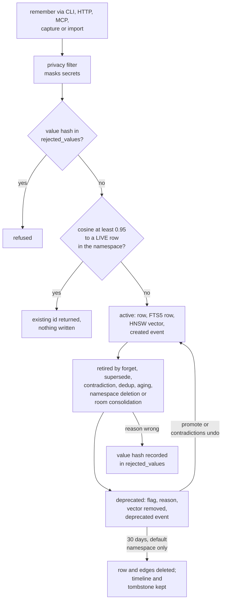

## 1. Executive Summary

Uteke is a local memory engine for AI agents shipped as one Rust binary family:
SQLite with FTS5, a usearch HNSW index and EmbeddingGemma (Q4 ONNX, 768
dimensions) on the CPU, behind a CLI, an HTTP daemon and a stdio MCP server. Its
retriever is the most carefully measured part, and its correction path
remembers what it was told.

**Retrieval is where the engineering went.** The default `fusion` strategy is a
weighted reciprocal-rank fusion of a vector ranking and a vector-plus-FTS5
ranking, with weights tuned on a LongMemEval subset and a comment saying so. The
raw per-question output of the 500-question LongMemEval-S run is committed, and
the README's 98.2% recall_any@5 recomputes from it: 491 correct out of 500.

**A wrong value stays wrong.** Forgetting or superseding a memory with the
reason `wrong` records a hash of its normalised text, and every memory write
path checks that hash before inserting. That earns `tombstone`. The timeline
records creation, content edits and every retirement with its reason, and a
prune keeps it, which earns `audit_log`.

**Scope is a real predicate, chosen by the caller.** The lexical arm filters the
namespace in SQL and the vector arm before scoring, and committed suites on all
four surfaces assert that one namespace's rows stay out of another's populated
result. Those earn `scope_enforced` and `negative_eval`. No token binds a
namespace, an HTTP read without one reads all of them, and background dedup
pairs memories across namespaces.

**Time travel is half built.** Callers can set when a fact was true, and a
point-in-time read returns retired rows, but one instant filters both axes
at once. `bitemporal` is withheld. So are `trust_state` and `human_review`.

## 2. Mental Model

A memory is a row of text an agent or a person hands to `remember`. It is
believed while `deprecated = 0`. Every retirement sets that flag with a reason,
stamps `deprecated_at`, removes the vector and writes a `deprecated` event:
forget, the `supersede` tool, contradiction-on-write, dream dedup, weekly aging,
namespace deletion and room consolidation. A deprecated row can be restored by
`promote`, or by `contradictions undo` for a supersession, until a prune deletes
it.

One reason means more than retirement. `wrong`, or `wrong:` with a note, also
records the value in `rejected_values`, keyed on a hash of its normalised text,
and no memory write accepts that text again until a `promote` lifts it
(`crates/uteke-core/src/tombstone.rs:35`, `:62-80`). An ordinary forget records
nothing, so the same text can be written back as new.

The word *contradiction* means two unrelated things. On write, it is cosine
above 0.65 in the same namespace, so the nearest related memory is retired. In
the dream cycle, it is shared tags with cosine at or below 0.6.

## 3. Architecture

Five crates: `uteke-core` (the library), `uteke-cli`, `uteke-server` on
`tiny_http`, `uteke-mcp` (the shared JSON-RPC handler and a stdio binary) and
`docgen`. The store lives in `~/.codecora/uteke` or `UTEKE_HOME`: a SQLite file
opened with WAL, a 5-second busy timeout and foreign keys on
(`crates/uteke-core/src/memory/store.rs:250-255`), a usearch index file or the
pure-Rust `vecq` backend, and an embedding cache. Vectors are stored twice, as a
BLOB on the row and in the index, so `uteke repair` can rebuild the index from
SQLite. Embeddings default to local ONNX, with OpenAI-compatible, Ollama and
cloud-fallback embedders optional.

**One process per store.** `load_or_create_for` takes an exclusive lock on the
index file for the life of the `Uteke` instance, and a second process retries
for 30 seconds (`crates/uteke-core/src/memory/vector.rs:460-486`, `:1011-1012`).
When the lock times out, `Uteke::open` keeps the files and works from an
in-memory index rebuilt from SQLite (`crates/uteke-core/src/lib.rs:1069-1077`).
That index has no path and is never saved, so the second process's index writes
last only as long as it runs.

**Deployment.** One binary, no API key, a 200 MB model on first run, and a
Docker image for the daemon. The server binds `127.0.0.1` and sends no CORS
headers unless origins are configured, and a Host-header check guards a
loopback bind against DNS rebinding (`crates/uteke-server/src/context.rs:157-188`,
`:218-236`). Authentication is off when no token is set. Each binary sends a
`HEAD` to `github.com/codecoradev/uteke/releases/latest` daily, which
`UTEKE_NO_UPDATE_CHECK` or a config key turns off
(`crates/uteke-core/src/update_check.rs:20`, `:241`). The README also offers
Uteke Cloud, a hosted service at `uteke.app` that `server.json` lists as a
remote MCP endpoint; no code in the engine calls it.

## 4. Essential Implementation Paths

- **Write.** `remember_embed_detailed`
  (`crates/uteke-core/src/operations/write.rs:214-269`) runs the privacy filter
  (`:224-226`) and the tombstone check (`:236`), embeds, and calls
  `check_duplicate`, which returns an existing live id at cosine 0.95 or above
  in the namespace (`:281-346`). `commit_memory` (`:431-525`) checks the
  tombstone again, inserts, writes the content hash and a `created` event,
  wires edges from `[[slug]]`, `@tag` and `^uuid` markup, inserts the vector and
  adds `similar_to` and `possible_duplicate` edges at cosine 0.80 and 0.92.
- **Recall.** `rrf_fuse_weighted` fuses `Vector` and `Hybrid` at 1.7 and 1.0
  (`crates/uteke-core/src/operations/mod.rs:156-158`,
  `crates/uteke-core/src/operations/recall.rs:942-985`), and the boosts are
  applied over a window of `4 x limit + 16` (`recall.rs:383-405`). The default
  limit is 10 on every surface (`crates/uteke-core/src/recall_request.rs:31`).
- **Unified recall.** For `type = all` the default path resolves an omitted
  namespace to `default`, runs memory recall and a namespace-scoped document
  search, and fuses them (`crates/uteke-core/src/lib.rs:2685`).
- **Supersede and undo.** `supersede` (`crates/uteke-core/src/edges.rs:1987-2117`)
  inserts the edge pair, deprecates the old row and, for a `wrong` reason,
  records the tombstone in one transaction. `undo_supersession` (`:2148-2235`)
  reverses it and records `supersession_undone`.
- **Contradiction-on-write.** `remember_with_contradiction`
  (`crates/uteke-core/src/consolidate.rs:63-175`) retires the first live
  neighbour above 0.65 with a reason and bypasses the 0.95 dedup gate.
- **Capture.** Off by default (`crates/uteke-core/src/capture.rs:97`). When on,
  a turn is masked and queued in `observations` without embedding; a worker
  extracts facts by offline rules, or by a model only with `mode = "llm"`
  (`:221-228`), and stores each through `remember` (`:918-957`).
- **Lifecycle.** `lifecycle_cycle` (`crates/uteke-core/src/maintenance.rs:709-800`)
  deprecates the oldest unpinned rows older than 90 days with at most three
  accesses, capped at 1% of active rows between 1 and 50, then hard-deletes rows
  deprecated more than 30 days. Both queries resolve an absent namespace to
  `default` (`crates/uteke-core/src/memory/aging.rs:155`,
  `crates/uteke-core/src/memory/bulk.rs:321`).
- **Dream.** `dream` runs lint, backlinks, dedup at cosine 0.92 keeping the
  newer row, a contradiction scan capped at 200 rows, orphan count, compact and
  verify (`crates/uteke-core/src/dream.rs:9-15`).
- **Time travel.** `recall --at` and `list --at` default to history mode and
  return a row that was live at the instant on both axes
  (`crates/uteke-core/src/operations/time_travel.rs:99-111`, `:164-188`,
  `crates/uteke-core/src/memory/crud.rs:913`, `:972-975`).

## 5. Memory Data Model

| Table | Holds |
| --- | --- |
| `memories` | `id` (UUIDv7), `content`, `embedding` BLOB, `tags`, `metadata`, `namespace`, `memory_type`, `importance`, `pinned`, access counters, `deprecated`, `deprecate_reason`, `deprecated_at`, `valid_from`, `valid_until`, `slug`, `source`, `source_type`, `author_type`, `author`, `source_hash` |
| `memory_tags`, `memories_fts` | a tag join table and an FTS5 index over content, tags, namespace and type, kept by triggers |
| `memory_edges` | typed edges between memories — `supersedes`, `superseded_by`, `references`, `similar_to`, `possible_duplicate` and more — cascading on delete |
| `graph_nodes`, `graph_edges` | a separate entity graph; callers map a memory to its node before adding an edge |
| `timeline_events` | per-memory events with `actor` and `evidence_json`, with no foreign key since schema v20 (`crates/uteke-core/src/memory/store.rs:84-92`) |
| `rejected_values` | the tombstone: a normalised-text hash, the memory id, a masked reason and preview (`crates/uteke-core/src/tombstone.rs:84-116`) |
| `observations` | raw captured turns with a job status — pending, extracting, done, failed |
| `documents`, `document_chunks`, `documents_fts` | a hierarchical wiki with a version counter, chunked and embedded |
| `rooms`, `room_memories`, `room_documents` | rooms as a join to memories with a caller-supplied `author` and `role` |

`valid_from` and `valid_until` are columns a caller can set on CLI, HTTP, MCP
and import, through `set_validity`
(`crates/uteke-core/src/memory/store.rs:513-531`). When the caller sets
nothing, `valid_from` is the write time, and a deprecation writes its own
time into `valid_until` unless an earlier end is already there. A test asserts
that equality (`crates/uteke-core/src/remember_exec.rs:345`). A restore clears
`valid_until`, including a caller's. The nine memory types select a recency time
constant: 365 days for decisions and preferences, 180 for facts, 30 for events.

## 6. Retrieval Mechanics

Fusion is the default everywhere, and it is a sound design: the vector and
hybrid arms fail on different questions, and weighted RRF keeps both. What
follows it is not calibrated to it. After `rrf_fuse_weighted` a memory's score
is the fused RRF sum, at most `(1.7 + 1.0) / 61 ≈ 0.044`, and the boosts then add
`0.1 x salience + 0.1 x recency` (`crates/uteke-core/src/salience_recency.rs:40-47`,
`:122-138`). The server never changes those weights.

**The boosts outweigh the ranking inside the window.** For a `fact`, a 30-day
age gap is worth 0.015 of recency, and the fused gap between rank 1 and rank 35
in both arms is 0.016. With the default limit of 10 the window is 56 candidates,
so the final top ten inside it is ordered about as much by age and importance
as by relevance.

**Strict mode reads the right number.** `--strict` filters on a `similarity`
field, the vector leg's cosine before boosts, and does so before the limit cut
(`crates/uteke-core/src/recall_filter.rs:40-44`). A hit found only by full-text
search has no similarity and is dropped. `--min` and `min_score` compare
against the fused score.

Access tracking counts results: one recall bumps `recall_count` and
`last_accessed` on the memories it returns, once
(`crates/uteke-core/src/memory/aging.rs:31-55`). FTS5 scores are normalised over
surviving rows, filters widen the vector pool once to the maximum window before
giving up, the cache stores pre-boost scores, and `--explain` replays each
stage. `--pack` fills a character budget from the ranked list without a model.

## 7. Write Mechanics

Writes are synchronous and local. A `remember` blocks for the privacy filter,
the tombstone check, one CPU embedding, a 5-nearest dedup search, the SQLite
writes, edge wiring and a 20-nearest auto-link search. A memory is retrievable
as soon as the call returns. The index is saved once 64 mutations or 2 seconds
have piled up, and each save serialises the whole index file
(`crates/uteke-core/src/memory/vector.rs:58-61`, `:612-723`, `:737-745`).

The privacy filter masks secrets in content, tags, metadata strings and source
before anything is embedded, and records a `redacted` event
(`crates/uteke-core/src/operations/write.rs:146-155`, `:224-226`). Documents are
not filtered.

Dedup and contradiction are both nearest-neighbour thresholds on the new text's
embedding, scoped to its namespace. At 0.95 the write is dropped in favour of
the live row; with contradiction mode on, the first live row above 0.65 is
retired whether or not it disagrees. An update re-embeds and overwrites content
in place, refreshes the content hash and writes an `updated` event with both
hashes in the same transaction (`crates/uteke-core/src/memory/crud.rs:459-485`).

Capture extraction is opt-in and stores each fact through `remember`, so the
filter, the tombstone and the dedup gate all apply. Its facts carry the source
`capture`, which falls to the lowest trust tier.

**Background.** In server mode, the weekly cycle deprecates at most 50 rows and
prunes rows deprecated for 30 days, both in `default` only. The three-day dream
cycle runs dedup over every namespace and pairs each memory with its index
neighbours without a namespace check
(`crates/uteke-server/src/main.rs:467`, `crates/uteke-core/src/consolidate.rs:181-251`),
deprecating the older of each pair. Nothing rewrites memory content in the
background.

## 8. Agent Integration

The stdio MCP server exposes 52 tools, 25 of them to a read-only token
(`crates/uteke-mcp/src/lib.rs:261-313`), for memories, documents, rooms, tags,
namespaces, the graph, provenance, the timeline and the contradiction ledger;
the same handler serves `POST /mcp`. Every read tool's result is wrapped in
`<uteke-stored-data>` with the tag escaped inside stored text, and the tool
descriptions say the contents are data (`:108-167`). `UTEKE_MCP_FENCE=0` turns
the fence off.

Recall results flag a memory that carries a `superseded_by` edge
(`:1585-1596`), which after the deprecation filter fires only for a row
restored by `promote`, since `promote` leaves the edge.

`uteke connect` installs hooks for Claude Code, Codex and Cursor and records
them for removal. The Claude Code hooks recall a packed context of up to 3,000
characters at session start and capture prompt and stop turns when capture is
on. The pi extension and the Hermes plugin auto-recall with a minimum score of
0 at their defaults. A read-only browser viewer serves the timeline and recent
memories behind a per-launch token, and on a non-loopback bind also requires the
server token.

## 9. Reliability, Safety, and Trust

**A value retracted as wrong stays retracted.** The tombstone is keyed on the
value, not the row, so it outlives the memory it came from, and a test asserts
it survives a prune (`crates/uteke-core/src/tombstone.rs:349`). Every row insert
in production passes `commit_memory` or the structural import's own check, and
update checks it too. Two paths leave a gap. `undo_supersession` makes a row
superseded as wrong live again and leaves its tombstone in place
(`crates/uteke-core/src/edges.rs:2166`), so the stored value and its refusal
coexist. Documents are never checked.

**The timeline answers why most memories changed.** Since schema v20 the event
table carries no cascading key, and a test asserts that a prune keeps the
history of the rows it deletes
(`crates/uteke-core/src/timeline_write_tests.rs:242`). Content edits record
both hashes, so the provenance report's tamper check accepts an edit made
through `uteke_update`. Promote, tag and metadata edits, validity changes
and namespace deprecation write no event; a test pins the tag case
(`:82-112`).

**Time travel applies both axes at one instant.** `recall --at` and `list --at`
return a row created before the instant, not deprecated before it, and valid at
it (`crates/uteke-core/src/operations/time_travel.rs:164-188`,
`crates/uteke-core/src/memory/crud.rs:972-975`). "Where did I live last March"
and "what did we believe last March" are one query, and a fact back-dated with
`valid_from` cannot be returned for any instant before it was recorded. The
project's design note lists a valid-time-only query as a follow-up
(`docs/plans/2026-11-03-time-travel-1598.md:40`). `bitemporal` is withheld.

**Scope holds on the read path for a caller that names it.** The server's two
tokens are store-wide (`crates/uteke-server/src/context.rs:76-91`). HTTP
recall, search, list and export read every namespace when the parameter is
omitted (`crates/uteke-core/src/recall_request.rs:16`). Rooms deliberately span
namespaces, and the dream dedup retires one namespace's memory because another
holds a newer near-copy. The README's "fully isolated memory per agent" holds
only for clients that each pass their own namespace.

**Declared limits that remain.** Room consolidation builds every record as
`agent`/`derived`, the lowest tier, so its provenance gate cannot fail on tier;
only the hedging check can reject (`crates/uteke-core/src/consolidation_exec.rs:158-159`).
Aging and prune resolve an absent namespace to `default`, so the server's
weekly cycle never ages or prunes any other namespace.

**Withheld marks, stated once.** `trust_state`: `deprecated` is the store's
soft delete, set by aging and namespace deletion as well as by supersession, and
nothing reads its reason, so "out of service" and "not believed" are one state.
The `min_trust` filter applies a tier derived at read time from self-declared
author and source types, and the project's MCP schema and changelog say it is
not a trust state. `human_review`: no memory waits for anyone. Capture writes extracted
facts live, and `uteke_forget`, `uteke_supersede` and
`uteke_contradictions_undo` are on the agent's own MCP surface.

## 10. Tests, Evals, and Benchmarks

The suite is 1,653 test functions in 136 files, 3 of them ignored; tests supply
a keyword embedder through the public open path, so recall, dedup and isolation
run in CI without the model. CI runs clippy with warnings as errors and
`cargo test --workspace`, and `cargo mutants` runs on pull requests to `main`.
I did not run any of it.

The marks rest on these cases:

- `test_fts5_namespace_filter` and `test_fts5_deprecated_excluded`
  (`crates/uteke-core/src/memory/fts5.rs:373-391`, `:410-426`), each asserting
  an exact one-row result beside a matching row that must be excluded;
- the scope-isolation suites over core, HTTP, MCP and CLI on one two-namespace
  fixture, each requiring its own marker present and the other's absent
  (`crates/uteke-core/src/isolation_tests.rs:50-79`);
- the tombstone cases for remember, room remember, update and prune
  (`crates/uteke-core/src/tombstone.rs:290`, `:349`);
- the timeline cases for update, deprecation and prune
  (`crates/uteke-core/src/timeline_write_tests.rs:22`, `:148`, `:242`).

The unified-recall and graph isolation cases have no positive control, and the
coverage gates never call a read with the namespace omitted.

**Benchmarks recompute.** The README's 98.2% recall_any@5 on LongMemEval-S
(`README.md:19`) recomputes from `benchmarks/longmemeval/results/default-500q-v0.20.0.jsonl`
as 491 correct out of 500, and 462 correct out of 470 non-abstention questions, using the
dataset's `answer_` prefix on evidence sessions because the gold file is not
committed. The older v0.17 file gives the 492 correct out of 500 the README once cited. The
benchmark imports each haystack in one batch, so every memory shares a write
time and the recency boost is flat; it does not exercise the ordering effect in
section 6. LoCoMo raw retrieval results are committed with a reported 0.840
recall_any@5, which I did not recompute. A model-judged end-to-end LoCoMo QA
figure of 72.2% recomputes as 1,112 of 1,540 from
`benchmarks/locomo/results/qa-e2e-2026-11-09-sonnet55.jsonl`; it measures the
judge and the answering model as much as the store. No paper of its own.

## 11. For Your Own Build

### Steal

- **A tombstone keyed on the normalised value, checked at the one commit step.**
  Hash the text after normalisation, record it only when the user says the value
  is wrong, and refuse it in the function every insert passes through.
- **An event table with no cascading key.** History that a prune can delete is
  not history; drop the foreign key and keep the events of deleted rows.
- **Weighted fusion of two complete rankings, tuned and documented in place.**
  State the tuning set and the plateau in the constant's comment, and commit the
  raw per-question outputs so the headline recomputes without an embedder.
- **One isolation fixture driven through every surface.** The same two-namespace
  vocabulary, asserted present and absent over core, HTTP, MCP and CLI, with a
  gate that fails when a read route has no case.

### Avoid

- **Adding cosine-scale boosts to RRF scores.** Either normalise the fused score
  or keep boosts and thresholds on the arm that produced them.
- **One instant for two clocks.** A point-in-time read that filters valid time
  and record time together cannot answer either question alone.
- **An undo that forgets the refusal it caused.** Restoring a value superseded as
  wrong should lift or consult its tombstone, not leave both standing.
- **A namespace default that only some surfaces apply.** The CLI scopes an
  omitted namespace to `default` and HTTP reads all of them; one rule, stated in
  one place, is the boundary.

### Fit

A strong choice for one developer who wants fast, offline, well-measured recall
behind MCP, with corrections that stick and a history of why memories changed.
Weigh it carefully if namespaces must hold against another client on the same
server, if facts must be queried by when they were true rather than when they
were recorded, or if a retracted value must stay retracted after an undo.

## 12. Open Questions

- How often, on a real store with memories of different ages, the recency and
  salience boosts reorder the top ten against the fused ranking; the committed
  benchmarks cannot show it.
- Whether the prune scoped to `default` is intended to spare other namespaces or
  is an artefact of `unwrap_or(DEFAULT_NAMESPACE)` in two queries.
- Whether namespaces, which the project marks as deprecated in favour of rooms,
  tags and author, will keep their predicate once rooms carry the scope.

## Appendix: File Index

- Library entry and open path: `crates/uteke-core/src/lib.rs`. Operations:
  `crates/uteke-core/src/operations/` (`write.rs`, `recall.rs`, `update.rs`,
  `forget.rs`, `time_travel.rs`, `mod.rs`).
- Schema and store: `crates/uteke-core/src/memory/store.rs`, `schema.rs`,
  `crud.rs`, `bulk.rs`, `aging.rs`, `fts5.rs`, `vector.rs`, `documents.rs`,
  `rooms.rs`, `tags.rs`.
- Correction: `crates/uteke-core/src/tombstone.rs`, `edges.rs`, `timeline.rs`,
  `timeline_write_tests.rs`, `provenance.rs`.
- Consolidation, dream and capture: `crates/uteke-core/src/consolidate.rs`,
  `dream.rs`, `maintenance.rs`, `consolidation_exec.rs`, `consolidation_api.rs`,
  `capture.rs`, `extraction.rs`, `privacy.rs`.
- Scoring and requests: `salience_recency.rs`, `recall_request.rs`,
  `recall_filter.rs`, `recall_exec.rs`, `remember_exec.rs`, `pack_mode.rs`.
- Server: `crates/uteke-server/src/main.rs`, `handlers/`, `context.rs`,
  `api_registry.rs`, `viewer.rs`. MCP: `crates/uteke-mcp/src/lib.rs`,
  `main.rs`. CLI: `crates/uteke-cli/src/cli.rs`, `commands/`, `connect/`,
  `hook_run.rs`.
- Isolation suites: `crates/uteke-core/src/isolation_tests.rs`,
  `crates/uteke-server/src/handlers/isolation_tests.rs`,
  `crates/uteke-cli/tests/scope_isolation.rs`.
- Integrations: `extensions/pi-memory-provider/index.ts`,
  `crates/uteke-cli/assets/hermes-uteke-memory/__init__.py.tmpl`.
- Benchmarks: `benchmarks/longmemeval/`, `benchmarks/locomo/`.

### Recorded searches

Run from the repository root at the pinned commit with `/usr/bin/git grep`.

- **The timeline is append-only.**
  `git grep -n -i -E 'delete from timeline_events|update timeline_events' -- '*.rs' '*.sql'`
  returns nothing.
- **No producer for tag events.**
  `git grep -n -E 'TimelineEventType::Tagged' -- '*.rs'` returns only the enum's
  tests in `crates/uteke-core/src/timeline.rs`, after its `#[cfg(test)]`.
- **Namespace changes write no event.**
  `git grep -n -i timeline -- crates/uteke-core/src/memory/tags.rs crates/uteke-core/src/namespace_migrate.rs`
  returns nothing.
- **Undo and documents do not consult the tombstone.**
  `git grep -n -E 'check_not_rejected|tombstone::check' -- crates/uteke-core/src/memory/documents.rs crates/uteke-core/src/edges.rs`
  returns nothing.
- **Every memory insert passes one function.**
  `git grep -n -i -E 'insert (or [a-z]+ )?into memories[ (]' -- '*.rs'` returns,
  outside test modules, `crates/uteke-core/src/memory/crud.rs:106`, whose one
  production caller is `operations/write.rs:451`, and
  `crates/uteke-core/src/structural_export.rs:464`, which checks the tombstone at
  `:442`.
- **No valid-time-only query.**
  `git grep -n -i -E 'valid_at|known_at|as_known' -- '*.rs'` returns a test
  name in `crates/uteke-cli/src/commands/recall.rs:681` and a certificate check
  in `crates/uteke-cli/src/commands/release_verify.rs:184`, nothing else.
- **No token binds a namespace.**
  `git grep -n -i namespace -- crates/uteke-server/src/context.rs` returns
  nothing.
- **No memory review state.**
  `git grep -n -i -E 'pending|approved|unverified|quarantin|needs_review' -- crates/uteke-core/src/memory/schema.rs`
  returns `:1226`, the `observations` job status.
- **The deprecation reason is never read.**
  `git grep -n -E 'deprecate_reason *(=|LIKE|IN|!=)' -- crates` returns writers
  and a doc comment, no read predicate.
- **The server keeps the default boosts.**
  `git grep -n 'set_salience_recency_config(' -- crates` returns
  `crates/uteke-cli/src/commands/recall.rs:145` and tests.
- **Documents bypass the privacy filter.**
  `git grep -l -E 'privacy|redact' -- crates/uteke-core/src/memory/documents.rs crates/uteke-core/src/room_ops.rs crates/uteke-core/src/memory/rooms.rs`
  returns nothing.
- **Three ignored tests.** `git grep -c '#\[ignore' -- crates` sums to 3.
- **No paper of its own.**
  `git grep -n -i -E 'arxiv|bibtex|@article|@misc|doi\.org' -- '*.md' '*.cff'`
  returns the LongMemEval citation and the Mem0 and Zep identifiers in
  `docs/benchmark-positioning.md`.

## History

**2026-11-10** — [`d69a1cc54470e25d9510a653b7ce2a587e93471a`](https://github.com/codecoradev/uteke/commit/d69a1cc54470e25d9510a653b7ce2a587e93471a). 272 commits past `c0573a4`. A value forgotten or superseded as wrong is refused on every memory write path, and the timeline records edits and every deprecation and survives the prune: `tombstone` and `audit_log` are earned, four marks ([section 9](#9-reliability-safety-and-trust)). Caller validity lands in columns, but a point-in-time read applies both axes at one instant, so `bitemporal` stays withheld. The lock timeout no longer deletes index files, both auto-recall hooks work at defaults, the graph foreign-key failure and the room key mismatch are fixed, and access counts results only ([section 3](#3-architecture), [section 8](#8-agent-integration)). The README headline is 98.2% and recomputes as 491 correct out of 500. The census at the first reading described `3b93b34`, 18 commits before that pin. Screened again; nothing installed or run.

**2026-09-17** — [`c0573a42b72d87f33d99300c362598e892ce5918`](https://github.com/codecoradev/uteke/commit/c0573a42b72d87f33d99300c362598e892ce5918) — re-pinned after 18 commits. All three anchored files are byte-identical at both commits — the core library, the FTS5 memory module carrying both the scope predicate and the negative-eval case, and the operations module — so both marks stand on unchanged code and every anchor here is exact at the new pin. Nothing was installed, built or run.

**2026-09-11** — [`c0573a42b72d87f33d99300c362598e892ce5918`](https://github.com/codecoradev/uteke/commit/c0573a42b72d87f33d99300c362598e892ce5918) — first reading. Screened with `scripts/screen_repo.py`: no auto-running configuration and no build-time execution path; every manifest reads as inside the seven-day cooldown because the depth-1 clone dates each file to the pinned commit; three unpinned surfaces in benchmark and docs tooling (a Python requirements file with `>=` ranges, a VitePress `package.json` with floating ranges and a GitHub-sourced theme); `AGENT.md` and `AGENTS.md` read as data. Nothing was built or run. The LongMemEval figures were recomputed from the committed raw outputs, and the foreign-key failure reproduced against the tree's DDL in Python's `sqlite3`, not by running Uteke.
