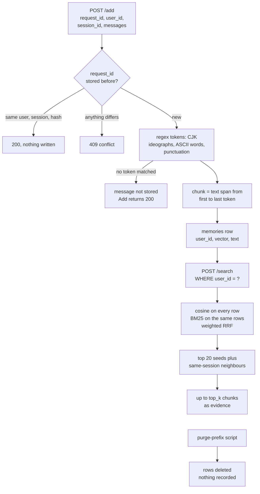

## 1. Executive Summary

Vanilla RAG Memory is a single-process FastAPI server that implements the
Agent Memory Leaderboard's synchronous Add/Search contract. Add stores each
message as verbatim chunks with a vector in SQLite; Search returns one user's
best chunks as evidence and never generates an answer. The notable part is
how little can leak: one `user_id` predicate loads the candidate rows, and
dense scoring, BM25 statistics, reranking and the neighbour window all run
inside that set. The weakness is the tokenizer under the chunker. It matches no
Cyrillic, Hangul or kana, so such a message is never stored while Add answers
200, which the contract defines as persisted.

Nothing else is memory in the sense of belief. There is no extraction, no
consolidation, no update, no status and no history; a chunk is evidence until
an operator deletes its user's prefix with a script. The README calls it a
naive baseline and the code matches that description. An offline path builds a
FAISS index over a JSONL corpus for ordinary RAG benchmarking and shares only
the embedder with the server.

There is no licence. The repository has no LICENSE file and neither the README
nor `pyproject.toml` names one, so the code is all rights reserved by default:
readable, not reusable. Two marks are earned, `scope_enforced` and
`negative_eval`, both on the user boundary.

## 2. Mental Model

A memory is a **chunk of one message** as the caller sent it: role, content,
the caller's millisecond timestamp, `user_id`, `session_id` and the
`request_id` of the Add that carried it. Content is never rewritten. A message
longer than 320 tokens becomes several overlapping chunks, each an independent
row (`memory_store.py:157-176`, `:375-392`).

The state machine has three states and two transitions:

- **absent** until an Add commits it, which happens at most once per
  `request_id`;
- **retrievable** from the moment Add returns, to any Search naming the same
  `user_id`;
- **gone** when `scripts/memory_admin.py purge-prefix` deletes every row whose
  `user_id` starts with a prefix.

Nothing moves a chunk between those states except the caller and the operator.
The system holds no view on whether a chunk is true, current or contradicted.
Two chunks saying opposite things are both retrievable and ranked by
similarity alone. The contract gives judgement to the organiser: Search returns
evidence and the organiser's platform runs the answer model and the grader
(`README.md:18`, `docs/competition-contract.md:36-41`).

The only identity rule is idempotency. A repeated Add with the same
`request_id`, user, session and payload hash writes nothing and succeeds; the
same `request_id` with anything different is refused with 409
(`memory_store.py:302-310`, `:356-373`).

## 3. Architecture

One Python process, `uvicorn vanilla_rag.api:app` with one worker, holds one
`SQLiteMemoryStore` built once from environment variables
(`api.py:65-111`, `Dockerfile:28`). The store opens a new SQLite connection
per call with a 60-second busy timeout and WAL journaling
(`memory_store.py:245-254`).

**Persistence.** Three tables (`memory_store.py:257-286`):

- `add_requests`: `request_id` primary key, `user_id`, `session_id`,
  `payload_hash`, ingestion `created_at`;
- `memories`: chunk id, `request_id` foreign key, `user_id`, `session_id`,
  `role`, `content`, `source_timestamp`, `created_at`, a float32 `embedding`
  BLOB and its `dimension`, with an index on `user_id`;
- `store_metadata`: one row, `embedding_identity`.

**Embedding.** `SentenceTransformerEmbedder` loads `BAAI/bge-small-en-v1.5` by
default, normalises vectors, and prefixes queries with BGE's retrieval
instruction for English BGE models (`embeddings.py:14-41`). Its identity is
the model name plus the query prefix, and the store appends
`|context=v1:<n>` when contextual embedding is on. A database records the
identity on first open and refuses to open under any other
(`memory_store.py:202-213`, `:288-299`).

**Optional reranker.** `MEMORY_RERANKER_MODEL` loads a sentence-transformers
`CrossEncoder` with `trust_remote_code=False`, in float16 on CUDA
(`reranking.py:13-51`).

**Offline path.** `vanilla_rag.cli index|ask|evaluate|prepare-hotpot` chunks a
JSONL corpus, builds a `faiss.IndexFlatIP`, saves it beside `chunks.jsonl`, and
reports recall, MRR, answer-in-context, exact match and token F1
(`cli.py:30-76`, `index.py:12-57`, `evaluation.py:31-74`). It has no user key
and no Add path; it is a benchmark harness, not part of the service.

### Deployment and ergonomics

The service needs Python 3.10 to 3.12 with torch and sentence-transformers, or
Docker, and network access to Hugging Face on first start unless a local model
directory is configured (`README.md:25-39`). No LLM key is needed to store or
search; `OPENAI_API_KEY` serves only the offline `--generator openai` path
(`generation.py:19-38`). It runs fully offline once the model is cached.

`MEMORY_API_KEY` must be set or Add and Search answer 503, unless
`ALLOW_UNAUTHENTICATED=true` (`api.py:114-129`). The store is one SQLite file
that `sqlite3` reads directly, but the vectors are opaque BLOBs and a row
edited by hand keeps its old embedding. Requirements are ranges with no
lockfile (`requirements.txt`, `pyproject.toml:10-21`).

**The image and the README describe different services.** The README freezes
0.6.0 as `hybrid` retrieval, lexical weight 0.5, no context messages, no option
views and a result window of one around 20 seeds, and its `docker run` passes
those values explicitly (`README.md:52-57`, `:73-78`, `:155-156`). The
`Dockerfile` bakes in `enhanced`, lexical weight 0.25, one context message and
option weight 0.2 (`Dockerfile:8-12`). That is the 0.4.0 configuration, from
the 5 August commit that last changed the file. A platform that builds the
repository and sets only the key, which the README names as a submission route
(`README.md:21-23`), runs 0.4.0's ranking.

The two configurations also write
incompatible databases, since the context setting is part of the identity.
`compose.yaml` tags its image `0.4.0` and reads `.env`, whose example matches
the README.

## 4. Essential Implementation Paths

- **Add.** `add_memory` (`api.py:171-182`) builds `MemoryMessage`s and calls
  `SQLiteMemoryStore.add` (`memory_store.py:355-453`). It hashes user,
  session and messages; returns early on an identical prior request and raises
  `RequestConflictError` on a different one (`:356-373`). It splits each
  message with `split_memory_text`, derives each chunk id as `mem_` plus 24
  hex characters of SHA-256 over `request_id:message:chunk`, and computes the
  embedding text (`:375-392`). It embeds every chunk under `_embedding_lock`
  (`:394-398`), then opens `BEGIN IMMEDIATE`, repeats the request_id check,
  and inserts the request row and every chunk (`:400-447`).
- **Search.** `search_memory` (`api.py:185-188`) calls `SQLiteMemoryStore.search`
  (`memory_store.py:455-553`): load the user's rows (`:458-468`), build the
  query views (`:470-477`), embed them (`:478-484`), score and fuse
  (`:486-511`), rerank (`:513-531`), window (`:533-537`, `:555-583`), and
  render each hit (`:538-553`, `:585-606`).
- **Delete.** `scripts/memory_admin.py purge-prefix --user-prefix P --confirm`
  (`memory_admin.py:35-51`).
- **Health.** `health` returns `stats()` without authentication
  (`api.py:166-168`, `memory_store.py:608-613`).
- **Replay.** `scripts/local_benchmark.py` splits a normalised record into Adds
  of at most 20 messages and 2,000 words, the organiser's boundaries, and
  scores answer-in-context and evidence recall over Search results
  (`local_benchmark.py:28-43`, `:71-123`); `scripts/prepare_public_data.py`
  converts LoCoMo and LongMemEval into that format.
- **Tests.** `tests/test_memory_store.py` for the store; `tests/test_api.py`
  for the routes, skipped without FastAPI.

## 5. Memory Data Model

The `memories` row is the whole data model (`memory_store.py:265-277`). There
is no status, confidence, version, supersession pointer or expiry column, and
no table besides the three above.

**Scope** is `user_id`, a non-empty string from the request
(`api.py:26-30`, `:40-44`). The contract makes it the only isolation boundary
and says `session_id` is provenance, not a filter
(`docs/competition-contract.md:21-23`). The service stores `session_id` and
uses it only to keep the neighbour window inside one conversation
(`memory_store.py:576-577`). The API key is shared by every caller, so the
boundary separates evaluation users from one another, not callers.

**Time.** `source_timestamp` is the caller's message time. `memories.created_at`
is that time rendered as ISO 8601, or wall-clock time when the caller sent
none (`memory_store.py:312-316`, `:387`). The ingestion time lives on
`add_requests.created_at` (`:420-423`), and nothing reads it. Search returns
`source_timestamp` when present and otherwise `created_at`, so a row without a
caller time reports its ingestion time as its date (`:541`).

**Provenance** is `request_id`, `session_id` and `role`. The role is free text
of at least one character. The pinned commit, dated 11 August, widened the
schema from `user` and `assistant` to any role and lifted the 20-message cap
per Add (`api.py:20-30`, `test_api.py:81-103`).

## 6. Retrieval Mechanics

Search is exhaustive over one user. It loads every row of that `user_id`,
stacks the embeddings into a matrix and multiplies by the query vectors
(`memory_store.py:458-466`, `:486-490`). Cost is linear in that user's chunks
on every query, BM25 included, and there is no vector index on the service
path.

**Query views.** With `options` present, `hybrid` and `dense` append them to
the query as one text, for the dense and the BM25 query alike. `enhanced`
keeps the bare query and adds one view per option, then raises a row's dense
score by `option_view_weight × max(best option score − base score, 0)`
(`:470-477`, `:491-496`). Under `hybrid` a distractor option's words weigh
as much as the correct option's, so a chunk mentioning a wrong answer is
pulled up too.

**Fusion.** In `hybrid` and `enhanced`, BM25 (k1 1.5, b 0.75) is computed over
the same rows, so document frequency and average length are per user
(`:128-154`, `:500`). Dense rank contributes `1/(k + rank + 1)` for every row,
lexical rank `lexical_weight/(k + rank + 1)` for rows with a positive BM25,
`k` 60, ties broken by dense score (`:501-511`). The lexical tokenizer
casefolds ASCII word runs, takes CJK ideographs one per token, and drops
punctuation (`:41-46`).

**Rerank.** An optional cross-encoder scores the top `max(top_k, 200)`
candidates against the bare query and reorders them; rows outside the
candidate set get `-inf`, reported as score 0 (`:513-531`, `:542-544`).

**Window.** With `MEMORY_RESULT_WINDOW=1`, the default, each of the top 20
results pulls in the row before and after it in insertion order when that row
shares its `session_id`, then the remaining ranks fill to `top_k`
(`:555-583`). A neighbour keeps its own score, so the returned list is not in
score order, although the contract says relevance order.

**Rendering.** Each hit's content is `[role | ISO time] text`, or with
`MEMORY_TEMPORAL_ENRICHMENT=true`, a message date plus each relative-date
phrase a regex finds, resolved against it in the form
`<phrase> = January 19, 2023` (`:585-606`, `:77-125`).
Search returns at most `top_k`, capped at 100 by the request schema
(`api.py:44`).

## 7. Write Mechanics

Add is the only writer. There is no extraction prompt, no deduplication
across requests, no merge and no conflict detection; the same sentence sent in
two requests is two rows.

**What the chunker keeps.** `TOKEN_PATTERN` is
`[一-鿿]|[A-Za-z0-9_]+|[^\w\s]` (`chunking.py:8`). A chunk is the
original text from its first matched token to its last
(`memory_store.py:162-172`). Every other letter, Latin with diacritics
included, is a word character outside both letter alternatives and matches
nothing. I copied the pattern and the split loop into a scratch script and ran
them on sample strings. `Привет мир`, `안녕하세요` and `こんにちは` produced no
chunk. `Я живу в Berlin с мамой` was stored as `Berlin`. `Zürich café` became
`Zürich caf`.

The consequences follow from `add`. A message with no match contributes no row
and the Add returns 200 with every field echoed, against a contract that
reads 200 as every message persisted (`docs/competition-contract.md:16-17`).
An Add in which no message matches raises `ValueError` before any write
(`memory_store.py:391-392`). The route catches only `RequestConflictError`,
so the caller sees a 500 and every retry repeats it (`api.py:174-177`). No test
covers a script outside ASCII and the CJK block; the one non-ASCII case,
`test_memory_store.py:178-181`, is Chinese.

**Contextual embedding.** With `MEMORY_CONTEXT_MESSAGES=n`, a chunk's vector is
computed over its role and text plus excerpts of up to `n` neighbouring
messages from the same Add (`memory_store.py:318-342`). The stored content is
the chunk alone. Context never crosses an Add boundary, so the first message
of each Add has no predecessor.

**Concurrency.** Embedding runs outside any transaction; the insert runs under
`BEGIN IMMEDIATE` after a second request_id check, so concurrent identical
retries write once and all succeed (`memory_store.py:394-447`,
`test_memory_store.py:171-176`).

### Operational cost

Add blocks the caller on embedding every chunk on the server's model, under a
process-wide lock that Search also takes (`memory_store.py:242`, `:394`,
`:478`), so Adds and Searches serialise on the embedder. A chunk is
retrievable the instant Add returns; there is no deferred stage. No background
pass exists and nothing rewrites the store. Search returns up to 100 chunks
and the caller decides how many reach a prompt; the service injects nothing.

## 8. Agent Integration

There is no agent integration in the usual sense. The client is an evaluation
harness that posts conversations and questions; there are no tools, hooks, MCP
server or prompt. Authentication accepts `X-Api-Key`, `Authorization: Bearer`
or `Authorization: Token` and compares with `hmac.compare_digest`
(`api.py:114-129`). Request validation errors are logged and returned with
location, type and message only, never the submitted content, and a test
holds that (`api.py:145-163`, `test_api.py:105-135`).

Adapting it to another client means writing that client: the two routes are a
clean store-and-search pair keyed by a caller-chosen user string.

## 9. Reliability, Safety, and Trust

### The boundary is one predicate, and three reads sit outside it

The search read is the only read of memory content, and it carries the
predicate before any scoring (`memory_store.py:458-466`). Every later stage
indexes into that row list. That includes the BM25 corpus statistics, which a
shared lexical index would compute across users. Three reads omit `user_id`,
and none returns content:

- `stats()` counts requests, memories and distinct users across the database
  and is served unauthenticated on `/health` (`memory_store.py:608-613`,
  `api.py:166-168`);
- Add's request_id lookups are global (`memory_store.py:358-373`,
  `:403-418`), so posting another user's `request_id` answers 409 and reveals
  that it exists;
- the admin script's statistics run over the whole file
  (`memory_admin.py:9-14`).

`user_id` itself is whatever the caller sends under the shared key. Against
the evaluator that is the contract. Against any second party holding the key
there is no boundary.

### Deletion is a script, with a gap between its two halves

The contract requires evaluation data to be deleted within 30 days of a run
(`docs/competition-contract.md:29-34`). The only deletion is `purge-prefix`,
run by hand. It collects matching `request_id`s, then opens `BEGIN IMMEDIATE`,
deletes `memories` by prefix and `add_requests` by the collected list
(`memory_admin.py:37-49`). An Add for that prefix committing between the
collection and the transaction loses its rows but keeps its request row. A
retry of that Add then finds the request, counts zero rows and answers 200
(`memory_store.py:362-373`). The script runs no `VACUUM` and sets no
`secure_delete`, so deleted text stays in free pages of the SQLite file until
they are reused.

### Fail-closed configuration

A database written under one embedding identity cannot be opened under
another, so switching the model, the BGE query prefix or the context setting
fails at startup rather than mixing vector spaces (`memory_store.py:288-299`,
`test_memory_store.py:225-226`). An unset API key fails closed with 503. The
README's pre-run checklist lists rate limiting (`README.md:341`), and `src/`
implements none.

### Marks

Two are carried.

- **`scope_enforced`** — `user_id` is on every row and `WHERE user_id = ?` is
  the first step of the only content read; every ranking arm runs inside its
  result. The limits are in the subsection above.
- **`negative_eval`** — `test_user_isolation` asserts that a search for u1 on
  u2's word is non-empty, then that no hit holds u2's text
  (`test_memory_store.py:96-101`). Two rows and `top_k` 10 with no score
  threshold mean a missing predicate returns u2's row, so the case can fail
  both ways. It drives the store, not the HTTP route.

Five are withheld.

- **`tombstone`** — purge deletes rows and records nothing; the same text can
  be added again under a new `request_id`.
- **`trust_state`** — no status of any kind exists on a row.
- **`bitemporal`** — one time per chunk, the caller's message time or the
  ingestion time in its absence; the request's ingestion time has no reader,
  and nothing expresses a validity interval.
- **`audit_log`** — `add_requests` is an idempotency key, deleted by the same
  purge it would have to record.
- **`human_review`** — nothing waits for anyone; Add commits immediately.

## 10. Tests, Evals, and Benchmarks

Five unittest files hold 25 cases. `test_memory_store.py` has 13, driven by a
deterministic hashing embedder, so no model is downloaded. They cover
idempotent and persistent Add, conflict, concurrent retries, user isolation,
contextual embedding text, the identity refusal, option views, the reranker
handoff, temporal rendering and the neighbour window. `test_api.py` has four
route cases behind `skipUnless(FASTAPI_AVAILABLE)`, so an environment without
FastAPI reports them skipped (`test_api.py:11`, `:35`). There is no CI
configuration. I did not run any of them.

`test_hybrid_search_recovers_exact_lexical_match` builds an embedder that
scores the target row lowest, asserts dense mode misses it and hybrid mode
finds it over the same file (`test_memory_store.py:183-198`). That makes the
lexical arm's contribution an assertion that can fail rather than an average.

`scripts/local_smoke.py` runs eight HTTP checks against a live server. Its
cross-user check asserts only absence (`local_smoke.py:102-105`), so an empty
result passes it; the store test above is the one that can fail.

The README reports public-data regressions for three versions
(`README.md:153-182`). For 0.6.0 they are evidence recall 0.927652 at top 100
and judge accuracy 76.9175% with `gpt-4o-mini` on 1,382 LoCoMo-Refined
questions. For 0.4.0 they are a paired comparison on 1,533 LoCoMo10 questions
and a load test. Each is labelled as not an official result. No result file,
per-question output or run log is committed, since `artifacts/` is gitignored,
so none recomputes from the tree. No paper is associated with the project.

## 11. For Your Own Build

### Steal

- **Apply the scope where rows are loaded, not where results are filtered.**
  When every arm, corpus statistics and a reranker included, indexes into one
  pre-filtered list, adding an arm cannot add a leak.
- **Fold every setting that changes the vector space into a stored identity**
  and refuse to open a store under another. Model, query prefix and contextual
  window all qualify.
- **Re-check idempotency inside the write transaction.** Embed outside it,
  then take the lock and look again, so expensive work stays outside the lock
  and concurrent retries write once.
- **Test fusion with an embedder built to be wrong.** A dense arm that ranks
  the target last proves the lexical arm earns its place.
- **Pair every exclusion with a populated assertion on the same query.**

### Avoid

- **A tokenizer as the gate on what gets stored.** If the chunker cannot see a
  script, the write acknowledges text it discarded. Chunk by characters, or
  fail the request when tokenization drops content.
- **Two sources of defaults for one release.** The image and the README name
  different configurations, and only one was validated.
- **A delete that reads its targets outside its own transaction.**

### Fit

This suits someone entering the same leaderboard, or anyone who wants a
reference for what a contract-compliant baseline does and how a user boundary
should be held. It is small enough to read in an hour. Walk away if memory
must be corrected, forgotten on request, or judged; none of that exists. Walk
away as well if users write in a script outside ASCII and the CJK block, until
the tokenizer changes. The code is all rights reserved, so the ideas can be
borrowed and the files cannot.

## 12. Open Questions

- Which configuration the organiser's build ran, and whether it set the
  retrieval variables or only the key.
- Whether any evaluation suite sends messages outside ASCII and the CJK
  block, and how many Adds returned 200 having stored nothing.
- How Search latency grows with a user's row count, since every query is a
  full scan with Python BM25.
- Whether a licence is intended.

## Appendix: File Index

- Storage, write and retrieval: `src/vanilla_rag/memory_store.py`
- HTTP surface and configuration: `src/vanilla_rag/api.py`, `.env.example`,
  `Dockerfile`, `compose.yaml`
- Embedding, reranking, tokenizer: `src/vanilla_rag/embeddings.py`,
  `src/vanilla_rag/reranking.py`, `src/vanilla_rag/chunking.py`
- Deletion: `scripts/memory_admin.py`
- Contract: `docs/competition-contract.md`
- Offline benchmark: `src/vanilla_rag/cli.py`, `index.py`, `pipeline.py`,
  `evaluation.py`, `datasets.py`, `generation.py`
- Replay, smoke, load: `scripts/local_benchmark.py`,
  `scripts/prepare_public_data.py`, `scripts/local_smoke.py`,
  `scripts/load_test.py`
- Tests: `tests/test_memory_store.py`, `tests/test_api.py`,
  `tests/test_core.py`, `tests/test_public_data.py`,
  `tests/test_load_test.py`

### Recorded searches

Run from the repository root at the pinned commit with `/usr/bin/git`.

- **No licence.**
  `git grep -n -i -E 'licen[cs]e|copyright|rights reserved|spdx' -- .`
  returns nothing, and `git ls-files | /usr/bin/grep -i -E 'licen|copying|notice'`
  returns nothing; the GitHub API reports `license: null`.
- **Every SQL read of the store.**
  `git grep -n -E 'FROM (memories|add_requests|store_metadata)' -- src scripts`
  returns 15 lines. `user_id` is in the predicate at `memory_store.py:462` and
  in the two prefix statements of `memory_admin.py`; the others are the
  request_id lookups, the identity read and the global counts.
- **No delete or forget in the service.**
  `git grep -n -i -E 'delete|forget|purge' -- src` returns nothing; the same
  pattern over `scripts` returns `memory_admin.py` eight times.
- **No update or delete route.**
  `git grep -n -E '@app\.(delete|put|patch)' -- src` returns nothing;
  `git grep -n -E '@app\.(get|post)' -- src` returns the three routes.
- **No status on a row.**
  `git grep -n -i -E 'status|trust|verified' -- src/vanilla_rag/memory_store.py`
  returns nothing; the same pattern over `src/vanilla_rag/api.py` returns the
  HTTP status lines.
- **No validity time or retention job.**
  `git grep -n -i -E 'valid_?(from|to|until)|expires?_?at|ttl|retention' -- src scripts`
  returns nothing.
- **Add catches one exception type.**
  `git grep -n -E 'except' -- src/vanilla_rag/api.py` returns line 176,
  `except RequestConflictError`.
- **No script ranges beyond the CJK block.**
  `git grep -n -i -E 'u3040|u30ff|uac00|u0400' -- src` returns nothing;
  `git grep -n -E 'u4e00' -- src` returns `chunking.py:8`.
- **The ingestion time has no reader.**
  `git grep -n 'created_at' -- src` returns the `add_requests` insert at
  `memory_store.py:422` and, for reads, only the `memories` select and its two
  renderings (`:461`, `:541`, `:604`).
- **The one non-ASCII test is Chinese.**
  `LC_ALL=C git grep -n -I -E $'[\x80-\xff]' -- tests` returns
  `test_memory_store.py:179` and `:181`; the same command over `README.md`
  counts 112 lines.
- **No background work.**
  `git grep -n -i -E 'thread|schedul|cron|background|asyncio|create_task' -- src`
  returns the two `threading.RLock` locks and their imports only.
- **No VACUUM or secure delete.**
  `git grep -n -i -E 'vacuum|secure_delete' -- .` returns nothing.
- **No rate limit.**
  `git grep -n -i -E 'rate.?limit|throttl' -- src` returns nothing.
- **No CI and no committed results.**
  `git ls-files .github` returns nothing;
  `git grep -n -E '0\.927652|76\.9175' -- .` returns `README.md:157` and
  `:159` only.
- **No paper.**
  `git grep -n -i -E 'arxiv|bibtex|@article|@misc|doi\.org|citation' -- .`
  returns nothing.

## History

**2026-11-04** — [`31ab7bf9cfa3ee3c4f986e82f6e7a00b134ba8ca`](https://github.com/wenxiaof345-ctrl/vanilla-rag-memory/commit/31ab7bf9cfa3ee3c4f986e82f6e7a00b134ba8ca). First reading, at the head of `main` on 11 August 2026, from a shallow clone; history from the GitHub API. Screened first: no auto-run surface, no build-time execution, nothing inside the seven-day cooldown, and two unpinned surfaces, `pyproject.toml` with no lockfile and range-pinned `requirements.txt`. No licence. Nothing installed, built or run; the tokenizer regex was re-typed into a scratch script and run on sample strings. Two marks: `scope_enforced` for the one `user_id` predicate every ranking arm runs under, and `negative_eval` for a cross-user case with a populated control ([section 9](#9-reliability-safety-and-trust)).
