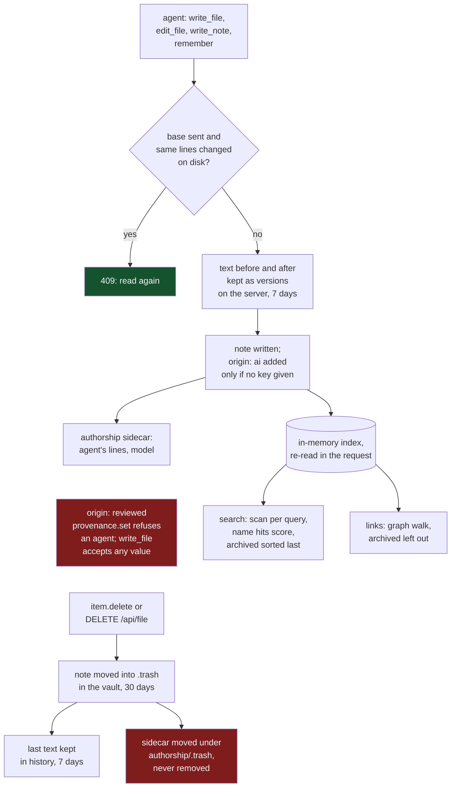

## 1. Executive Summary

Vaultite is a desktop and server app over a folder of Markdown files, which
agents — Claude Code or Codex in its terminals, or any MCP client — read and
write through one registry of operations served as the `vau` CLI, HTTP and MCP
tools. What is notable is the write contract: exact-text edits, whole-file
writes merged three ways against the text the caller read or refused, a
version kept before and after every agent operation, and the lines an agent
wrote recorded beside the note. What is weak is what follows the write. The
`origin` label that marks an agent's note as unreviewed is refused to an agent
by the labelling op and accepted from it through `write_file`, and no read
consults it; search ranks text matches by modification time alone; and a
deleted note leaves its agent-written lines in a sidecar nothing removes.

It carries `negative_eval`.

**Licence.** The bundled citeproc-js is taken under CPAL 1.0
(`plugins/core/references/citeproc/PROVENANCE.md`), whose Exhibit B reads
*Display of Attribution Information is required in Larger Works*, and §14
places that display *each time … a Larger Work is launched or initially run*.
The attribution phrase and URL appear nowhere outside that folder, the CSL
styles and `NOTICE`, and nothing in the build or the interface reads `NOTICE`.
§15 adds that an External Deployment of `citeproc.mjs` counts as distribution.
The References plugin that loads it is off by default. Everything else is
Apache-2.0 in `LICENSE` and `package.json:4`, and the vendored SheetJS,
kdbxweb, libghostty-vt, lint-rule and skill files carry permissive licences
that `NOTICE` lists.

**The write path refuses the two common ways an agent loses text.**
`write_file` refuses text ending in the note a paged `read` appends, and over
MCP refuses to replace a file longer than one read unless a `base` is sent
(`core/coreops/files.ts:160-167`). With a base, lines changed on disk meanwhile
are merged and a clash in the same lines is a 409 telling the agent to read
again (`core/contracts/save.ts:31-51`). `edit_file` requires its `old` text to
occur once unless `all` is set (`core/coreops/files.ts:197-213`). Before and
after each agent op, File history keeps the file as a version
(`plugins/core/history/plugin.ts:500-516`).

**The review label is advisory twice over.** An agent's new note gets
`origin: ai`, and `provenance.set` refuses an agent any other value with a 403
(`plugins/core/provenance/plugin.ts:277-279`). The create hook only adds a key
the text does not already carry (`core/vault.ts:1043`), no save hook guards the
key, and a committed test has an MCP client create a note declaring
`origin: human` and asserts the label stays
(`tools/test/vault/provenance.ts:30-33`). No search, link, list or context read
filters on the value.

**Deletion is a move, and copies stay behind.** A delete renames the file into
`.trash/` inside the vault for 30 days. The server keeps its last text for the
7 days File history keeps versions. Its authorship sidecar, which holds the
agent-written lines verbatim, moves under `authorship/.trash/` and is never
removed.

## 2. Mental Model

A memory is a file a person could open in another Markdown editor. Its kind is
its `type:` key, and plugins define kinds with their own formats: a person
under `People/`, a log, a note, the user's own `ME.md`. Nothing is extracted
from conversation; every memory is a file an agent or the user chose to write.
The op the system names for memory, `people.remember`, appends one sentence
under `## About me` or `## How to work with me` in `ME.md`, or into a person's
file ending with `(from <source>, <date>)`, and skips it if the exact line is
already there (`plugins/core/people/ops.ts:95-148`).

A file is *live* while it is in the vault outside a dot folder and indexed.
Archiving moves it into an `.archive/` folder beside it and sets
`archived: true` (`plugins/core/archive/AGENTS.md`); it is then left out of
lists, blocks, the graph and database views, and sorts last in search. Deleting
moves it into `.trash/`, out of the index, and a daily job removes trash older
than 30 days (`core/files.ts:340-371`, `core/app.ts:91`). Separately, the
server keeps earlier versions of every text file for 7 days.

Nothing in the model says whether a file is believed. The `origin` label and
the per-line authorship say who wrote it; both are displayed and neither gates
a read. Agent and user hold the same note verbs, except that a plugin acting on its
own needs a grant to write outside `.vaultite/` (`core/writegate.ts:67-84`).

## 3. Architecture

One Node server (`server.ts`, `core/`) serves a vault on `127.0.0.1:8793`; the
Electron desktop app, the web app and an iPhone app in development are clients
of it. Every feature, the file tree included, is a plugin under
`plugins/core/`, loaded and hot-reloaded by the core, which never imports one.

| Place | Holds |
| --- | --- |
| The vault folder | Notes and other files; `.trash/`; `.archive/` folders; `.vaultite/` settings, the agents' rules file and the provenance sidecars |
| The server machine's local directory | File history per vault, Activity's day logs, the trust store, kept state shared with other machines, the device-sync store |
| Server memory | The `Vault` index of every parsed Markdown file (`core/vault.ts:653`), and up to 256 MB of other files' text for search (`core/files.ts:383-476`) |
| `~/Backups/vault.git` on the sync hub | An hourly git snapshot of the vault while device sync runs (`plugins/core/sync/plugin.ts:32`, `:299-311`) |

There is no database, no embedding and no model call on the memory path; the
SQLite module in `core/agents.ts` opens other programs' files read-only. A
public MCP listener can be reached through Vaultite Cloud's relay, a hosted
service whose code is not in the tree.

### Deployment and ergonomics

A DMG, a Windows installer or a Linux package, or `npm ci && npm run build`
and `vau service install` from source. Nothing needs an account or an API key.
The main server takes no credentials from loopback or the tailnet; it is meant
for those networks, and only the owner, by loopback or a Tailscale login,
reaches the shell and the screen (`core/owner.ts:1-2`). The store is a folder
of Markdown the user can grep, edit in Obsidian or keep in git, and repair by
hand.

## 4. Essential Implementation Paths

| Path | Location |
| --- | --- |
| Read, search, write, edit, move, list ops and their MCP names | `core/coreops/files.ts:46-296` |
| File routes: read, write, delete, move, restore | `core/files.ts:713-869` |
| Save plan: base check and three-way merge | `core/contracts/save.ts:31-51` |
| Search scan, scoring, sort, archived last | `core/files.ts:512-607` |
| Search query parser, Obsidian syntax | `core/searchquery.ts` |
| Vault index, create and save hooks, trash | `core/vault.ts:653`, `:1040-1090`, `:1585-1608` |
| Trash expiry job | `core/files.ts:340-371`, `core/app.ts:91` |
| Item ops, delete to trash | `core/coreops/items.ts:64-77` |
| `remember` and timelines | `plugins/core/people/ops.ts:51-148` |
| Note upsert by id | `plugins/core/notes/plugin.ts:128-175` |
| Version history, agent-op snapshots, restore | `plugins/core/history/plugin.ts:178-252`, `:436-516` |
| Origin label, authorship sidecars | `plugins/core/provenance/plugin.ts:54-64`, `:94-107`, `:258-345` |
| Link graph op | `plugins/core/graph/plugin.ts:180-212` |
| Archive ops | `plugins/core/archive/plugin.ts:58-110` |
| Activity log and its delete route | `plugins/core/activity/events.ts:32-127` |
| Imported memories review list | `plugins/core/ai-import/plugin.ts:235-271` |
| MCP server and instructions | `plugins/core/mcp/plugin.ts:36-90`, `plugins/core/mcp/protocol.ts:120-127` |
| Agents' briefs | `core/plugins.ts:1069-1080`, `plugins/core/terminal/backends.ts:198-203` |
| Plugin write gate | `core/writegate.ts:50-84` |

## 5. Memory Data Model

A note is frontmatter and a Markdown body. Keys the system reads:

- **`type`**: the kind. A kind owned by a plugin parses and renders the file
  its own way and may require fields.
- **`id`**, **`created`**, **`updated`** for notes; `write_note` upserts on the
  id and replaces the body (`plugins/core/notes/plugin.ts:133-136`).
- **`tags`**, **`aliases`**, wiki links, which the link index resolves.
- **`archived`**: `true` or `yes` only (`core/fileprops.ts:21-23`), or any path
  inside an `.archive/` folder.
- **`origin`**: `human`, `reviewed`, `mixed` or `ai` by default, values a vault
  may redefine (`plugins/core/provenance/plugin.ts:12-17`).

Beside a note, `.vaultite/plugins/provenance/authorship/<note>.json` holds up to
400 spans, each the author, agent, model, effort, time, first line and the
lines' text (`plugins/core/provenance/authorship.ts:1-5`). On the server,
history keeps `head`, `<t>.snap` and `meta.json` per file under a hash of its
path. Activity keeps day logs of events with an actor, an action and the paths.

`ME.md` has two sections, `## About me` and `## How to work with me`. A person
file holds facts before its first heading and a `## Timeline` of dated lines,
each with a kind such as call or note.

**`trust_state` is withheld.** `origin` is a discrete status with a value that
means not reviewed, and nothing reads it to exclude a file: its own guide calls
it *"A label, not a lock"* (`plugins/core/provenance/AGENTS.md:4`). A user's
database view can filter on it like any key. `archived` is a lifecycle
position.

**`bitemporal` is withheld.** A timeline line carries the date the contact
happened, and `created` and `updated` are record time. No field states when a
fact stops holding, and no read takes an as-of instant.

**`tombstone` is withheld.** Trash is a move keyed on the path.
`core/kept.ts:23` keeps 30-day tombstones for deleted runtime-state keys across
machines, which are delete-sync markers. When device sync merges a delete with
a concurrent edit, the edit is kept and the delete is recorded as a conflict
(`core/syncengine.ts:300-305`).

## 6. Retrieval Mechanics

Retrieval is pulled by the agent. An agent started in the app gets the
terminal brief and one line from each plugin that is on in its system prompt,
with lines its `CLAUDE.md` files already hold left out
(`plugins/core/claude-code/plugin.ts:484-492`, `plugins/core/claude-code/memory.ts:14-38`);
an MCP client gets the same lines as the server's instructions. The Me plugin's
line names `ME.md` and tells the agent to read it before writing. No note's
content is injected.

**Search** (`core/files.ts:531-607`) parses the query in Obsidian's syntax:
words, phrases, `-word`, `OR`, regular expressions, `file:`, `path:`, `tag:`,
`line:`, `section:`, `task:`, properties. It then scans every parsed note and
the cached text of every other text file; images, PDFs, media and JSON data are
not searched.

1. A file is skipped if it is outside the asked folder, or matches the vault's
   ignore filters unless the asked folder is itself ignored (`:542`, `:579`).
2. A match's score is three per match in the file *name*, plus five if the
   name contains the whole query (`:546`). Matches in the text add nothing.
3. `relevance` sorts by score, then by newest modification (`:513`).
4. Archived files are moved after the rest, then the page is cut (`:604`).

The MCP tool defaults to 20 files and 3 lines per file, and a `read` answer
over MCP stops at 100,000 characters with the offset to continue
(`core/coreops/files.ts:10`, `:89-91`). Its text gives the path and the lines
and drops the `archived` flag the route returns, so a file archived by its key
without being moved reads as current (`core/coreops/files.ts:106-115`).

**Links** (`plugins/core/graph/plugin.ts:180-212`) returns a file's backlinks
and outgoing links and, with `depth` up to 5, the files further out. Archived
files are left out unless asked for.

**Query** runs the property engine database views use, with `where`, `sort`
and `columns`.

The failure modes follow from the scoring. A query whose words appear only in
note bodies returns them newest first, so an older note that answers the
question ranks below any recent one that mentions the word. There is no
stemming and no semantic arm.

## 7. Write Mechanics

Every write is an explicit call or a direct file edit. Agents use
`write_file`, `edit_file`, `write_note`, `write_log`, `add_timeline`,
`remember`, `clip`, `inbox_add`, the generic item ops through `call`, or a
shell in the vault folder. A write through the server re-reads the file into
the index before answering (`core/files.ts:791`), so it is searchable at once.
A shell edit reaches the index through the file watcher.

**Writes block the agent** for one file write, one re-read and, for an agent
op, two version copies. No model is called. The authorship record runs after
the answer in a per-file queue (`plugins/core/provenance/plugin.ts:325-345`).

Two writes replace rather than merge. `write_note` with an existing title
replaces the body (`plugins/core/notes/plugin.ts:133-136`), and `write_file`
without a base replaces the file. History keeps the previous text in both
cases.

`remember` is append-only with an exact-line check. A restated fact in other
words is a second line, and a contradiction is left to the prose instruction
*"If you're not sure who it's about, or it contradicts the vault, don't write
it: ask."* (`plugins/core/people/ops.ts:103`).

### Forgetting

- **Delete.** `item.delete` and `DELETE /api/file` move the file into
  `.trash/<path> <local stamp>` and drop it from the index
  (`core/vault.ts:1593-1608`, `core/files.ts:733-748`). No MCP tool is named
  for it; `call` reaches `item.delete`. Restore puts it back.
- **Trash expiry.** Daily, files trashed more than 30 days ago are removed
  (`core/files.ts:340-371`).
- **History.** A deleted file's last text stays a version, marked gone, until
  it is 7 days old, and `restore_version` brings the file back
  (`plugins/core/history/plugin.ts:146-151`, `:235-252`, `:471-498`).
- **Archive.** A move into `.archive/`, reversible, with links rewritten.

### Operational cost

Search reads every note in memory per query and up to 256 MB of other files'
text, and reads anything larger from disk. History copies each changed text
file. Nothing rewrites the store in the background except the recap Activity
writes, when it is on.

## 8. Agent Integration

Each op is declared once with its parameters, its help and an optional MCP
name; the same declaration is a `vau` command, `POST /api/ops/<id>` and an MCP
tool (`core/ops.ts:61-104`). The MCP server adds `ops` to list or explain any
op and `call` to run one by id. Tool annotations carry the op's kind as
`readOnlyHint` and `destructiveHint` (`plugins/core/mcp/catalog.ts:15`).

Three routes reach it. `vau mcp` over stdio. `POST /api/mcp` for the owner,
like the terminal. A public listener for AI apps on the internet, signed in
with a code the owner types, where a connection can be made read-only and
anything that can run code on the machine, `.vaultite/` writes included, waits
for the owner's approval on their phone (`plugins/core/mcp/public.ts:813`).
Writing a note does not wait.

Agents started in the app's terminals run in the vault folder with a shell. The
app passes them a system-prompt addition and Claude Code hooks that report each
edit and command back to Activity
(`plugins/core/claude-code/plugin.ts:448-467`). `.vaultite/AGENTS.md`, written
by the Agent files plugin, holds the app's rules for agents, one line per
plugin that is on, and a section for the user's own.

**`human_review` is withheld.** No write waits for anyone. The `origin` label
fails twice: the producer can write it, as section 9 shows, and nothing gates
on it. Imported ChatGPT and Claude memories go to a review list as unticked
tasks, and `ai-import.apply` adds the ticked ones through `remember`
(`plugins/core/ai-import/plugin.ts:235-271`); an agent holds `edit_file` to
tick them and `call` to run the apply, and the op checks no actor. The pinned
commit removes the Review plugin, which listed agents' changes for the user to
keep or revert with ops that refused agents; those changes were already live
while they waited.

## 9. Reliability, Safety, and Trust

### The reviewed label is one the agent can type

The design gives the agent one value. A note an agent creates through the
server gets `origin: ai` from a create hook
(`plugins/core/provenance/plugin.ts:54-64`), and `provenance.set` returns 403
for an agent asking for any other value or for no label (`:277-279`), with a
test asserting the refusal (`tools/test/vault/provenance.ts:172`).

The write path does not apply the rule. The create hook adds `origin` only
when the text has no such key (`core/vault.ts:1043`), and the one save hook
registered in the tree bumps a note's dates
(`plugins/core/note-dates/plugin.ts:35`). An agent that writes `origin: human`
into a new note's frontmatter, or replaces `origin: ai` with
`origin: reviewed` through `edit_file`, is stored as written. The first case
is a committed test: an MCP client creates `Prov/Mine.md` with
`origin: human`, and the check asserts the label stays
(`tools/test/vault/provenance.ts:30-33`). An agent with a shell can do the same
to the file directly, where the server cannot see it.

### A deleted note's agent lines outlive the trash

When a note moves into `.trash`, its authorship sidecar moves to the matching
path under `.vaultite/plugins/provenance/authorship/.trash/`
(`plugins/core/provenance/plugin.ts:94-107`). The daily trash job removes the
note and fires no hook, and Provenance's own cleanup removes only entries in
its attachment list (`:181-188`). The sidecar, which stores each agent-written
line's text, stays in `.vaultite/` and syncs with the vault.

### Deletion leaves copies the delete does not name

Beyond the sidecar: the last text sits in File history on each server machine
for 7 days. With Activity on, the day's recap in `Recaps/<date>.md` quotes the
text changed and is *"kept in the vault for good"*
(`plugins/core/activity/AGENTS.md`). With device sync running, the hub commits
the vault to `~/Backups/vault.git` every hour, and nothing in the sync plugin
prunes it (`plugins/core/sync/plugin.ts:299-311`,
`plugins/core/sync/hub.ts:14-32`).

### Who wrote a version depends on a plugin that is off by default

History names a version's writer from Activity's change events
(`plugins/core/history/plugin.ts:401-413`), and the header line saying an agent
changed a file reads the same events. Activity is off by default
(`plugins/core/activity/manifest.json:5`). With it off, versions are kept
without a writer and the header line never appears; the authorship sidecar is
kept either way.

Activity is not an audit trail when it is on. It merges a repeated event within
90 seconds by rewriting the earlier one
(`plugins/core/activity/events.ts:32-55`), keeps 14 days, and
`DELETE /api/activity` empties every day's file (`:121-127`). The main server
takes no credentials from loopback, where an agent in the app's terminal runs.
**`audit_log` is withheld** on that, and History's versions, pruned at 7 days,
do not replace it.

### What holds up

- The write contract: refusal on a paged read, a base for long files over MCP,
  three-way merge or 409, exact-once edits.
- Authorship comes from the request's writer, which the server resolves from
  the connection, and not from the agent's word; spans are found again by text
  as the note changes, and a line the user later edits shows as mixed.
- A plugin acting on its own needs a grant to write outside `.vaultite/`,
  checked on every write, move and delete (`core/writegate.ts:67-84`).
- A shared folder's guest is held to that folder on read, search and write,
  and a guest's text cannot add images, HTML, code blocks other apps run or
  links to commands (`core/guests.ts:130-153`).

**`scope_enforced` is withheld.** There is one vault per server and one user,
and every agent reads all of it. The ignore filter is lifted by the agent's own
`folder` argument, and the guest allow-list is a directory boundary for people
who are not agents.

## 10. Tests, Evals, and Benchmarks

`tools/test_vault.ts` runs 138 test files against a real server on a scratch
vault, 26,221 lines with 4,411 `check()` calls; CI runs it with 34 other
`tools/test_*.ts` suites on Ubuntu, macOS and Windows on every push
(`.github/workflows/ci.yml:27-93`). `check` records a failure for a false value
and `skip` is a separate status (`tools/test/lib.ts:123-136`). Browser QA lives
in `web/qa/`. I ran none of it.

**`negative_eval` is earned on search.** `tools/test/vault/ops.ts:226-240`
writes three notes containing *zebracorn*, places two under ignore filters, and
requires search to return exactly the third; the same block asserts the graph
leaves them out and that naming their folder finds them. The surviving note is
the positive control. `tools/test/vault/share.ts:133-135` asserts a guest's
search for a word that exists only outside the shared folder returns no file,
while a word inside returns that folder's note. Both assert absence from a
populated retrieval; neither is about a corrected or deleted value.

Also covered: `remember` writes under the right heading once and refuses an
unknown person (`tools/test/vault/ops.ts:66-82`,
`tools/test/vault/mcp.ts:320-327`); history keeps a deleted file's last content
and prunes it after `keep_days` (`tools/test/vault/history.ts:91-99`); an
archived file sorts last in search and is marked in the route's answer
(`tools/test/vault/graph.ts:241`).

Not covered: an agent changing `origin` through `write_file` or `edit_file`
being refused, which the one test on the subject asserts the opposite of; a
trashed note's authorship sidecar; a trashed note's absence from search; the
MCP search text for an archived file.

No paper describes the system and no memory benchmark is committed. The arXiv,
BibTeX and DOI matches in the tree belong to the References plugin's parsers.

## 11. For Your Own Build

### Steal

**Make the write tool refuse the truncating write.** A paged read ends with a
recognisable note, and a write whose text ends in it is refused with the two
safe alternatives named.

**Take a base on whole-file writes and merge three ways.** A clash in the same
lines returns the current text and a 409; anything else merges. An agent that
read a stale copy cannot erase the user's edit.

**Snapshot the file before and after every agent op.** Each agent change
becomes a version of its own, so restoring one agent's edit does not need a
diff of the user's.

**Record authorship on the server, beside the file.** The writer comes from
the request; the agent is told not to stamp its own text, and the note stays
clean.

**Give each op one declaration and derive the CLI, HTTP and MCP surfaces from
it.** The help an agent reads is the help a person reads.

### Avoid

**Do not enforce a label on one verb and accept it in the text on another.**
If a value is the user's to give, the save path has to refuse it from an agent,
or the refusal on the labelling verb is decoration.

**Do not move sidecars with a file into the trash and forget them there.** A
cleanup keyed on the trash has to cover every place a move hook put something.

**Do not score text search by title matches alone.** Body-only matches ordered
by recency bury the older note that answers the question.

**Do not make writer attribution depend on an optional plugin.** The history
the user is pointed at should not lose its names when a logging feature is off.

### Fit

It fits one person who wants agents to write into the same Markdown folder
they read and edit, on their own machines and tailnet, and who values being
able to open the files anywhere over any automatic recall. The cost is a large
application with an Electron shell and dozens of plugins to adopt for what is,
on the memory side, files plus a scan.

It does not fit where agent-written content must be held back until a person
approves it, where deletion has to be complete, or where several agents or
people need separate scopes over one vault. Retrieval is as good as the agent's
query words.

## 12. Open Questions

- **Is an agent meant to be able to set `origin` in the text?** The labelling
  op refuses it and a test asserts the text path keeps it; one of the two is
  presumably not the intent.
- **What replaces Review for a user who wants to see agents' changes?** The
  version history's header depends on Activity, which is off by default.
- **Does the device-sync hub's git snapshot run on a single-machine install?**
  The interval starts with sync; whether a lone machine counts as its own hub
  was not traced.
- **How is the CPAL attribution meant to be met?** The References plugin is off
  by default, and no display was found.
- **What does Vaultite Cloud's relay keep?** Its code is not in the tree.

## Appendix: File Index

| File | Role |
| --- | --- |
| `core/vault.ts` | The index, kinds, create and save hooks, trash |
| `core/files.ts` | File routes, search scan and scoring, trash expiry |
| `core/contracts/save.ts` | Save plan and merge |
| `core/coreops/files.ts`, `core/coreops/items.ts` | Read, search, write, edit, list and item ops |
| `core/ops.ts`, `core/plugins.ts` | Op declaration, agents' briefs |
| `core/writegate.ts`, `core/owner.ts`, `core/guests.ts` | Plugin write grants, owner check, guest write rules |
| `core/searchquery.ts` | Search syntax |
| `plugins/core/history/plugin.ts` | Versions, agent-op snapshots, restore, prune |
| `plugins/core/provenance/plugin.ts`, `authorship.ts`, `AGENTS.md` | Origin label, authorship sidecars |
| `plugins/core/people/ops.ts`, `plugins/core/me/` | `remember`, timelines, `ME.md` |
| `plugins/core/notes/plugin.ts`, `plugins/core/archive/plugin.ts` | Note upsert, archive |
| `plugins/core/graph/plugin.ts`, `plugins/core/query/plugin.ts` | Links and property queries |
| `plugins/core/activity/events.ts`, `store.ts`, `AGENTS.md` | Activity log, recaps |
| `plugins/core/ai-import/plugin.ts` | Imported memories review list |
| `plugins/core/mcp/plugin.ts`, `protocol.ts`, `catalog.ts`, `public.ts` | MCP server and public listener |
| `plugins/core/claude-code/plugin.ts`, `memory.ts`, `plugins/core/terminal/backends.ts` | Agent launch and briefs |
| `plugins/core/sync/plugin.ts`, `hub.ts`, `core/syncengine.ts` | Device sync and the hub's git snapshot |
| `tools/test/vault/ops.ts`, `share.ts`, `provenance.ts`, `history.ts`, `search.ts` | The tests cited |

### Recorded searches

Run with `/usr/bin/git` in a full clone at the pinned commit.

- `git ls-files core plugins web/src electron | grep -E '\.(ts|tsx)$' | grep -v -E '/qa/|citeproc|xlsx' | xargs cat | wc -l` — 217,984 lines in 1,613 files.
- `git grep -c -E '(^|[^[:alnum:]_.])check\(' -- 'tools/test/vault/*.ts'`, summed — 4,411.
- `git grep -n -E 'origin *(==|!=|=) *"?ai|origin: ?ai|!origin' -- bundles examples plugins skills core`, setting aside the provenance plugin's own guide and server — `examples/vault/Notes/How this vault works.md:8` and `plugins/core/provenance/index.tsx:97`, neither a filter. The pattern matches, so it can.
- `git grep -n -w reviewed -- '*.ts' '*.tsx'` — the provenance plugin's values and menu, and an unrelated `reviewed` field in the companion's jobs; no read of the label.
- `git grep -n -E 'onSave\(' -- plugins core` — `plugins/core/note-dates/plugin.ts:35` is the one plugin saver.
- `git grep -n -E 'AUTHORSHIP' -- plugins core` — `plugins/core/provenance/plugin.ts:102`, `:292`, `:293`; no removal outside the move hook.
- `git grep -n 'emptyTrash' -- core plugins server.ts` — the definition and `core/app.ts:91`.
- `git grep -n 'archived' -- core/coreops/files.ts` — lines 252, 287 and 292, the actions and list ops; none in the search op's text.
- `git grep -n -E 'gc|prune' -- plugins/core/sync/hub.ts` — nothing. Control: `git grep -c git -- plugins/core/sync/hub.ts` — 13.
- `git grep -n -E 'route\("DELETE"' -- plugins/core/activity` — `events.ts:121`.
- `git grep -n -i -E 'folder|scope|withhold' -- plugins/core/mcp/public.ts` — the `withhold` and `tools` settings, the OAuth scope `vault` and the approval text; no folder limit on a connection.
- `git grep -n -i -E 'contradict|supersed|valid_from|valid_until|tombstone' -- core plugins` — `core/kept.ts:23` and `:54`, the updater's CI check, the prose at `plugins/core/people/ops.ts:103` and licence text.
- `git grep -n -i -E 'citationstyles\.org|Frank Bennett|implements the Citation Style Language' -- . ':!plugins/core/references/citeproc' ':!plugins/core/references/styles'` — `NOTICE:22` and `:25` only. Control: the same URL is in `plugins/core/references/citeproc/CPAL`.
- `git grep -n -E '"NOTICE"|NOTICE' -- electron web/src core package.json '*.yml' '*.json' ':!package-lock.json'`, setting aside notice words — nothing.
- `git grep -n -i -l -E 'arxiv|bibtex|@article|@misc|doi\.org|CITATION\.cff|LoCoMo|LongMemEval' -- .` — the References plugin, its styles, `core/docs/from-other-apps.md`, a research bundle guide, the changelog and a kdbx file; no paper on the system.
- `git ls-files | grep -i -E '(^|/)(licen[sc]e|copying|notice|contributing|third.party)'` — `LICENSE`, `NOTICE`, `CONTRIBUTING.md` and the vendored licence files; `plugins/core/references/citeproc/CPAL` and `AGPLv3` sit beside them under other names.

## History

**2026-11-17** — [`55768189f71c42b878e75a599dd6427367cdb077`](https://github.com/Vaultite/vaultite/commit/55768189f71c42b878e75a599dd6427367cdb077) — first reading, from a full clone holding 2,289 commits. Screened before reading: the screen found a Claude Code marketplace manifest, a `.claude/settings.json` SessionStart hook and a nested plugin (`plugins/core/terminal/claude-pictures`) with its own hook registrations, committed git hooks that a `prepare` script points `core.hooksPath` at, and a `package.json` and lockfile changed inside the seven-day cooldown; `CLAUDE.md` was treated as data, and nothing was installed or run. No finding was re-derived outside the tree, and the device-sync engine and Vaultite Cloud's relay were not traced. One mark: `negative_eval`, on search. `trust_state` and `human_review` are withheld on the `origin` label, which gates no read and which an agent can type.
