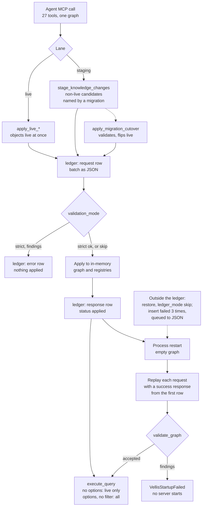

## 1. Executive Summary

Vellis is a local MCP server that keeps an agent's knowledge as a typed graph:
anchors for people, tasks and projects, typed fact objects attached to them, and
typed links, all checked against a schema the agent can extend by migration.
What is notable is how it persists. The graph lives in process memory, and its
only durable copy is an append-only SQLite ledger of change batches, replayed
from the first row at every start, so no mutation can reach the graph without a
ledger row and survive a restart. What is weak is that the agent holds the
switches around both guarantees: a write may skip validation, a restore may
skip the ledger, and a forgotten value can never leave the ledger.

The repository carries two products. Bibliotek is a component library of
storage, graph, schema, constraint, migration, validation, query and controller
components, each specified first in textual SysML v2 under `model/`. Vellis is
the application assembled from them in `apps/rtg_knowledge_graph/`. No model
runs anywhere in the tree: the agent decides what to write and in what shape,
and code decides only whether the shape is valid.

Retrieval is a declarative pattern query over the in-memory graph, with typed
buckets, link requirements and property predicates, and nothing ranks a result.
An agent that wants to recall "the dentist" has to know the type and field to
ask for, or call the fact lookup with an exact value.

**Licence.** The pages under `reference/specifications/` are not Apache-2.0.
They are 1,145 Markdown pages extracted from the OMG's SysML 2.0 and KerML 1.0
PDFs, whose reproduced licence on physical page 5 grants use on condition that
copies *"will not be copied or posted on any network computer"*, that no
modifications are made, and ends the permission without notice on breach. The
pages sit in a public repository, re-rendered as Markdown. `NOTICE` names only Volant
Partners, and the README says only that third-party materials keep their own
licences. The memory server never reads these pages; they serve the model
tooling. The code is Apache-2.0 throughout and the manifest agrees.

One mark is earned, `audit_log`, on the ledger. Section 9 gives the reasons for
the six withheld.

## 2. Mental Model

A memory is a **fact object** attached to an anchor. The installed Everyday Life
schema has twelve anchor types (Person, Group, Area, Goal, Project, Task, Event,
Routine, Decision, Note, Resource, Place), each with one `…Facts` data type, and
nine link types such as `belongs_to`, `depends_on` and `mentions`
(`apps/rtg_knowledge_graph/resources/everyday_life_schema.json`). Only a name
or title is required, so a partial fact is storable.

A fact is believed when it is present and live in the graph. There is no
confidence, no status and no source on a fact. Validity is structural: a batch
is admitted when the result conforms to the live schema and constraints.

There are two ways in:

- **Live lane.** `rtg_apply_live_graph_changes` and
  `rtg_apply_live_anchor_records` write objects that are live at once. The lane
  refuses a write that marks an object non-live
  (`components/rtg/controller/implementation.py:2015-2029`).
- **Staging lane.** `rtg_stage_knowledge_changes` writes non-live candidates,
  each named in a migration record's `graph_make_live` list
  (`:2031-2092`). `rtg_apply_migration_cutover` validates the projected state
  and flips them live; `rtg_abandon_migration` deletes the candidates no other
  migration names (`:1233-1310`).

A fact stops being believed when it is deleted, overwritten by a write to the
same UUID, pruned with an abandoned migration, or replaced wholesale by a
restore. None of those removes the fact from the ledger, whose request rows hold
every batch as written. The graph forgets; the ledger never does.

## 3. Architecture

One Python process. `build_app` composes an in-memory graph, schema registry,
constraint registry and migration store with a deterministic validator, a query
engine, a JSON file store and a SQLite store, and hands them to
`InProcessRtgController` (`apps/rtg_knowledge_graph/composition.py:33-54`). The
controller serialises every operation behind one `threading.RLock`
(`components/rtg/controller/implementation.py:180`).

Persistence is two directories under `.data/rtg_knowledge_graph/`:
`controller.sqlite`, holding the ledger table, and `json_file/`, holding
snapshots and the ledger-failure queue (`apps/rtg_knowledge_graph/config.py:8-9`).
Both are unencrypted, which the getting-started guide says. A persisted snapshot
is never read at startup: `prepare_controller` sees an empty graph with a
non-empty ledger, classifies the state `needs_replay` and replays from the first
row (`apps/rtg_knowledge_graph/starter_schema.py:65-93`,
`components/rtg/controller/implementation.py:616`).

The MCP server is FastMCP 3 over stdio by default, or Streamable HTTP with
`serve-mcp --transport http`. The tool metadata, descriptions and lanes are
loaded from a model-generated manifest that must declare exactly 27 tools
(`apps/rtg_knowledge_graph/mcp_toolset.py:44-98`).

Runtime dependencies are `fastmcp` and `google-re2`, which the query engine and
the validator use for regex predicates. The SysML model, its Java validator and
the specification corpus are development inputs; nothing on the serving path
reads them.

### Deployment and ergonomics

`uv run vellis setup` provisions Python 3.14 and the locked dependencies, asks
once before writing a user-wide MCP registration for Codex, Claude Code or
Claude Desktop, and installs the Everyday Life schema only into an empty graph.
`uv run vellis doctor` inspects without writing. Nothing has to be running
besides the client, no API key is needed, and it runs offline.

The store is not repairable by hand in any useful way. The SQLite table is
readable JSON, but the graph is whatever replaying it produces; editing a row
changes history, and deleting one changes what every later batch applies to.
The documented reset is to stop the client and delete the directory.

## 4. Essential Implementation Paths

- **Mutation.** `_apply_normalized_change_batch`
  (`components/rtg/controller/implementation.py:277-344`): resolve local refs
  to UUIDs, check the lane, write the request row, validate when
  `validation_mode` is `strict` (`:299`), capture a preimage, apply, restore
  the preimage on an exception, write the response row. `_apply_resolved_batch`
  (`:1587-1675`) is the one function that mutates the graph from a batch.
- **Ledger.** `_LEDGER_SCHEMA` (`:124-133`); `_record_ledger` (`:2094-2133`)
  with three insert attempts and the JSON fallback (`:2135-2173`);
  `flush_ledger_failures` (`:1197-1231`).
- **Replay and verification.** `replay_ledger` (`:914-1053`),
  `_successful_transaction_metadata` (`:2858-2889`), `verify_replay_from_ledger`
  (`:1055-1146`), `_domain_state_digest` (`:2574`).
- **Startup.** `prepare_controller`
  (`apps/rtg_knowledge_graph/starter_schema.py:65-177`).
- **Snapshots and restore.** `persist_system_snapshot` (`:691-714`),
  `restore_from_snapshot` (`:806-856`), `_replace_state_from_snapshot`
  (`:858-912`).
- **Migrations.** `apply_migration_cutover` (`:346-495`),
  `abandon_migration` and `_apply_abandon_migration` (`:763-804`,
  `:1233-1310`), `list_migration_history` (`:1148-1195`).
- **Query.** `execute_query` (`:497-504`); `SimpleRtgQueryEngine` and
  `_matches_live` (`components/rtg/query/implementation.py:440-451`);
  `decode_query_options` (`apps/rtg_knowledge_graph/mcp_codec.py:820-843`).
- **Graph.** `put_data_object` replaces in place
  (`components/rtg/graph/implementation.py:149-177`); `delete_anchor`
  cascades (`:234`).
- **MCP.** Registration in `apps/rtg_knowledge_graph/mcp_server.py:25-357`,
  bodies and usage guides in `apps/rtg_knowledge_graph/mcp_toolset.py`,
  decoding in `apps/rtg_knowledge_graph/mcp_codec.py`.

## 5. Memory Data Model

Three object kinds share one UUID space (`components/rtg/graph/protocol.py:13-38`):
`RtgAnchor` (type, display name, system map), `RtgDataObject` (type, JSON
properties, system map) and `RtgLink` (type, source, target, system map). A data
object must be indexed to at least one anchor, and an anchor delete removes the
data objects no other anchor holds, with their links.

The system map's one field in use is `live`, absent meaning true
(`components/rtg/query/implementation.py:446`). There is no timestamp, author,
source or version on any object. The only clock is `recorded_at` on ledger rows.

Schema definitions are themselves records with a live flag: an anchor
definition can require data types, and a data object definition lists its
properties with `required` and `value_kinds`, a date kind checked against
`YYYY-MM-DD` (`components/rtg/change_validation/implementation.py:1322`).
Constraints add cardinality and query-pattern rules. Migration records carry a
status of `draft`, `ready`, `failed`, `applied` or `abandoned`, the UUIDs they
make live and retire, and evidence entries. An applied migration is pruned from
the store, and `list_migration_history` reconstructs its events from the ledger.

The ledger row is `(ledger_position, transaction_id, operation_name,
record_kind, payload_json, recorded_at)`. A request payload is the resolved
batch, so it holds every property value written. A recorded restore stores the
whole supplied snapshot in its request row.

Domain dates such as `due`, `target_date` and `captured_at` are ordinary fact
properties. Nothing in the system reads them as validity time.

## 6. Retrieval Mechanics

`rtg_execute_query` takes a `query_spec` of anchor buckets by type, link
requirements between buckets (optional ones keep unlinked rows), data
requirements with predicates, and a return spec of properties, groupings and
`count` aggregations. Operators are `exists`, `equals`, `not_equals`, `lt`,
`lte`, `gt`, `gte`, `contains`, `in`, `substring` and `regex` under RE2
(`components/rtg/query/protocol.py:10-22`). Ordering is on returned properties;
limit and offset page the result. There is no relevance score.

The live filter depends on how the agent calls. With no `query_options`, the
controller queries live objects only (`components/rtg/controller/implementation.py:503`).
With any `query_options` that does not name `live_filter`, the codec defaults
it to `all` (`apps/rtg_knowledge_graph/mcp_codec.py:831`), so a query that asks
only for a limit or an order also returns staged candidates. The usage guides'
examples all pass `{"live_filter": "live"}`, and the fact lookup sets it itself
(`apps/rtg_knowledge_graph/mcp_toolset.py:956`).

`rtg_resolve_anchor_by_fact` builds an `equals` query on one property and
returns the matching live anchors with guidance for zero, one or several
matches (`:622-652`, `:914-988`). It is how an agent finds an anchor it already
wrote: the bootstrap checklist tells it to resolve UUIDs this way before writing
links (`:1364-1365`). `rtg_get_object` fetches any
object by UUID, live or not, and `rtg_export_system_snapshot` returns the whole
graph.

Nothing is injected. The agent reads system state, discovers anchor types,
fetches a schema pack and composes a query, which costs several tool calls and
an exact vocabulary. A question phrased in other words than the stored values
finds nothing.

## 7. Write Mechanics

Every write is the agent's, through a tool, synchronous, with no model call. A
batch is written as a request row, validated, applied to process memory and
answered with a response row; it is queryable when the call returns.

`rtg_apply_live_anchor_records` is the everyday form: a list of anchors, each
with fact objects, compiled into one graph change set with generated local refs
(`apps/rtg_knowledge_graph/mcp_toolset.py:599-620`, `:692-765`). Both live write
tools have a dry-run twin that resolves refs and returns findings without a
ledger row.

Two switches lower the guarantees, and both are tool arguments:

- **`validation_mode: "skip"`** on `rtg_apply_live_graph_changes`,
  `rtg_apply_live_anchor_records`, `rtg_stage_knowledge_changes` and
  `rtg_stage_schema_migration` applies the batch unchecked
  (`apps/rtg_knowledge_graph/mcp_server.py:109-122`). The ledger records it and
  replay re-applies it without validation. Startup then calls `validate_graph`
  and raises `VellisStartupFailed` when it reports findings
  (`apps/rtg_knowledge_graph/starter_schema.py:81-92`). A committed test leaves
  a graph that fails validation after one skip-mode write
  (`components/rtg/controller/tests/test_rtg_controller_contract.py:635-656`),
  so from reading, such a write runs until the process stops and then keeps the
  server from starting.
- **`restore_options.ledger_mode: "skip"`** on `rtg_restore_from_snapshot`
  replaces the state and writes no row
  (`components/rtg/controller/implementation.py:812-856`,
  `apps/rtg_knowledge_graph/mcp_codec.py:1104-1110`). The model's own contract
  for the action reserves skip for internal recovery
  (`model/vellis/VellisOperations.sysml:176`); the MCP codec accepts it from
  any caller. The next start replays the ledger without that restore.

When a ledger insert fails three times the change is still applied, the result
carries `audit_degraded`, and the row goes to `system/ledger_failures.json`
(`:2094-2133`). Only `rtg_flush_ledger_failures` moves it into the table, and
nothing calls it at startup. A transaction whose response row is queued has no
success response, so a restart before the flush replays without it.

Deduplication is the agent's job, through the fact lookup. A cardinality
constraint with a maximum could refuse a second anchor with the same fact, and
the starter bundle installs schema and a migration and no constraint. An overwrite of an
existing UUID replaces the object without a version
(`components/rtg/graph/implementation.py:149-177`). Conflict handling is schema
conformance: two contradicting `TaskFacts.status` values on two objects are both
valid.

### Operational cost

A write costs a lock, two SQLite inserts and a validation pass over the touched
objects; a cutover validates the projected state of the whole graph. No
background pass exists. Startup cost grows with the ledger, because every start
replays every successful request from the first row, and a recorded restore
replays its full snapshot. Nothing is injected per turn; a query result is
bounded by its `limit`.

## 8. Agent Integration

The 27 tools fall into lanes declared in the manifest: state and discovery,
live graph, query, knowledge engineering, migration, and recovery and audit.
The manifest labels each with an audience of `everyday`, `advanced` or
`operator`; all 27 are registered on the one MCP server, so the agent holds the
operator tools too, including restore, replay and flush.

`rtg_get_usage_guide` serves topics such as `everyday_life_schema`,
`tool_call_shapes`, `query_examples`, `live_write` and `recovery_and_replay`,
written as JSON with minimal examples. Errors carry a structured diagnostic with
a code, the offending path, a remedy and guide topics
(`apps/rtg_knowledge_graph/mcp_toolset.py:654-689`). The server instructions ask
the agent to read state first, discover schema before writing and dry-run risky
changes (`apps/rtg_knowledge_graph/mcp_server.py:26-33`).

Setup registers one client at a time. The README offers one memory across
Claude, Codex and other tools, and the guide offers localhost HTTP for that.
Nothing in the tree keeps two stdio processes from opening the same storage:
each holds its own in-memory graph, each appends to the same table, and neither
sees the other's writes until a restart replays both in position order. From
reading, that replay applies each batch to a state its writer never saw.

## 9. Reliability, Safety, and Trust

### The ledger is the store

Coverage holds by construction for the calls that record. The graph has no
durable form other than the ledger, so a mutation without a request and a
success response is lost at the next start. The table is written by INSERT only;
the tree has no UPDATE, DELETE or DROP on it. Each refusal leaves an error row:
an invalid batch writes `request` then `error` and applies nothing
(`components/rtg/controller/tests/test_rtg_controller_contract.py:860-902`).

`rtg_verify_replay_from_ledger` replays into scratch state and compares a
SHA-256 digest of the canonical domain state with the live one, separately from
the ledger cursor and the counts (`components/rtg/controller/implementation.py:1055-1146`,
`:2574-2602`). A test changes one fact's value so the counts match and requires
`state_equivalent_to_live` false (`test_rtg_controller_contract.py:1746-1788`).
That is the right check for an event-sourced store, and it is exposed to the
agent.

The ledger carries no actor, and rows are not chained or signed. Anyone with
the file can rewrite history and the next start will rebuild from it.

### What the agent can switch off

The two skip switches in section 7 are the defects that matter. Skip-mode
validation can leave a graph the next start refuses, and a skip-mode restore
can leave a running state the ledger does not describe. The tool descriptions
call restore operator use; the server exposes it to the same caller as every
other tool.

The live lane also flips a staged candidate live outside its migration: the
lane refuses only `live: false` (`implementation.py:2015-2029`), and the
validator checks only that the referenced object exists
(`components/rtg/change_validation/implementation.py:1113-1116`).

### Forgetting

A delete removes an object from the graph and from every later snapshot. Its
values stay in the request row that wrote them, and in any recorded restore
that carried them, for as long as the SQLite file exists. No tool rewrites or
compacts the ledger, and the documented way to forget is to delete the whole
directory.

### Access

Stdio is the default. `serve-mcp --transport http` starts Streamable HTTP with
no authentication; the launch metadata says `"auth": "none"`
(`apps/rtg_knowledge_graph/mcp_launch.py:157`). `--host` defaults to
`127.0.0.1` and accepts any value (`apps/rtg_knowledge_graph/main.py:111-115`),
while the guide says HTTP must remain bound to loopback.

### Marks

- **`audit_log` — earned.** The ledger is an append-only record of every
  mutation the controller records, in the system's own store, and the store is
  rebuilt from it. Its gaps are a skip-mode restore, a queued insert until it is
  flushed, and the absence of an actor.
- **`trust_state` — withheld.** The only state that withholds an object is the
  two-valued `live` flag of migration staging. The same agent that stages a
  candidate cuts it over or flips it live, the default query honours the flag
  only when no options are passed, and rejection is deletion.
- **`scope_enforced` — withheld.** There is no scope key. One graph per storage
  root is a physical partition chosen at launch.
- **`bitemporal` — withheld.** Objects have no time fields; `recorded_at` on
  the ledger is record time, and domain dates are properties nothing reads.
- **`tombstone` — withheld.** A deleted value is in the ledger as a past write
  and nothing consults it on a later write; the same fact can be written again.
- **`human_review` — withheld.** Writes are applied when the agent calls, and
  cutover, abandon and restore are tools the agent holds. The README's rule that
  only a human owner accepts a component concerns the SysML design model, not
  graph content.
- **`negative_eval` — withheld.** The cases that exclude material assert an
  empty result over a graph whose only matching object is the excluded one:
  a staged candidate absent before cutover with one binding after
  (`test_rtg_controller_contract.py:1190-1246`), and a non-live anchor hidden
  under the live filter and returned under an overlay
  (`components/rtg/query/tests/test_rtg_query_contract.py:218-236`). Neither
  requires the excluded object absent from a result holding something else.

## 10. Tests, Evals, and Benchmarks

I ran none of the suites; counts are from reading. The Check workflow runs
`just check` (Ruff, BasedPyright, skill metadata, the SysML model checks and
pytest) on Ubuntu, and on Windows generates the MCP configuration and runs
`apps/rtg_knowledge_graph/tests/test_rtg_knowledge_graph_app.py`
(`.github/workflows/check.yml`). No test in the tree is marked skip.

Each component has a contract test file whose tests are grouped under named
verification objectives from its SysML model. The controller file holds 40 tests,
the MCP files 41, the query file 26 and the graph file 22. The ledger tests
cover request and response rows on a live write, request and error rows on a
refused one, the failure queue and its flush after a reload, replay from a
persisted snapshot path, a failed cutover replayed as failed, a restore
recorded and replayed (`:1973-2046`), and the digest comparison above.

No test has two controllers write to one ledger, restarts after a skip-mode
write, restarts after a skip-mode restore, or queries with options that omit
`live_filter`.

The evals under `docs/guides/vellis/evals/` are manual: copy-paste prompts for
an agent, a runbook and a walkthrough, with expected tool results and no
committed run or score. There is no benchmark and no paper reference in the
tree.

## 11. For Your Own Build

### Steal

- **Make the log the store.** If the only durable copy of the graph is the
  ledger, an unrecorded mutation cannot survive a restart, and coverage needs
  no separate discipline.
- **Write the request before validating, and the outcome after.** A refused
  batch leaves a request and an error row, so the history of what was tried is
  as complete as what was applied, and migration history is derived from it.
- **Compare replayed state by digest, not by count.** Equal counts with one
  changed value is the case a count check misses.
- **Fail closed at startup.** Refusing to serve a graph that does not replay
  and validate beats silently opening an empty one.
- **Give every error a code, a path and a remedy.** An agent that gets the
  exact field and a minimal example corrects its next call.

### Avoid

- **A guarantee with a switch on the agent's tool surface.** A `skip` for
  validation or for the ledger belongs to an operator path the model cannot
  reach, or nowhere.
- **A default that flips with an unrelated argument.** A filter that applies
  when options are absent and lifts when any option is present is a filter
  callers lose by asking for a limit.
- **An append-only log holding the content it was asked to forget.** Event
  sourcing and deletion need a plan: crypto-shredding, a compaction that
  rewrites the payload, or a separate content store the log points into.
- **One in-process state per client over a shared log.** Either one process
  owns the log or every writer reads before it writes.

### Fit

This suits a person or team who wants a structured, schema-governed personal
database that an agent edits on their behalf, values a full replayable history
over storage size, and runs one client. The schema discipline is the product:
a reader who wants to say "remember this" in free text and find it by meaning
later will find the query surface too exact and the vocabulary too fixed.

It does not suit memory that must be forgotten on request, several agents
writing at once over stdio, or any deployment where the model connected to it
is not trusted with restore and validation switches. The code has not moved
since 13 July 2026, so a reader adopting it adopts the beta as tagged.

## 12. Open Questions

- What happens when two clients run stdio servers on one storage root? The
  reading above is from code; whether replay fails or diverges depends on the
  batches.
- Is the `all` default for an options object without `live_filter` intended?
  The guides avoid it by always naming the filter.
- How long does startup take on a ledger with thousands of batches and a few
  recorded restores?
- Does the OMG grant cover publishing the extracted specification pages in a
  public repository? The tree states no separate permission.

## Appendix: File Index

- Controller, ledger, replay, snapshots, migrations:
  `components/rtg/controller/implementation.py`,
  `components/rtg/controller/protocol.py`
- Graph: `components/rtg/graph/implementation.py`,
  `components/rtg/graph/protocol.py`
- Validation: `components/rtg/change_validation/implementation.py`,
  `components/rtg/change_validation/protocol.py`
- Query: `components/rtg/query/implementation.py`,
  `components/rtg/query/protocol.py`
- Schema, constraints, migration records: `components/rtg/schema/`,
  `components/rtg/constraints/`, `components/rtg/migration/`
- Storage: `components/storage/sql/implementation.py`,
  `components/storage/json_file/implementation.py`
- Application: `apps/rtg_knowledge_graph/composition.py`,
  `apps/rtg_knowledge_graph/starter_schema.py`,
  `apps/rtg_knowledge_graph/config.py`, `apps/rtg_knowledge_graph/main.py`
- MCP: `apps/rtg_knowledge_graph/mcp_server.py`,
  `apps/rtg_knowledge_graph/mcp_toolset.py`,
  `apps/rtg_knowledge_graph/mcp_codec.py`,
  `apps/rtg_knowledge_graph/mcp_launch.py`,
  `apps/rtg_knowledge_graph/resources/model_app_manifest.json`
- Starter schema: `apps/rtg_knowledge_graph/resources/everyday_life_schema.json`
- Model: `model/vellis/VellisOperations.sysml`, `model/bibliotek/components/`
- Tests: `components/*/*/tests/`, `apps/rtg_knowledge_graph/tests/`,
  `.github/workflows/check.yml`
- Guides and evals: `docs/guides/vellis/getting-started.md`,
  `docs/guides/vellis/evals/`
- Specification corpus: `reference/specifications/`

### Recorded searches

Run from the repository root at the pinned commit with `/usr/bin/git grep`.

- **The ledger is only inserted into and read.**
  `git grep -n -i 'insert into rtg_controller_ledger' -- .` returns three
  lines; `git grep -n -i -E 'delete from|update rtg_controller_ledger|drop table|truncate' -- . ':!reference'`
  returns only a `"truncated"` key in the validator and its test.
- **No scope key on records or reads.**
  `git grep -n -i -E 'tenant|user_id|owner_id|workspace_id|namespace|principal' -- components apps vellis`
  returns argparse `Namespace`, `uuid5` `NAMESPACE_URL` and the graph's global
  type namespace.
- **No authentication on the HTTP transport.**
  `git grep -n -i -E 'auth|bearer|api_key|token' -- 'apps/rtg_knowledge_graph/*.py' ':!apps/rtg_knowledge_graph/tests'`
  returns setup's human-authorization help text, the `--transport` help text
  and `"auth": "none"` in `mcp_launch.py:157`.
- **No loopback check on `--host`.** `git grep -n -E 'is_loopback|ipaddress' -- apps vellis`
  returns nothing; `git grep -n DEFAULT_LOCALHOST_HOST -- apps` matches.
- **No inter-process lock.**
  `git grep -n -i -E 'fcntl|flock|msvcrt|portalocker|filelock' -- . ':!reference' ':!uv.lock'`
  returns nothing; `git grep -n -E 'threading.RLock' -- components` matches
  `components/rtg/controller/implementation.py:180`.
- **No model or embedding on the serving path.**
  `git grep -n -i -E 'embed|vector|cosine|openai|anthropic|llm' -- components apps vellis ':!*/tests/*'`
  returns two `re2.fullmatch` lines in the validator.
- **No validity-time fields.**
  `git grep -n -i -E 'valid_from|valid_to|valid_until|effective_(from|to)' -- components apps vellis`
  returns nothing.
- **No value-keyed refusal.**
  `git grep -n -i -E 'tombstone|blocklist|suppress' -- components apps vellis`
  returns nothing.
- **The ledger-failure flush runs only from its tool.**
  `git grep -n -E 'flush_ledger_failures|_load_persisted_ledger_failures' -- '*.py' ':!*/tests/*'`
  returns the MCP registration, the toolset method and the controller's own
  definitions.
- **The starter bundle installs no constraint.**
  `git grep -n -c constraint_changes -- apps/rtg_knowledge_graph/resources/everyday_life_schema.json`
  returns nothing; the same count for `schema_changes` returns 1.
- **Every guide example names the live filter.**
  `git grep -n -A3 '"query_options"' -- apps/rtg_knowledge_graph/mcp_toolset.py`
  returns nine guide and lookup occurrences, each with `"live_filter": "live"`,
  and the decoder call at `:639`.
- **No skipped tests.** `git grep -n -E 'skipif|pytest.skip|importorskip' -- '*.py'`
  returns nothing.
- **No paper reference.**
  `git grep -n -i -E 'arxiv|bibtex|@article|@misc|doi\.org|zenodo|CITATION' -- . ':!reference' ':!uv.lock'`
  returns a skill's instruction about citations and a test name about PDF
  citation anchors.

## History

**2026-11-26** — [`bb91b8eef434da1a360777811070aee7e2630e57`](https://github.com/volantlabs/vellis/commit/bb91b8eef434da1a360777811070aee7e2630e57). First reading, from a full clone at the head of `main`, the commit triage selected. Screened first: no auto-run surface, nothing inside the seven-day cooldown, no build-time execution, no unpinned surface, `uv.lock` present; `AGENTS.md`, guides, prompts and skills read as data. Nothing was installed, built or run, and the 314 test functions were not run. One mark, `audit_log`, on the ledger ([section 9](#9-reliability-safety-and-trust)).
