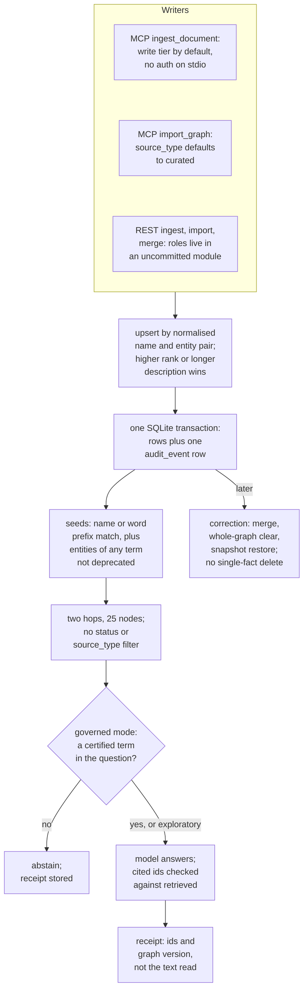

## 1. Executive Summary

VeritasGraph is an on-prem GraphRAG and agent framework. A local model
extracts entities and relationships from document chunks into one SQLite graph
that the Studio web app, a stdio MCP server and a CLI share. An agent writes
through the MCP tools `veritasgraph_ingest_document` and
`veritasgraph_import_graph`, and reads back through `veritasgraph_query`,
`veritasgraph_search_entities` and `veritasgraph_get_entity`. What is notable
is the governance ledger. Every graph mutation appends a SHA-256-chained
`audit_event` row in the transaction that makes it, and destructive operations
snapshot the graph first. Each answer is stored as a receipt naming the graph
version it read. What is weak is correction. No route deletes one fact,
a re-ingested correction wins only if its description is longer, and the
provenance rank that protects curated content is a label the writer chooses.

**Governance sits on the vocabulary, not on the facts.** Entity types,
predicates and glossary terms carry `proposed`, `certified` or `deprecated`.
Entities and relationships carry no status at all, and retrieval reads neither
status nor provenance (`studio_api/graphrag_engine.py:1317-1397`). Governed
mode answers when one certified term appears anywhere in the question
(`veritasgraph/answerability.py:47`). The coverage ratio computed two lines
earlier is reported and never consulted.

**The Studio cannot start from this checkout.** `studio_api/main.py:32`,
`:35` and `:38` import `routes.ontology`, `routes.structured` and `security`,
and `orchestrator.py:32` imports `netguard`. `.gitignore:135` ignores
`studio_api/*`, so none of the four was ever committed. Three survive only as
setuptools output under `build/lib/studio_api/`; `routes/structured.py` is
nowhere. The bearer-token roles and the only callers of the certify and
deprecate writer are in those files. The MCP server and the CLI's compile,
import and export commands import nothing missing.

**This report covers `veritasgraph/`, `studio_api/` and `veritasgraph_mcp/`.**
The monorepo's other trees hold no agent write path. `veritas-reason/` is a
renamed copy of the [Semantica](../semantica/) code base: its `LICENSE` keeps
Hawksight AI's copyright, and a name substitution turned `cluster_semantically`
into `cluster_veritasreasonlly`. `clinical-kg`, `floorplan-kg`,
`MedTrust Agent`, `municipality-incident-chatbot` and
`medkg-signal-reference` are document or prediction applications.

**Licence.** The MIT grant covers a source tree that withholds four modules
the Studio imports, because `.gitignore:135` ignores `studio_api/*`.
`security.py`, `netguard.py`, `routes/ontology.py` and `routes/structured.py`
are absent; the first three exist only as build output under `build/lib/` and
in the committed `veritasgraph_mcp.egg-info/SOURCES.txt`. Permission to
modify the Studio's role checks is permission to modify code the repository
does not contain. `veritas-reason/` is another project's code under its own
MIT notice, naming Hawksight AI, while the root `LICENSE` names Bibin Prathap
for the whole tree. `medkg-signal-reference/data/` bundles 8,002 PhysioNet
Challenge 2012 files and eICU demo tables that its own README calls ODC-BY 1.0,
with no licence file beside them.

## 2. Mental Model

A memory is a graph row. An entity is keyed by its whitespace-collapsed,
lower-cased name, so two different things with one name are one entity
(`studio_api/graphrag_engine.py:598-617`). A relationship is keyed by its
ordered pair of entity ids, so a second statement about the same pair folds
into the first edge instead of adding one (`:644-653`, `:668-691`). Each row
keeps the list of source chunk ids it came from, which is what makes a
citation checkable.

**A fact is never believed or doubted; it is ranked.** `source_type` is
`curated`, `extracted` or `inferred`, ranked 3, 2 and 1 (`:175`). On a merge,
higher rank overwrites the type and description; at equal rank the longer
description wins (`:624-640`, `:675-689`). Nothing on the read path consults
the rank. So a correction ingested from a revised document replaces the old
description only when it is longer, and otherwise adds its chunk id to the
`sources` list beside the claim it contradicts.

**A fact stops being one in three ways, none of them aimed at that fact.**
`merge_entities` folds one entity into another and keeps the dropped name as
an alias (`:1223-1284`). `clear` empties the graph after a snapshot
(`:1133-1154`). `restore` swaps the whole graph for a snapshot (`:1167-1191`).
There is no verb that removes one entity, one relationship or one document.

**The vocabulary has the state machine the facts lack.** Types, predicates and
terms carry a `CHECK`-constrained status (`veritasgraph/store/migrations.py:72-73`,
`:90-91`, `:107-108`). Every upsert resets it to `proposed`, whatever it was
(`veritasgraph/ontology/__init__.py:253`, `:291`, `:324`), and
`Ontology.set_status` is the only writer of `certified` or `deprecated`
(`:369-387`). `match_terms` skips deprecated terms (`:204`); extraction maps
onto certified types and predicates only (`:116-141`).

## 3. Architecture

Three entry points share one engine. `GraphRAGEngine` keeps the graph in
process dicts as a read cache over `SqliteGraphStore`, re-syncing when another
process has bumped `graph_version` and reloading fully when `epoch` changes
(`studio_api/graphrag_engine.py:451-480`). Writes take `BEGIN IMMEDIATE`, so
one process writes at a time across Studio, MCP and CLI, and readers never
block (`veritasgraph/store/sqlite.py:58-98`). Each write stamps its rows with
the new version, and deletions leave a row in a table named `tombstone` so
other caches can drop them (`veritasgraph/store/migrations.py:56-63`,
`veritasgraph/store/sqlite.py:267-277`).

Model calls go to Ollama at `OLLAMA_HOST`, or to an OpenAI-compatible endpoint
when `VG_GRAPHRAG_CHAT=openai` (`studio_api/graphrag_engine.py:562-581`). The
optional structured-data layer under `veritasgraph/structured/` governs a
semantic catalogue of an external database in Postgres with pgvector; it holds
no agent memory and this report does not read it further.

### Deployment and ergonomics

The MCP path needs Python, `httpx` and a local model:
`python -m veritasgraph_mcp` with `VERITASGRAPH_MCP_MODE` set, and the store
is created on first use under `STUDIO_DATA_DIR`. It runs fully offline. The
Studio path needs FastAPI and, from this checkout, the four missing modules
named in section 1. The store is readable by hand: every row's full JSON sits
in a `body` column, and snapshots are zlib-compressed JSON
(`veritasgraph/governance.py:98-120`). The Studio turn buffer is a plain JSON
file (`studio_api/store.py:396-417`).

## 4. Essential Implementation Paths

- **Ingest.** `GraphRAGEngine.ingest` chunks the text, applies the PII policy
  per chunk, runs `extract_chunk` on every chunk before taking the write lock,
  then merges all chunks and appends one `graph.ingest` audit row in a single
  transaction (`studio_api/graphrag_engine.py:827-884`). `merge_chunk` maps raw
  types and predicates onto certified vocabulary and records unmapped ones as
  `proposed` entries with `INSERT OR IGNORE` (`:730-825`,
  `veritasgraph/ontology/__init__.py:389-408`).
- **Import.** `import_graph` adapts Graphify, Understand-Anything, AI Atlas or
  generic node and edge JSON, tags every row with the caller's `source_type`,
  snapshots first under `overwrite`, and audits (`:889-1067`).
- **Retrieve and answer.** `retrieve` seeds, expands and gathers sources
  (`:1377-1397`); `query` runs the governed gate, builds the prompt, checks
  cited ids against retrieved ones and stores a receipt (`:1464-1613`).
- **Correct.** `merge_entities` (`:1223-1284`), `clear` (`:1133-1154`),
  `restore` (`:1167-1191`), `update_rows` for compile normalisation
  (`:1286-1312`).
- **Compile.** `run_compile` takes a `job_lock` row, runs six stages and
  writes suggestions keyed by a fingerprint (`veritasgraph/compile.py:296-330`);
  `resolve_suggestion` applies an accepted merge or term (`:89-122`).
- **Agent turns.** `Orchestrator` recalls the last `memory_turns` (default 6)
  turns before the model call and appends the user and assistant turns after
  it (`studio_api/orchestrator.py:592-603`, `:675`, `:698-700`).

## 5. Memory Data Model

| Table | Holds | Status or time |
| --- | --- | --- |
| `source`, `entity`, `relationship` | JSON bodies with `sources`, `source_type`, `origin`, `pii_flags` | `row_version` only |
| `tombstone` | kind and id of a deleted row | `row_version`, for cache sync |
| `entity_type`, `predicate`, `term` | vocabulary, synonyms, term-entity links | `status`, `updated_at` |
| `suggestion` | compile output, unique `fingerprint` | `open`, `accepted`, `rejected` |
| `audit_event` | actor, action, target, detail | `seq`, `ts`, `prev_hash`, `hash` |
| `snapshot` | compressed graph and term links | retention 20 by default |
| `answer_log`, `feedback` | question, answer, evidence ids, rating | `ts`, `graph_version` |

The schema is in `veritasgraph/store/migrations.py:17-213`. Sources carry
`created_at`; no row carries a validity time. `actor` is a role plus a token
fingerprint on REST (`build/lib/studio_api/security.py:157`) and `mcp:stdio`
on the MCP server (`veritasgraph_mcp/tools.py:38`). No graph table has a user,
tenant, project or agent column.

The Studio turn buffer is `_agent_memory`, a dict of lists keyed by agent id
and capped at 50 turns, each holding `role`, `content` and `at`
(`studio_api/store.py:132-148`).

## 6. Retrieval Mechanics

Seeding is lexical. An entity is a seed when its full name appears in the
question as a phrase, or when a question word of more than three letters
starts a word of its name. It is also a seed when linked to a matched glossary
term (`studio_api/graphrag_engine.py:1317-1338`, `veritasgraph/text.py:26-28`).
Term matching includes `proposed` terms and skips only `deprecated` ones
(`veritasgraph/ontology/__init__.py:197-210`). Expansion is breadth-first to
depth 2 and 25 nodes, in dictionary insertion order, so when the cap bites the
earliest-written entities win (`studio_api/graphrag_engine.py:1350-1375`).

Every chunk behind every retrieved node and edge goes into the prompt with no
token bound on the `/graphrag/query` and MCP paths (`:1534-1544`). The Studio
orchestrator budgets the same context to `context_budget`, default 600 tokens,
before the model call (`studio_api/orchestrator.py:616-631`).

The citation check is exact: ids of the `doc_xxx#n` shape in the answer are
compared to the retrieved set, and the answer is `grounded` when it cites at
least one retrieved source and nothing else
(`studio_api/graphrag_engine.py:1562-1572`). In governed mode an ungrounded
answer is replaced by a refusal (`:1601-1609`). The check proves a cited id
was retrieved, not that the sentence beside it is supported.

## 7. Write Mechanics

Writes are hot-path and blocking. An MCP `ingest_document` call returns after
one model call per chunk and one transaction; the facts are retrievable at
commit. Extraction runs outside the lock, so a slow model blocks only its own
caller (`studio_api/graphrag_engine.py:835-847`). Nothing deduplicates beyond
the name and entity-pair keys. Agent-generated facts are handled exactly like
document facts: an agent's ingest is extracted, and an agent's import is
stored as given with the `source_type` it names.

**The provenance rank protects nothing an agent cannot claim.**
`handle_import_graph` passes `args.get("source_type", "curated")`
(`veritasgraph_mcp/tools.py:307`), and the tool schema says the default is
curated (`:628`). Under `merge_strategy="overwrite"` an MCP client replaces
any entity's type and description (`studio_api/graphrag_engine.py:627-635`).
The write is audited with the strategy and counts, not the values replaced
(`:1033-1047`); the snapshot taken first holds them.

The compile pass reads the whole graph each run to compute degrees and name
groups, with no model call (`veritasgraph/compile.py:136-280`). The Studio
turn buffer rewrites `workspace.json` whole on each append, twice per turn
(`studio_api/store.py:132-138`, `:396-417`).

### Operational cost

A write blocks for the extraction calls and one SQLite transaction. No
background pass calls a model. On the read path the MCP and REST query
inject every chunk behind up to 25 nodes and their edges, unbounded; the
Studio pipeline caps it at its token budget and prepends up to six raw
turns.

## 8. Agent Integration

The MCP server exposes three tiers chosen by `VERITASGRAPH_MCP_MODE`, default
`write` (`veritasgraph_mcp/tools.py:41-43`). `read` lists 14 tools; `write`
adds `ingest_document`, `import_graph` and `propose_term`
(`:612`, `:636`, `:655`); `admin` adds `clear_graph` (`:662`). A tool above
the tier is reported as unknown. The stdio server authenticates nobody; the
tier is the whole boundary. Through the Studio's HTTP bridge the tier is
lowered to the caller's role (`studio_api/routes/mcp.py:75-76`).

The server instructions tell the agent to call `check_answerable` before a
factual answer and to treat `grounded=false` as unverified
(`veritasgraph_mcp/tools.py:730-737`). No tool merges entities, resolves a
suggestion, restores a snapshot, or certifies and deprecates; those are REST
routes. An agent cannot remove what it wrote except by clearing the graph.

`propose_term` calls `Ontology.upsert_term`
(`veritasgraph_mcp/tools.py:269-295`), whose conflict clause sets
`status = 'proposed'` on an existing term
(`veritasgraph/ontology/__init__.py:320-328`). An MCP client can therefore
demote a certified term by re-proposing it, rewrite its definition, relink it
to other entities, and return a deprecated term to `proposed`, where
`match_terms` seeds retrieval from it again.

## 9. Reliability, Safety, and Trust

### What governed mode enforces

`check_answerable` returns `answerable` when at least one entity seed exists
and, in governed mode, at least one matched term is certified
(`veritasgraph/answerability.py:47`). A question naming one certified term and
five unknown words passes. After the gate, retrieval runs as in exploratory
mode, seeding from proposed terms too. The README's "answers only when
certified terms cover the question" is, in code, "when one certified term is
present".

### What the audit chain proves

`_event_hash` is SHA-256 over the previous hash and the row's fields with no
key (`veritasgraph/governance.py:33-35`), and `verify_audit` recomputes the
chain from genesis (`:76-85`). It detects an edit to one row by someone who
does not recompute the rest. Anyone who can write the database file can
rewrite a row and every hash after it, and the head is not exported anywhere.
`propose_term` writes the term and the audit row in two transactions
(`veritasgraph_mcp/tools.py:285-294`). The Studio turn buffer and workspace
resources write no audit row.

### Deletion and erasure

`clear` keeps the whole graph in a snapshot (`studio_api/graphrag_engine.py:1147-1150`),
retained until 20 newer snapshots push it out (`veritasgraph/governance.py:114-119`).
`answer_log` keeps every question and answer, and the audit detail keeps
document titles, with no delete path for either. PII handling tags, redacts
or rejects at ingest and redacts on read for roles below the reveal role
(`veritasgraph/pii.py:98`, `:134`, `:141`); under the default `tag` policy the
text is stored in full.

### Shared turn memory

`POST /playground/chat` is a viewer route (`build/lib/studio_api/security.py:37-43`),
and the turn buffer is keyed by agent id alone. Every caller of an agent with
`use_memory` reads the last six turns of every other caller of that agent.

### Marks

- **`audit_log`** — awarded on `audit_event`. One INSERT per graph mutation,
  in the same transaction, reached from the MCP stdio server; the only SQL on
  the table is that INSERT. The limits are the two above: counts rather than
  values, and an unkeyed chain.
- **`trust_state`** — withheld. Facts have no status. The vocabulary status
  filters term matching and gates governed answers, but nothing in the source
  tree calls `set_status`: its only callers are in
  `build/lib/studio_api/routes/ontology.py:153-182`, whose source is ignored.
  From this checkout every term stays `proposed`.
- **`human_review`** — withheld. A term an agent proposes is matched and seeds
  retrieval while it waits, so certification gates one mode, not admission.
  The certify route is admin-only in the build copy, and the agent can undo a
  deprecation through `propose_term`. Suggestions wait for an editor, but they
  are compiler output, not agent writes.
- **`tombstone`** — withheld. The `tombstone` table is a delete-sync marker.
  Suggestion fingerprints are keyed on entity ids (`veritasgraph/compile.py:207`,
  `:230`), so they stop a question recurring, not a value. A deprecated type
  survives `record_proposals` because of `INSERT OR IGNORE`, the closest thing
  here, but with no certified vocabulary the raw type still reaches the entity.
- **`scope_enforced`** — withheld. No graph row carries a scope key; one
  SQLite file per deployment is a physical partition. Roles gate verbs.
- **`bitemporal`** — withheld. Sources carry `created_at`; nothing carries a
  validity time.
- **`negative_eval`** — withheld; see section 10.

## 10. Tests, Evals, and Benchmarks

CI runs `pytest studio_api/tests tests -m "not ollama"` and ignores the
browser file (`.github/workflows/ci.yml:41-45`). The `client` fixtures import
`studio_api.main` (`studio_api/tests/test_studio_api.py:27`), which imports
the uncommitted modules, so on a fresh checkout every test using the app
client should fail at setup. I ran none of it.

The Python suite covers graph import adapters and merge strategies, including
that a curated description survives an extracted import
(`studio_api/tests/test_graph_import.py:128-160`), and the MCP tiers
(`tests/test_mcp_modes.py:40-54`). No test calls `record_audit`,
`verify_audit`, a snapshot, `restore`, `merge_entities` or
`resolve_suggestion`.

The Playwright suites under `tests/studio-e2e/tests/integration/` drive a
live Studio and Ollama. `s06-ontology.spec.ts` checks that editors cannot
certify, that MCP cannot, and that governed mode abstains before a term is
certified and answers after (`:27-49`, `:89-132`). The committed
`tests/studio-e2e/test-results/integration.json`, dated 8 November 2026,
covers suites s01 to s04: 32 passed, 1 skipped.

**`negative_eval` is withheld.** The closest case is
`s03-citations.spec.ts:75-82`: on a populated graph, "What is the capital of
France?" must retrieve nothing. That asserts an empty result for an unrelated
question, which a retriever returning nothing would also pass; it is an
abstention test. `test_pipeline_redacts_pii_input` asserts an email is absent
from the model input (`studio_api/tests/test_studio_api.py:369-382`), which is
the input guardrail, not retrieval.

**Paper.** The README cites an ICASF 2025 paper by bibtex with no DOI or arXiv
id (`README.md:664-671`). The committed PDF with that title opens as a slide
deck; I read its first three pages, which are title and motivation slides. No
evaluation result for the graph is committed.

## 11. For Your Own Build

### Steal

- **Audit in the same transaction as the write.** Appending the audit row
  inside the transaction that changes the rows means a crash cannot leave a
  change without its record or a record without its change.
- **Snapshot before anything destructive.** Clear, overwrite import and
  restore all snapshot first, and restore snapshots the graph it replaces.
- **Version stamps for cross-process caches.** A monotonic `graph_version` on
  every written row, a deletion table keyed by version and an `epoch` for full
  reloads let several processes share one SQLite file with cheap incremental
  sync.
- **Store the answer receipt.** Recording the question, cited ids, retrieved
  ids and graph version per answer makes "what did it read" a lookup.

### Avoid

- **A provenance rank the writer sets.** If precedence protects curated
  content, the label has to come from the channel, not from an argument with
  `curated` as its default.
- **An upsert that resets review state.** Re-proposing an entry should not
  demote it or revive a deprecation; key the reset on a changed definition and
  refuse it for deprecated entries.
- **One edge per entity pair.** Two different statements about the same pair
  need two rows, or a correction lands as a description-length contest.
- **An unkeyed hash chain called tamper-evident.** Without a key or an
  exported head, the chain detects accidents, not an operator.

### Fit

This suits one team running a local model over its own documents that wants
citations it can check and a record of who changed the graph. It does not
suit memory that has to be corrected or forgotten one fact at a time, since
the only removals are a merge or a whole-graph clear. Nor does it suit
multi-user agent memory, since nothing scopes rows and the Studio's turn
buffer is shared per agent. Anyone adopting the Studio from source has to
write the role and certification modules first.

## 12. Open Questions

- Whether `studio_api/security.py`, `netguard.py` and the two route modules
  match the `build/lib/` copies, and whether the published wheel ships them.
- Whether `routes/structured.py` exists anywhere outside the author's tree.
- Whether the one-edge-per-pair key is intended, given that predicates are
  typed.
- Whether governed mode is meant to use the coverage ratio it computes.

## Appendix: File Index

- Storage and schema: `veritasgraph/store/sqlite.py`,
  `veritasgraph/store/migrations.py`, `veritasgraph/store/migrate_json.py`
- Write path: `studio_api/graphrag_engine.py` (`ingest`, `merge_chunk`,
  `import_graph`, `_upsert_entity`, `_upsert_relationship`)
- Retrieval: `studio_api/graphrag_engine.py` (`_seed_entities`, `_expand`,
  `retrieve`, `query`), `veritasgraph/answerability.py`, `veritasgraph/text.py`
- Governance: `veritasgraph/governance.py`, `veritasgraph/compile.py`,
  `veritasgraph/ontology/__init__.py`, `veritasgraph/pii.py`
- Agent turns: `studio_api/store.py`, `studio_api/orchestrator.py`,
  `studio_api/routes/playground.py`
- MCP and API: `veritasgraph_mcp/tools.py`, `veritasgraph_mcp/server.py`,
  `studio_api/routes/graphrag.py`, `studio_api/routes/mcp.py`,
  `studio_api/main.py`, `veritasgraph/cli.py`
- Build copies of the missing modules: `build/lib/studio_api/security.py`,
  `build/lib/studio_api/routes/ontology.py`, `build/lib/studio_api/netguard.py`
- Tests: `studio_api/tests/test_graph_import.py`,
  `studio_api/tests/test_studio_api.py`, `tests/test_mcp_modes.py`,
  `tests/studio-e2e/tests/integration/s03-citations.spec.ts`,
  `tests/studio-e2e/tests/integration/s06-ontology.spec.ts`

### Recorded searches

Run from the repository root at the pinned commit with `/usr/bin/git`.

- **The Studio's role and route modules are not tracked.**
  `git ls-files studio_api/security.py studio_api/netguard.py studio_api/routes/ontology.py studio_api/routes/structured.py`
  returns nothing; the same command with a `build/lib/` prefix lists the first
  three, and `git check-ignore -v studio_api/security.py` names `.gitignore:135`.
- **Nothing in the source tree calls `set_status`.**
  `git grep -n 'set_status(' -- veritasgraph studio_api veritasgraph_mcp`
  matches only the definition at `veritasgraph/ontology/__init__.py:369`;
  `git grep -n 'set_status(' -- build` matches the route at
  `build/lib/studio_api/routes/ontology.py:169`.
- **The audit table is only inserted into.**
  `git grep -n -E '(UPDATE|DELETE FROM)[[:space:]]+audit_event'` returns
  nothing; `git grep -n -E 'INSERT INTO[[:space:]]+audit_event' -- veritasgraph`
  matches `veritasgraph/governance.py:55`.
- **No route deletes one fact.** `git grep -n -E '@[a-z_]+\.delete\(' -- studio_api/routes`
  matches three routes: the whole graph, an agent's turn buffer and a Studio
  resource.
- **No validity time.**
  `git grep -n -i -E 'valid_from|valid_to|valid_until|valid_at|event_time|occurred_at' -- veritasgraph studio_api veritasgraph_mcp`
  returns nothing; the same pattern counts 16 lines in
  `veritas-reason/veritasreason/kg/temporal_model.py`.
- **No scope key on graph tables or tools.**
  `git grep -n -i -E 'tenant|user_id|workspace_id|project_id|namespace' -- veritasgraph/store veritasgraph/governance.py veritasgraph/ontology veritasgraph/compile.py studio_api/graphrag_engine.py veritasgraph_mcp/tools.py`
  returns nothing; the same pattern counts 12 lines in
  `veritas-reason/veritasreason/context/agent_memory.py`.
- **Retrieval reads neither status nor provenance.**
  `sed -n 1317,1397p studio_api/graphrag_engine.py | grep -c -E 'source_type|status'`
  prints 0; `sed -n 586,642p studio_api/graphrag_engine.py | grep -c source_type`
  prints 5.
- **No test covers the audit chain or snapshots.**
  `git grep -n -i -E 'verify_audit|audit/verify|record_audit|list_snapshots|restore' -- studio_api/tests tests`
  returns nothing; `git grep -c -E 'verify_audit|record_audit' -- veritasgraph/governance.py`
  counts 3.
- **No MCP tool corrects a fact.**
  `git grep -n -E 'set_status|merge_entities|resolve_suggestion|restore' -- veritasgraph_mcp/tools.py`
  returns nothing; `git grep -n -E 'clear\(' -- veritasgraph_mcp/tools.py`
  matches line 324.
- **No arXiv id or DOI.** `git grep -n -i -E 'arxiv|doi\.org|doi:' -- README.md`
  returns nothing; `git grep -n -i 'bibtex' -- README.md` matches line 664.

## History

**2026-11-21** — [`68552fdd06dd43bc19e1ded5ff6b72b57c4a100f`](https://github.com/bibinprathap/VeritasGraph/commit/68552fdd06dd43bc19e1ded5ff6b72b57c4a100f) — first reading, from a full clone of the default branch `restored-main`, scoped to `veritasgraph/`, `studio_api/` and `veritasgraph_mcp/`. That branch rewrites `master`: 38/39 of `master`'s commits reappear with the same tree and author time, past the first three under new hashes, and the 19 that GitHub had signed lose their signatures. Screened first: four auto-run entries (`.vscode/settings.json` and the veritas-reason Claude plugin manifest, hooks directory and `hooks.json`, whose hooks syntax-check edited files and print warnings); nine `conftest.py` build-time execution points; sixteen unpinned surfaces; nothing inside the cooldown. MIT, no rider. Nothing installed, built or run. One mark: `audit_log`.
