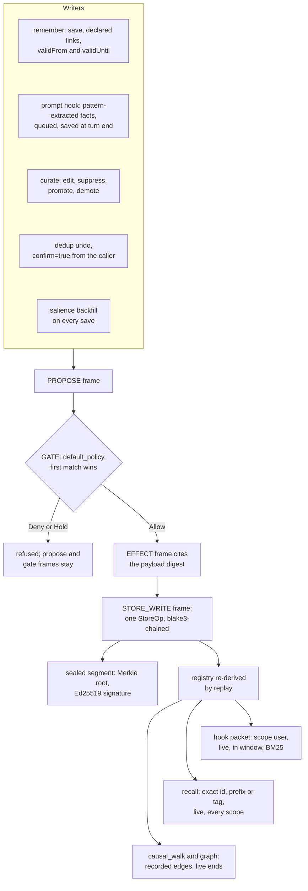

## 1. Executive Summary

Vestige is a local MCP memory for coding agents in which every mutation is
proposed, judged by a deterministic gate, and admitted as a frame on Strata, an
append-only log whose frames are hash-chained and whose sealed segments are
signed. State is replayed from the log rather than stored beside it, which
makes the audit trail structural rather than a table someone remembered to
write. The weak side is review: the Memory PR queue that would hold a risky
write for a person is forced to its pass-through mode on the only backend the
binary ships.

**Every write has one path.** `admit_write_with_params`
(`crates/strata-store/src/store.rs:1596-1668`) appends a PROPOSE frame and a
GATE frame, refuses on `Deny` or `Hold` with both frames left on the log, then
appends an EFFECT citing the payload digest, and only then the single
`STORE_WRITE` frame at `:1664`. Ingest, edit, retire, review, edges, anchors,
intentions and salience changes are all `StoreOp` variants through that
function. `receipt get` explains a write, `receipt replay` re-derives it and
reports a mismatch, and `vestige strata-verify` checks the chain and the
trailers offline.

**Erasure is refused and says why.** `purge`, `delete` and `delete_knowledge`
return `unavailable_in_4_0` (`crates/vestige-mcp/src/server.rs:387-394`).
`suppress` hides a record from every read and keeps its bytes, and its tool
description says it *"cannot be undone … and is not erasure"*
(`server.rs:594`). A committed test scans the raw segment files for the
suppressed marker and fails if the bytes are gone, with the message *"suppress
must not claim erasure"* (`strata_memory.rs:4583-4592`).

**The project removed its own retrieval.** Version 4.0 (30 September 2026)
dropped embeddings, keyword search and SQLite from the default build. The
agent's `recall` resolves an exact id, a unique prefix of eight or more
characters, or an exact tag, and a free-text query returns `handle_required`
with candidates. The one ranked read is the lifecycle-hook packet, which runs
exact-token BM25 over the scoped store (`tools/memory_packet.rs:380`). The
Fellegi-Sunter merge and supersede planner is withheld on Strata
(`server.rs:396-420`), and its scorer `score_pair` has no caller outside its
own file.

**The benchmark page labels its own numbers as describing another engine.**
`docs/BENCHMARKS.md` opens by saying *"There is no 4.x benchmark on this
page."* Section 10 has the rest.

## 2. Mental Model

A memory is a `NodeRecord` (`crates/strata-store/src/types.rs:101-133`): id,
scope, content, sorted tags, node type, `created_at_ms`, `valid_from_ms`,
`valid_until_ms`, an optional `superseded_by`, and source provenance. Its FSRS
card lives in the kernel state, folded from review events on the log.
Retrievability is derived on read from the card and the clock, and
`docs/STORAGE.md` states that it is not stored.

Nothing on the log is overwritten. An edit admits a successor and retires the
predecessor. A suppression admits a one-character anchor node, retires the
target in its favour, then retires the anchor
(`crates/vestige-mcp/src/strata_memory.rs:854-895`). An undo appends a
compensating record. A record is live while `superseded_by` is empty, and that
is the only lifecycle test any read applies (`strata_memory.rs:1613`).

A retirement is a `RETIRE` proposal, and the pinned policy decides it by name.
`default_policy` (`store.rs:516-541`) allows four named rules — `edit` only when
the successor was admitted in the same tool call, `suppress`, `intentions`, and
`purge` only with `confirm` — holds every other `RETIRE`, and allows any other
write under a blast-radius cap of 10,000. The rule name travels as a
domain-separated hash in the proposal's `params_hash`, never as content.

## 3. Architecture

Ten crates. `strata` is the log engine: segments, group commit, sealing and
tail verification (`crates/strata/src/log.rs`). `strata-gate` is the policy VM
and the record kinds PROPOSE, GATE, EFFECT, GAP, LESSON_ALARM, CANARY and ALERT
(`crates/strata-gate/src/record.rs`). `strata-store` is the memory registry
folded from the log, and `strata-kernel` the integer FSRS fold.
`strata-migrate` and `vestige-upgrade` import a v3 `vestige.db` read-only into
a new log under a signed migration receipt, and `strata-verify` checks a data
directory offline. `vestige-core` keeps the cognitive modules; `vestige-mcp` is
the server, the CLI, the dashboard and the hook surface.

The log format is in `crates/strata/src/format.rs:12-14` and `:43-44`. Each
frame carries the blake3 of the previous frame, a segment header carries the
previous segment's hash, and a sealed segment ends in a trailer holding the
frame count, a Merkle root, and an Ed25519 signature over the segment id, the
previous segment hash and that root. Persisted records carry integers and
strings only, and the store reads no wall clock (`types.rs:1-7`), so replay is
deterministic.

There is no SQLite backend to fall back to. `legacy-sqlite = []` is an empty
feature in both `crates/vestige-core/Cargo.toml:17` and
`crates/vestige-mcp/Cargo.toml:17`, and `crates/vestige-core/src/storage/`
holds contracts and types with no SQL implementation.

## 4. Essential Implementation Paths

**Save** — `remember` (`tools/remember_unified.rs`) → `smart_ingest`, which
parses `validFrom`/`validUntil`, infers one unambiguous `as of YYYY-MM-DD`
phrase (`tools/smart_ingest.rs:388`), and checks the secret gate and canonical
duplicates → `ingest_in_scope_with_receipt` (`store.rs:1721-1760`) → declared
links through `check_links`, which refuses a target in another scope
(`strata_memory.rs:1003-1035`) → salience backfill for the new id.

**Prompt hook** — `packages/vestige-init/hooks/memory.cjs` extracts facts from
the user's prompt by pattern into a per-session queue file, saves up to 20 at
turn end through `remember`, and on session, prompt and tool events calls
`session` with `memory_hook`, which lands in `memory_packet::packet`
(`tools/session_context.rs:127-133`).

**Recall** — `recall::handle_flow` (`tools/recall.rs:243-321`) →
`resolve_handle` (`strata_memory.rs:1942-2018`): exact id, then a unique prefix
of eight or more characters, then an exact case-sensitive tag, each over live
records only.

**Retire** — `curate` edit → `StrataStore::edit`; `curate` suppress →
`suppress_memory` (`strata_memory.rs:3717-3746`), which also retires every live
GhostLink composition naming the record.

**Undo** — `dedup` action `undo` with an `operation_id` and `confirm=true`
appends a compensating record; `strata_memory.rs:5176-5215` is the test.

## 5. Memory Data Model

| Frame payload (`StoreOp`, `crates/strata-store/src/op.rs`) | What it does |
| --- | --- |
| `UpsertNode` | Creates a node, or rewrites one on the `set_created_at` and undo paths |
| `SupersedeNode` | Sets `superseded_by`; admitted only as a `RETIRE` under a named rule |
| `ReviewNode` | Folds an FSRS rating with a signed `reviewed_at_ms` |
| `SaveEdge`, `SaveEdges` | Typed edges from an eight-value vocabulary (`types.rs:16-25`) |
| `UpsertIntentions` | Intention rows, one effect for the batch |
| `RecordAnchors`, `ReplaceAnchors`, `RecordAnchorVerdict` | Code anchors and their cached verification verdict |
| `AdjustSalience` | A bounded stability change with its entity evidence and `undo_of` |

The variants are borsh-positional, and the file says to append only, *"or old
logs stop replaying"* (`op.rs:66-67`).

The edge vocabulary calls `supersedes` and `corrects` *"review-gated"* trails
(`types.rs:36-38`). `corrects` has no writer outside the v3 importer.
`supersedes` is a declared link the caller adds on save, and it records an edge
without retiring the target (`strata_memory.rs:935-997`, `:1040-1083`).

## 6. Retrieval Mechanics

**Recall is lookup, not search.** `resolve_handle` filters with `retrievable`
and nothing else. It reads no scope and no validity window, so a tag returns
every live record carrying it from every scope, expired ones included. A
Strata-side description string advertises *"exact-token BM25 over stored
text"* for `recall` (`server.rs:600`); the recall code path runs no ranking,
and `lexical::rank` has one caller, the hook packet.

**The hook packet is the ranked read.** `packet`
(`tools/memory_packet.rs:344-530`) loads the scope's nodes, drops retired ones
and those outside their validity window at the current time, and ranks the
prompt by exact-token BM25 over content and tags (`tools/lexical.rs:88-140`).
A prompt naming one recorded person does not pull in another person's records.
Up to four two-hop bridges follow `person:`, `place:`, `food:`, `file:`,
`service:` and `symbol:` tags, and whole records are packed into about 3,000
tokens. An empty prompt injects nothing.

**Walks follow recorded edges only.** `causal_walk` and the `graph` subgraph
skip superseded endpoints (`strata_memory.rs:2461-2480`), and GhostLink
proposals stay inside one scope (`crates/strata-store/src/ghostlink_tests.rs:309`).

**Scope is a predicate on some reads and absent from the main one.** The hook
packet filters on scope at `memory_packet.rs:350`, but the hook passes none, so
`session_context.rs:128` defaults it to `user`. A record the agent saves under a
project scope is never injected, and any tag recall returns it. The
documentation states the cross-scope behaviour as intended: *"Exact-handle
reads such as an id or a prefix work across scopes"* (`docs/STORAGE.md`).

## 7. Write Mechanics

The gate is deterministic: an ordered rule list, first match wins, default deny,
no clocks, floats or environment (`crates/strata-gate/src/policy.rs:1-2`). A
secret gate runs before it; `docs/STORAGE.md` lists the live-key families it
refuses in every stored field.

**Writes arrive from the user's prompts as well as from the agent.**
`explicitFact` in `memory.cjs` matches possessions, people, places, dates,
jobs, health and preferences, and tags them `person:`, `place:`,
`preference:key=value` and similar. A queued fact is saved at the next turn
event with an `intent_id` hashed from client, session and prompt, so a replay
returns the first write instead of making a second one.

**Every save triggers backfill.** `remember` runs the retroactive salience
planner on each new id (`tools/remember_unified.rs:140-167`). It walks recorded
edges backward and raises the stability of older memories sharing an exact
entity. Each change is an `AdjustSalience` frame carrying the exact
before-score, so `undo` restores it, and `dry_run` previews with nothing
appended (`tools/backfill.rs:16-27`).

**A save tagged `pinned` rewrites the agent's instruction file.** After the
ingest, `remember` calls `project` with `path: "CLAUDE.md"` and `confirm: true`
supplied by the code itself (`tools/remember_unified.rs:188-205`). `project`
replaces only the fenced region, inside the server's working directory, from
the `user` scope's durable records.

**Duplicates are exact.** The canonical index keys on `(scope,
canonical_hash(content))`, and a duplicate becomes an echo node pointing at the
original (`store.rs:1262-1290`).

## 8. Agent Integration

Six advertised MCP verbs — `session`, `remember`, `recall`, `causal_walk`,
`curate`, `precedent` (`server.rs:28-35`, `:1231-1330`) — plus a `reflex` tool
left out of `tools/list` for hooks to call. Older tool names dispatch too, and
each such call appends an unsigned line to `legacy-tool-calls.jsonl`
(`server.rs:37-68`).

`@vestige/init` installs the hooks. Besides the memory hook, Reflex keeps
per-session context manifests and pushes each retirement of a held memory once
to every other session holding it (`tools/reflex.rs:979-984`; test at
`:4053`). At compaction it gives back the memories a summary dropped, under the
test at `:4179`.

The Operator gates in `operator/` and `operator-lite/` judge shell and tool
calls before they run. They write receipts and permits, which the `precedent`
verb reads and Reflex turns into stop memories. They are not on the memory
write path.

## 9. Reliability, Safety, and Trust

**Bitemporal — awarded.** `valid_from_ms` and `valid_until_ms` are separate
fields from `created_at_ms` (`types.rs:122-126`). The MCP adapter stamps
`created_at_ms` from the wall clock and takes validity from the caller
(`strata_memory.rs:1534-1536`). The agent sets it through `remember`'s
`validFrom`/`validUntil` (`smart_ingest.rs:81-87`), an inferred `as of` date,
or the 30-day default on `state` records. The hook packet and the projection
withhold a record outside its window. No Strata read asks for a past instant:
recall's `validAt` belongs to the legacy `reason` mode, which returns
`similarity_disabled`.

**Audit log — awarded.** Every mutation is a frame behind a recorded gate
verdict, and the log is the store. The intent index and maintenance stamps are
side files, and neither changes what a read returns.

**Negative eval — awarded.** `retired_nodes_stay_out_of_every_read_tool`
(`strata_memory.rs:4735-5149`) retires a marker record linked to a kept
control, asserts the control is visible, then asserts the marker's content and
id are absent from every agent read tool. That is the paired shape a filter
excluding everything cannot pass. The hook packet has no such case.

**Human review — withheld; a queue nothing fills.** `trace/review.rs` defines
Memory PRs: `fast`, `risk_gated` and `paranoid` modes, a risk taxonomy, and
dashboard routes to list and decide them (`dashboard/mod.rs:225-236`). The
server calls the gate before a mutating tool runs and after a write lands
(`server.rs:1571`, `:1734`).
`read_review_mode` returns `Fast` whenever the backend is Strata
(`trace_recorder.rs:118-137`), and Strata is the only backend. The gate VM's
`require_human` modifier turns an allow into a permanent `Hold`
(`policy.rs:35-38`, `:78-80`), and no shipped rule sets it. What remains are
caller-set flags, `confirm=true` on undo and on project write; `suppress` needs
none.

**Trust state — withheld.** The axes are lifecycle (`superseded_by`), validity,
scope, FSRS retrievability, a float trust on receipts, and actor endorsements
whose weights, in `actor.rs:13-15`'s words, never establish that a claim is
true. None is a credence state that withholds a record.

**Tombstone — withheld.** A retired record gives up its place in the canonical
index (`store.rs:1265-1277`), and `find_node_by_canonical_hash` returns live
records only (`:1769-1779`). The same content saved again is a fresh live
record, and the prompt hook saves it again whenever the user repeats it.

**Scope enforced — withheld.** The scope key reaches the hook packet, the
projection and GhostLink, but not `recall`, the agent's read verb. That is the
line drawn for [Cortex](../cortex/): a predicate half the read paths cannot
express does not hold the mark.

## 10. Tests, Evals, and Benchmarks

**No paper of its own.** The code cites FSRS-6, Bjork & Bjork's dual strength,
ACT-R and Cai 2024 for backfill. A `whitepaper-tr-2026-01` tag exists, and no
paper file is in the tree at the pin.

1,468 Rust test functions across the crates, with `cargo test --workspace` and
per-crate runs in `.github/workflows/ci.yml:113-124`. The strata crates test
replay, damaged segments, receipts and imports, and `retire_policy_stdio`
exercises the named rules over real stdio. **I did not run them.** The screen
found two auto-run surfaces (`hooks/` with 18 entries, and `server.json`) and
dependency manifests inside the seven-day cooldown, a count the shallow clone
inflates.

**The benchmark page discloses that its numbers describe another engine.**
`docs/BENCHMARKS.md:3` states that the MemConflict run used 2.4.1 and Silent
Rotation v3.1, both with hybrid recall that a 4.x build lacks, so the harnesses
*"record retrieval errors, not scores"* against it. The CauseBench retraction
stands, as does the Answer Accuracy versus Conflict Recognition Score
correction that puts the best CRS at 0.2501. The Silent Rotation table carries
its own caveat: only the `rag`, `mem0` and `zep` baselines converged on the
wrong key.

`benchmarks/real_engine/` is a LongMemEval-S campaign harness with a spending
ledger; no result from it is committed. `benchmarks/agentdojo/` measures the
Operator gate against prompt injection, not memory.

## 11. For Your Own Build

### Steal

- **Make the log the store.** One function appends propose, verdict, effect and
  data in that order, and state is a replay. Nothing can mutate memory without
  leaving the frame that explains it.
- **Name the retirement rule, and hold the unnamed.** Four named `RETIRE` rules
  are allowed and every other retirement is held, so a new retirement path
  fails closed until someone writes its rule.
- **Withhold an action rather than fake it.** Erasure, merge planning and
  `protect` are dropped from the advertised schema and refused with a reason,
  and `scan` reports `mergeCandidates` as `unavailable` so it cannot be read as
  "none found".
- **Test the absence beside the presence.** The retired-read test keeps a linked
  control and asserts both halves for every tool.
- **Store the exact before-value with every score change.** `AdjustSalience`
  carries the old stability and the latest card event, so an undo is exact.
- **Tell other sessions when a belief they hold is retired.** The push reaches
  every session holding the old id, once.

### Avoid

- **A review mode that falls back silently.** A configured `paranoid` mode
  becomes `fast` with one log warning, and the dashboard keeps serving the
  queue's routes.
- **A memory verb that writes the agent's instructions.** A `pinned` tag
  rewrites `CLAUDE.md` with a confirmation the code supplies.
- **A scope that only one read honours.** The hook partitions; recall does not.
- **Suppression without a value key.** A hidden fact comes back the next time
  the user says it.
- **A tool description that outruns the code.** One `recall` description says
  BM25, and the code resolves handles.

### Fit

For one developer who wants an agent's memory, and its corrections, to be
provable after the fact, and who will work by exact ids and tags rather than by
search. Not for anyone who needs erasure: the log keeps every byte, and the
documentation says to use full-disk encryption and points to planned
crypto-erasure.

## 12. Open Questions

- **Does any shipped path produce a held `RETIRE`?** Every unnamed retirement is
  held and nothing releases it; no path past the four named rules was traced.
- **Is the stale-belief list persisted across restarts?** The retirements live
  in Reflex state, and whether that state survives a restart was not traced.
- **Does any read consult the anchor verdicts?** `RecordAnchorVerdict` caches
  `verified`, `moved`, `drifted`, `missing` or `unverifiable`, and the op
  comment says readers re-verify against the live tree.

## Appendix: File Index

**The log** — `crates/strata/src/log.rs`, `crates/strata/src/format.rs:12-14`,
`:43-44` (chain and signed trailer)

**The gate** — `crates/strata-gate/src/policy.rs:35-38`, `:78-80`
(`require_human`), `crates/strata-gate/src/record.rs`

**The store** — `crates/strata-store/src/op.rs` (`StoreOp`),
`crates/strata-store/src/types.rs:101-133` (`NodeRecord`),
`crates/strata-store/src/store.rs:403-418` (`permissive_policy`), `:420-495`
(named rules), `:516-541` (`default_policy`), `:1262-1290` (canonical index),
`:1596-1668` (admission), `:1721-1760` (ingest), `:1769-1779` (duplicate
lookup), `:2378-2443` (retire)

**The adapter** — `crates/vestige-mcp/src/strata_memory.rs:854-895`
(`retire_live`), `:935-1083` (declared links), `:1526-1538`
(`to_store_input`), `:1613` (`retrievable`), `:1942-2018` (`resolve_handle`),
`:2242-2256` (scoped reads), `:3717-3746` (`suppress_memory`)

**Reads** — `crates/vestige-mcp/src/tools/recall.rs:243-321`,
`tools/memory_packet.rs:344-530`, `tools/lexical.rs:88-140`,
`tools/session_context.rs:127-133`

**Writes** — `tools/remember_unified.rs:140-205`,
`tools/smart_ingest.rs:81-87`, `:388`, `tools/backfill.rs:16-27`,
`packages/vestige-init/hooks/memory.cjs`

**Review** — `crates/vestige-core/src/trace/review.rs`,
`crates/vestige-mcp/src/trace_recorder.rs:118-137`,
`crates/vestige-mcp/src/server.rs:1571`, `:1734`,
`crates/vestige-mcp/src/dashboard/mod.rs:225-236`

**Withheld surface** — `crates/vestige-mcp/src/server.rs:387-436`, `:594-600`

**Reflex** — `crates/vestige-mcp/src/tools/reflex.rs:979-984`, `:4053`, `:4179`

**Tests** — `crates/vestige-mcp/src/strata_memory.rs:4538`, `:4735-5149`,
`:5176`; `crates/strata-store/src/ghostlink_tests.rs:233`, `:309`;
`crates/vestige-core/src/memory/node.rs:497`;
`packages/vestige-init/test/memory-edge.test.js:23`, `:68`

**Benchmarks** — `docs/BENCHMARKS.md`, `benchmarks/memconflict/`,
`benchmarks/before-you-change-that/`, `benchmarks/real_engine/`,
`benchmarks/agentdojo/`

## Appendix: Recorded Searches

Run from the root of the checkout at the pinned commit.

| Claim | Command | Result at this pin |
| --- | --- | --- |
| The prior benchmark is retracted | `grep -n "formally withdrawn" docs/BENCHMARKS.md` | One hit in the retraction notice |
| No 4.x benchmark is published | `sed -n 3p docs/BENCHMARKS.md` | The notice ending *"There is no 4.x benchmark on this page."* |
| No SQLite backend is compiled | `git grep -n -E '^legacy-sqlite' -- crates/vestige-core/Cargo.toml crates/vestige-mcp/Cargo.toml` | `legacy-sqlite = []` in both |
| One data-frame writer | `git grep -n -E 'KIND_STORE_WRITE, ' -- crates/strata-store/src` | `store.rs:1664`; every other hit is a test fixture |
| BM25 runs only in the hook packet | `git grep -n -E 'lexical::rank' -- crates` | One hit, `tools/memory_packet.rs:380` |
| Recall's handle path reads no scope | `sed -n '1942,2018p' crates/vestige-mcp/src/strata_memory.rs \| grep -c scope` | `0` |
| Recall's tool code has no scope predicate | `git grep -n -w scope -- crates/vestige-mcp/src/tools/recall.rs` | Two schema description strings, no code |
| No shipped rule requires a human | `git grep -n -E 'require_human: *true' -- crates` | Nothing |
| Review modes fall back on Strata | `sed -n '118,137p' crates/vestige-mcp/src/trace_recorder.rs` | Returns `ReviewMode::Fast` when the backend is Strata |
| No `corrects` edge writer | `git grep -n -E 'EdgeKind::Corrects' -- crates` | Only `types.rs:55` and `:68`, the enum and its name |
| The Fellegi-Sunter scorer has no caller | `git grep -n -E 'score_pair\(' -- crates` | Hits only inside `advanced/merge_supersede.rs` |
| Duplicate lookup ignores retired records | `sed -n '1769,1779p' crates/strata-store/src/store.rs` | Filters on `NodeRecord::is_live` |
| Recall's handle path reads no validity window | `sed -n '1942,2018p' crates/vestige-mcp/src/strata_memory.rs \| grep -c valid_` | `0` |
| The hook passes no scope | `grep -n memory_hook packages/vestige-init/hooks/memory.cjs` | Two calls, `:590` and `:604`, neither with a `scope` field |
| Nothing releases a held write | `git grep -n -E 'StoreError::Held' -- crates` | Construction at `store.rs:1644`, `:2758` and the error mapping; no reader of a held proposal |
| No LongMemEval-S result is committed | `git ls-files benchmarks/real_engine` | Harness code, manifests, `reproduce.sh` and `published.json`, which holds other systems' published scores as context |
| No paper in the tree | `git grep -l -i -E 'bibtex\|@misc\|@article\|CITATION.cff\|zenodo\|doi\.org' -- README.md docs` | Nothing |

## History

**2026-11-06** — [`26a54f15c4f154a765e9b931e7d7925e86233a85`](https://github.com/samvallad33/vestige/commit/26a54f15c4f154a765e9b931e7d7925e86233a85) — 777 commits past the previous pin, through the 4.0 move to the Strata log and on to 6.2.0; the SQLite storage, embeddings and keyword search are deleted. **`negative_eval` awarded** on a paired retired-read test ([section 9](#9-reliability-safety-and-trust)). `bitemporal` and `audit_log` hold on the log. `human_review` stays withheld: the Memory PR queue is forced to fast mode on Strata, the only backend. Every section is rewritten. The body published at the previous pin overstated one mark: section 9 read *"Human review — awarded"* beside the History entry withdrawing it. Its 1,088-test figure does not reproduce at that pin, which carries 1,644, and its `sqlite.rs` anchors named a path that was a directory there. Re-screened; nothing built or run.

**2026-09-18** — [`3c5b198712d97b1f5350a04a4f2df5ed6cb2245b`](https://github.com/samvallad33/vestige/commit/3c5b198712d97b1f5350a04a4f2df5ed6cb2245b) — re-pinned from `548ccae`; 37 files and +5,879 lines, re-screened at the new pin. **Human review withdrawn.** The record read *"a preview plan the caller inspects, with `confirm=true` required before an uncertain merge applies"*, and the word doing the work is *caller*: `confirm` is a field in the tool call, read at `crates/vestige-mcp/src/trace_recorder.rs:460-466` as `args.get("confirm").and_then(|v| v.as_bool()).unwrap_or(false)` and documented in the tool description itself as *"'purge' (for good; confirm=true)"*. The model sets it. That is a guard against a slip, like `--force`, not a person in the loop — the same ruling this atlas applied to a declared approve tool elsewhere. The `scan` / `plan` / `apply` separation remains the right shape and keeps the plan inspectable; nothing requires that anyone inspects it. `bitemporal` and `audit_log` hold, and the reversal payload stored with every applied operation is untouched by this.

**2026-09-11** — [`548ccae20961db1a176a09242931459363ee5d83`](https://github.com/samvallad33/vestige/commit/548ccae20961db1a176a09242931459363ee5d83) — re-read, 1,135 files and 195,125 insertions past the previous pin in a single commit. **All three marks re-verified and unchanged**, with `capability_evidence` records added where the report had none. **The report's stated risk is not merely closed — the benchmark it was about was retracted by its own author.** The previous edition said the headline benchmark lived on another branch and none of its numbers were checkable. At this commit five harnesses sit in `benchmarks/`, and `docs/BENCHMARKS.md` opens by formally withdrawing CauseBench — *"Its harness no longer exists, its repro command 404'd, and its published numbers are retracted. CauseBench must never be cited… not even as 'an earlier result'"* — together with a separately invalidated LongMemEval run, and states the principle behind the rewrite: *"After a retraction, a number that cannot be reproduced by a stranger is worse than no number at all."* What replaced it is documented carefully: an external benchmark with a pinned upstream revision; a correction to the field's reading of that paper (the six-number list everyone quotes is Answer Accuracy, not Conflict Recognition Score — *"calling them CRS overstates the field by roughly a factor of two"*, with the best CRS at 0.2501); four mandatory arms including a no-memory floor and a BM25 bar, justified by MemDelta's finding that a single embedding-model change moved accuracy 6.2pp at p=0.004; a structural contradiction metric that *"cannot be satisfied by the server merely emitting the word 'contradiction'"*; a nine-item limits section longer than the results, which disqualifies the project's own best framing — *"CRS-struct is not a head-to-head win… and must never be presented as such"*; and a refusal to estimate the two white-box metrics the public data cannot support. The recorded-agent package discloses that the competing arm was cut off at its time limit **even though its final application also passes 21/21**. Section 10 is rewritten around this and five bullets were added to *Steal*; the *Avoid* bullet about putting a headline benchmark on another branch is removed as answered. Screened before reading: twenty-five findings; nothing was built or run.

**2026-08-09** — [`a8b0a75661faaa396fa4519c82fcc369f0ddef8e`](https://github.com/samvallad33/vestige/commit/a8b0a75661faaa396fa4519c82fcc369f0ddef8e) — first reading. Screened before reading: one auto-run surface (`server.json`), build-time execution in an npm manifest, and twelve dependency manifests inside the seven-day cooldown including `Cargo.lock` and `pnpm-lock.yaml`. The tree was read, never built, and no test or benchmark was run. The Silent Rotation benchmark is on a different branch and was not obtained.
