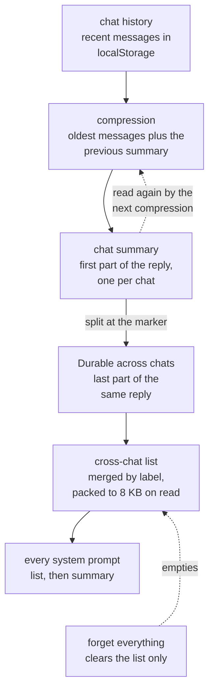

## 1. Executive Summary

Waifu Companion is **a browser AI companion**: a Live2D character with voice,
chatting through an LLM. It is a static web app with no build step. Memory has
two layers, both in `localStorage`:

- **Per chat:** the recent messages and one rolling summary. When the history
  outgrows its budget, a model compresses the oldest messages into the summary.
- **Across chats:** a list of short facts the summariser marks as worth keeping
  (*"Durable across chats:"*). The list is merged by label and written into every
  conversation's system prompt.

The code is MIT-0. By default every model call, including the summarisation,
goes through WaifuAI's hosted proxy at `waifu-companion-proxy.thewaifuai.workers.dev`
(`app/scripts/waifu_proxy.js:104-108`). A user can switch to OpenRouter, Groq or
another OpenAI-compatible endpoint.

What is good:

- **Compression cannot overwrite a newer state.** Each run captures the chat id,
  the summary, its progress marker and the revision counters for both memories.
  It drops its result if any of them changed while the model was answering, so a
  reset, a deleted message, an edit or "forget everything" wins
  (`app/scripts/chat_controller.js:421-470`).
- **Source text is removed only after it has been summarised.** Messages leave
  the history only once the summary that covers them is accepted. A message too
  large for one request is compressed in checkpointed parts that survive a reload.
- **The budgets never block a chat.** An oversized legacy summary is compressed
  in parts while the chat continues on a trimmed copy.

No capability mark is earned.

What is weak:

- **Forgetting is partial.** "Forget everything remembered between chats" clears
  the cross-chat list. The per-chat summaries the list was distilled from stay,
  and the next compression of any of those chats can put the same facts back.
- **One label holds one value.** A durable line replaces the stored line whose
  first 24 characters before a colon match, so a new `Likes:` line erases the
  earlier likes.

## 2. Mental Model

A memory is **a line of text the companion is told it remembers**. There are no
records, ids or states; there are two strings, the chat's summary and the
cross-chat list, and the model reads both on every turn.

### How a thing becomes a belief

`maybeSummarizeConversation` runs when a chat has more messages than the
trigger, or its older history exceeds 128 KB (`app/scripts/chat_controller.js:421-480`).
It keeps the newest half of the memory size and builds a compression task for the
rest, which carries the previous summary as input. The summariser's instruction
asks for the new summary followed by a section starting *"Durable across
chats:"*. That section lists *"the facts about the user and the relationship
that should carry into future conversations (for example their name and personal
details, likes and dislikes, open storylines, promises…)"*
(`app/scripts/context_budget.js:92`).

`splitDurable` cuts the reply at that marker. `mergeDurable` folds each line into
the stored list: a line with a short label, up to 24 characters before `": "`,
replaces the stored line with the same label, and any other line replaces an
identical line or appends (`context_budget.js:100-123`). The list is saved
unpacked; `packUserMemory` keeps the newest lines within 8 KB when it is read.

### How a belief stops being one

A stored line is replaced by a newer line with the same label, drops off the
front when the list passes 8 KB at read time, is edited away by the user, or goes
with the whole list when the user forgets everything. Nothing records that a line
was removed or replaced.

## 3. Architecture

Plain browser scripts loaded in order by `app/index.html`, sharing state through
an `AppState` object and window properties (`app/scripts/global_state.js`).
`storage.js` wraps `localStorage` with a typed API. On a quota error it reclaims
UI cache keys and retries once, and in an embedded restricted frame it falls back
to an in-memory map (`app/scripts/storage.js:150-260`). `context_budget.js` holds
the byte limits:

| Limit | Bytes |
| --- | ---: |
| history | 128 KB |
| summary | 32 KB |
| transcript | 128 KB |
| request | 256 KB |
| cross-chat list | 8 KB |

`chat_manager.js` keeps one `chatData_<id>` entry per chat with its messages,
summary and progress. Live2D, PIXI, Kokoro TTS and the Cubism runtime load from
CDNs at run time, two of them without a version (`app/index.html`); Google
Analytics is included.

### Deployment and ergonomics

Open the site, or serve the folder. There is nothing to install, and memory lives
in the browser profile, so it does not follow the user to another device or
browser. The summary and the list are plain text areas in the settings panel.

## 4. Essential Implementation Paths

**Compression** — `maybeSummarizeConversation` (`app/scripts/chat_controller.js:421-480`)
→ `ConversationBudget.compressionTask`, `accept`, `splitDurable`, `mergeDurable`
(`app/scripts/context_budget.js:95-180`) → `requestMemorySummary`
(`app/scripts/ai_interface.js:742-745`).

**Prompt** — `buildChatMessages` in `app/scripts/ai_interface.js:190-246`: core
persona, custom persona, the packed cross-chat list as *"Things you remember
about the user from earlier conversations"*, then the active summary.

**Persistence** — `persistConversationMemory`, `persistUserMemory`
(`chat_controller.js:400-416`); `saveCurrentChat` and the welcome openers in
`app/scripts/chat_manager.js`.

**Editing and forgetting** — `handleSavePersona` and `handleForgetEverything`
(`app/scripts/settings_handlers.js:395-462`).

## 5. Memory Data Model

Per chat (`chatData_<id>`): `id`, `name`, `messages`, `conversationSummary`,
`summaryProgress` (a partial-compression checkpoint keyed by message id, offset
and a content signature), `summaryBackup`, `messageCountSinceLastSummary` and
timestamps. Global keys hold `userMemory`, the cross-chat list as one string, and
`crossChatMemory`, the toggle, on by default.

A durable line's only structure is its optional label. There is no source, no
date, no confidence, and no link back to the chat or message it came from.

## 6. Retrieval Mechanics

There is no retrieval step. The whole packed list and the active chat's summary
go into every system prompt, the list before the summary, and the recent
messages follow. A new chat with a non-empty list greets the user with the two
newest lines. A restored chat with a summary greets them with its first 140
characters.

Failure modes:

- **Everything competes for one prompt.** At 8 KB of list and 32 KB of summary,
  the memory can take a large share of a small model's context on every turn.
- **The oldest facts drop first.** Packing keeps the newest lines, whatever they
  are.

## 7. Write Mechanics

Compression is part of a user turn and runs at most once per turn, after a two
minute cooldown if the previous attempt failed. The new summary replaces the old
one only if nothing changed meanwhile; a durable section is merged only if the
toggle was on at the start and is still on, and the list has not been edited or
cleared since. Source messages are trimmed after the summary is accepted, so a
failed or rejected compression keeps everything. The tests check each of these
guards, including that an edit to `Name: Corrected` survives an in-flight
compression that returns `Name: Rei` (`app/tests/test_memory_limit.cjs:261-282`).

**The guard protects one compression, not the correction.** The chat summaries
are left intact by an edit and by "forget everything". A later compression reads
the previous summary as input, so if a summary still says the user is Rei, the
next durable section can say `Name: Rei` again and replace `Name: Corrected` by
label. I traced this through `compressionTask` and `mergeDurable` and did not run
it.

## 8. Agent Integration

The companion is the agent; there are no memory tools. An experimental setting
lets the model change application settings. The memory is shaped entirely by the
summariser prompt and the user's edits.

## 9. Reliability, Safety, and Trust

**Where the memory goes.** The cross-chat list and the summary are written into
every request, and summarisation sends the chat's older messages. With the
default provider, all of it goes to the WaifuAI proxy; with another provider, to
that provider. The settings explain the provider choice; the memory itself never
leaves the browser through any other path.

**What forgetting does.** `handleForgetEverything` empties the list after a
confirmation that says *"This cannot be undone"*. Nothing marks the forgotten
lines, and the per-chat summaries that produced them stay. A user who wants a
fact gone has to remove it from every chat summary that mentions it as well.

### Marks

No capability mark is earned.

- `human_review` is withheld. The text areas let a person rewrite or clear memory
  after it is written, which is editing after the fact, not a gate.
- `negative_eval` is withheld. `the toggle removes cross-chat memory from requests`
  asserts that the list is absent from the assembled system prompt, which is not
  a retrieval result.
- `tombstone`, `trust_state`, `bitemporal`, `scope_enforced` and `audit_log` have
  no mechanism.

## 10. Tests, Evals, and Benchmarks

178 `node:test` cases in 17 `.cjs` files run the browser scripts against stub
DOM and storage objects. They cover context budgets, compression checkpoints,
stale-result rejection, the durable split and merge, cross-chat greetings, turn
ownership, speech and locale loading. Five Python files drive a real browser.
The memory suites are the strongest part, and they test the races that matter for
a single-user store.

There is no CI workflow and no evaluation of memory quality. I read the tests and
ran nothing.

The screen could not see this tree: it parses no manifest here, and there is
none. By hand, the execution surface is the scripts `app/index.html` loads at run
time. Pixi 5.3.3, Day.js 1.10.6 and Kokoro 1.2.1 come from CDNs with pinned
versions. `pixi-live2d-display` and a Live2D library from a GitHub path load
with no version or ref. Google Analytics loads too. Nothing was opened in a
browser.

## 11. For Your Own Build

### Steal

**Capture the state a background write depends on, and drop the write if any of
it moved.** Chat id, summary, progress and two revision counters, compared after
the model answers, make a slow summariser safe against every user action.

**Remove source only after the summary that covers it is accepted.** A failed
compression then costs a retry, not the conversation.

**Ask the summariser for the durable part in the same call.** One request yields
the chat summary and the cross-chat facts, with a marker the client can split on.

### Avoid

**Don't forget the output and keep the input.** Clearing the distilled list while
the summaries that produced it remain means the next compression can restore what
the user removed. Remove the facts from the sources, or record what was
forgotten.

**Don't key a fact on a label that holds one value.** `Likes:` and `Promises:`
are lists; replacing by label erases them.

**Don't send memory to a default hosted endpoint without saying so where the
memory is.** The memory panel is where the user decides what to keep.

### Fit

This suits **someone building a single-user companion in a browser** who wants
continuity across chats without a server, and wants the user to see and edit what
the companion remembers. The compression engineering is worth copying on its own.

It is not a memory to rely on for anything the user needs gone, or for facts that
must not overwrite each other, and it stays with one browser profile.

## 12. Open Questions

- **Should "forget everything" also clean the chat summaries?** Its wording
  promises the cross-chat memory only; whether the summaries are meant to keep
  the facts is not stated.
- **Should labelled lines accumulate?** The merge rule treats every label as
  single-valued, while the prompt's own examples include likes, dislikes and
  promises.

## Appendix: File Index

**Memory** — `app/scripts/context_budget.js`, `chat_controller.js`,
`chat_manager.js`, `storage.js`, `global_state.js`, `settings_handlers.js`,
`ai_interface.js`, `waifu_proxy.js`.

**Tests** — `app/tests/test_memory_limit.cjs`, `test_context_budget.cjs`,
`test_cross_chat_memory.cjs`.

**Docs** — `app/docs/memory.md`.

### Recorded searches

Run from the repository root at the pinned commit with `/usr/bin/git grep`.

- **Forgetting touches only the list.** `git grep -n -A10 'function handleForgetEverything' -- app/scripts`
  shows `userMemory` and its storage key cleared and no chat summary touched.
- **No record of a removed line.** `git grep -n -i -E 'tombstone|forgotten|suppress' -- app/scripts`
  returns the `user_memory_forgotten` analytics event at `settings_handlers.js:460`
  and two unrelated suppressions of completion hooks and duplicate sends in
  `chat_controller.js`.
- **No CI.** `ls .github` fails.
- **Unversioned run-time scripts.** `git grep -n -E 'pixi-live2d-display/dist|gh/dylanNew' -- app/index.html`
  returns the two script tags with no version or ref.

## History

**2026-11-09** — [`f6f2b92a0c0d3576affd9e9c55473dc2035f8b71`](https://github.com/waifuai/waifu-companion/commit/f6f2b92a0c0d3576affd9e9c55473dc2035f8b71). First reading, from a full clone of `main`. The screen found nothing it parses; by hand, there is no manifest, no build step and no CI, and the run-time CDN scripts include two with no version. I opened, installed and ran nothing; the tests were read, not run. No capability mark (§9).
