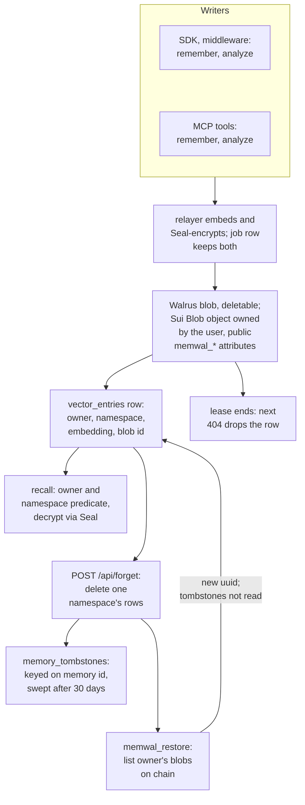

## 1. Executive Summary

Walrus Memory is Mysten Labs' agent memory service. A Rust relayer embeds a
memory with an OpenAI-compatible model, encrypts it with Seal, uploads the
ciphertext to Walrus, and transfers the resulting Blob object on Sui to the
user's address. Each memory also gets a pgvector row in the relayer's
Postgres. Recall searches that index by owner and namespace, downloads the
matching blobs, and decrypts them. A TypeScript and a Python SDK, Vercel AI SDK
middleware, an MCP server with OAuth, a stdio MCP connector with Claude Code,
Codex and Cursor hooks, and an OpenClaw plugin all reach the same relayer.

The access-control design is the notable part. The Move contract mixes a counter
into every Seal identity and bumps it whenever a delegate is removed or the
account is frozen, so a removed key cannot fetch the key for anything written
afterwards. A memory reaches the user's wallet only in a transaction that
re-checks that counter. Forget fences in-flight remember jobs in the same
transaction that drops the index rows, so a finishing worker cannot write them
back.

The weak part is what forget means. It deletes index rows for one namespace,
and the documentation says outright that restore can re-index them, since the
blob and its on-chain object remain. The session-start guidance tells the agent
to run `memwal_restore` whenever recall returns nothing for a namespace it has
used. The remember job row keeps the ciphertext and the embedding. Nothing
supersedes or corrects a memory: the extraction prompt forbids it and the
consolidator module is an empty placeholder.

**Licence.** The Python SDK declares a licence the tree does not contain.
`packages/python-sdk-memwal/pyproject.toml:10` sets `license = "MIT"`, with an
MIT classifier at line 19. The only licence text in the repository is the root
Apache-2.0 `LICENSE`, and the package directory has no licence file of its own,
so the published package metadata and the repository grant different terms.
Every npm manifest (`packages/sdk`, `packages/mcp` and its three plugin
manifests, `packages/openclaw-memory-memwal`) says Apache-2.0 and agrees with
the root file. `apps/chatbot/LICENSE` is Vercel's Apache-2.0 notice for the
template that app is built from. There is no rider against analysis.

## 2. Mental Model

A memory is a piece of text. `remember` stores it whole, and `analyze` has an
LLM split a passage into atomic facts, each tagged `vital`, `standard` or
`trivial` (`services/server/src/services/prompts/extract.txt`). The bucket
becomes an importance float, 0.9, 0.5 or 0.2, used only for ranking
(`services/server/src/services/extractor.rs:38-42`,
`services/server/migrations/009_importance_signal.sql`). Nothing marks a memory
as a candidate, a verified fact or a retracted one. Everything in the index is
served.

A memory is never revised. The extraction prompt says *"Do NOT edit, merge, or
supersede existing memories — only emit what is new in the input"*
(`extract.txt:10`), so "I moved from Hanoi to Da Nang" becomes a new fact beside
"User lives in Hanoi", and both are recalled. The consolidator module that would
mark a `valid_until` is a doc comment with no code
(`services/server/src/services/consolidator.rs:1-20`). Its header says
duplicates collide because the same plaintext gives the same ciphertext and
blob id. `analyze.rs:63` says the opposite, that Seal encryption is not
deterministic. Deduplication actually runs on a SHA-256 of owner, namespace and
text on the job row (`services/server/src/routes/remember.rs:1472-1481`).

A memory stops being served in three ways, and only one of them removes it:

- **Forget** (`POST /api/forget`) hard-deletes every index row in one namespace
  and records each memory id in `memory_tombstones` for 30 days
  (`services/server/src/storage/db.rs:3424-3468`, `:52`). The blob, its Sui
  object and the job row stay. Restore lists the owner's blobs on chain and
  re-indexes any whose blob id has no row, under a new uuid, without reading
  the tombstone table (`services/server/src/routes/admin.rs:1014-1073`, `:1367`).
- **Lease end.** A blob is stored for a fixed number of Walrus epochs. When an
  aggregator returns 404, recall or restore deletes that blob's rows
  (`services/server/src/engine/walrus_seal.rs:102-106`). Nothing in the tree
  extends a lease.
- **Security delete** removes Walrus Blob objects on chain. It covers only blobs
  tracked in the old-V1 database, behind two flags, and the owner signs the
  transaction (`docs/api/security-delete.md`).

The owner holds each Blob object, registered as deletable
(`services/server/scripts/sidecar/routes/walrus-upload-journal.ts:1137-1146`), so
the owner can delete one from a Sui wallet outside this tree. No relayer route
does that for a memory written on the current path.

## 3. Architecture

Four processes and several external services. The relayer
(`services/server/src`, axum) verifies Ed25519-signed requests, runs remember,
recall, analyze, ask, restore and forget, queues wallet jobs in Postgres with
Apalis, and serves OAuth for MCP. A Node sidecar (`services/server/scripts`),
reachable only from the relayer with a shared secret, does Seal encryption and
decryption, Walrus uploads, and the metadata-and-transfer transactions signed
by the server's wallets, and hosts the MCP server the relayer proxies at
`/api/mcp`. A Rust indexer reads `AccountCreated` events from Sui checkpoints
into an `accounts` table (`services/indexer`). A React dashboard runs in the
owner's browser and signs account and delegate-key transactions there
(`apps/app`). `docs/architecture/README.md` lists the same containers and is
consistent with the routes I read.

Standing it up needs PostgreSQL with pgvector, Redis, a Sui fullnode, Walrus
aggregators and an upload relay or publisher, Seal key servers, an
OpenAI-compatible gateway for embeddings and extraction, and server wallets
funded with SUI for gas and WAL for storage. Enoki is optional for sponsorship
and zkLogin. Auth fails closed when Redis is down. Nothing runs offline, and
every write costs the operator a Walrus storage payment and a Sui transaction.
The relayer is self-hostable (`docs/relayer/self-hosting.md`); the documented
default is a relayer Mysten runs.

Postgres is the only copy of jobs, OAuth state, quotas and owner tokens. The
documentation calls the vector index a rebuildable cache, and restore is the
rebuild. A `BENCHMARK_MODE` swaps the storage engine for a plaintext column with
no Seal, Walrus or Sui (`services/server/migrations/008_benchmark_plaintext.sql`,
`services/server/src/routes/analyze.rs:8-14`); it is off by default.

## 4. Essential Implementation Paths

- **Remember.** `routes::remember` inserts a `remember_jobs` row keyed by the
  content dedupe hash and returns 202 (`services/server/src/routes/remember.rs:862`).
  A spawned task summarises text over the embedder's limit, embeds the original
  or the summary, encrypts the original, reserves storage quota, and persists
  the ciphertext and embedding on the job row before handing off to a wallet
  (`remember.rs:240-326`). The wallet job uploads, stamps metadata, transfers
  the Blob, and only then inserts the index row
  (`services/server/src/jobs.rs:1691-1711`).
- **Analyze.** `routes::analyze` recalls up to ten related memories as dedup
  context, calls the extractor, then embeds, encrypts and enqueues one job per
  fact. A fact whose text matches a live job with a different bucket updates
  that row's importance instead of writing again
  (`services/server/src/routes/analyze.rs:32-96`).
- **Blob metadata.** The register transaction carries `memwal_namespace`,
  `memwal_owner`, `memwal_package_id` and `memwal_job_id`, and the transfer
  transaction adds `memwal_agent_id`
  (`walrus-upload-journal.ts:1137-1146`,
  `services/server/scripts/sidecar/blob-metadata.ts:169-198`). These are public
  attributes on a Sui object, readable by anyone who knows the owner's address.
- **Recall.** `search_similar` runs the cosine query under `owner = $2 AND
  namespace = $3`, widens the window when duplicate blob ids crowd it, and
  returns hits that the engine hydrates through a Redis ciphertext cache,
  Walrus aggregators and batched Seal decryption
  (`services/server/src/storage/db.rs:210-242`, `:3213-3247`,
  `services/server/src/engine/walrus_seal.rs`).
- **Forget.** `delete_by_namespace` takes a namespace advisory lock, deletes and
  tombstones the rows in one CTE, fails every non-terminal job in the namespace
  with tombstones for their ids, releases their quota reservations, and NULLs
  the idempotency keys so the same text can be written again
  (`db.rs:3424-3571`).
- **Restore.** `routes::restore` asks the sidecar for the owner's Blob objects
  filtered by namespace and package, subtracts blob ids already indexed or
  negative-cached, downloads, decrypts, re-embeds, and inserts new rows at
  importance 0.5 in one transaction (`services/server/src/routes/admin.rs:953-1417`).
- **Security delete.** Challenge, verify, list, prepare, submit and cancel
  routes over the legacy database's `delete_blobs_tracking`; finalize deletes
  and tombstones the index rows for the deleted blobs
  (`services/server/src/storage/security_delete_store.rs:692-718`).

## 5. Memory Data Model

`vector_entries` is the index: `id`, `owner`, `namespace`, `blob_id`, a
1,536-dimension `embedding` under HNSW, `created_at`, `updated_at`,
`importance`, `blob_size_bytes`, `agent_id`, `package_id`, and `end_epoch` with
`expires_at` for the storage lease (`services/server/migrations/001_init.sql`,
`002`, `009`, `014`, `017`). The memory text is not in Postgres outside
benchmark mode; it is the Seal ciphertext on Walrus. The embedding is stored in
the clear.

`remember_jobs` carries the pipeline state, `pending`, `running`, `uploaded`,
`done` or `failed`, plus the idempotency key, the request fingerprint, the
upload journal and the preparation payload: `preparation_encrypted_b64` and
`preparation_vector` (`migrations/005_remember_jobs.sql`,
`012_remember_write_idempotency.sql`). `memory_tombstones` holds `memory_id`,
`owner`, `namespace`, `blob_id` and `deleted_at`
(`migrations/020_read_api_followups.sql:11-17`). It serves two readers: the
owner read API lists deletions from it for Console sync, and every job and
insert path checks it by job id so a forgotten job cannot land
(`services/server/src/routes/memory_read.rs:548-585`, `db.rs:3029-3035`).

On chain, `MemWalAccount` holds the owner, up to a fixed number of delegate
keys, an active flag, an admin quarantine flag, and `access_counter_version`
(`services/contract/sources/account.move:141-175`). `seal_approve` grants
decryption to the owner or any listed delegate for any identity whose suffix is
the owner and a counter not past the current one (`account.move:1105-1129`).
The namespace is not part of the identity check, so every delegate of an
account can decrypt every namespace.

There is no validity time. `created_at` and `updated_at` are record time, and
`expires_at` is the storage lease. The extractor writes event dates into the
fact text, as in *"User went hiking on Friday, 19 May 2023 (2023-05-19)"*
(`extract.txt`), and no field carries them.

## 6. Retrieval Mechanics

Retrieval is one vector arm. The query embedding is cached in Redis on API base,
model and query text (`services/server/src/routes/recall.rs:23-69`). The cosine
search is filtered by owner and namespace. When the security-delete table is
present, it also excludes blobs in `deleting`, `deleted` or `deleted_external`
(`db.rs:231-242`). Hits are de-duplicated by blob id, optionally re-ranked by
`CompositeRanker` on distance, recency and importance, which short-circuits at
default weights, and hydrated (`recall.rs:72-120`). A hit whose blob is gone is
dropped and its row deleted. The recall SQL does not read `expires_at`, so the
lease takes effect only at the 404.

The AI SDK middleware recalls on the last user message, keeps up to five hits
above a relevance of 0.3, and injects them as nonce-delimited user data while
the trust policy stays in a system message
(`packages/sdk/src/ai/middleware.ts:186-188`, `:255-283`, `:404-432`). `ask`
recalls and passes memories to the model as JSON-encoded untrusted context
(`services/server/src/routes/admin.rs:33`).

Over-recall is the failure the design invites. Without supersession, an old
fact and its correction are both near the query, and the ranker can weight
recency but cannot exclude the older one.

## 7. Write Mechanics

Writes are deferred. `remember` returns a job id at once. The memory becomes
recallable after embedding, encryption, the Walrus upload, and the
metadata-and-transfer transaction; the handler's own comment puts the index
insert *"minutes later"* (`remember.rs:288-293`). `analyze` blocks on the LLM
extraction call before it returns the per-fact job ids. The TypeScript SDK offers
`waitForRememberJob` and the MCP server a status tool. No background pass rewrites
the store. The periodic work is the tombstone sweep (`main.rs:3051`), stale-job
failure, expiry metadata refresh and the account indexer.

The write path has two filters. The MCP sidecar runs every free-text input
through a shape-based credential redactor before it reaches the SDK
(`services/server/scripts/mcp/tools/redaction.ts`), and the extraction prompt
treats the input as untrusted data. The redactor's header gives its reason:
*"Walrus storage is append-only and immutable: a secret that reaches it cannot
be deleted"* (`redaction.ts:7-10`). Blobs are registered deletable, so the
storage layer can delete them; the relayer offers no way to do it for a current
memory.

Deletion is per namespace only. There is no per-memory delete route on the
relayer. The TypeScript SDK exposes restore and no forget; the Python SDK wraps
both (`packages/python-sdk-memwal/memwal/client.py:1292`). The forget handler's
doc comment describes it as used by the benchmark harness for inter-run cleanup,
*"also a general admin op"* (`admin.rs:50-62`).

### Operational cost

Every remember costs one embedding call, a Seal encryption, a Walrus upload
paid in WAL, and a Sui transaction paid in SUI, from the operator's wallets.
Analyze adds one LLM extraction call and one related-memory recall per input.
Recall costs one embedding (cached), one pgvector query, and a Walrus download
and Seal decryption per hit. The middleware injects at most five memories per
turn into a user message, after the system prompt.

## 8. Agent Integration

The relayer-hosted MCP server registers `memwal_remember`,
`memwal_remember_status`, `memwal_remember_bulk`, `memwal_analyze` and
`memwal_restore` under the write scope, and `memwal_recall`, a namespaces tool
and a health tool under the read scope
(`services/server/scripts/mcp/tools/index.ts:19-40`). There is no forget tool.
The stdio connector `packages/mcp` bridges a client to that endpoint, and its
plugin registers SessionStart, UserPromptSubmit and PostToolUse hooks that
inject guidance and make no network calls
(`packages/mcp/plugin/hooks/hooks.json`). Automatic saving is off until the
user turns it on from a terminal.

The SessionStart guidance includes *"If memwal_recall unexpectedly returns
nothing for a namespace you've used before, run memwal_restore to rebuild the
index from Walrus"* (`packages/mcp/plugin/scripts/on_session_start.mjs:21`). The
restore tool's description says the same (`restore.ts:89-94`). After a forget,
recall for that namespace returns nothing, and the agent holds the tool that
brings it back.

The OpenClaw plugin recalls before prompt build and captures at agent end
(`packages/openclaw-memory-memwal/src/index.ts:7`). The Vercel AI SDK
middleware recalls before each call and analyzes the user message after it, in
the background.

## 9. Reliability, Safety, and Trust

### What remains after forget

| What | Where | Retrievable by |
| --- | --- | --- |
| The ciphertext | Walrus, until the lease ends | anyone with the blob id; decryptable by the owner and every current delegate |
| The Blob object and its `memwal_namespace`, `memwal_owner`, `memwal_agent_id` attributes | Sui | anyone |
| Ciphertext and embedding | `remember_jobs.preparation_*` and the Apalis job payload | the operator |
| Memory id, namespace, blob id | `memory_tombstones`, for 30 days | the owner read API |
| Ciphertext | Redis blob cache, until its TTL | the relayer |
| The memory itself | the index again | the owner or any delegate, by calling restore |

The forget handler's comment and the API reference both say the blobs persist
and restore can re-index them (`admin.rs:50-62`,
`docs/relayer/api-reference.md:604-606`). The job row is the part neither
mentions. The preparation columns are written at `remember.rs:310-326`, and no
production path sets them back to NULL. The embedding is unencrypted, so a
forgotten memory's vector stays in the operator's database.

### Delegate removal

Removing a delegate or freezing an account bumps `access_counter_version`.
`seal_approve` refuses any counter above the current one, and
`seal_encrypt_fence` aborts a write whose ciphertext uses a stale counter, in
the same transaction that transfers the Blob (`account.move:1105-1150`,
`blob-metadata.ts:122`). A sidecar configured to allow the legacy `v1` Seal ABI
skips the fence for those writes. The contract states the limit itself: the
rotation is *"Forward-only by design"*, and everything written before it stays
readable by any delegate authorised then (`account.move:169-173`).

### Who can read which namespace

The relayer filters every read by the owner it derived from the signature. The
namespace is whatever the caller names. Seal does not check it, so any delegate
key of an account can recall, restore or decrypt any of that account's
namespaces. Namespaces separate one owner's apps by convention.

### Marks

- **`scope_enforced`** — awarded on the owner predicate in recall, restore
  discovery, stats and the owner read API, with the owner from `AuthInfo`
  (`auth.rs:414-420`). The namespace predicate is on the same queries, and the
  caller supplies it.
- **`negative_eval`** — awarded; see section 10.
- **`tombstone`** — withheld. `memory_tombstones` is keyed on the memory id and
  fences in-flight jobs and drives Console sync. Forget NULLs the idempotency
  key on purpose so a re-analyze of the same text is a new write
  (`analyze.rs:36-38`), and restore inserts under a new uuid.
- **`trust_state`** — withheld. Importance is a ranking float. Job status is
  pipeline state, and the security-delete states describe the blob's deletion,
  not whether the memory is believed.
- **`bitemporal`** — withheld. Event dates live in the fact text; the columns
  are record time and the storage lease.
- **`audit_log`** — withheld. Sui records every Blob registration and transfer,
  but forget, importance changes and lease drops happen only in Postgres.
  `memory_tombstones` is swept after 30 days, and `remember_jobs` is updated in
  place. `deletion_batch_members` in the legacy database keeps claim lineage for
  security deletion, and its rows are updated as claims resolve.
- **`human_review`** — withheld. Nothing waits for approval. The dashboard
  browses memories and runs security delete.

### Other risks

- The recall filter for pending security deletes probes the relayer's own
  database for `delete_blobs_tracking` (`db.rs:2884-2912`), while the legacy
  migrations that create it run against `LEGACY_DB_URL`
  (`services/server/src/storage/legacy_db.rs`). Unless both URLs name one
  database, the filter stays off, and a deleted blob drops out of recall only
  when its download fails.
- Namespace names are public. A namespace such as `health` or a client's name
  is written as a plaintext attribute on a Sui object.

## 10. Tests, Evals, and Benchmarks

The relayer has 1,068 Rust test functions, 278 of them `tokio::test`,
inline in the modules. CI runs `cargo test --bins` with pgvector 17 and Redis as
services on every push and pull request to `main`, `staging` and `dev`
(`.github/workflows/test.yml:536-592`). The database tests return early without
`DATABASE_URL`, and the CI job sets it. Move has 108 tests, the sidecar 515, the
SDK 367, the MCP connector 332, and Python 421 across the SDK, the server's
end-to-end scripts and the benchmark harness. I ran
none of it.

`negative_eval` rests on two populated cases in `services/server/src/storage/db.rs`:

- `search_similar_hides_memories_claimed_by_a_pending_security_delete`
  (`:2252-2352`) inserts two rows with identical embeddings, cycles one blob's
  tracking state through all six values, and asserts the exact recall set for
  each: both rows for `deletable`, `not_owner` and `expired`, only the live row
  for `deleting`, `deleted` and `deleted_external`.
- `forget_then_immediate_recall_returns_nothing` (`:2361-2422`) forgets one
  namespace of two, asserts the forgotten one returns nothing on the next read,
  and asserts the kept one still returns `blob-keep`.

No test asserts that a forgotten memory stays out after restore, and the API
reference documents the opposite: restore re-indexes forgotten blobs.

`services/server/benchmarks` is a LoCoMo and LongMemEval harness with an LLM
judge, comparing ranker presets against pure cosine. Its results directory is
gitignored, and `reference_scores/` holds other systems' published numbers,
citing the LongMemEval paper and [arXiv:2504.19413](https://arxiv.org/abs/2504.19413).
No result for Walrus Memory is committed. No paper describes Walrus Memory itself.

## 11. For Your Own Build

### Steal

- **Rotate the encryption identity on revocation.** Mix a counter into the key
  id, bump it on every removal and freeze, refuse key requests above the
  current value, and re-check it in the transaction that persists the
  ciphertext. A removed key then reads nothing written after its removal.
- **Fence in-flight writes in the forget transaction.** Fail every pending job
  in the scope and tombstone its id in the same transaction that drops the
  rows, so a worker that finishes later cannot write the memory back.
- **Redact before an immutable write.** A credential filter belongs in front of
  storage that cannot be cleaned afterwards, with model-facing rules as a
  second layer rather than the only one.

### Avoid

- **A forget that lives only in the projection.** If the index is rebuilt from
  a durable store, the decision to forget has to be in the rebuild's input,
  keyed on what the rebuild reads, or the rebuild undoes it. Here restore
  matches by blob id and the tombstone is keyed on a memory id restore never
  sees.
- **Telling the agent to restore on an empty result.** An empty recall after a
  forget is the correct answer; guidance that treats it as data loss turns the
  user's deletion into a recovery step.
- **Public metadata beside encrypted content.** Namespace and agent attributes
  on a public object say who stores what about which subject, whatever the
  ciphertext protects.

### Fit

This fits a builder who wants memory a user owns and can carry between
relayers, with encryption the operator cannot quietly widen, and who accepts
paying for a Sui transaction and Walrus storage on every write. It suits
append-mostly memory: preferences, notes, research trails. Walk away if memory
must be correctable or erasable on request. No memory can be edited or
superseded, deletion is per namespace and reversible by design, and what is
erasable depends on a lease or on the owner deleting objects from a wallet.
Walk away too if the deployment cannot run a Sui and Walrus stack and fund its
wallets.

## 12. Open Questions

- Whether `LEGACY_DB_URL` and `DATABASE_URL` name one database in the hosted
  deployment, which decides whether recall hides blobs pending security delete.
- Whether Apalis job rows, which carry ciphertext and embedding, are pruned by
  anything outside this tree.
- Whether forget is meant to survive restore; the API reference treats
  re-indexing as a feature, and the MCP guidance invokes it on an empty recall.
- What Walrus storage nodes and aggregators keep after a deletable blob is
  deleted on chain; that is beyond this repository.

## Appendix: File Index

- Storage and schema: `services/server/migrations/001_init.sql` to `027`,
  `services/server/migrations_legacy/`, `services/server/src/storage/db.rs`,
  `services/server/src/storage/legacy_db.rs`
- Write path: `services/server/src/routes/remember.rs`,
  `services/server/src/routes/analyze.rs`, `services/server/src/jobs.rs`,
  `services/server/src/services/extractor.rs`,
  `services/server/src/services/prompts/extract.txt`,
  `services/server/scripts/sidecar/routes/walrus-upload-journal.ts`,
  `services/server/scripts/sidecar/blob-metadata.ts`
- Retrieval: `services/server/src/routes/recall.rs`,
  `services/server/src/engine/walrus_seal.rs`,
  `services/server/src/services/ranker.rs`
- Deletion and restore: `services/server/src/routes/admin.rs`,
  `services/server/src/routes/security_delete.rs`,
  `services/server/src/storage/security_delete_store.rs`,
  `docs/api/security-delete.md`
- Access control: `services/contract/sources/account.move`,
  `services/server/src/auth.rs`
- Agent integration: `services/server/scripts/mcp/tools/`,
  `packages/mcp/plugin/`, `packages/sdk/src/ai/middleware.ts`,
  `packages/openclaw-memory-memwal/src/`
- Tests: `services/server/src/storage/db.rs` (inline), `.github/workflows/test.yml`

### Recorded searches

Run from the repository root at the pinned commit with `/usr/bin/git grep`.

- **Restore does not read the tombstone table.**
  `git grep -n memory_tombstones -- services/server/src/routes/admin.rs`
  returns nothing; `git grep -c memory_tombstones -- services/server/src/routes/analyze.rs`
  counts 2.
- **No forget tool on MCP.**
  `git grep -n -i forget -- services/server/scripts/mcp packages/mcp/src`
  matches only a test-hook comment at `services/server/scripts/mcp/tools/remember-bulk.ts:58`;
  `git grep -c memwal_restore -- services/server/scripts/mcp/tools/restore.ts`
  counts 4.
- **The TypeScript SDK has no forget call.**
  `git grep -n -i forget -- packages/sdk/src` matches three fire-and-forget
  comments in `ai/middleware.ts` and `forget(blobId)` on the mock client at
  `mock.ts:647`; `git grep -c 'def forget' -- packages/python-sdk-memwal/memwal/client.py`
  counts 4.
- **No production path clears the preparation payload.**
  `git grep -n -E 'preparation_(vector|encrypted_b64)[[:space:]]*=[[:space:]]*NULL' -- .`
  returns nothing; `git grep -n -E 'preparation_encrypted_b64 = ' -- services/server/src`
  matches `routes/remember.rs:316`, three test lines in the same file, and a
  test at `storage/db.rs:5889`.
- **Blob deletion is built only for security delete.**
  `git grep -n build_delete_tx -- services/server/src` matches
  `sui/tx_build.rs`, `routes/security_delete.rs`, `jobs_security_delete.rs`,
  `sui/input_freshness.rs` tests and a comment in `sui/mod.rs`.
- **Recall does not read the lease.**
  `git grep -n expires_at -- services/server/src/routes/recall.rs services/server/src/engine/walrus_seal.rs`
  returns nothing; `git grep -c expires_at -- services/server/src/routes/memory_read.rs`
  counts 14.
- **No validity-time field.**
  `git grep -n -w -i -E 'valid_from|valid_until|valid_to' -- services/server/src services/server/migrations`
  matches only `services/server/src/services/consolidator.rs:16`, a comment;
  `git grep -n -w -c expires_at -- services/server/migrations/017_memory_expiry_columns.sql`
  counts 2.
- **No review or belief status in the schema.**
  `git grep -n -i -E 'approved|verified|candidate|rejected' -- services/server/migrations`
  matches three comments, in `011_mcp_oauth.sql:39` and
  `020_read_api_followups.sql:3` and `:25`.
- **No paper.** `git grep -n -i -E 'arxiv|bibtex' -- README.md SKILL.md docs`
  returns nothing and no `CITATION.cff` is tracked;
  `git grep -l -i arxiv -- services/server/benchmarks` lists the LongMemEval
  adapter and the two reference-score files.

## History

**2026-11-21** — [`856fb01793fdb4301cc1b1a9c8673c4c55595f08`](https://github.com/MystenLabs/walrus-memory/commit/856fb01793fdb4301cc1b1a9c8673c4c55595f08) — first reading, from a full clone of `dev`, scoped to the relayer's remember, analyze, recall, forget, restore and security-delete paths, the schema, the Move account contract, the sidecar's upload and metadata code, the MCP tools and plugin hooks, and their tests; the apps were read only for delete paths. Screened first: five auto-run surfaces, a Claude Code plugin marketplace manifest at the root and the plugin under `packages/mcp/plugin` with Claude Code, Codex and Cursor hooks; two build-time execution points, an npm `prepublishOnly` and a Makefile; 14 unpinned surfaces; nothing inside the cooldown. Apache-2.0 at the root, MIT declared for the Python SDK; no rider. Nothing installed, built or run. Two marks: `scope_enforced`, `negative_eval`.
