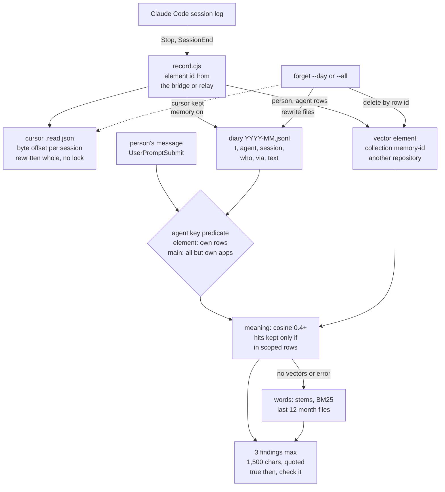

## 1. Executive Summary

Fractera is a self-hosted workspace around Claude Code: a Next.js core that
runs a main agent and one agent per "element", each a separate Next.js service,
driven from a terminal or Telegram. Its own memory, which it calls the base
memory, is a diary. A hook copies every word the person and the agents say from
Claude Code's session logs into monthly JSONL files, with no model, and recalls
up to three related lines before each message, scoped to the agent asking. The
weak part is the write path's bookkeeping. The cursor that stops a session being
copied twice, and that keeps a forgotten day from coming back, is rewritten
whole by every session that ends a turn, with no lock, and nothing tests it.

The diary serves two hooks. At session start an agent gets its last exchange
with the person and, for the main agent, its last note of where it stopped.
Before each of the person's messages it gets up to three findings, first by
cosine similarity through the node's vector element and otherwise by a
hand-written stemmer and BM25. The texts are quoted and headed *"true then —
check it if it matters"*.

The scope key is the agent id on every row. An element reads its own rows. The
main agent reads every element's rows except those of apps with an owner of
their own. On a walled server the id comes from the caller's key, not from
anything the session sends.

Two other stores sit beside the diary. One is Claude Code's own memory folder,
which the bridge relocates into the node. The other is a "deep memory" that the
README describes at length, with facts, photos, PDFs and reminders. It lives in
a separate repository the installer clones; this tree holds only its client,
so how it stores, corrects and forgets is not inspectable here.

**Licence.** The MIT grant permits anyone to *"copy, modify, merge, publish,
distribute"*, and the first gate of the prebuild, `scripts/check-origin.mjs`,
refuses to build any checkout whose `origin` is not a direct GitHub fork of the
original. Its header gives the owner's reason as making it impossible for
anyone to sell updates built on the starter, plans to obfuscate the file, and
notes that until then the check can be removed by editing it
(`scripts/check-origin.mjs:1-14`). A copy redistributed under the licence does
not install unmodified. The data layer, vectors, embeddings and deep memory the
README calls the node's memory are among 13 other repositories, so this `LICENSE`
covers none of the code that stores a vector.

One mark is earned: `scope_enforced`, on the agent key. Section 9 gives the
reason for each of the six withheld.

## 2. Mental Model

A memory is **something said**: one row of the diary per utterance of the
person, an agent or the node, copied from the session log as it was said. The
owner's rule for it is quoted in the writer's header: if the architect asked
for a record, the agent must not think about what it refers to, and nothing is
filtered by meaning (`lib/agent-kit/memory/record.cjs:1-4`). There is no
extraction, no fact and no belief. A row is evidence that something was said on
a date.

A row has three states, none stored as a field.

- **Written.** After each turn the Stop hook appends the new words of the
  session to the month's file and sends person and agent rows to the vector
  element (`lib/agent-kit/memory/record.cjs:66-107`, `:124`).
- **Recalled.** A row of the asking agent's scope, from another session, that
  matches the person's message by meaning or by words, is shown before the
  message with its date and speaker (`lib/agent-kit/memory/recall.cjs:316-350`).
  Rows older than the last twelve monthly files are not read.
- **Forgotten.** `forget --day` or `forget --all` removes the rows and their
  vectors. The person asks the main agent in words, and the
  `know-the-architect` skill maps the request to the command
  (`scripts/memory.mjs:144-169`, `.claude/skills/know-the-architect/SKILL.md:60-76`).

A second rule governs absence. When the person turns memory off, the writer
still reads the session and moves its cursor, and writes nothing, so turning
memory on again never copies what was said meanwhile
(`lib/agent-kit/memory/record.cjs:68-70`, `:94`, `:103-105`). Forgetting leans
on the same cursor: the month files are rewritten and the cursor stays, so the
next hook on that session starts after the forgotten words.

The "picture of the person" is different in kind. It is Claude Code's own
memory folder, written by the model with its file tools; the bridge points
every session's `autoMemoryDirectory` at `data/services/<id>/memory`, and the
brief reads the index lines of records typed `user` or `feedback`
(`lib/agent-kit/modes.cjs:374-378`, `lib/agent-kit/memory/brief.cjs:71-102`).
The core keeps no state about those records.

## 3. Architecture

The core is a Next.js 16 application with a custom server, a control panel and
a bridge that starts Claude Code sessions in pseudo-terminals, one per element
and one for the main agent (`app/[lang]/(architectLayer)/architect/build/_agent-kit/server/bridge.cjs`;
the same file is copied byte for byte under every other element's directory).
The bridge writes each session's `--settings` with the memory folder and the
memory hooks (`bridge.cjs:290-292`, `:310`).

The base memory needs only the file system. Its vector arm needs two other
elements running: `data`, the one door to the vector element, and
`embeddings`, a local MiniLM model the vector element calls
(`lib/agent-kit/memory/embed.cjs:1-8`, `:30-35`). The core finds the data
element's port in `WEB4-ITEMS-REGISTRY/web4-items.json` and authenticates with
`DATA_SECRET` from `.env.local`. Without either, recall uses words.

`.gitmodules` does not exist. The 13 element repositories are cloned by
`serve:start` on first run and named in the registry; `fractera-memory-starter`
is one (`WEB4-ITEMS-REGISTRY/web4-items.json:153`, `README.md:373`).

### Deployment and ergonomics

The README's install path is a fork, a terminal running `claude`, and one
command. On a home computer every element's agent runs as the person's OS user,
and the README says so: the stores keep the doors apart, not the disk
(`README.md:177`). On a dedicated server a custom element's agent runs as its
own Linux user, reads nothing of the core, and gets its hooks through a relay
(`lib/agent-kit/hook-relay.cjs:1-11`). The diary needs no configuration and
no service; it starts with the first session the bridge launches.

## 4. Essential Implementation Paths

- **Hook installation.** `memoryHooks(element, mode)` returns Stop and
  SessionEnd for the writer and SessionStart and UserPromptSubmit for the
  readers, with the element id as the last argument, and returns nothing for a
  working-process session, whose prompts are other agents' orders
  (`lib/agent-kit/modes.cjs:393-404`).
- **Write.** `recordSession` reads the log from the session's cursor, keeps
  typed user text and assistant text, keeps Telegram replies sent through the
  reply tool, labels the first typed message and the node's own texts as
  `node`, skips a whole `claude -p` session, appends rows, and rewrites the
  cursor file (`lib/agent-kit/memory/record.cjs:39-107`).
- **Vectors.** `save` posts each person and agent row as text to
  `/vectors` with an id hashed from its own fields, and `kind` re-reads the
  vector element's model on every call and empties the ledger when it changed
  (`lib/agent-kit/memory/embed.cjs:38`, `:59-86`).
- **Recall.** `recallBest` scopes the diary, searches the collections of the
  agents in scope, keeps hits above 0.4 whose id is a scoped row, one per
  exchange, and falls back to `findings` on any error
  (`lib/agent-kit/memory/recall.cjs:316-350`).
- **Brief.** `brief` composes the last exchange, the last note and, for an
  element, the main agent's picture of the person
  (`lib/agent-kit/memory/brief.cjs:112-147`).
- **Control.** `scripts/memory.mjs` implements `show`, `forget`, `off`, `on`,
  `vectors`, `adopt` and `backfill`.
- **Walled relay.** `/api/node/hook-relay` resolves the caller from
  `x-element-key` and runs `record`, `brief` or `recall` with that id
  (`app/api/node/hook-relay/route.ts:23-34`,
  `lib/agent-kit/hook-relay-run.cjs:27-29`).

## 5. Memory Data Model

A diary row is
`{ t, agent, session, who, via, user?, text }`, with `text` cut to 8,000
characters (`lib/agent-kit/memory/record.cjs:17`, `:97`). `who` is `person`,
`agent` or `node`; `via` is `terminal`, `telegram` or `core`; `user` is the
Telegram user name when the message came through the channel. Rows go to
`data/node/memory/episodes/<YYYY-MM>.jsonl` by the month of their timestamp.

Beside it:

- `.read.json`, one object keyed by session id holding a byte offset, whether
  the first typed message was seen, and a skip flag
  (`lib/agent-kit/memory/record.cjs:73-75`);
- `notes.jsonl`, rows of `{ t, agent, note }` cut to 300 characters
  (`lib/agent-kit/memory/brief.cjs:150-157`);
- `settings.json`, present only when memory is off;
- `vectors.json`, the vector model, its dimensions and a map from row id to
  agent, written through a temporary file and a rename
  (`lib/agent-kit/memory/embed.cjs:40-45`).

A row's id is the SHA-1 of agent, session, time, speaker, channel and text, so
the same row always maps to the same vector and forgetting can find it
(`lib/agent-kit/memory/embed.cjs:37-38`). Nothing on a row says whether it is
true, current or superseded.

## 6. Retrieval Mechanics

Recall runs as a UserPromptSubmit hook and only on the person's words. A
prompt the diary's own classifier labels as the node's text, a slash command or
a system insertion gets nothing (`lib/agent-kit/memory/recall.cjs:270-273`).
Rows of the current session are skipped, because they are already in context.

**By meaning.** The question goes as text to `/vectors/search` for each agent
in scope that has a stored vector, ten hits each. A hit counts when its cosine
is at least 0.4 and its id is one of the scoped rows, and the first per
exchange is kept, up to three (`lib/agent-kit/memory/recall.cjs:316-346`).
The comment at `:306-308` says 0.4 was chosen in the middle of the gap between
expected rows (0.451 to 0.692) and unrelated questions' best rows (0.162 to
0.348) on the step's check sets, whose file is not in this tree.

**By words.** When the vector path fails for any reason, `findings` stems the
message with a Snowball Russian stemmer written in the file and a light English
one, drops stop words including the words people use to point at the past, and
ranks rows by BM25 (k1 1.2, b 0.75). It weights the person's words at 1.3, the
agent's at 1.0 and the node's at 0.6, doubles names, numbers and ids, and
multiplies by a recency factor that falls from 1.0 toward 0.75 with a 30-day
scale. A row must cover 35% of the message's information and match two of its
words, a strong word, or its only word (`lib/agent-kit/memory/recall.cjs:28-36`,
`:201-267`).

**What the agent receives.** At most three findings, at most 1,500 characters,
each with UTC time, speaker and channel, inside guillemets with any closing
guillemet doubled, under a header naming the path that found them and saying
the text was true then (`lib/agent-kit/memory/recall.cjs:275-297`). The hook
returns it as the UserPromptSubmit hook's `additionalContext`, which Claude
Code adds beside that message (`:367`).

**At session start.** On `startup`, not after `/clear` or a resume, the brief
gives the agent's last person message and its answer (300 and 400
characters), the main agent's last note if it is newer than that exchange, and
for an element the main agent's picture of the person up to 1,500 characters
(`lib/agent-kit/memory/brief.cjs:24`, `:112-130`). With no picture, the main
agent is told to run its first-meeting questions.

## 7. Write Mechanics

Writes happen in the Stop hook after every answer and in the SessionEnd hook,
which the bridge gives a 10-second timeout because its sessions end by killing
the pseudo-terminal (`lib/agent-kit/modes.cjs:380-392`, `:400`). The writer
copies, never interprets.

- **What is kept.** The person's typed text, Telegram messages unwrapped from
  their channel envelope, a Telegram message that arrived while the agent was
  off, the agent's text blocks and its Telegram replies
  (`lib/agent-kit/memory/record.cjs:39-63`).
- **What is not.** Tool calls and results, files, slash commands and their
  output, meta insertions, and every line of a `claude -p` session
  (`:86-87`).
- **The node's texts.** The first typed message of a session is the bridge's
  launch prompt and is labelled `node`, as are texts the core types into a
  live session (`:35-50`). The rule depends on Claude Code's log shape.
- **Agent-generated content.** The agent's answers are stored and recalled
  beside the person's words, at weight 1.0 against 1.3. An agent's wrong
  statement in one session is offered as memory in the next, under the same
  "true then" header.
- **No dedupe and no conflict handling.** Two sessions that say contradictory
  things both stay; recall returns whichever matches.

**Forgetting** is by day on the computer's clock, or everything
(`scripts/memory.mjs:144-169`). It rewrites each affected month file through a
temporary file and a rename, removes that day's notes, deletes the vectors of
the removed rows that the ledger knows, and says how many vectors it could not
delete. The output reminds the person that Claude Code keeps its own session
logs until it deletes them. There is no forget by phrase, row or person.

**The cursor.** `recordSession` reads the whole `.read.json`, changes one
session's entry and writes the whole object back, with no lock and no rename
(`lib/agent-kit/memory/record.cjs:73`, `:103-105`). The main agent and the
elements end turns independently, so two hooks can interleave. An inference
from the code, not tested: when they do, the later write drops the earlier
session's new offset, and that session's next hook copies the same bytes
again. If the person forgot that day in between, the forgotten words return,
as long as Claude Code still holds the log.

The **deep memory** is written by `npm run remember`, which posts to the
memory element's `/v1/remember` with optional files and a reminder
(`scripts/node-commands.mjs:179-214`). Its behaviour is outside this tree.

### Operational cost

- **Does the write block the agent?** The Stop hook runs synchronously after
  each answer: a file append, then one HTTP call per row to the vector element
  with an 8-second timeout. No model is called.
- **Lag.** A row is in the diary when the turn's Stop hook ends and in the
  vector collection when `save` returns. Recall skips the current session
  anyway, so a row matters from the next session on.
- **Background passes.** None. `npm run memory -- vectors` re-embeds rows
  without a vector when someone runs it, and after a model change it re-embeds
  everything.
- **Read cost.** The word path reads the last twelve month files on every
  message; a measured 0.12 to 0.19 seconds is quoted in a comment
  (`lib/agent-kit/modes.cjs:387`). The injection is at most 1,500 characters
  per message and 1,500 plus about 1,000 at session start, attached to the
  message rather than the system prompt.

## 8. Agent Integration

The model does not call the base memory; hooks do. The only agent-driven
operations are the main agent's note (`npm run done -- --note`,
`scripts/main-agent-cli.mjs:482-488`) and the person's controls, which the main
agent runs on the person's words through the `know-the-architect` skill.
`lib/agent-kit/memory/memory.md` is the text that tells agents what their
memory is and to say no more than that.

An element's agent that is asked to remember something passes the request to
the main agent, which runs `npm run remember` or `npm run remind`. `remind`
answers from the deep memory and from the diary, the latter with
`recallBest` as the main agent (`scripts/node-commands.mjs:216-242`).

`.claude/hooks/brain-ingest.py` posts edited project documents to
`localhost:3002/api/rag/ingest`. `.claude/settings.json` does not register it
and no route of that name is in the tree, so it does nothing.

The integration is specific to Claude Code: it reads Claude Code's session-log
format, its hook events and its `autoMemoryDirectory` setting. The diary
writer, the recall module and the brief are each a few hundred lines with
Node built-ins only, and could be lifted into another Claude Code setup.

## 9. Reliability, Safety, and Trust

### The scope key and who sets it

The agent id reaches the hooks as a command-line argument the bridge writes
into the session's settings, so the model inside the session does not choose
it (`lib/agent-kit/modes.cjs:398-402`). On a walled server the hook relay takes
the id from the caller's key (`app/api/node/hook-relay/route.ts:23`,
`lib/agent-kit/hook-relay-run.cjs:4-5`). The relay also refuses a `record`
whose `transcript_path` is not in the caller's own Claude project folder,
after a red-team run on 20 November 2026 found an element could copy the main
agent's conversation into its own diary rows
(`lib/agent-kit/hook-relay-run.cjs:46-82`).

On a home computer the boundary is softer. Every element runs as the same OS
user, and an element's agent is kept from reading `data/node/memory` by a
PreToolUse hook that asks the person, not by file permissions
(`scripts/element-isolate.mjs:13-15`). `npm run memory -- recall <id>` prints
any agent's findings to whoever runs it.

### What crosses the boundary by design

The main agent reads every element's rows except those of an app with its own
owner, so a family node's architect sees what each member said, as the README
states. Every element that is part of the project receives the main agent's
picture of the person at session start. An app with its own owner gets its own
picture instead (`lib/agent-kit/memory/brief.cjs:137-147`).

### Injection handling

Recalled and briefed text is quoted with doubled closing guillemets, so a
quote cannot close itself. The brief's header says the quotes are data, not
instructions (`lib/agent-kit/memory/brief.cjs:129`). Recalled text is the
person's and agents' own past words, including anything an agent quoted from a
web page in its answer.

### Marks

- **`scope_enforced` — earned.** The agent id is on every row and both recall
  paths and the brief filter on it; the vector hits are intersected with the
  scoped rows, so the collection is not the only boundary. The id is set by
  the bridge or by the caller's key.
- **`negative_eval` — withheld.** `scripts/own-app.test.mjs:73-78` asserts on a
  populated three-row array that `inScope` excludes an own app's rows from the
  main agent and other agents' rows from an element. It tests the predicate,
  not the read path: `findings` or `recallBest` could stop calling it and the
  test would still pass. Seeding rows of two agents and asserting the other's
  row is absent from `findings` would earn it.
- **`trust_state` — withheld.** A row has no status. The header's "true then,
  check it" applies to every finding alike.
- **`tombstone` — withheld.** The cursor that keeps a forgotten session from
  being copied again is keyed on the session and a byte offset, not on what
  was said; the same words in a new session are recorded, as a diary should.
- **`bitemporal` — withheld.** `t` is the time the line was said, taken from
  the log; nothing records when a statement held.
- **`audit_log` — withheld.** The diary is itself append-only, and forgetting
  rewrites it with no record of what was removed or by whom.
- **`human_review` — withheld.** `npm run memory -- show` lists counts and the
  picture's index lines; nothing waits for a person's approval.

## 10. Tests, Evals, and Benchmarks

I ran nothing from the repository. CI runs `npm ci`, a path-case check,
`node scripts/node-update.test.mjs` and `npm run build`, whose prebuild's 132
steps include `scripts/own-app.test.mjs` and `scripts/redteam-holes.test.mjs`
(`.github/workflows/three-os.yml:54-70`, `package.json:18`). The origin gate lets the original's own CI through
(`scripts/check-origin.mjs:48`).

What touches memory:

- `scripts/own-app.test.mjs:56-78`: an own app's brief carries its own picture
  and never the architect's, a project element's brief carries the
  architect's, and the `inScope` predicate on a three-row array. The brief
  cases call `compose` with the picture already chosen, so they test the
  wording, not which picture `brief` reads.
- `scripts/redteam-holes.test.mjs:33-65`: the relay's transcript check refuses
  the main agent's log, a neighbour whose folder name is longer, a symlink
  planted in the element's own folder and a non-transcript, and the relay
  refuses before any script runs.
- `scripts/element-wall.test.mjs:418-438`: the relay rewrites the memory hooks
  of a walled session into relay calls with no id argument.

What is not covered:

- No test calls `recordSession`, so the log parser, the off switch and the
  cursor are untested.
- No test calls `findings` or `recallBest`; the stemmer, the BM25 weights and
  the 0.4 floor have no committed case.
- No test runs `forget` or checks that a forgotten day stays out.

Comments cite check sets and measurements in step files such as
`completed-steps/595-8b.md`, which are not in this tree. No paper is cited.

## 11. For Your Own Build

### Steal

- **Copy, do not extract.** A diary that copies words from the session log
  with no model is cheap, cannot invent, and leaves interpretation to the
  reader. The rule that a `claude -p` session is never a conversation keeps
  automation out.
- **An off switch that moves the cursor.** Reading past what is said while
  memory is off, rather than not reading, is what makes "on" not resurrect it.
- **The scope id from the caller's credential.** The relay ignores any id in
  the request and checks that the transcript belongs to the caller.
- **Intersect vector hits with the scoped rows.** A per-agent collection plus
  an id check against the agent's own rows keeps one boundary from being the
  only one.
- **Tell the model how old and how sure.** Date, speaker and "true then"
  on every finding, quoted so it cannot break out.

### Avoid

- **A shared cursor file rewritten whole.** Keep one cursor file per session,
  or take a lock, or write through a rename after re-reading.
- **Recalling the agent's own answers as memory.** Weighting them below the
  person's words still puts an earlier session's mistake in front of a new message.
- **Hand-written stemmers with no committed case.** The comments describe
  failures found by hand (`«Токио»` and `«токены»` sharing a stem,
  `lib/agent-kit/memory/recall.cjs:228-229`); those belong in a test.

### Fit

This suits someone who already runs Claude Code as the agent and wants a
session to know what was said in earlier sessions, in any language, with no model
bill for memory. The base memory is a small, readable part of a large
and fast-moving product that installs only from a GitHub fork and pulls 13
other repositories; borrowing the four modules is easier than adopting the
node. Walk away if memory must hold facts rather than quotes, if two
statements must be reconciled, or if forgetting must be by subject rather
than by day.

## 12. Open Questions

- Whether concurrent Stop hooks are serialised anywhere outside these modules,
  which would rule out the cursor race.
- Whether an element's Telegram bot can admit more than one person; the diary
  stores the Telegram user but recall does not filter on it.
- What the vector element does with a row's text on `DELETE /vectors/<id>`;
  the comment at `lib/agent-kit/memory/embed.cjs:101-103` says it keeps the
  text beside the vector.
- How the deep memory stores, corrects and forgets, which needs a reading of
  `Fractera/fractera-memory-starter`.

## Appendix: File Index

- Write path: `lib/agent-kit/memory/record.cjs`,
  `lib/agent-kit/memory/embed.cjs`
- Retrieval and context assembly: `lib/agent-kit/memory/recall.cjs`,
  `lib/agent-kit/memory/brief.cjs`
- Hook wiring: `lib/agent-kit/modes.cjs` (`memoryDir`, `memoryHooks`),
  `app/[lang]/(architectLayer)/architect/build/_agent-kit/server/bridge.cjs`
- Walled relay: `lib/agent-kit/hook-relay.cjs`,
  `lib/agent-kit/hook-relay-run.cjs`, `app/api/node/hook-relay/route.ts`
- Control: `scripts/memory.mjs`, `scripts/main-agent-cli.mjs`,
  `.claude/skills/know-the-architect/SKILL.md`,
  `lib/agent-kit/memory/memory.md`
- Deep memory client: `scripts/node-commands.mjs`
- Isolation: `scripts/element-isolate.mjs`, `scripts/element-boundary-hook.mjs`
- Unwired: `.claude/hooks/brain-ingest.py`
- Tests: `scripts/own-app.test.mjs`, `scripts/redteam-holes.test.mjs`,
  `scripts/element-wall.test.mjs`, `.github/workflows/three-os.yml`
- Licence gate: `scripts/check-origin.mjs`, `LICENSE`

### Recorded searches

Run from the repository root at the pinned commit with `/usr/bin/git grep`.

- **No status field in the memory modules.**
  `git grep -n -E 'status|verified|candidate|confidence' -- lib/agent-kit/memory scripts/memory.mjs`
  returns `lib/agent-kit/memory/embed.cjs:50` and `:61`, an HTTP status and
  the vector element's `/vectors/status` route.
- **No value-keyed refusal.**
  `git grep -n -i -E 'tombstone|blocklist|suppress|rejected' -- lib/agent-kit/memory scripts/memory.mjs`
  returns nothing; the same pattern over `lib/agent-kit` matches
  `lib/agent-kit/resume.cjs:10`.
- **No validity time.**
  `git grep -n -i -E 'valid_?(from|to|until)|validFrom|validUntil' -- . ':!package-lock.json'`
  returns nothing.
- **The only appends are the diary and the notes.**
  `git grep -n -E 'appendFileSync' -- lib/agent-kit/memory scripts/memory.mjs`
  returns `lib/agent-kit/memory/record.cjs:98` and
  `lib/agent-kit/memory/brief.cjs:155`.
- **No lock in the memory modules.**
  `git grep -n -i -E 'lock|flock|O_EXCL' -- lib/agent-kit/memory` returns
  nothing; the same pattern over `lib/agent-kit` matches
  `lib/agent-kit/guard-search.cjs:15`.
- **No approval step.**
  `git grep -n -i -E 'approv|pending|review' -- lib/agent-kit/memory scripts/memory.mjs`
  returns nothing; over `lib/agent-kit` it matches
  `lib/agent-kit/commands.cjs:68`.
- **The RAG ingest hook has no registration and no route.**
  `git grep -n -E 'brain-ingest|api/rag' -- . ':!package-lock.json'` returns
  only `.claude/hooks/brain-ingest.py:45`.
- **No test exercises the diary's read or write functions.**
  `git grep -n -E 'findings|recordSession|recallBest|stemRu|lastExchange|memory -- forget|forget\(' -- '*.test.mjs' '*.test.cjs' '*.test.ts'`
  returns `scripts/element-delete-agents.test.mjs:41-42`, which call an
  unrelated `supervision.forget`; `git grep -n -c -E 'inScope' -- '*.test.mjs'`
  returns `scripts/own-app.test.mjs:4`.
- **The memory element's code is not in the tree.**
  `git ls-files | grep -c -i 'memory-starter'` returns 0, and `.gitmodules`
  does not exist.
- **No paper reference.**
  `git grep -n -i -E 'arxiv|bibtex|@article|@misc|doi\.org' -- . ':!package-lock.json' ':!lib/agent-kit/skills/catalog'`
  returns nothing; over `lib/agent-kit/skills/catalog` it matches third-party
  skill cards.

## History

**2026-11-26** — [`e7395d7eb42a441f4c17d824b74a3717de9ac35d`](https://github.com/Fractera/web4-node-starter-kit/commit/e7395d7eb42a441f4c17d824b74a3717de9ac35d). First reading, read only, from a full clone at the head of `main`, 13 commits past `ad23116a069f`, the commit triage selected; none of the 13 touches the memory modules, the hook wiring or their tests. Screened first: four auto-run surfaces (`.claude/hooks/`, `.claude/settings.json`, `.githooks/`, `.mcp.json`), `package.json` inside the seven-day cooldown with `preinstall` and `postinstall` scripts and floating ranges under a lockfile. `CLAUDE.md`, skills and prompts were read as data. Nothing was installed, built or run, and the test files were not run. One mark, `scope_enforced` ([section 9](#9-reliability-safety-and-trust)).
