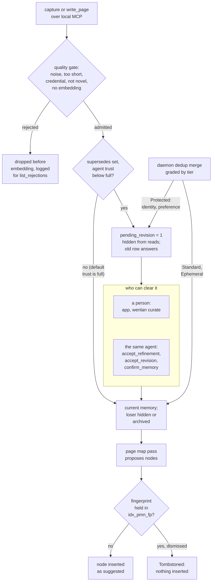

## 1. Executive Summary

Wenlan is a local-first knowledge base that maintains Markdown wiki pages from
captured memory and imported sources, served to coding agents over MCP and to
a person through a desktop app. Its best mechanism is a tombstone on the
mind-map layer: a dismissed node keeps its row, its fingerprint stays under a
unique index, and every later insert of the same placement is a no-op the
caller sees by name. Its weakest property is the boundary around a Space: an
MCP recall that names no Space reads all of them.

The repository moved from `7xuanlu/wenlan` to `wenlan-app/wenlan`, and the
release checks and install links in the tree name the new owner.

**The tombstone is on the mind-map, and it is real.** A page map is a graph of
nodes referring to memories, entities, pages, sections and free-text ideas.
Each node carries a `fingerprint` of `(ref_kind, ref_id, parent_ref)` — what
it points at and where it hangs — under `UNIQUE(page_id, fingerprint)`.
Dismissing a node sets `status = 'dismissed'` and **keeps the row**, and
`patch_map_node` refuses any edit to it. Every insert is
`ON CONFLICT(page_id, fingerprint) DO NOTHING`, and the code reads the
conflicting row back to distinguish a live `Duplicate` from a `Tombstoned`.

The LLM suggestion pass is a separate, insert-only accessor, with the reason
in its module docstring: a re-proposal of a dismissed fingerprint is a
`Tombstoned`, so the pass *"never updates, deletes, resurrects, or overwrites
any existing row"*. In the
[strong-form taxonomy](../../patterns/rejected-value-tombstone/) this is the
*collided* kind made deliberate, with the outcome a named variant the caller
handles. It is a rejected **placement**, not a rejected **fact**: dismissing a
node says the memory does not belong there, and nothing stops the claim being
re-stored.

**Scope is a filter the agent chooses.** `resolve_read_scope` returns
`ReadScope::Global` for an absent or blank Space name, and the MCP `recall`
tool describes its `space` argument only as *"Filter by topic scope"*. A
strict `WENLAN_SPACE` pin overrides the model's argument, and the app sets one
when a person shares a single Space with a web AI app; the configurations
written for local coding tools carry no pin. The scope mark is withheld for that
reason ([section 6](#6-retrieval-mechanics)).

**Review is real at the sentence and the note, and open at the memory.** A
machine write to a page lands only on the AI's own sentences; a change to a
sentence the person wrote is staged as a proposal, and the routes that accept
one refuse any caller that sends an agent name. The memory and page-revision
queues are different: `accept_refinement`, `confirm_memory` and
`accept_revision` are declared MCP tools refused only over remote transport,
and local MCP is how the producing agent connects
([section 9](#9-reliability-safety-and-trust)).

## 2. Mental Model

Wenlan holds three layers and calls the middle one memory.

**Sources** are the outside world — files, an Obsidian vault, a Logseq
graph, imported chat exports — chunked into rows. **Memories** are typed claims, each
with a schema declaring required and optional fields
(`crates/wenlan-core/src/schema.rs`). A `decision` requires `decision` and
`context` and may carry `alternatives_considered`, `date` and `reversible`.
**Pages** are the Markdown wiki the person reads, assembled from memories with
citations, each sentence carrying who wrote it; a **page map** is a graph view
over a page.

A capture becomes a stored belief by passing the quality gate, and stops
being one when a later memory supersedes it. Who may supersede it without a
person depends on two things: the trust level the user assigned the writing
agent, and, for merges the daemon proposes itself, the stability tier of the
memory type.

The page-map tombstone is a second, disjoint state machine over the same
material: a node is `suggested`, `active` or `dismissed`, with `pinned` a
separate flag. The allowed moves are `suggested → active`,
`suggested → dismissed` and `active → dismissed`, so dismissal is the one
permanent state, and it holds the fingerprint against every future pass.

## 3. Architecture

Five crates plus the desktop app. `wenlan-core` holds the database,
ingestion, retrieval, the knowledge graph, synthesis, claim derivation,
evaluation and the maintenance passes. `wenlan-types` is the shared
vocabulary, `wenlan-server` the HTTP daemon, `wenlan-mcp` the tool surface,
`wenlan-cli` the command line. The Tauri app under `app/` starts the daemon
and a relay sidecar for web AI apps.

Storage is one libSQL database with `F32_BLOB(768)` embeddings in the
`memories` table itself — no separate vector store — plus tables for the
knowledge graph, pages and their history, page maps, the refinement queue,
the Brief and its history, and an access log.

The most distinctive engineering choice is outside the memory model.
`crates/wenlan-core/src/drift_guard.rs` is a set of test-only "teeth" that
parse the source with `syn` and fail CI when a class of drift appears — a
second copy of the sentence-splitting regex, a flag documented but not wired,
a config key without its counterpart. Its header states the design: *"Failure
messages teach the fix: each gate's assert states the invariant that broke"*.
`faithfulness.rs` carries the matching comment on its own function: *"This is
the ONE definition of the sentence boundary"*.

Several defects this atlas reports elsewhere are exactly what those teeth are
built to catch: a column with no reader, a flag documented and never wired, a
mechanism described in a migration comment and implemented nowhere.

## 4. Essential Implementation Paths

**Capture.** `POST /api/memory/store` resolves the agent from `x-agent-name`,
looks up its trust level (`"full"` when no agent is named), runs the quality
gate, validates the typed schema, embeds and inserts. A `supersedes` from an
agent below full trust is stored with `pending_revision = 1`
(`crates/wenlan-server/src/memory_routes.rs:570-691`).

**Correction by the daemon.** The refinery runs `contradiction.rs`'s cheap
structured-field pre-filter — returning `Consistent`, `Contradicts` or
`Supersedes` — before any LLM check. `Contradicts` goes to `awaiting_review`
at any tier; `Supersedes` goes through `apply_merge_by_tier`, which applies
Ephemeral and Standard merges and queues Protected ones
(`crates/wenlan-core/src/synthesis/refinement_queue.rs:427-455`,
`crates/wenlan-core/src/synthesis/distill.rs:2306-2343`).

**Page writes.** Agent, pipeline and manual page writes go through
`post_write::page_write`; citation backfill and revision acceptance write
through the db layer. The ownership gate stages a revision card when a machine writes to a
review-locked page, or to a human-owned page without a matching
`expected_version`; otherwise the sentence gate keeps every sentence the
person wrote and stages the AI's changes to them as `sentence.propose`
entries (`crates/wenlan-core/src/post_write/page_update.rs:155-178`,
`:1091-1135`, `:1205-1220`).

**Review.** `wenlan curate` and the app list, accept and dismiss. Over MCP the
same verbs are `accept_refinement`, `reject_refinement`, `confirm_memory`,
`accept_revision` and `dismiss_revision`. Sentence and note proposals are
accepted only at `POST /api/pages/{id}/sentences/proposals/{proposal_id}/accept`
and `POST /api/notes/proposals/{id}/accept`, both behind `require_person`.

**Mind map.** `db/page_map.rs` holds the data layer; `page_map_improve.rs` is
the LLM pass that proposes nodes and edges and treats `Tombstoned` as a
first-class outcome.

## 5. Memory Data Model

The `memories` columns that carry the design rather than the statistics:

| Column | Role |
| --- | --- |
| `memory_type`, `structured_fields`, `retrieval_cue` | The typed schema, its filled fields, and a generated question the memory answers |
| `stability` | `new`, `learned` or `confirmed`, set at store from tier, trust and quality |
| `confirmed`, `pinned` | Both set the decay rate to exactly zero |
| `supersedes`, `supersede_mode` | The link and whether the loser is hidden or archived |
| `pending_revision` | A staged replacement, excluded from every read until accepted |
| `event_date`, `event_end` | The time span a memory's text refers to, from a temporal cue |
| `confidence`, `effective_confidence` | The stated value and the same value after recency and access decay |
| `version`, `changelog` | A row version and a JSON array of what changed |

Two smaller things are worth naming. `retrieval_cue` is generated from a
per-type template — *"What was decided about {decision} and why?"* — so a
stored memory carries the question it answers, which narrows the
query/document vocabulary gap without a model at query time. And
`enrichment_origin` is a table that keeps, in its own comment, *"the three
store-time choices that cannot be"* reconstructed from the memory row once the
request is gone: whether the type was explicit, whether the structured fields
were, and whether a Space was rejected. That is provenance about the
pipeline's own decisions.

Pages carry two further records. `page_history` holds one row per page
version with `edited_by`, and sentence authorship records `person`, `ai`,
`unknown` or `original` for each sentence. `page_truth_state` holds a machine
axis, `support_status IN ('supported','provisional')`, beside a human axis
bound to the exact version and digest a person reviewed.

## 6. Retrieval Mechanics

Hybrid retrieval with an optional cross-encoder reranker (`reranker.rs`),
knowledge-graph community routing (`community_routing.rs`,
`community_partition.rs`), a temporal channel that adds
`event_date BETWEEN ? AND ? OR event_date IS NULL` when the query carries a
high-confidence time cue (`temporal_query.rs`), and topic matching, over
embeddings stored inline.

Decay is applied twice and the distinction is explicit in `decay.rs`:
`effective_score` multiplies the search-time score by recency and access
boosts, while `effective_confidence` applies the same factors to the stored
confidence. `decay_rate_for` returns exactly `0.0` when a memory is
`confirmed` or `pinned`, so the two states that mean "a person vouched for
this" are immune to disuse.

**Scope reaches the SQL, and the caller picks it.** `ReadScope` is `Global`,
`Space(id)` or `Uncategorized`, and `matches!(scope, ReadScope::Global)`
selects the statement itself at each search site, so a named Space is a
predicate rather than a post-filter. The resolver fails loudly on an unknown
Space and on `uncategorized` colliding with a registered name. It returns
`Global` when no name is given (`crates/wenlan-core/src/read_scope.rs:34-40`),
and the daemon takes the request body's `space` ahead of the
`X-Wenlan-Space` header (`crates/wenlan-server/src/read_scope.rs:7-17`).

On the MCP side, `effective_space` uses a `WENLAN_SPACE` pin when the process
has one and ignores the model's argument with a warning; otherwise it passes
the model's `space`, then `WENLAN_DEFAULT_SPACE`, then nothing
(`crates/wenlan-mcp/src/tools.rs:42-64`). The only writer of `WENLAN_SPACE`
in the tree is the relay launcher, which pins it when a person shares one
Space with a web AI app (`app/src/remote_relay/runtime.rs:204-213`). The MCP
README says the same of the fallback: *"an overridable `WENLAN_DEFAULT_SPACE`
is not an authorization boundary"*.

So a standard-profile session — the one written into a local coding tool's
MCP config, as a command and arguments with no environment — reads every
Space when `recall` omits `space`. Under a pin the boundary holds on every
read the query-only profile exposes, including the id-addressed
`get_page_sources`, which scopes by the header
(`crates/wenlan-server/src/page_routes.rs:361-362`). The session-start
`brief` refuses an unresolved Space instead of widening: *"Space not
resolved. Pass `space` or configure a default Space."*

## 7. Write Mechanics

`quality_gate.rs` is a pre-store filter that runs before anything is
embedded, with a typed rejection reason: `NoisePattern`, `TooShort`,
`NotNovel`, `CredentialLeak`, `EmbeddingUnavailable`. Refusing a credential at
the gate means the secret never becomes a row. `EmbeddingUnavailable` as a
rejection means novelty could not be assessed and the gate declines rather
than admitting by default — the fail-closed posture of
[Memory Palace](../memory-palace/)'s write guard, reached independently.

Contradiction handling keeps the model out of the common path.
`fields_may_contradict` compares structured fields of two memories of the
same type and returns true only when key fields overlap and values differ;
it returns false on parse failure, missing fields, or non-overlapping
contexts — three ways of declining to guess.

The stability tier is a property of the *type*: Protected for identity and
preference, Standard for fact, decision, lesson and gotcha, Ephemeral for the
rest. It decides how a merge the daemon proposes applies, and it exempts
Protected memories from decay-driven archival (`select_evictions`). It does
not gate an agent's own `supersedes`: that is decided by the agent's trust
level, whose column default is `'full'`. The contrast with
[YesMem](../yesmem/), which grades the same decision by earned usage, is that
Wenlan's version is cheaper to reason about and blunter.

**The person's sentences are kept.** On a page write the sentence gate runs
for every machine writer except the mechanical link rewrite after a rename.
Each sentence the person wrote that the write changed or dropped stays as it
is, and the change is staged for them; on a human-owned or review-locked page
the same applies to sentences of unknown origin. The comment states the rule
plainly: *there is no "AI may edit directly" setting*.

The page changelog is a bounded FIFO. `append_changelog_entry` caps at 20
entries and trims from the front, skipping entries marked `fs_edit` or
`manual_edit`, so machine entries are dropped before human ones. That is the
right priority for a capped array, and it is a recent-changes buffer.

## 8. Agent Integration

`wenlan-mcp` serves three profiles. `standard` is the local stdio surface a
coding agent gets: capture, recall, the Brief, page reads and writes, lint and
repair, steep, the review verbs and proposal tools. `query-only` exposes
`brief`, `recall` and `get_page_sources`, requires a bearer token and a
strict `WENLAN_SPACE` pin, and rejects every other tool name before dispatch.
`web-write` adds the writes a person allowed a web AI app.

A CLI with `brief`, `capture`, `recall`, `curate`, `wiki`, `lint` and
`pages`; a desktop app that runs the daemon and the relay; and an HTTP server.
All of them read one libSQL file. Remote transport refuses the review, steep
and lint-repair verbs with a message pointing at local MCP, and refuses
delete and rename unless a person allowed web writes.

The product framing is that the artifact is a Markdown wiki page with
inspectable citations rather than a memory API. That is why the citation,
faithfulness and claim-derivation machinery is as large as the retrieval
machinery, and why most of the surface is about pages.

## 9. Reliability, Safety, and Trust

**Tombstone — awarded, and scoped.** The mechanism is described in section 1.
It is value-keyed (a derived fingerprint, not a row id), durable (the
dismissed row is retained, and migration 134 copies it into the rebuilt
table), and enforced on the write path (a unique index plus `DO NOTHING`).
`validate_ref_component` rejects a `ref_kind` or `ref_id` containing the
fingerprint separator, so a crafted ref cannot forge a component boundary.
Two edges of it: `reset_page_map`, reachable only as `DELETE
/api/pages/{id}/map`, deletes the map and every tombstone with it, by design;
and an `idea` node's `ref_id` is a UUID rather than its text, so the key
blocks a placement of referenced material, not a repeated idea.

**Scope enforced — withheld.** The predicate is real and compiled into SQL,
and a pinned process cannot widen it. In the configuration a local agent
runs, the model selects the Space or omits it for the whole library, which is
a filter it chooses rather than a boundary on it
([section 6](#6-retrieval-mechanics)).

**Human review — withheld.** `refinement_queue` with `awaiting_review`, a
partial index over the two open states, a `resolved_at` stamp, the
capture-time trust gate and `wenlan curate` make a real queue. The agent
holds the verbs that empty it: `accept_refinement_impl`
(`crates/wenlan-mcp/src/tools.rs:3478-3505`) refuses only
`TransportMode::Http`, and `handle_accept_refinement`
(`crates/wenlan-server/src/refinery_routes.rs:133`) and
`handle_accept_revision` apply no actor check. The trust gate is also keyed
on the name the agent reports in `x-agent-name`.

The sentence and note proposals are the passing shape, on a different layer.
No MCP tool accepts either, and `require_person` refuses any request that
names an agent, which is a self-declared header rather than a verified
principal. The page path around them is open: a revision card keeps the
agent's full text — *"An agent's own edit is left as written"* — and
`accept_page_revision_card` applies it as `revision_accept` without the
sentence gate, so an agent that writes to a review-locked page and then calls
`accept_revision` replaces the person's sentences.

**Trust state — withheld.** `pending_revision = 1` hides a staged
replacement from more than sixty read predicates, and that is the nearest
thing here: it is a staging flag on a proposed write, not a status on the
stored claim. `page_truth_state` is a stored two-value support axis that the
visibility contract would use to hide an unsupported page from automatic
readers. That branch requires `claim_promoter_enforcement = 1` in
`app_metadata`, and only tests write that key
(`crates/wenlan-core/src/db/truth_exposure.rs:405-445`, `:587-607`), so in a
running install the machine verdict hides nothing.

**Audit log — withheld.** The memory changelog is the 20-entry FIFO in
section 7. `page_history` keeps every page version, and `delete_page` deletes
it, because page ids can be reused (`crates/wenlan-core/src/db.rs:55925-55932`).
`brief_history` appends one row per Brief update and cascades away with its
Space. `access_log` records reads.

**Bitemporal — withheld.** `event_date` and `event_end` record the time span
a memory's text refers to, extracted from a temporal cue by the enrichment
pass or by migration 55 against `last_modified`, and the temporal channel
filters on them. That is when a described event happened, not an interval
over which a claim held: nothing closes it when the claim is superseded, and
the knowledge graph's `valid_until` is stamped with the wall clock at
supersession, which is record time.

**Negative eval — awarded, and not from the evaluation harness.** That
harness is large and positive-signal: recall, MRR, NDCG, faithfulness, rank
overlap. The exclusion assertions live in the test tree: two core tests
against a real temporary database, each asserting the in-scope row first and
the out-of-scope row absent, and four in the refinement queue pinning that
unconfirmed folder-document chunks are excluded from both synthesis pools
beside a confirmed duplicate that must appear.

## 10. Tests, Evals, and Benchmarks

**No paper.** No arXiv reference, DOI, `CITATION.cff` or BibTeX block in the
README or `docs/`.

The evaluation subsystem has 36 modules and directories under
`crates/wenlan-core/src/eval/` covering LoCoMo, LongMemEval, answer quality,
KG faithfulness with and without an LLM judge, entity dedup, latency, cost,
throughput, retrieval drift and rank overlap, with `goldens/` holding an
anchor and a current snapshot for ranking so a change in order is a diff.

The committed result is deliberately narrow, and the README frames it as one:
*"These LongMemEval (LME) snapshots measure retrieval of saved knowledge, not
AI answer quality."* It reports LongMemEval Oracle over 500 questions at 93.6%
Recall@5, 0.857 MRR and 0.883 NDCG@10, and the deep `LME_S` subset over 90
questions at 87.7%, 0.815 and 0.822. **I did not run any of it.**

The test that reads most like a scope assertion is not one.
`mcp_capture_and_recall_respects_space` captures an alpha and a beta memory
against a wiremock that answers every store with the same id and every
search with only the alpha row, then asserts beta is absent from the
rendering. Its own doc comment says what it proves: that the MCP layer
threads `space` through and renders exactly what the daemon returns.

**I ran no tests.** The screen flagged eight auto-run surfaces: four at the root, all present at the previous pin — `.claude-plugin/`, `.claude/hooks/`, `.claude/settings.json` and `.githooks/` — and the plugin under `plugin/`, whose hooks run on SessionStart, UserPromptSubmit and Stop and whose `.mcp.json` declares an MCP server; four `build.rs` files including a
vendored updater plugin, two npm `postinstall` scripts, and twelve dependency
files changed inside the seven-day cooldown, `Cargo.lock` and
`pnpm-lock.yaml` among them. A tree with active hooks and a lockfile changed
on the day of the pin is one to read, not to build.

## 11. For Your Own Build

### Steal

- **Keep the dismissed row so its key stays occupied.** The whole tombstone
  is a unique index on a derived fingerprint plus `ON CONFLICT DO NOTHING`. No
  lookup, no extra table, and a re-proposal cannot land. The cost is that the
  dismissed row can never be garbage-collected, which is the correct trade.
- **Make the suggestion path insert-only by construction.** A separate
  accessor that can only insert means an LLM improvement pass cannot resurrect
  or overwrite anything, and the docstring says so.
- **Validate the components of a derived key against separator injection.**
  If your key is `a<SEP>b<SEP>c`, a crafted `b` containing `<SEP>` is a forged
  key.
- **Gate machine writes per sentence, by author.** Keeping every sentence the
  person wrote and staging the AI's change to it is finer than a page lock and
  loses no agent work.
- **Set the decay rate to zero for confirmed and pinned.** If a person vouched
  for a memory, disuse is not evidence against it.
- **Pre-filter contradictions on structured fields with no model.**
  Overlapping keys with different values is a cheap candidate test that
  returns false on every uncertain case.
- **Store the question the memory answers.** A per-type `retrieval_cue`
  template costs one format string and gives the retriever a document-side
  paraphrase of the query.
- **Automate the drift check.** `drift_guard.rs` parses the source and fails
  CI on a documented-but-unwired flag or a duplicated definition.

### Avoid

- **Do not let an omitted scope mean everything.** Wenlan's `brief` refuses
  an unresolved Space while its `recall` widens to all of them; the first is
  the safe default.
- **Do not leave a second door around a gate.** The sentence gate keeps the
  person's text, and a revision card the agent can accept itself replaces it.
- **Do not read a capped changelog as an audit trail.** Twenty entries, FIFO,
  and the machine history disappears first.
- **Do not conclude the fact layer is protected because the graph layer is.**
  A dismissed node says nothing about whether the claim it pointed at may be
  re-stored.

### Fit

This is for a single person or a small team who want a maintained Markdown
knowledge base rather than a memory API, are prepared to run a desktop app and
a local libSQL database, and value opening a citation to see the source
behind a sentence. It is not a component to vendor: a codebase this size with
its own drift-guard framework is a product you adopt.

The reason to read it even if you never run it is `db/page_map.rs`, about
1,600 lines: the tombstone in it works because of a database constraint
rather than a policy.

## 12. Open Questions

- **Does anything tombstone a fact?** `forget` is a hard delete, the quality
  gate's rejection log is a diagnostic list, and no table keyed on rejected
  content was found that a capture consults (see *Recorded searches*).
  Whether a forgotten memory is re-extracted from the source it came from was
  not traced end to end.
- **How often does a gated change wait for a person?** The queue is reachable
  and the agent can clear it; nothing in the tree reports how many rows sit
  in `awaiting_review` in a real store, or who resolved them.
- **Will the support axis be switched on?** The hiding branch, its tests and
  its audit row exist; the one key that enables it has no production writer.
- **Is the 768-dimension embedding inline in `memories` a scaling limit?** The
  README reports a 10,000-page test answering app search in 11 to 50 ms; the
  point where one table stops being simple and fast was not established.

## Appendix: File Index

| Path | What to read it for |
| --- | --- |
| `crates/wenlan-core/src/db/page_map.rs:118`, `:271-300`, `:790-1000`, `:1033-1220`, `:1622` | The tombstone: outcomes, fingerprint and separator check, both inserts, the status machine, reset |
| `crates/wenlan-core/src/page_map_improve.rs` | The insert-only suggestion pass and its handling of `Tombstoned` |
| `crates/wenlan-core/src/db/page_map_independent.rs:127-183` | Migration 134, which rebuilds the map tables and keeps dismissed rows |
| `crates/wenlan-core/src/read_scope.rs`, `crates/wenlan-server/src/read_scope.rs` | The scope enum, the resolver that returns `Global` on no name, body before header |
| `crates/wenlan-mcp/src/tools.rs:42-64`, `:105-147`, `:555` | `effective_space`, the tool profiles, the `recall` scope argument |
| `crates/wenlan-mcp/src/lock_state.rs`, `app/src/remote_relay/runtime.rs:204-213` | The `WENLAN_SPACE` pin and its one writer |
| `crates/wenlan-server/src/memory_routes.rs:570-691` | Agent trust resolution and the capture-time `pending_revision` gate |
| `crates/wenlan-core/src/synthesis/refinement_queue.rs:427-455`, `crates/wenlan-core/src/synthesis/distill.rs:2306-2343` | Daemon correction and the tier-graded merge |
| `crates/wenlan-mcp/src/tools.rs:3378-3505`, `:4657-4697` | The review verbs on the agent's surface and their transport check |
| `crates/wenlan-core/src/post_write/page_update.rs:136-178`, `:1091-1220` | The ownership gate, the revision card, the sentence gate |
| `crates/wenlan-core/src/post_write/page_revision.rs:120-200`, `:334-352` | Accepting a page revision card without the sentence gate |
| `crates/wenlan-server/src/sentence_routes.rs:88-96`, `crates/wenlan-server/src/note_routes.rs:44-49` | `require_person` on the proposal accept routes |
| `crates/wenlan-core/src/db/claim_identity.rs:415-445`, `crates/wenlan-core/src/db/truth_exposure.rs:405-607`, `crates/wenlan-core/src/truth_contract.rs:233-264` | The page support axis and the enforcement key it waits on |
| `crates/wenlan-types/src/sources.rs:103-122`, `crates/wenlan-core/src/decay.rs`, `crates/wenlan-core/src/db.rs:2571` | Stability tiers, decay, archival |
| `crates/wenlan-core/src/quality_gate.rs`, `crates/wenlan-core/src/contradiction.rs`, `crates/wenlan-core/src/schema.rs` | Write gate, structured contradiction pre-filter, typed schemas |
| `crates/wenlan-core/src/db.rs:4446`, `:10052`, `:55842`, `:62148` | `enrichment_origin`, `page_history`, `delete_page`, `append_changelog_entry` |
| `crates/wenlan-core/src/drift_guard.rs`, `crates/wenlan-core/src/faithfulness.rs` | The drift-guard teeth |
| `crates/wenlan-core/tests/space_scoping_e2e.rs`, `crates/wenlan-mcp/tests/space_roundtrip_e2e.rs` | The real-database exclusion tests, and the wiremock rendering test |
| `crates/wenlan-core/src/eval/`, `docs/eval/` | The evaluation subsystem and its method |

### Recorded searches

Run at the tree root of the pinned checkout with `git grep`.

- `git grep -n -E 'idx_pmn_fp|ON CONFLICT\(page_id, ?fingerprint\)' -- crates` — `db.rs:9636`, `:9954`, `db/page_map_independent.rs:183`, `db/page_map.rs:846`, `:967`, and test fixtures.
- `git grep -n -i -E 'delete[[:space:]]+from[[:space:]]+page_map' -- crates` — `db/page_map.rs:1626` (`reset_page_map`) and `db.rs:55960` (`delete_page`); both delete the `page_maps` row and cascade.
- `git grep -n -E 'reset_page_map|map/(nodes|edges|improve)' -- crates/wenlan-mcp` — no match; MCP reads a map and never writes one.
- `git grep -n -E '"WENLAN_SPACE"' -- app crates ':!*test*'` — one writer, `app/src/remote_relay/runtime.rs:211`; the rest read it.
- `git grep -n 'claim_promoter_enforcement' -- crates ':!*test*' ':!*tests/*'` — the key constant and a comment in `db/truth_exposure.rs`; no writer.
- `git grep -n 'fn require_person' -- crates` — `note_routes.rs:44`, `sentence_routes.rs:88`; neither is called from `refinery_routes.rs` or `memory_routes.rs`.
- `git grep -n -E 'StabilityTier::Protected' -- crates ':!*test*'` — tier tables, decay, the eviction exemption, the merge branch in `synthesis/distill.rs:2333`, and the store route's `stability` value; no capture gate.
- `git grep -c -E 'pending_revision[[:space:]]*(=|!=|<>)[[:space:]]*0' -- crates/wenlan-core/src` — 63 in `db.rs` and more across `db/`.
- `git grep -n -E 'DELETE FROM page_history' -- crates ':!*test*'` — `db.rs:55928`, in `delete_page`.
- `git grep -n -i -E 'valid_(from|to|until|at)|event_(time|date)' -- crates/wenlan-core/src ':!*test*'` — `event_date` and `event_end` on memories and `valid_until` on graph edges; no valid-from axis.
- `git grep -n -i -E 'CREATE TABLE( IF NOT EXISTS)? [a-z_]*(rejection|suppress|tombstone|forgotten|blocklist)' -- crates` — `genesis_suppression` only, an expiring hold on new-page genesis.
- `git grep -n -i -E 'arxiv|bibtex|@article|@misc|doi\.org' -- README.md docs` — no match.
- `git grep -n -i -E 'anthropic|machine learning|not (be )?used (for|to)' -- LICENSE` — no match; the Apache-2.0 text carries no rider, identical at both pins.

## History

**2026-11-02** — [`80528ef32df79d0567f5bca8eaa3db8e755aeadd`](https://github.com/wenlan-app/wenlan/commit/80528ef32df79d0567f5bca8eaa3db8e755aeadd) — re-screened at the same pin with plugins below the checkout root followed. The screen had not counted 4 auto-run surfaces, 8 in all: hooks registered in `plugin/hooks/hooks.json` on SessionStart, UserPromptSubmit and Stop; an MCP server declared in `plugin/.mcp.json`. The hook and MCP files were read at the pin as data; nothing was installed or run, and no mark changes.

**2026-11-01** — [`80528ef32df79d0567f5bca8eaa3db8e755aeadd`](https://github.com/wenlan-app/wenlan/commit/80528ef32df79d0567f5bca8eaa3db8e755aeadd) — 257 commits on, through 0.20.5. The repository moved from `7xuanlu/wenlan` to `wenlan-app/wenlan`, and the archive fork was renamed to `agent-memory-atlas-archive/wenlan-app--wenlan` to match; the licence is unchanged. **`scope_enforced` is withdrawn as wrong at the previous pin**: an omitted Space resolves to `Global` in code identical at both commits, so a standard-profile MCP recall reads every Space ([section 6](#6-retrieval-mechanics)). `negative_eval` holds on the real-database tests; the MCP round trip it led with runs against a mock ([section 10](#10-tests-evals-and-benchmarks)). Also wrong then: "no validity axis" missed `event_date`, and the Protected tier gates daemon merges, not an agent's supersede ([section 9](#9-reliability-safety-and-trust)). Added upstream: per-sentence authorship and person-only proposal routes. `tombstone` holds. Screened from a full clone: the same auto-run surfaces, one new `build.rs`, twelve dependency files inside the cooldown, `AGENTS.md` and `CLAUDE.md` read as data. Nothing was installed, built or run.

**2026-09-19** — re-pinned to [`47971618cf9559aab57cfd5b79a9c9636cbfa64d`](https://github.com/7xuanlu/wenlan/commit/47971618cf9559aab57cfd5b79a9c9636cbfa64d), ten commits and 99 files on. **`human_review` is withdrawn; three marks stand.** The previous record already named the finding in its own first clause — *"three MCP tools plus a CLI that move a row out of it"* — and the surface has if anything widened: `accept_refinement`, `reject_refinement`, `confirm_memory`, `accept_revision` and `dismiss_revision` are all declared tools. `accept_refinement_impl` refuses only over HTTP transport, telling the caller to use local MCP instead, which is how an agent connects; the server handler behind it applies no trust, actor or principal check. The capture-time trust gate is genuinely good and is now described in section 1 on its own terms: with the agent's trust set below full by the user, a capture carrying `supersedes` is staged, the response says `gated: true`, and the tool text tells the model the superseded memory keeps answering searches until a human accepts. A gate whose queue the gated party can empty is the shape this sweep keeps finding. `tombstone`, `scope_enforced` and `negative_eval` re-verified. Screened again first; nothing installed, built or run.

**2026-09-16** — [`413e18a2f81d2b9dfe2ba7d6653038bff775b91d`](https://github.com/7xuanlu/wenlan/commit/413e18a2f81d2b9dfe2ba7d6653038bff775b91d) — re-read after 29 commits, through 0.18.8. Six of the eight anchored files are byte-identical at both commits, including the page-map module behind the tombstone, the refinement queue behind human review, and both scoping end-to-end tests. All four marks hold. `db.rs` and `repair.rs` moved substantially and were re-derived: the `idx_pmn_fp` unique index and the `ON CONFLICT DO NOTHING` insert are intact, and the read scope still selects the statement rather than trimming the result, at more call sites than before. The work in this window is the repair operation's lifecycle — persisted preparation status, safe cancellation, authenticated resumption after a cold start, and per-operation validators that re-check a review row's action, status and expected source ids before applying, so a card built against a row that has since drifted refuses with `repair_target_stale` rather than applying to whatever is there now. The durability detail worth borrowing sits in `pending_verification_manifest_ids`: startup restores the daemon-owned writer fence from the durable artifacts on disk, and a corrupt or mismatched artifact fails closed instead of letting background maintenance resume over a half-applied repair. Anchors in both moved files are updated. Nothing was installed, built or run.

**2026-09-13** — the repository was renamed from `7xuanlu/origin` to `7xuanlu/wenlan`, upstream of the pinned commit and after the reading below. No re-reading: the pin, `analyzed_at` and every finding are unchanged, and only `source_name`, `source_url`, `revision_url`, `archive_name` and the repositories-inspected entry moved. The slug is unchanged, so no published URL moved. The archive fork was renamed to `agent-memory-atlas-archive/7xuanlu--wenlan` to match.

**2026-09-10** — [`82d30581723cc59f806f4c5364fc1e4c225b57b2`](https://github.com/7xuanlu/wenlan/commit/82d30581723cc59f806f4c5364fc1e4c225b57b2) — read again, 333 commits and 1,206 files past the previous pin against 268,626 insertions. The three awarded marks hold and now carry evidence records: the page-map fingerprint is still unique per page with `ON CONFLICT … DO NOTHING`, the `Tombstoned` outcome is still a named variant the caller handles, `ReadScope` still branches the SQL rather than trimming its result, and the refinement queue still carries `awaiting_review` under a partial index. **`negative_eval` is added as a first-reading error.** The report said no committed case asserts that particular material must not be returned; `crates/wenlan-mcp/tests/space_roundtrip_e2e.rs` asserted exactly that at the previous pin, in the same file at lines 189-192, with the in-scope positive control immediately before it — and the tree carries further exclusion assertions in `space_scoping_e2e.rs` and four in the refinement queue. The claim was made against the evaluation harness, which is positive-signal, and not against the test tree, which is where the assertions are. Test attributes run 5,819. Screened before reading: a dependency surface changed within the seven-day cooldown; nothing was installed, built or run.

**2026-08-09** — [`87ee2831a8b9445026c33139adfd8d87bf60ad45`](https://github.com/7xuanlu/wenlan/commit/87ee2831a8b9445026c33139adfd8d87bf60ad45) — first reading. Screened before reading: three auto-run surfaces (`.claude/hooks/`, `.claude/settings.json`, `.githooks/`), build-time execution in two `build.rs` files and an npm manifest, and eleven dependency manifests changed inside the seven-day cooldown including `Cargo.lock`. The tree was read, never built, and no test or eval was run.
