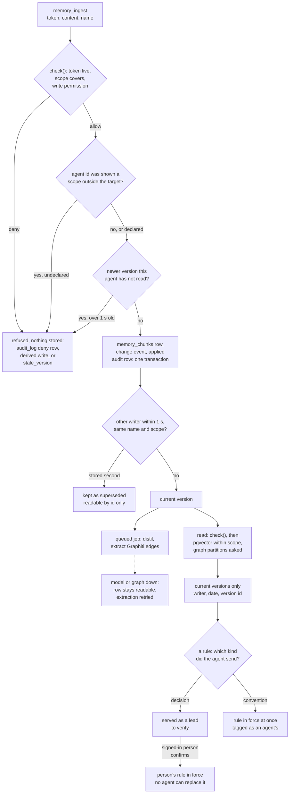

## 1. Executive Summary

Willder is a multi-tenant memory service that several agents and people read and
write at once. Facts are versioned rows in Postgres with pgvector, mirrored as
temporal edges in Neo4j through [Graphiti](../graphiti/). Agents connect over
MCP, each with its own scoped, expiring token. What is notable is how much of
the shared-memory problem is settled by deterministic code. One audited access
check runs before every store call, a write made from a stale read is refused,
races are settled first-stored-wins, and the database keeps the audit table
append-only. What is weak is where the boundary sits and what
can be seen of its history. Every guarantee is application code over stores
that trust their caller, and the public repository is eight bot commits.

The design philosophy is stated in the contribution guide: *"No model in any
decision path: visibility, relevance, staleness or ordering"*
(`CONTRIBUTING.md`). Models distil and extract on the write side and answer in
the chat route. They do not decide who may read, which version is current, or
whether a claim is settled.

The strongest part is the test suite around negative outcomes. Scope leaks,
superseded versions, deleted facts and erased people are each asserted absent
on named read paths, with a positive control beside the assertion, and the CI
workflow gives those suites the database they need.

The least proven parts are the governance features above the graph. A fact
dispute can be opened and resolved, and resolving it changes no edge. An
agent's decision waits for a person, and an agent's convention does not.

## 2. Mental Model

A memory is a version of a fact: a piece of text filed under an entity name in
one scope, written by a named person, agent or connector. A second write under
the same name is a new fact unless it names the version it replaces. Rules are
a second kind of record, conventions and decisions, served unasked at the start
of each session. Working notes are a third kind, and they expire.

A version is believed when it is stored. There is no candidate tier for facts.
What the system controls is which version is current and how a claim is
labelled when it is served.

- **Replacement.** A write that names `baseVersion` replaces that version if
  it is still current, and is refused with `stale_version:` otherwise
  (`services/memory/fact-update.ts:185-233`).
- **Stale reads.** The server records every version it showed each agent. A
  write with no base is refused when the fact has a newer version its writer
  never read, stored more than one second earlier
  (`services/memory/fact-reads.ts:262-319`).
- **Races.** Two writers of one name in one scope inside one second, neither
  having seen the other: the version stored first stays current and the other
  is kept, marked superseded (`services/memory/conflict.ts:74`, `:338`).
- **Retirement.** A rule leaves service by being superseded once or retired.
  A graph edge leaves when Graphiti ends it. A deleted fact is removed.
- **Status.** A claim's status is computed when it is served. A person's record
  is *verified*. An agent's is *proposed*, *untested*, *failing* or *tested*,
  from what the capture of its own session recorded after the write
  (`services/memory/claim-status.ts:107-136`).

Nothing an agent writes can call itself settled. The file that computes status
says a claim's status comes *"from recorded evidence only, never from its text
or its writer's declared role"* (`services/memory/claim-status.ts:8-9`).

## 3. Architecture

Four processes and two databases make up the engine.

- **Postgres** with `pgvector` and `ltree` holds orgs, the scope tree, grants,
  capability token hashes, `audit_log`, `memory_chunks`, `fact_edges`,
  `change_events`, `conventions`, `working_notes`, briefs and the erasure
  tables (`prisma/schema.prisma`). The 112 migrations create the triggers
  that the audit chain, the change-feed sequence and the erasure re-apply
  flag rest on.
- **Neo4j 5.26** holds Graphiti's entities, edges and episodes. Each scope
  path is one `group_id` (`services/memory/graphiti-store.ts:274`).
- **The memory service** is a FastAPI application that owns Graphiti and
  Neo4j. It embeds with BGE-small-en-v1.5 on the CPU and calls an
  OpenAI-compatible endpoint for extraction when one is configured
  (`memory-service/app/main.py`, `memory-service/requirements.txt`). It pins
  `graphiti-core==0.30.2`.
- **The MCP server** runs as a route of the web app or as a local stdio
  process, registering the same tools either way (`mcp/tools.ts:39-53`).
- **The web app** is Next.js with Clerk for sign-in. It carries the grant and
  token screens, the audit view, the confirm page and the delete routes.
- **Inngest** runs the queued jobs.

The Node side reaches memory through `GuardedMemoryStore`, which wraps a
hybrid store over the pgvector and Graphiti clients
(`services/memory/guarded-store.ts:567-594`, `services/memory/hybrid-store.ts:201`).

### Deployment and ergonomics

Self-hosting means Docker Compose with three containers, Node, a Prisma
migration and a token minted from the command line (`docker-compose.yml`,
`README.md`). Postgres and the memory service bind to `127.0.0.1` and Neo4j is
not published. Reads need no model key. Writes are stored and readable without
one, and only graph extraction is skipped. The embedding model is about 130 MB
and loads offline.

The web app is optional and needs a Clerk instance. Without it there is no
confirm page and no fact-delete route, since neither exists as an MCP tool or
a self-host script. `npm run selfhost:export` writes one JSON Lines file in a
documented format (`docs/export-format.md`). The store is repairable with SQL
and Cypher, and anyone holding either database credential reads every tenant.

## 4. Essential Implementation Paths

- **Access decision.** `check` → `evaluate` → `recordAudit`
  (`services/access/check.ts:565-585`, `:958-980`, `:1058-1083`). Capability
  lookup with live grant re-derivation is `loadMatchingCapabilities`
  (`:706-835`).
- **Write.** `handleMemoryIngest` → `ingestMemory` → `storeForReading` →
  `PgvectorMemoryStore.ingestOnce` (`mcp/tools/memory-ingest.ts:122-200`,
  `lib/inngest/memory-ingest.ts:736-835`, `:481-505`,
  `services/memory/pgvector-store.ts:756-822`).
- **Stale and conflicting writes.** `assertBaseVersionCurrent`,
  `assertNoUnreadVersion`, `recordSupersession`
  (`services/memory/fact-update.ts:185`, `services/memory/fact-reads.ts:262`,
  `services/memory/conflict.ts:338`).
- **Extraction.** `runMemoryIngest` → `distillFacts` → `extractIntoGraph` →
  the memory service's `/ingest` (`lib/inngest/memory-ingest.ts:328-360`,
  `:146-239`, `:362-432`; `memory-service/app/main.py:474-555`).
- **Retrieval.** `memory_query` → `GuardedMemoryStore.retrieve` →
  `HybridMemoryStore.retrieve` → `PgvectorMemoryStore.retrieve` and
  `GraphitiMemoryStore.retrieve` → `search_edges`
  (`mcp/tools/memory-query.ts:76`, `services/memory/guarded-store.ts:596-888`,
  `services/memory/hybrid-store.ts:256`,
  `services/memory/pgvector-store.ts:907-1125`,
  `services/memory/graphiti-store.ts:423-460`,
  `memory-service/app/graph/search.py:48-98`).
- **Context injection.** `readServableTaskStart` and the block builder
  (`services/memory/task-start.ts:1397`, `mcp/task-start-notice.ts`); change
  notices (`mcp/change-notices.ts`, `services/memory/change-feed.ts:134`).
- **Rules.** `recordAuthorizedConvention`, `confirmConvention`,
  `retireConvention` (`services/memory/conventions.ts:149-176`, `:406-437`,
  `:330-362`).
- **Deletion.** `PATCH`/`DELETE /api/memory/facts/[id]` →
  `GuardedMemoryStore.removeFact` (`app/api/memory/facts/[id]/route.ts:27`,
  `:148`; `services/memory/guarded-store.ts:1212-1294`).
- **Erasure.** `runPersonErasure` → `recordSuppressions`; `reapplyErasures`
  (`services/memory/person-erasure.ts:273-290`,
  `services/memory/erasure-suppression.ts:552`,
  `services/memory/erasure-reapply.ts:104`).
- **Cross-scope writes.** `authorizeDerivedWrite`
  (`mcp/derived-write.ts:49`, `services/access/derived-writes.ts`).
- **Audit.** `writeAuditRow`, `recordAppliedChange`, `recordWriteEffect`
  (`services/access/audit-row.ts:36-52`, `services/access/check.ts:1106`,
  `:1409`); the chain verifier (`services/access/audit-chain.ts`,
  `scripts/verify-audit-chain.ts`).

## 5. Memory Data Model

`MemoryChunk` is the version (`prisma/schema.prisma:1697-1790`). Its fields
are `content`, `entityName`, `scopePath`, `actorType`, `actorId`, `sourceId`
or `uploadId`, `contentKey`, `factVersion`, `baseVersionId`, `role`,
`embedding`, `occurredAt`, `receivedAt`, `createdAt` and `storedSeq`.
`entityName` and scope together are the contention key. `factVersion` separates
a row the fact path stored from a file passage or connector item that shares
the name.

`FactEdge` records relations between records by id: `supersedes`,
`derivedFrom`, `dependsOn`, `ownedBy`, `deliveredTo`, `causedBy`
(`prisma/schema.prisma:2412-2449`). Whether a version is current is the absence
of an incoming `supersedes` edge, and no other place records it
(`services/memory/superseded-facts.ts:11-13`).

`Convention` is a rule: kind, subject, text, scope, writer, a unique
`supersedesId`, `supersededById` for a version that lost a race, and
`retiredAt` (`prisma/schema.prisma:2118-2148`). A rule is never edited.

`ChangeEvent` is one row per governed write, inserted in the write's own
transaction with a gapless per-org `seq`, the writer, the entry point, a
200-character summary, the authorizing audit row, and the task and session the
writer's connection named (`prisma/schema.prisma:1969-2038`). `AgentCursor`
holds each agent's position.

Three tables record what an agent has been shown. `FactVersionRead` holds one
row per agent and version, read whole or only sighted. `SessionScopeRead`
holds the scopes whose content the agent id was ever served. Both drive write
refusals (`prisma/schema.prisma:1889-1930`).

Time is carried four ways on a chunk: stated event time, receipt on the
database clock, creation, and insertion order. Graph edges carry Graphiti's
`valid_at`, `invalid_at`, `created_at` and `expired_at`.

Scope is an `ltree` path rooted at `org_<orgId>`. Rows written by paths that
name no scope are untagged, and only a caller whose checked scope covers the
org root reads them (`services/memory/pgvector-store.ts:386-398`).

## 6. Retrieval Mechanics

A read runs `check()` first and nothing is searched on a denial. The account
tier then decides which stores answer, the token budget and a per-call latency
ceiling: 2,000, 6,000 or 16,000 tokens (`services/memory/account-tiers.ts:49-53`).
The Starter tier allows neither the graph nor the vector store, so its memory
search returns no facts, which the README lists under Limits.

The vector store takes the nearest rows by their own embedding and the nearest
passages, inside one visibility predicate: tenant, non-null embedding, no
incoming `supersedes` edge, and scope containment
(`services/memory/pgvector-store.ts:400-415`). A query quoting four or more
words also runs a trigram match, and its ranking is fused by reciprocal rank
with `k = 60` (`services/memory/text-match-fusion.ts:93`). Rows an erasure
suppresses are excluded and the search runs again, at most three rounds
(`services/memory/pgvector-store.ts:313`).

The graph leg is Graphiti's edge search, BM25 and cosine fused by reciprocal
rank, with a filter that drops ended edges
(`memory-service/app/graph/search.py:48-98`). Graphiti matches `group_id`
exactly, so the guard asks three legs: the checked scope, the bare org
partition when the scope covers the org root, and every registered descendant
scope in one call (`services/memory/guarded-store.ts:696-773`). At most 1,000
descendants are searched and the rest are named in the reply
(`services/access/check.ts:987`).

The merge deduplicates by normalized text and by the chunk ids stamped on
graph episodes. It fills the page by writer tier, person before agent before
extraction, with a small floor per tier and reserved slots for close vector
hits. It then cuts from the bottom to the token budget
(`services/memory/guarded-store.ts:814-830`). A retired version that ranked is
replaced by its current successor (`services/memory/current-versions.ts`).

Delivery is tool-mediated for search and automatic for context. The first tool
result of a session carries a task-start block with a 600-token budget for its
records (`mcp/task-start-notice.ts:169`), and later results carry change
notices. Ranking inside the block is lexical, by term rarity, with no
embedding (`services/memory/task-start.ts`).

Each fact is returned with its writer, date and version id. A read reports the
stores that failed and the scopes it did not search, so a partial answer is
not presented as complete (`services/memory/guarded-store.ts:860-877`).

## 7. Write Mechanics

Every writer calls `ingestMemory`. For an agent's write the row is embedded
and inserted in the request, in one transaction with its change event, its
conflict outcome and its `memory.write.applied` audit row
(`lib/inngest/memory-ingest.ts:481-505`). The reply carries the version id.
The embedding call has a 15-second ceiling, after which the write is left to
the queued job (`:453`).

The queued job distils and extracts. Content from a person or from
`memory_ingest` longer than 15 characters goes to a model that returns facts,
typed entities, attribute facts and decisions
(`lib/inngest/memory-ingest.ts:59-63`, `:146-239`). Each derived sentence
becomes a Graphiti episode. When extraction yields no relation, the memory
service writes a verbatim `Fact` node by raw Cypher so the text stays visible
in the graph (`memory-service/app/graph/visibility.py:198-262`). A failed
extraction leaves the row readable and queues a retry
(`services/memory/graph-extraction-retry.ts`).

Deduplication is a content key over org, scope, name, normalized content and
base version, with a unique index. A retried identical ingest keeps one row,
and an `idempotencyKey` replays the first reply
(`services/memory/ingest-key.ts`).

Correction by a person is `PATCH /api/memory/facts/[id]`: the old version is
removed under a `memory.delete` decision, the corrected text is ingested, and
the feed reports a supersede. An agent corrects by writing with `baseVersion`.
MCP has no delete tool.

A write can be refused for a reason unrelated to its own scope. If the agent id
was ever served content from a scope outside the target's subtree, the write
is refused unless it lists those scopes in `intentionalShareFrom`. A declared
share writes a `memory.write.declassified` audit row and a `derivedFrom` edge,
and announces itself to the source scope's readers
(`services/access/derived-writes.ts`, `mcp/derived-write.ts:49`). The record
never expires; a 30-minute idle expiry was removed on 24 October 2026 because
an agent's context outlives it.

Connector and upload writes pass the erasure list first. A connected source
takes the access of the scope it lands in, and connecting one where more
readers would see it requires a recorded acknowledgement
(`services/access/source-widening.ts`).

### Operational cost

An agent's write blocks on one local embedding and one Postgres transaction.
`docs/architecture.md` reports a write-to-read median of 538 ms for one writer
on the hosted service, from a harness that is not in the repository. Extraction is
deferred: one model call to distil and Graphiti's own calls per episode. No
pass rewrites the store. A read is two or three store calls and one to three
audit inserts; each audit insert takes a row lock on the org's chain head, so
audit writes for one org are serial
(`prisma/migrations/20261006160000_audit_log_tamper_evident/migration.sql:120-143`).
The task-start block and notices ride on tool results, not on the system
prompt, so they do not disturb a cached prefix.

## 8. Agent Integration

The MCP server registers thirteen tools: `memory_query`, `memory_entity`,
`memory_version`, `memory_ingest`, `fact_link_source`, `get_my_brief`,
`memory_stale`, `memory_changes`, `memory_note`, three contact tools and
`send_feedback` (`mcp/tools.ts:39-53`). A connection that sends
`X-Willder-Tools: coding` lists four of them, to save schema tokens
(`mcp/tool-set.ts:22`).

The agent's authority is read and write inside its token's scope. It can
replace versions it has read, record rules, post notes and link a fact to a
source. It cannot delete a fact, confirm a rule, resolve a dispute, retire a
person's rule, export, or mint or extend a token. Only a person issues a
token, for seven days by default and at most ninety, and an admin token lasts
two hours (`services/access/issue-capability.ts:30-33`, `:87-95`).

Server instructions tell the agent to record a rule only when the person
stated it, to prefer `decision` when unsure, and to show the person the confirm
link (`mcp/willder-server.ts:23-30`). That is prompt text. The enforced half is
that the link opens a route an agent's token cannot use.

Claude Code hooks under `cli/hooks/` surface change notices while the agent is
busy, send the files a claim touches, and capture session state: the files
changed and the last test run, redacted. That capture is the evidence the claim
status reads. A session names its task with a `willder/task` hint or header,
and later sessions of the same task are served what earlier ones wrote.

The documentation carries a connection page per client under `docs/connect/`.
OAuth for clients that cannot send a bearer header is built and off by default.

## 9. Reliability, Safety, and Trust

**Scope is enforced twice on the Postgres side and once on the graph side.**
`check()` decides, and the SQL repeats the containment. The graph has no
containment, so the guard computes the partition list and verifies each
returned fact names a partition it asked for
(`services/memory/guarded-store.ts:766-773`). This is the `scope_enforced`
mark. The README names what it does not cover: no row-level security, a
memory-service key that reads any `group_id`, and graph writes from a few
routes and jobs that go around the guarded store.

**The audit records mutations and cannot be edited by the application.** A
write produces an authorization row, an applied row and, for destructive
calls, an effect row naming the executed partition. Triggers refuse update,
delete and truncate, and a per-org hash chain makes a dropped trigger
detectable after the fact. This is the `audit_log` mark. The row holds ids and
scopes, not content.

**Query text is stored in that table.** A read's audit target is
`query:<the query text>` (`services/memory/guarded-store.ts:603-607`). Person
erasure writes audit rows and reads them for its counts; nothing in
`services/memory/person-erasure*.ts` or `erasure-*.ts` changes one, and the
trigger would refuse it. A name typed into a search before an erasure stays in
`audit_log` until the org is deleted, and an admin's export writes audit rows
as stored (`docs/export-format.md`).

**Erasure leaves a value-keyed list.** The digests stop a connector re-sync,
a late upload extraction and an import from writing an erased person back, and
hide rows a restored backup returned until a re-apply removes them. While a
re-apply is due, `check()` refuses everything in the org except `access.manage`
(`services/access/check.ts:662-672`). This is the `tombstone` mark. A deleted
fact has no such record: an agent may write the same sentence again.

**An agent's decision waits for a person; its convention does not.**
`ruleIsSettled` returns true for any rule whose kind is not `decision`
(`services/memory/claim-status.ts:33-35`). The server comment says a
convention *"is served at once, marked as recorded by an agent"*
(`mcp/willder-server.ts:8-9`). The `kind` is the agent's own tool argument. On
the decision path the confirming actor is verified from a session and no tool
reaches the verb, but the argument that selects that path is the producer's.
An agent that wants a rule in force without a person has a documented way to
get one, with a tag, so `human_review` is withheld.

**Status is computed, not stored.** The five-value claim status and the
settled-or-lead split are functions of the create event's writer and of
session captures, evaluated per read. No column holds them and no query can
select by them. Stored lifecycle is supersession edges and a retirement
timestamp, both keyed on the record. `trust_state` is withheld.

**Dispute resolution is a record with no effect.** Disputes are opened by a
brief correction, an architecture run and a staleness scan. A scope admin
resolves one through a signed-in route, and the route's header says the graph
side *"is NOT wired here yet"* (`app/api/facts/disputes/[id]/resolve/route.ts:1-5`).
No retrieval file reads `fact_disputes`, and the `rejected` status has no
writer.

**Lost updates are refused without client cooperation.** The server-side read
record means a client that never sends `baseVersion` is still protected. A
sighting in a change notice does not count as a read, so an agent cannot write
past a version it saw only as a truncated line.

**Races are settled by storage order.** The winner is whichever row was
inserted first, which is deterministic and unrelated to which statement is
correct. The task-start block serves conflicting versions together and asks
the person (`services/memory/served-conflicts.ts`).

**Event time reaches chunks and not the graph for agent writes.**
`withoutOccurredAt` strips the stated date before every graph write, so that
*"a stated date never decides which of two contradicting edges the graph
retires"* (`lib/inngest/memory-ingest.ts:509-518`). This is the `bitemporal`
mark with its limit: the graph's validity is real for connector content and
server-clock for agent content.

**Injection.** Task-start lines name their source, and leads are headed
*"Leads to verify"* (`mcp/task-start-headings.ts:91`). Connector content enters
at extraction tier, which ranks last. Nothing scans content for instructions.

## 10. Tests, Evals, and Benchmarks

I ran nothing. I counted 1,038 Vitest files and 46 pytest files with
`git ls-files`, and 8,337 line-leading `it(` or `test(` call sites and 398
`def test_` functions with `git grep -c`. Of the Vitest files, 420 carry
`realdb` in the name and 441 contain a `skipIf`.

The real-Postgres suites open with `describe.skipIf(!QA_URL)`. The CI workflow
sets `QA_DATABASE_URL` on each of four shards against a `pgvector/pgvector:pg16`
service, builds a template database from the migrations, and gives each worker
a copy (`.github/workflows/ci.yml:164-171`, `tests/setup/test-databases.ts`).
A final job passes only if the shards together ran every file `vitest list`
names. The workflow's own comment records that these suites once skipped in CI
without notice. A local `npm test` without the variable is green having
skipped them, which the contribution guide says.

A separate job starts the memory service against a disposable Neo4j and runs
two graph-delete suites, failing unless every case passed and none skipped
(`.github/workflows/ci.yml:369-378`). The Python suite runs under `pytest` in
its own job; twenty of its files are named as integration tests, and the ones
I opened skip without a Neo4j URI variable.

The tests I read can fail. The containment suite pairs reachable and
unreachable cases through the store's real SQL. The conflict suite asserts
`toContain` for the winner beside `not.toContain` for the loser on each read
path. The erasure suite writes the message once before the erasure as a
control. The leak evals run the real guard over a fixture store and add a case
that pins the SQL the real vector store sends.

The static gates are part of the evidence. One ESLint rule fails any
memory-table query outside `services/access` and `services/memory`, and another
allows a single audit writer. CI also runs a dead-code gate, a migration drift
check, and a script that fails when the code reads a credential the README's
bypass table omits.

The README's latency and deletion figures were measured on the hosted service
by a harness that, in its words, *"is not in this repository"*. No retrieval
quality benchmark is claimed and none is committed. No paper accompanies the
project.

The public history cannot show how any of this was arrived at. The first
commit, dated 29 October 2026, adds 2,022 files whose migrations run from
8 June 2026. The CI workflow fetches full history for a `deploy-identity.test.ts`
that is not in the tree, and code comments cite design documents and tracker
ids that are absent.

## 11. For Your Own Build

### Steal

- **Record what each agent was shown, and refuse writes against it.** A
  per-agent table of served versions turns optimistic concurrency into a
  server-side rule that works for clients that send no version.
- **Separate a read from a sighting.** A truncated feed line puts the writer
  under the stale rule without counting as having read the version.
- **Write the authorization, the applied effect and the executed partition as
  three audit rows.** The first proves permission, the second that the write
  landed, the third where.
- **Give every negative assertion a positive twin in the same test.** The
  contribution guide requires a leak test with each new read surface.
- **Track scopes read per agent id and refuse the summarising write.** A
  read in one scope and a write in another are each permitted; only a record
  of what was served sees the flow between them.
- **Publish the list of credentials that bypass the check, and fail the build
  when it drifts.**
- **Keep the suppression list as digests bound to the tenant.** It recognises
  an erased person without holding the name.

### Avoid

- **A review gate selected by the producer's own argument.** If one value of
  an enum waits for a person and another does not, the writer decides.
- **A resolution route ahead of its effect.** A dispute that can be resolved
  while the losing edge stays served reads as governance and is a ledger.
- **User-typed text in an immutable log.** An append-only table needs its
  inputs chosen with deletion in mind.
- **A taint that only the operator can clear.** A permanent per-agent record
  is safe and pushes operators toward minting fresh agent ids, which also
  resets the stale-read record.
- **Two stores with different notions of time.** The stated date on the row
  and the server clock on the graph will disagree for backdated facts.

### Fit

This is memory for a team running several agents against shared business or
project context, where the failure that hurts is one agent reading or
overwriting what it should not. It assumes an operator willing to run
Postgres, Neo4j, a Python service with a local model, a queue and, for people,
a web app with a hosted identity provider. The amount of machinery is
proportionate to multi-tenant use and excessive for one developer and one
agent. A reader who needs the database to enforce isolation should walk away,
because the design places every boundary in application code and says so. A
reader who needs approval before any fact is believed should walk away too:
facts are believed on arrival, and the review that exists covers decisions.

## 12. Open Questions

- What does the private history hold, and which commits does
  `deploy-identity.test.ts` read?
- Is the convention path's lack of confirmation intended, or does a later
  version route agent conventions through the same lead state?
- When is the graph-side effect of a dispute resolution wired, and which edge
  does it end?
- Does any process remove or redact `query:` targets in `audit_log` after a
  person erasure on the hosted service?
- How does graphiti-core 0.30.2 choose `invalid_at` for an agent fact when the
  reference time is the server clock and the text states an older date?
- How often does the 1,000-descendant bound leave scopes unsearched in a
  large org, and do agents act on the `unsearchedScopes` note?
- Do the hosted measurements recompute from an artifact the project could
  publish?

## Appendix: File Index

- **Schema:** `prisma/schema.prisma`, `prisma/migrations/`,
  `docs/willder_database.md`.
- **Access:** `services/access/check.ts`, `scope-containment.ts`,
  `issue-capability.ts`, `derived-writes.ts`, `audit-row.ts`, `audit-chain.ts`,
  `source-widening.ts`; `lib/access-context.ts`.
- **Write path:** `mcp/tools/memory-ingest.ts`, `lib/inngest/memory-ingest.ts`,
  `services/memory/pgvector-store.ts`, `fact-update.ts`, `fact-reads.ts`,
  `conflict.ts`, `edges.ts`, `ingest-key.ts`, `graph-extraction-retry.ts`.
- **Retrieval:** `services/memory/guarded-store.ts`, `hybrid-store.ts`,
  `graphiti-store.ts`, `account-tiers.ts`, `routing-policy.ts`,
  `text-match-fusion.ts`, `current-versions.ts`, `superseded-facts.ts`;
  `memory-service/app/graph/search.py`.
- **Context assembly:** `services/memory/task-start.ts`,
  `mcp/task-start-notice.ts`, `mcp/change-notices.ts`,
  `services/memory/change-feed.ts`, `claim-status.ts`, `session-state.ts`,
  `working-notes.ts`.
- **Rules and disputes:** `services/memory/conventions.ts`, `rule-copies.ts`,
  `fact-disputes.ts`, `scope-dispute-scan.ts`, `fact-provenance.ts`;
  `app/api/memory/conventions/[id]/confirm/route.ts`,
  `app/api/facts/disputes/[id]/resolve/route.ts`.
- **Deletion and erasure:** `app/api/memory/facts/[id]/route.ts`,
  `services/memory/person-erasure.ts`, `erasure-suppression.ts`,
  `erasure-reapply.ts`, `org-export.ts`, `org-import.ts`;
  `memory-service/app/graph/erasure.py`, `retirement.py`.
- **Graph service:** `memory-service/app/main.py`, `graphiti_client.py`,
  `graph/visibility.py`, `graph/entities.py`, `graph/facts.py`.
- **MCP and CLI:** `mcp/tools.ts`, `mcp/tools/`, `mcp/willder-server.ts`,
  `mcp/tool-set.ts`, `mcp/derived-write.ts`, `cli/hooks/`.
- **Tests and gates:** `services/memory/access-leakage-eval.test.ts`,
  `pgvector-store.scope-containment.realdb.test.ts`,
  `person-erasure-aftermath.realdb.test.ts`,
  `mcp/conflict-every-read-path.realdb.test.ts`,
  `mcp/rule-confirmation.realdb.test.ts`, `eslint/`, `.github/workflows/ci.yml`.
- **Documentation:** `README.md`, `docs/architecture.md`, `mcp/README.md`,
  `docs/consent-deletion-suite.md`, `docs/export-format.md`, `CONTRIBUTING.md`,
  `LICENSE`.

### Recorded searches

Run with `/usr/bin/git grep` from the root of a checkout at
`48794d116e95a6843a9ea812b20c65b6c692299d`.

- `git grep -n -i -E 'CREATE POLICY|ENABLE ROW LEVEL SECURITY' -- prisma` — no match. Control: `git grep -c -i -E 'CREATE TRIGGER' -- prisma/migrations/20261006160000_audit_log_tamper_evident/migration.sql` returns 5.
- `git grep -n -i -E 'confirmConvention|approve|resolveFactDispute|removeFact\(|deleteRetiredConvention|retireConvention' -- mcp ':!*.test.ts' ':!*.testsupport.ts'` — two hits, both prose: `mcp/README.md:368` saying the draft approval tools are not registered, and the comment at `mcp/willder-server.ts:8`. No handler.
- `git grep -n -E 'confirmConvention\(' -- ':!*.test.ts'` — the definition and `app/api/memory/conventions/[id]/confirm/route.ts:19`.
- `git grep -l -E 'resolveCapability\(' -- app lib mcp scripts services ':!*.test.ts'` — `app/api/changes/notice/route.ts`, `app/api/changes/route.ts`, `app/api/mcp/route.ts`, `mcp/server.ts`, `mcp/tools/send-feedback.ts` and two files under `services/access`. No memory delete, confirm or dispute route.
- `git grep -n -E 'confirmConvention|removeFact\(|resolveFactDispute|retireConvention|removeEntity\(' -- services/agents lib app/api/memory/chat ':!*.test.ts'` — no match; the product's own agents hold `memory_read` and `memory_write` only (`services/agents/tools.ts:89`, `:156`).
- `git grep -n -E 'ruleIsSettled|claimStatusOf\(' -- ':!*.test.ts'` — the definitions, `mcp/task-start-notice.ts:1159` and `:1360`, and `services/memory/rule-copies.ts:132`. No SQL reads a status.
- `git grep -n -w 'rejected' -- services/memory/fact-disputes.ts services/memory/scope-dispute-scan.ts app/api/facts services/agents/architecture-run.ts 'app/api/briefs/[id]/correct/route.ts'` — no match. Control: `git grep -c -w 'disputed' -- services/memory/fact-disputes.ts` returns 6.
- `git grep -n -E 'factDispute|fact_disputes' -- services/memory/guarded-store.ts services/memory/pgvector-store.ts services/memory/graphiti-store.ts services/memory/hybrid-store.ts services/memory/task-start.ts mcp/tools` — no match. Control: `git grep -c -E 'fact_edges|factEdge' -- services/memory/pgvector-store.ts` returns 2.
- `git grep -n -E 'auditLog\.(update|updateMany|delete|deleteMany|upsert)|(UPDATE|DELETE FROM) "?audit_log' -- ':!*.test.ts' ':!*.testsupport.ts' ':!prisma/migrations'` — no match. Control: `git grep -n -E 'auditLog\.create' -- ':!*.test.ts'` returns `services/access/audit-row.ts:40`.
- `git grep -n -i -E 'audit_log|auditLog' -- 'services/memory/person-erasure*.ts' 'services/memory/erasure-*.ts' ':!*.test.ts'` — three hits in `erasure-accounting.ts`, a client type and two `SELECT`s.
- `git grep -n -E 'loadErasedPersonMatcher|loadErasedContentFilter' -- mcp/tools/memory-ingest.ts lib/inngest/memory-ingest.ts` — no match; an agent's write is not checked against the name digests. The same pattern hits `lib/inngest/connector-text-items.ts:368`.
- `git grep -n -E 'referenceTime' -- ':!*.test.ts' ':!*.testsupport.ts'` — connector readers, the retry job and the graph client; `mcp/tools/memory-ingest.ts` is not among them.
- `git grep -n -E 'removeFact|confirmConvention|DELETE' -- scripts/selfhost-token.ts scripts/selfhost-export.ts scripts/selfhost-smoke.ts scripts/lib/selfhost.ts` — one hit, a comment about revoking a capability at `scripts/lib/selfhost.ts:198`.
- `git ls-files | grep -c 'deploy-identity'` — 0. `git grep -c 'KNOWN_MIGRATION_EDITS' -- .github/workflows/ci.yml` returns 1 and the same pattern outside `.github` returns nothing.
- `git grep -n -i -E 'arxiv|bibtex|CITATION\.cff|doi\.org' -- README.md docs memory-service/README.md mcp/README.md` — no match.
- `git ls-files | grep -i -E 'results?/|\.jsonl$|benchmark|locomo|longmemeval'` — no file.
- `git ls-files | grep -i -E '(^|/)(licen[sc]e|copying|notice|third.party)'` — `LICENSE` only among licence files; `package.json:5` says MIT; no `.gitattributes` is tracked.

## History

**2026-11-14** — [`48794d116e95a6843a9ea812b20c65b6c692299d`](https://github.com/willderai/willder-core/commit/48794d116e95a6843a9ea812b20c65b6c692299d) — first reading, at the head of `main`, dated 4 November 2026. Marks: `tombstone` on the erasure suppression list, `bitemporal` on Graphiti edges and chunk event time, `scope_enforced` on the check and its predicates, `audit_log` on the trigger-guarded table, `negative_eval` on the real-Postgres leak, conflict and deletion suites. `trust_state` withheld: claim status is computed per read. `human_review` withheld: a decision waits for a person, and the agent's own `kind` argument decides whether its rule is a decision. LICENSE read in full: MIT, matching `package.json`, no rider. Screened before reading: no auto-run surface, two build-time execution points, four unpinned dependency surfaces. Nothing was installed or run. graphiti-core, a pinned dependency, was not opened.
