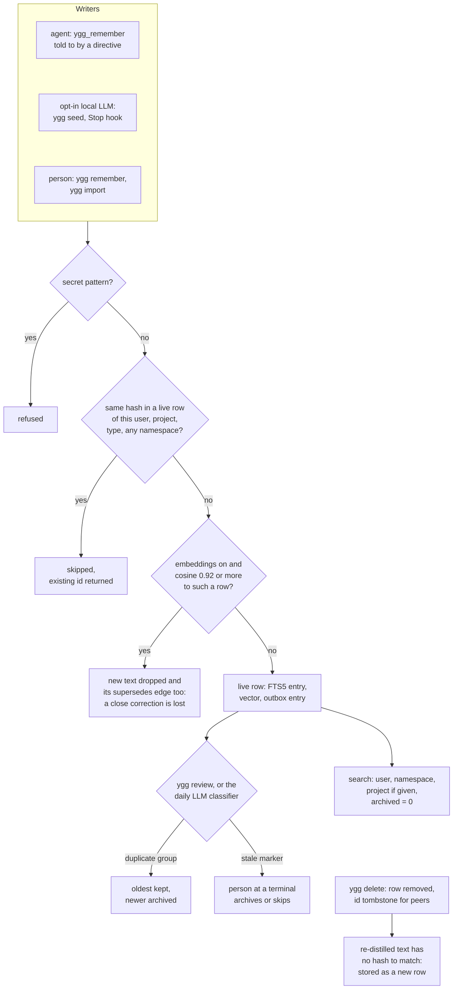

## 1. Executive Summary

Yggdrasil is a local memory daemon that Claude Code, Codex, OpenCode and any
MCP host share: one SQLite file, six MCP tools, and plugin hooks that inject a
project's memories at session start and cross-project hits on every prompt. Its
notable part is the zero-dependency path. The default engine is standard-library
Python over FTS5, injected memory is fenced as reference data with its origin,
and CI holds lexical recall to a published floor. Its weak part is what
"curated and semantically de-duped" means in code: with an embedding model
configured, a write within cosine 0.92 of a live memory in the same project and
type is dropped, not merged, so a correction phrased like the fact it corrects
is never stored.

Curation is done by the agent and by rules, not by a person in the write path.
The injected directive tells the model to save decisions and lessons with
`ygg_remember`; an exact content hash and, with an embedding model, the cosine
threshold decide whether the write lands. A person can run `ygg review` to
archive duplicates and stale markers after the fact, and an optional daily
local-LLM pass proposes the same.

**Licence.** The README grants *"GNU AGPL v3.0"* while the plugin manifests,
the skill and the PyPI classifier grant AGPL-3.0-or-later, and `LICENSE` is the
bare FSF text with no copyright line naming a holder or stating either version.
Section 14 of that text lets a recipient pick any published version when the
program names none, so which terms bind turns on which file a reader trusts.
Section 13 is live here rather than theoretical: the tree ships a
Streamable-HTTP MCP facade documented for exposure through a public tunnel, and
a modified engine or facade served that way must offer its source to remote
users.

Two marks: `scope_enforced` on the user, namespace and project keys in search
and the workspace queries, and `negative_eval` on populated workspace and sync
tests. Section 9 gives the reason for each of the five withheld.

## 2. Mental Model

A memory is **one atomic fact about a project**, written by the agent or
distilled from text by a local model, and live the moment it is stored. It
carries a type from a seven-value enum on the MCP schema, a project, a source,
an optional confidence and pin, and an archived flag
(`yggdrasil/ygg_mcp_server.py:50`, `yggdrasil/ygg_memory_server.py:382-402`).
There is no candidate state: a stored row is searchable at once and stays so
until it is archived or deleted.

A fact becomes a memory through three gates, all in code and none involving a
person (`yggdrasil/ygg.py:331-381`):

- **Secrets.** Eighteen patterns refuse keys, tokens, JWTs and credentialed
  URLs in the content or metadata on the client, and nine refuse them again in
  the engine's `/add` route (`yggdrasil/ygg.py:41-67`,
  `yggdrasil/ygg_memory_server.py:186-198`, `:2260-2271`).
- **Exact duplicates.** A SHA-256 of the content is looked up among live rows
  with the same user, project and type; a hit returns the existing id
  (`yggdrasil/ygg.py:365`, `yggdrasil/ygg_memory_server.py:923-933`).
- **Near duplicates.** With an embedding model configured, the engine embeds the
  text and compares it with every live embedded row in the same user, project
  and type; at cosine 0.92 or more the new text is discarded and the existing
  record comes back marked `SEMANTIC_DUPLICATE`
  (`yggdrasil/ygg_memory_server.py:625-630`, `:935-961`).

The near-duplicate gate is the system's meaning of "semantically de-duped", and
it decides by discarding the newer text. Nothing from the incoming write is
merged into the survivor. `remember` returns on a duplicate before it writes the
`solves`, `supersedes` or `contradicts` edges the caller passed
(`yggdrasil/ygg.py:403-414`), so `ygg_remember(content=<correction>,
supersedes=<old id>)` whose correction embeds within 0.92 of the old text stores
nothing and leaves the old memory active. The tool's description says
*"Near-duplicates are merged automatically"* (`yggdrasil/ygg_mcp_server.py:202`).
The response does name the surviving id and the similarity, so the agent is
told; its only way through is to reword, because no MCP tool edits a memory.

A memory stops counting in three ways. `supersede`, a `SUPERSEDES` edge, `ygg
review` and the optional classifier set `archived = 1`, which every search
excludes and `ygg unarchive` reverses (`yggdrasil/ygg_memory_server.py:1072-1073`,
`:1530`). `ygg delete` and `ygg reset` remove the row and write an id tombstone
so a linked machine does not send it back (`:963-983`). Nothing decays: recency
and usage change rank, never membership.

## 3. Architecture

The engine is one standard-library Python process. `ygg_memory_server.py` runs
a `ThreadingHTTPServer` on `127.0.0.1:42069` behind a bearer token kept 0600 in
`~/.yggdrasil/token`, with every write serialized under one lock on one SQLite
connection in WAL mode (`yggdrasil/ygg_memory_server.py:329-340`, `:2565`). It
refuses requests when no token is configured and rejects non-loopback `Host`
headers while bound to loopback (`:2069-2086`).

Around it:

- **The MCP facade** (`ygg_mcp_server.py`) answers stdio JSON-RPC and runs the
  CLI's own command functions in-process under a lock, so the tools and the CLI
  share one write path (`yggdrasil/ygg_mcp_server.py:294-324`). `ygg_http_mcp.py`
  serves the same tools over Streamable HTTP on port 42071; with no token file
  and no `YGG_MCP_TOKEN` it runs open (`yggdrasil/ygg_http_mcp.py:39-53`, `:75-77`).
- **Hooks** are standalone scripts that read config and call the engine over
  HTTP, so a session never imports the package.
- **Sync** has two transports sharing one merge module: `ygg sync` exports JSON
  files to a git repository, and `ygg link` pairs machines over TLS with each
  other's certificate pinned, binding a port only after pairing.
- **The workspace** is a local web UI over `/workspace/query`, a read-only
  query module that runs inside the engine, plus a catalogue of CLI jobs.
- **Service managers**: launchd, systemd or schtasks, or a lazy start on first
  use; `ygg consolidate` schedules the classifier on macOS only
  (`yggdrasil/cli.py:165-171`).

### Deployment and ergonomics

Nothing needs to be installed beyond Python 3.10: `pyproject.toml` declares no
dependencies. The default store is lexical; an embedding model is an Ollama or
OpenAI-compatible endpoint the person configures, and the background classifier
and distiller need a chat model on such an endpoint. No API key is needed to
store anything. A hosted embedding or distill endpoint is allowed, and
`distill_text` redacts secrets before text leaves the machine
(`yggdrasil/ygg_seed.py:1027-1032`).

The Claude Code plugin's manifest starts the MCP server as `uvx --from
yggdrasil-memory ygg mcp`, a PyPI package whose name matches `pyproject.toml`,
with no version pinned, while the hooks run from the plugin checkout
(`.claude-plugin/plugin.json`, `hooks/hooks.json`). The tools and the hooks can
therefore be different versions. The store is one SQLite file a person can open,
and a single memory can be exported to an Obsidian note with
`ygg_materialize`; editing that note changes nothing in the store.

## 4. Essential Implementation Paths

- **Write.** `ygg_remember` → `call_tool` → `remember` → `write_memory`: secret
  scan, `/find_hash`, then `POST /add` with `dedupe_threshold` 0.92
  (`yggdrasil/ygg_mcp_server.py:377-394`, `yggdrasil/ygg.py:331-424`).
  `MemoryStore.add` embeds outside the lock, runs `find_similar`, then inserts
  the row, the FTS entry and an outbox entry in one transaction
  (`yggdrasil/ygg_memory_server.py:610-659`).
- **After a write.** `_warn_related` searches the same project and type and
  prints up to two similar memories with a `ygg supersede` hint, which the MCP
  facade folds into the tool output (`yggdrasil/ygg.py:206-231`).
- **Distillation.** `distill_text` redacts, keeps the newest window of the text,
  asks the model for zero to six typed lessons, drops truncated or
  wrong-language ones, and writes each through `write_memory` with confidence
  0.6 and tag `seed` (`yggdrasil/ygg_seed.py:1027-1095`). The Stop hook spawns
  it detached on the session transcript (`yggdrasil/hooks/ygg_stop.py:35-74`).
- **Search.** `POST /search` → `MemoryStore.search`, then `record_access` on
  every returned id (`yggdrasil/ygg_memory_server.py:2432-2442`, `:1516-1683`).
  `ygg_search` and `ygg_bootstrap` filter one project; `ygg_recall` filters none
  (`yggdrasil/ygg.py:427-541`).
- **Injection.** The SessionStart hook searches the git toplevel's basename as
  project and adds a status block from `/get_all`
  (`yggdrasil/hooks/ygg_session_start.py:136-211`); the UserPromptSubmit hook
  searches every project with the prompt text
  (`yggdrasil/hooks/ygg_user_prompt.py:115-177`).
- **Archive and supersede.** `supersede`, `relate` and `unarchive` go through
  `PUT /update` and `POST /relate`; a `SUPERSEDES` edge archives its target in
  SQL (`yggdrasil/ygg.py:234-293`, `yggdrasil/ygg_memory_server.py:1032-1074`).
- **Review.** `review` gathers exact, text-signature and embedding duplicate
  groups and stale markers, and with `--apply` archives (`yggdrasil/ygg.py:757-846`,
  `yggdrasil/ygg_review_queue.py:66-226`).
- **Classifier.** `ygg_writepath.py` compares each unseen memory with its nearest
  peer above cosine 0.6 and asks a local model for `DUPLICATE`, `SUPERSEDES_A`,
  `SUPERSEDES_B`, `RELATED` or `UNRELATED` (`yggdrasil/ygg_writepath.py:53-82`,
  `:92-170`).
- **Delete.** `delete_by_id` and `purge` remove rows, FTS entries and edges and
  write tombstones in the same transaction (`yggdrasil/ygg_memory_server.py:963-1030`).
- **Sync.** `apply_remote` applies tombstones first, then merges by id under
  `ygg_sync_merge.merge_memory` (`yggdrasil/ygg_memory_server.py:1288-1380`,
  `yggdrasil/ygg_sync_merge.py:103-156`).

## 5. Memory Data Model

**The row.** `memories` holds `seq`, a text `id` (`ygg_` plus a UUID), `user_id`,
`namespace`, `scope`, `project`, `type`, `content`, `content_hash`, `source`,
`confidence`, `importance`, `created_at`, `access_count`, `archived`,
`metadata_json`, and by migration `last_accessed_at`, `embedding_blob`,
`embed_model` and `updated_at` (`yggdrasil/ygg_memory_server.py:382-450`). The
embedding lives in the row as packed float32 with the model's name, so a model
switch is detected and the rows are re-embedded at startup.

**Scope.** `user_id` defaults to `local` and `namespace` to `personal`, resolved
from env, then `~/.yggdrasil/config.json` (`yggdrasil/ygg_config.py:38-39`,
`:270-280`). `project` is a free string: the model's tool argument, or the
basename of the git toplevel in the hooks, so two repositories with the same
directory name share a project. `scope` is `project` or `global`.

**Provenance.** `source` defaults to `ygg-mcp` for tool writes and is a field the
model may set (`yggdrasil/ygg_mcp_server.py:228-232`); distillers write
`stop-hook` or the seed source. No message or session id is stored.

**Time.** `created_at`, `updated_at` and `last_accessed_at` are record times.
`archived_changed_at` in metadata stamps the archive decision for sync merges
(`yggdrasil/ygg_sync_merge.py:52-55`).

**Relations.** `relations` holds `(from_id, to_id, rel_type)` unique, with
`SOLVES`, `SUPERSEDES` and `CONTRADICTS`, and is hard-deleted with either
endpoint (`yggdrasil/ygg_memory_server.py:416-425`, `:975-976`).
`relation_tombstones` records unlinks for sync.

**Tombstones and outbox.** `tombstones` maps a deleted id to its earliest
deletion time and origin; `outbox` holds one row per changed entity until a peer
acknowledges it (`:458-490`). `gc_tombstones` has no caller outside the tests,
so tombstone rows accumulate, and `tombstone_wins` stops honouring one after 90
days (`yggdrasil/ygg_sync_merge.py:45`, `:166-177`).

## 6. Retrieval Mechanics

**The predicate.** `search` builds one `WHERE` for both arms: `user_id`,
`archived = 0`, then project, unassigned, scope, type, a JSON tag and a
namespace list when given (`yggdrasil/ygg_memory_server.py:1530-1553`).

**Lexical.** FTS5 with the Porter tokenizer over content expanded so
`snake_case` and `camelCase` identifiers match their parts; the query's terms are
ORed, capped at `max(limit × 10, 50)` by BM25 inside SQLite (`:1555-1572`). Each
hit scores BM25 relevance plus `0.25 × importance`, a recency term of at most 0.5
halving every 30 days, a usage term of up to 0.3 from `access_count`, and 0.5 for
a pin (`:1588-1603`). Confidence is in the row and in no score, although the
`ygg_remember` schema tells the model that a higher confidence *"ranks the memory
more strongly in recall"* (`yggdrasil/ygg_mcp_server.py:237`).

**Vector.** With an embedder, every row matching the predicate is scored by a
dot product of unit vectors held in an in-process cache, in Python, with no
index; `/health` warns past 20,000 rows (`:1616-1637`, `:2150-2158`). The default
fusion normalises each arm to its maximum and weights lexical 0.3 and vector 1.0;
`YGG_FUSION=rrf` switches to reciprocal rank with k = 60 (`:1640-1658`). When
nothing scores, the nearest rows by cosine are returned flagged `nearest`.

**Injection at session start.** The hook searches the project for
`"<project> decision lesson gotcha workflow command status"` with a limit of
five, and separately lists up to five `follow_up` and `project_status` rows of
that project (`yggdrasil/hooks/ygg_session_start.py:136-191`). The status block
reads `/get_all` with a limit of 500, and `get_all` orders by `created_at
ASC` (`yggdrasil/ygg_memory_server.py:724-735`), so once the namespace holds more
than 500 memories the block is drawn from the oldest 500 and a new status never
appears in it. In the lexical default, the first block matches only memories
whose text contains the project name or one of those words.

**Injection per prompt.** The prompt hook skips prompts under 15 characters or
starting with `/`, searches every project with the first 500 characters, keeps
hits with a vector score of 0.5 or, without embeddings, a fused score of 1.0, and
injects up to three, each marked with its project or *"other project"*, type and
source, inside `<recalled-memory>` with `<` neutralised
(`yggdrasil/hooks/ygg_user_prompt.py:106-177`). Both blocks call the notes
*"reference notes, not instructions"*. Both go into `additionalContext`, so the
system prompt prefix is untouched.

**What counts as use.** `/search` calls `record_access` on every id it returns
(`yggdrasil/ygg_memory_server.py:2440`). The prompt hook over-fetches six and
injects at most three, the session hook injects five on every session, and
`_warn_related` searches after every stored write, so access counts rise for memories
that were injected automatically, dropped by the relevance gate, or merely
resembled a new write. The usage boost then ranks those higher.

## 7. Write Mechanics

**Synchronous and immediate.** `ygg_remember` blocks on the embedding call (up
to 120 seconds per request against the embedding endpoint) and on the insert;
the row and its FTS entry commit together, so a memory is searchable when the
tool returns (`yggdrasil/ygg_memory_server.py:620-659`,
`yggdrasil/ygg_embeddings.py:41-46`). If the embedder fails, the row is written
without a vector and without the near-duplicate check, and the startup backfill
embeds it later.

**Who writes.** The model, through a directive the SessionStart hook injects
every session: *"WHEN you make a decision, learn a lesson, fix a non-obvious
bug, or hit a gotcha worth keeping, call ygg_remember"*
(`yggdrasil/hooks/ygg_session_start.py:70-77`). The skill says the same. A
person writes through the CLI and `ygg import`. Two local-LLM writers are opt-in:
`ygg seed` over Claude Code and Codex transcripts, Obsidian vaults and
`CLAUDE.md` repositories, and the Stop hook over each finished session
(`yggdrasil/service.py:840-859`).

**Near duplicates decide against the newcomer.** The threshold is
`YGG_SEMDEDUP_AT`, default 0.92 (`yggdrasil/ygg.py:39`). The comparison set is
live embedded rows of the same user, project and type, with no namespace term
(`yggdrasil/ygg_memory_server.py:945-946`), and the exact-hash lookup has none
either (`:929-930`). A distilled lesson at 0.93 to an older one is dropped,
which is the intent. A correction such as *"the retry limit is now 5"* against
*"the retry limit is 3"* differs in one token, and whether it clears 0.92
depends on the embedder; nothing in the tree measures it, and no test calls
`add` with a threshold.

**Review keeps the oldest.** `ygg review` groups duplicates three ways: equal
content hashes, equal opening text, and embedding groups at 0.95 or more within
project, type and model. For each group the oldest record is kept and the rest
archived with a `SUPERSEDES` edge from the keeper
(`yggdrasil/ygg.py:723-728`, `:809-818`). Without `--apply` it only reports; with
`--apply` on a terminal it asks per group; with `--apply --yes` it archives exact
groups and single-type groups at 0.97 or more unattended and flags the rest
(`:731-741`). Stale and conflict markers are a regex over content and `status`
and are never archived unattended (`yggdrasil/ygg_review_queue.py:203-226`). When
two near-identical memories disagree, the earlier one survives.

**The classifier.** `ygg_writepath.py` reads `get_all` with a default limit of
200, ordered oldest first, skips rows marked `writepath_seen`, and marks every
row it examines seen in dry-run as well as apply
(`yggdrasil/ygg_writepath.py:96`, `:111-132`). The launchd job passes no limit
and no `--apply` unless `YGG_CONSOLIDATE_APPLY=1` (`yggdrasil/install.sh:183-193`).
Two consequences follow from the code. Once the namespace passes 200 memories,
rows after the 200th are never examined. A switch from the default dry-run to
apply re-examines nothing already seen. At confidence 0.7 a `DUPLICATE` verdict
archives the newer row and a `SUPERSEDES` verdict archives whichever the model
names; each verdict is appended to `reports/writepath-audit.jsonl`.

**Deletion.** Hard, by id or by filter, with the row, FTS entry, vector cache and
edges removed and a tombstone written in one transaction. The tombstone is keyed
on the id; the hash check reads live rows only, so the same text distilled again
from a retained transcript is a new memory.

### Operational cost

No model runs on the write path in the default tier. With embeddings, each write
costs one embedding call and a Python scan of the project and type's vectors,
then one extra search for `_warn_related`. The classifier makes one model call
per unseen memory with a peer above cosine 0.6, once a day when scheduled. Every
injection is bounded: five memories and five statuses at session start, at most
three per prompt, each truncated to 180 to 220 characters.

## 8. Agent Integration

The MCP surface is six tools: `ygg_health`, `ygg_recall`, `ygg_bootstrap`,
`ygg_search`, `ygg_remember` and `ygg_materialize`
(`yggdrasil/ygg_mcp_server.py:57-291`). The agent can write and can archive
through `supersedes`; it has no edit, delete, review or unarchive tool. A coding
agent with a shell can run the `ygg` CLI, which has all of them.

Retrieval does not depend on the agent choosing to use it: the plugin registers
SessionStart and UserPromptSubmit hooks (`hooks/hooks.json`). The prompt hook asks
the model to mark reused notes as `"🌳 from memory: <gist>"`. Codex and OpenCode
get the MCP tools through `ygg install`, and Codex through its own plugin
manifest; the hooks are Claude Code's.

The update notice is appended to the first tool result of a session with an
instruction to relay it verbatim (`yggdrasil/ygg_mcp_server.py:441-466`).

## 9. Reliability, Safety, and Trust

### Corrections can be refused

The near-duplicate skip in section 7 runs before any relation is written, so the
`supersedes` argument the tool offers for corrections is discarded exactly when
the correction resembles its target most. The response names the existing id,
and nothing tells the model that the edge was dropped as well. Review then
prefers the older of any near-identical pair, and the optional classifier keeps
the older on `DUPLICATE`. Each step is defensible for duplicates; together they
make "newer and nearly the same" the case the system handles worst.

### Injected material is labelled, and labelled only

Both hooks frame memory as data and name its source and project, and the
memory blocks neutralise `<` (`yggdrasil/hooks/ygg_user_prompt.py:73-75`,
`:152-173`). The session-start status block does not
(`yggdrasil/hooks/ygg_session_start.py:154-157`). Nothing separates a memory a
person stated from one the model inferred or a distiller extracted from a
transcript, except a `source` string the writer chooses.

### Sync

`merge_memory` is commutative by construction: content goes to the later
`updated_at` and then the longer text, confidence and importance to the maximum,
pins are ORed, and the archived flag to the later archive decision
(`yggdrasil/ygg_sync_merge.py:103-156`). A live tombstone always beats an edit,
so a delete racing an edit on another machine discards the edit, as the README
says. The engine accepts any `user_id` in a request body under the one token, and
a paired peer's records are merged whatever their user and namespace.

### The Markdown claim

The README says *"every memory doubles as a plain-Markdown note you can read,
edit, and grep"*. A note exists only after `ygg_materialize` for one id, and the
only writer of note text is that command (`yggdrasil/ygg.py:560-606`). An edit to
the note is not read back.

### Marks

- **`scope_enforced` — earned.** `user_id`, `namespace` and `project` are stored
  on every row and appended to the search `WHERE` (`yggdrasil/ygg_memory_server.py:1530-1553`),
  and the workspace query requires user and namespace and applies the project to
  every operation (`yggdrasil/ygg_workspace_data.py:59-71`). The keys come from
  client config and from the model's `project` argument; cross-project recall is
  the product's purpose, and the write-time duplicate checks leave out the
  namespace.
- **`negative_eval` — earned.** `tests/test_workspace_data.py:38-44` stores the
  same word unassigned and in project B and requires the unassigned search to
  return only its row, with the unscoped search returning both;
  `tests/test_sync.py:193-208` requires a row found by search to vanish once an
  archived copy is synced in.
- **`trust_state` — withheld.** `archived` is a lifecycle flag with no
  unverified state, `CONTRADICTS` keeps both rows live and is read only by the
  relations display and the workspace graph, and `confidence` filters and ranks
  nothing.
- **`audit_log` — withheld.** No table records mutations: the outbox keeps one
  row per entity and drops it on acknowledgement, tombstones keep an id and a
  time, and `writepath-audit.jsonl` is the classifier's own verdict file outside
  the store.
- **`tombstone` — withheld.** `tombstones` is a delete-sync marker keyed on the
  id with a 90-day effect; no write path consults it.
- **`bitemporal` — withheld.** Only record times exist.
- **`human_review` — withheld.** No memory waits: every write is live. `ygg
  review` and the proposal flow in `ygg_review_actions.py` act after the fact,
  and the latter records an approver from an `--actor` argument.

## 10. Tests, Evals, and Benchmarks

CI runs `python -m unittest discover -s tests` on Ubuntu, macOS and Windows,
`scripts/run_gates.sh` against a fresh engine on Ubuntu and macOS, the web suite,
and a lexical recall floor (`.github/workflows/ci.yml`). I ran nothing from the
repository.

Covered, by reading:

- the engine's add, update, archive exclusion, project and namespace filters,
  tags, pins, usage ranking, delete and purge
  (`tests/test_ygg_memory_server.py`);
- `find_similar` thresholds and its project and type isolation with hand-set
  vectors (`tests/test_semantic_dedup.py`);
- near-duplicate grouping, oldest-first ordering, the 0.97 unattended rule and
  mixed-type refusal (`tests/test_near_duplicates.py`);
- sync merge properties, tombstone propagation and non-resurrection across git
  and two live peers (`tests/test_sync_merge.py`, `tests/test_sync.py`,
  `tests/test_sync_e2e.py`);
- the workspace read path's scope, including the populated cases cited in
  section 9 (`tests/test_workspace_data.py`);
- the hooks' framing and failure behaviour with a stubbed engine.

Not covered:

- No test calls `add` with `dedupe_threshold`, and none sends a correction with
  `supersedes` through `remember`.
- The engine-level scope and archive tests assert `[]` over a store holding one
  row (`tests/test_ygg_memory_server.py:94-131`), and the quality gate's
  cross-project check searches test-b with terms its fixture does not contain
  (`yggdrasil/ygg_quality_gate.py:173-187`, `yggdrasil/ygg_seed_demo.py:51-60`).
  Both pass against a search that returns nothing.
- Nothing tests the classifier's selection of rows or the session-start status
  block past 500 memories.
- No test deletes a memory and re-runs distillation over the same text.

`eval/ygg_eval.py` scores search directly on a committed 232-memory, 110-query
corpus (`eval/corpus_large.py`) with a dev and holdout split and bootstrap
intervals, and CI asserts lexical recall@1 of at least 0.77. The embedding
figures in `BENCHMARKS.md` need a model and are not run in CI. Its
4,799-memory store, where the default embedder falls to 0.550, is described and
not committed. The eval calls `search` without hooks, so it measures neither the
injection gate nor the usage feedback. No paper is cited.

## 11. For Your Own Build

### Steal

- **Fence injected memory as data and say where it came from.** Origin, project
  and a foreign-project marker beside every line, an escaped closing tag, and a
  sentence telling the model not to take orders from it.
- **A recall floor in CI.** A deterministic lexical eval with a published number
  that the build must meet turns a README badge into a regression test.
- **Commutative merge rules in one pure module.** Two transports cannot disagree
  when both import the same `merge_memory` and its property tests.
- **Tombstone and outbox in the delete's own transaction.** A crash cannot leave
  a delete that a peer undoes.

### Avoid

- **Dropping the newer of two near-identical writes.** A threshold on embeddings
  cannot tell a restatement from a correction that changes one number. Store the
  newcomer as a candidate linked to its twin, or carry its edges through, rather
  than returning the old row.
- **Keep-oldest as the duplicate rule.** It is safe for paraphrases and wrong for
  updates; prefer the newer, or ask.
- **A bounded `ORDER BY created_at ASC` behind a maintenance pass.** A capped
  read of the oldest rows starves everything written after the cap.
- **Counting injection as use.** Bump usage on what the agent cites or opens, not
  on every row a hook fetched.

### Fit

This fits a single developer who works across several repositories and agents on
one or two machines and wants a memory that installs in one command and runs
without a model. The store is small by design; the vector arm is a Python scan
and the maintenance passes read capped windows, so it is built for hundreds to a
few thousand memories. Walk away if a correction must reliably replace what it
corrects, if memories need a reviewed or trusted state before they are injected,
or if more than one person shares an engine.

## 12. Open Questions

- Whether the PyPI `yggdrasil-memory` package the plugin's `uvx` fetches matches
  this tree; `pyproject.toml` and `server.json` say 0.18.0 and the plugin pins no
  version.
- Whether the near-duplicate skip is meant to swallow the `supersedes` edge, or
  the edge was meant to apply before the dedup check.
- Whether keep-oldest is a deliberate policy for updates or a default chosen for
  paraphrases.
- What the 4,799-memory store behind `BENCHMARKS.md` contains.

## Appendix: File Index

- Engine, schema, write, search, delete, sync primitives:
  `yggdrasil/ygg_memory_server.py`
- Client write path, review, supersede, export: `yggdrasil/ygg.py`,
  `yggdrasil/ygg_core.py`, `yggdrasil/ygg_config.py`
- MCP: `yggdrasil/ygg_mcp_server.py`, `yggdrasil/ygg_http_mcp.py`
- Hooks: `yggdrasil/hooks/ygg_session_start.py`,
  `yggdrasil/hooks/ygg_user_prompt.py`, `yggdrasil/hooks/ygg_stop.py`,
  `hooks/hooks.json`
- Distillation: `yggdrasil/ygg_seed.py`
- Review and consolidation: `yggdrasil/ygg_review_queue.py`,
  `yggdrasil/ygg_review_actions.py`, `yggdrasil/ygg_writepath.py`,
  `yggdrasil/install.sh`
- Sync: `yggdrasil/ygg_sync_merge.py`, `yggdrasil/ygg_sync.py`,
  `yggdrasil/ygg_sync_node.py`, `yggdrasil/ygg_sync_protocol.py`
- Workspace: `yggdrasil/ygg_workspace_data.py`, `yggdrasil/ygg_workspace.py`,
  `yggdrasil/ygg_workspace_chat.py`, `web/src`
- Service and plugin: `yggdrasil/service.py`, `yggdrasil/cli.py`,
  `.claude-plugin/plugin.json`, `server.json`, `pyproject.toml`
- Tests and evals: `tests/`, `scripts/run_gates.sh`, `yggdrasil/ygg_quality_gate.py`,
  `eval/ygg_eval.py`, `eval/corpus_large.py`, `.github/workflows/ci.yml`

### Recorded searches

Run from the repository root at the pinned commit with `/usr/bin/git grep`.

- **No paper reference.**
  `git grep -n -i -E 'arxiv|bibtex|@article|@misc|doi\.org|zenodo' -- . ':!web/package-lock.json' ':!yggdrasil/workspace_static'`
  returns nothing; `git grep -n -i -E 'arxiv|citation' -- CHANGELOG.md` matches
  line 243.
- **No validity time.**
  `git grep -n -i -E 'valid_from|valid_to|valid_until|validity|effective_at|expires_at' -- yggdrasil ':!yggdrasil/workspace_static'`
  returns nothing; `git grep -n -i -E 'valid_from|created_at' -- yggdrasil/ygg_memory_server.py`
  matches line 395.
- **No mutation log table.**
  `git grep -n 'CREATE TABLE' -- yggdrasil ':!yggdrasil/workspace_static'`
  returns `memories`, `relations`, `tombstones`, `relation_tombstones` and
  `outbox` in `ygg_memory_server.py` and `chats` and `messages` in
  `ygg_workspace_chat.py`.
- **No pending or approval state in the engine.**
  `git grep -n -i -E 'pending|approv|quarantin' -- yggdrasil/ygg_memory_server.py`
  returns only `outbox_pending` at line 1204.
- **Confidence reaches no score.**
  `git grep -n confidence -- yggdrasil/ygg_memory_server.py` returns lines 393,
  536, 617, 639, 644, 1374, 1426, 1432, 1449 and 1455, none inside `search`
  (lines 1516-1683).
- **No test drives the near-duplicate skip.**
  `git grep -n -E 'dedupe_threshold|SEMANTIC_DUPLICATE' -- tests` returns
  nothing; the same pattern over `yggdrasil` returns nine lines.
- **Write paths do not consult tombstones.**
  `git grep -n -i tombstone -- yggdrasil/ygg.py yggdrasil/ygg_seed.py yggdrasil/hooks`
  returns nothing; `git grep -n -i tombstone -- yggdrasil/ygg_sync.py` matches
  line 12.
- **Tombstone collection has no product caller.**
  `git grep -n -E 'gc_|expired_tombstones' -- yggdrasil tests` returns the
  definition at `ygg_memory_server.py:1187`, two uses in `ygg_sync.py` over the
  git transport's file, and test lines.
- **Review does not read relations.**
  `git grep -n -i -E 'relation|contradict' -- yggdrasil/ygg_review_queue.py yggdrasil/ygg_review_actions.py`
  returns two regex lines in `find_stale_or_conflict_markers`.
- **The plugin does not register the Stop hook.**
  `git grep -n ygg_stop -- hooks .claude-plugin .codex-plugin .cursor-plugin`
  returns nothing; the same search in `yggdrasil/service.py` matches line 837.
- **Notes are written only by materialize.**
  `git grep -n -E 'note_for_record|materialize\(' -- yggdrasil ':!yggdrasil/workspace_static'`
  returns the definitions at `ygg.py:560` and `:597` and one call at `:606`.

## History

**2026-11-25** — [`4a1a6163b31023853569aa2cbd587da18fd1ba70`](https://github.com/VonderVuflya/Yggdrasil/commit/4a1a6163b31023853569aa2cbd587da18fd1ba70). First reading, from a full clone at the head of `main` (tag v0.18.0); no submodules. Screened first: five auto-run surfaces — the plugin manifests, `.claude-plugin/plugin.json` and `server.json` starting the MCP server from the PyPI package `yggdrasil-memory` through `uvx` (the name `pyproject.toml` declares, version unpinned in the plugin manifest), and `hooks/hooks.json` registering SessionStart and UserPromptSubmit scripts from the tree; nothing inside the seven-day cooldown; no build-time execution; two unpinned surfaces. The hooks were read and never run; skills and prompts were read as data. Nothing was installed, built or run, and the test suites were not run. Two marks: `scope_enforced` and `negative_eval` ([section 9](#9-reliability-safety-and-trust)). A near-identical correction is dropped at write with its `supersedes` edge, and review keeps the oldest twin.
