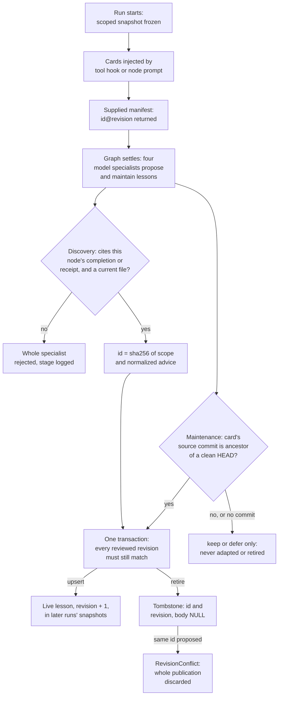

## 1. Executive Summary

Zeroshot is a Rust engine that runs coding agents as graphs of workers and
verifiers, so that one agent's output is checked by another. Its memory,
*Active Memory*, carries short lessons from finished runs into later ones. A
postmortem made of four model specialists writes them after the graph settles;
the host validates every proposal and owns the SQLite store. Later runs receive
matching lessons through tool hooks and through the node's private prompt.

What is notable is how little the model is trusted on the write side. A worker
has no write path at all. A specialist's proposal must cite an event the host
itself recorded for the named node, and a repository lesson must cite a file
that exists. The host derives the lesson's id from its content, stamps the
checkout commit, and publishes with a compare-and-swap over every lesson it
reviewed. Maintenance may change only cards with delivery evidence and a
compatible source commit.

What is weak is correction. No person can list, edit or delete a lesson: the
only verbs belong to the next postmortem. A lesson admitted while the checkout
was dirty records no source commit, and the code then refuses to adapt or
retire it, permanently. Replaced text is not kept, and a lesson has no
timestamp.

## 2. Mental Model

A memory is a *lesson*: one line of title and one of recommendation, written
for a future agent, with the reason it is expected to recur. The type's own
comment states the admission bar: *"Only costly, recurring lessons are
admitted"*, and the schema *"deliberately has no low-impact tier"*
(`zeroshot/src/active_memory/model.rs:41-42`).

Lessons come in two scopes. A repository lesson names files, folders,
identifiers or keyword groups in one repository and is recalled when a tool
call touches them. A graph lesson belongs to one node of one authored graph,
identified by the graph's hash, and is recalled whenever that node runs
(`model.rs:65-80`).

A lesson is believed from the moment it is published. There is no candidate
tier in the store. The epistemic work happens before publication and at each
later run:

- **Proposal.** Only the discovery specialists propose, and only after the
  main graph has settled. Workers never write.
- **Admission.** The host accepts a proposal when it cites a completion or a
  tool receipt the host recorded for that node, and, for a repository lesson,
  a current file matching one of its associations
  (`postmortem/proposals.rs:509-533`).
- **Maintenance.** Each later postmortem must keep, adapt, retire or defer
  every lesson the run was actually given, one decision per id
  (`proposals.rs:414-441`).
- **Retirement.** A retired lesson's row stays, with no body. Its id is a hash
  of scope and advice, so proposing the same advice again is refused.

Every delivery wraps cards in an `<active_memory>` block that opens
*"Previously observed guidance; check current source"*
(`zeroshot/src/active_memory/retrieval.rs:9`).

## 3. Architecture

Active Memory is a module of the `zeroshot` binary, not a service
(`zeroshot/src/active_memory.rs:1-20`). Its header states the boundary: *"the
store and matcher never invoke a model, a process, or a network service."*

- **Store.** One SQLite file, `active-memory/lessons.sqlite3` under the user's
  state directory, or under the target's storage for a Docker target
  (`zeroshot/src/native_v2_target/serve.rs:145`). It is opened in WAL mode with
  `synchronous=FULL`, and the file, its directory and its sidecars must be
  private to the user and free of symlinks and hard links
  (`store.rs:36-54`, `:465-574`). Placement inside the checkout is refused
  (`runtime.rs:61-63`).
- **Index.** Each run builds in-memory inverted indexes from its snapshot
  (`retrieval.rs:40-67`).
- **Broker.** A loopback TCP listener on one thread answers hook callbacks. A
  harness receives a private file holding the endpoint and a random 32-byte
  token bound to one invocation, never the database path
  (`hooks/broker.rs:96-158`).
- **Postmortem.** A second, synthetic graph of four verifier nodes run through
  the finished run's own provider binding (`postmortem/plan.rs:107-146`).

### What the hosted service holds

The tree defines the storage boundary as a trait, `ActiveMemoryBackend`, with
`snapshot` and `publish` (`backend.rs:52-68`). Its one implementation in the
tree is `SqliteMemoryBackend`. `ProductionHostingConfig.memory_backend` is the
slot for another, and defaults to `None`
(`zeroshot/src/native_v2_hosting.rs:106`, `:460`).

The Claude and OpenAI plugins register an HTTP MCP server at
`https://api.app.zeroshot.sh/mcp`. The bundled skill says that server *"exposes
typed environment and Memory operations"* and that *"human-only Memory
permissions still apply"* (`npm/zeroshot/skills/zeroshot/SKILL.md:92-94`). No
MCP server, no memory tool and no such permission check is in this tree. Those
operations, and whatever store sits behind the hosted platform, are outside
what this report reads.

### Deployment and ergonomics

Nothing has to be running. Memory is on by default and needs no key of its
own; the postmortem spends the run's own model connection, and its usage
counts toward the run. The store is an ordinary SQLite file whose lesson
bodies are JSON, so it can be read with `sqlite3`. Hand repair is possible and
unsupported: the guide offers a stop-and-copy backup, and the reference states
*"there is no built-in undo"* (`docs/guides/active-memory.md:100-103`,
`docs/reference/active-memory.md:148-149`). Local and
Docker-target stores do not synchronize.

## 4. Essential Implementation Paths

Paths are under `zeroshot/src/active_memory/`.

- **Preparation and snapshot.** `PreparedActiveMemory::prepare` →
  `ActiveMemoryStore::snapshot` → `read_scoped_lessons`
  (`runtime.rs:53-83`, `store.rs:123-136`, `:177-212`).
- **Repository recall.** harness hook → `Broker` → `RunMemorySource::tool_context`
  → `MemoryIndex::retrieve` → `render`
  (`hooks/broker.rs:171-190`, `runtime.rs:322-350`, `retrieval.rs:103-123`, `:168-215`).
- **Graph recall.** `ActiveMemoryHooks::invocation` → `graph_context` →
  `graph_guidance` (`hooks.rs:108-127`, `runtime.rs:352-359`, `retrieval.rs:157-166`).
- **Delivery receipts.** `RunMemorySource::select` and `manifest`
  (`runtime.rs:299-318`, `:385-394`); carrier acknowledgement in
  `return_context` (`hooks/broker.rs:228-246`).
- **Evidence.** `evidence::collect_inner` pages the run ledger;
  `ImpactEvidence::new` indexes completions and tool receipts per node
  (`postmortem/evidence.rs:107-140`, `postmortem/impact.rs:34-65`).
- **Proposal validation.** `ProposalContext::mutations`, `discovery`,
  `maintenance`, `adaptation` (`postmortem/proposals.rs:375-412`, `:475-507`,
  `:589-700`).
- **Source provenance.** `SourceGuard::capture`, `permits`, `stamp`
  (`source_guard.rs:24-109`).
- **Publication.** `BuiltinPostmortem::reconcile` → `publish` →
  `SqliteMemoryBackend::publish` → `apply_checked_batch`
  (`postmortem.rs:341-386`, `:245-266`, `backend.rs:85-112`, `store.rs:85-104`).
- **Schema.** `initialize` (`store.rs:214-244`).
- **Backfill.** `zeroshot memory init` → `initialize::init` →
  `publish::commit` (`zeroshot/src/native_v2_cli/memory.rs:33-48`,
  `postmortem/initialize/publish.rs:16-30`).
- **Supervisor hook-up.** `run_postmortem`
  (`zeroshot/src/native_v2_supervisor/postmortem.rs:22-95`).

## 5. Memory Data Model

`Lesson` has seven fields: `schema_version`, `id`, `revision`, `scope`,
`title`, `recommendation` and `evidence` (`model.rs:53-63`). The whole record
is capped at 8,192 bytes.

`LessonScope` is an enum. `Repository` carries the repository key and four
association lists: up to 32 files, 16 folders, 32 identifiers and 8 keyword
groups of two to four lowercase terms. At least one association is required,
paths must be literal and root-relative, and eleven generic words such as
`file`, `code` and `tool` are refused as keyword terms (`model.rs:336-417`).
`Graph` carries a lowercase SHA-256 graph hash, a node id and an optional
repository.

`LessonEvidence` holds the run id, the node id, one to eight reference strings
and a `costly_recurring_reason` (`model.rs:82-90`). References are pointers,
not copies: ledger cursors, `node:` and `hook:` receipts, `repository:` paths,
`graph:` nodes, and one host-written `source:<commit>`.

The table mirrors the scope into columns — `kind`, `repository`, `graph_hash`,
`node_id` — beside `id`, `revision`, `deleted` and a JSON `body`
(`store.rs:228-239`). A `CHECK` ties `deleted=1` to a null body.

Time is absent. A lesson has no creation or update stamp; the only clocks are
the monotonic `revision` per id and a store-wide `generation`. The `source:`
commit is the nearest thing to a date, and it records which code the lesson
was checked against, not when it held.

Text validation is shared by every field: no control or bidirectional
characters, no leading or trailing space, and four credential prefixes are
refused (`model.rs:318-334`). The repository key must be an identity and not a
locator: `://` and `@` are rejected (`model.rs:297-303`).

## 6. Retrieval Mechanics

Retrieval is deterministic and local. A run freezes one scoped snapshot at
start and never reads the store again for recall, so a lesson published during
a run reaches the next run and not this one.

For a tool call, the query is the tool's path fields and a bounded
concatenation of its string arguments. Paths are normalized lexically against
the tool's working directory and the workspace root; a path escaping the
workspace yields no match. Shell text is split on `;`, newline and `&&`, and a
leading `cd` moves the working directory for that segment
(`retrieval.rs:266-299`). The comment calls this *"deliberately a bounded
shell heuristic"*: a script that hides its paths matches nothing.

Scores are fixed and take the maximum per card: exact file 1000, containing
folder 800, whole identifier 700, a keyword group with all its terms present
500 (`retrieval.rs:101-153`). Identifiers match whole tokens; tokens are also
split on underscores and camel-case boundaries to feed keyword groups. Ranking
is score descending, then lesson id.

Rendering walks the ranking and admits each complete card that fits the byte
budget, skipping one that does not and continuing (`retrieval.rs:186-205`).
The budgets are per injection: 8,000 approximate tokens per hook and 16,000
per node invocation by default, at four bytes a token, with a ceiling of
64,000. There is no cumulative budget for a conversation.

Deduplication is by exact id and revision per provider session
(`runtime.rs:299-318`). Compaction does not reset it, so a card pushed out of
context by compaction is not sent again in that conversation.

Failure modes follow from exactness. A renamed file silences its lesson until
maintenance adapts the association. Folder associations are broad: a lesson on
a top-level folder matches every tool call beneath it at 800. Nothing ranks by
age or use, and ties fall to the id, which is a hash.

## 7. Write Mechanics

Writes happen once per run, after the main graph's outcome is latched. The
supervisor starts the postmortem only when memory and the postmortem are
enabled and the source node did not end on an authentication or
model-availability refusal
(`zeroshot/src/native_v2_supervisor/postmortem.rs:6-42`, `:125-154`).

Four specialists run in parallel as verifier nodes with structured outputs:
graph maintenance, repository maintenance, graph discovery and repository
discovery (`postmortem/plan.rs:20-25`, `:107-127`). They inherit one main
node's model and connections and are told to work read-only. Their input is a
frozen evidence document: the authored graph and runtime, per-execution state,
a 32 KiB tail of ledger records reclaimed from the largest consumer first, and
up to 512 tool receipts (`postmortem/evidence.rs:11`, `:35-70`).

The host then validates, and a single failure rejects that specialist's whole
output (`postmortem/execution.rs:145-161`).

- A discovery must name an agent node that executed, cite at least one
  reference owned by that node's completions or tool receipts, and resolve
  every reference (`proposals.rs:509-527`, `impact.rs:19-24`).
- A repository discovery must also cite a `repository:` file that opens and
  that is one of its files, sits under one of its folders, or contains one of
  its identifiers (`proposals.rs:788-817`).
- Advice containing a `path:line` position is refused (`proposals.rs:836-876`).
- A proposal whose id, or whose scope and normalized recommendation, already
  exists is dropped silently (`proposals.rs:398-411`).

Maintenance is exhaustive by construction. The set of supplied ids is taken
from the input the host built; a missing, duplicate or foreign decision fails
the specialist (`proposals.rs:422-440`). `keep` needs a current citation and a
reason. `adapt` and `retire` need current-run evidence as well. If the
delivery manifest is unknown, because a hook failed or a provider execution
errored, maintenance is refused outright (`proposals.rs:594-596`,
`runtime.rs:385-394`).

Publication is one `BEGIN IMMEDIATE` transaction. Every lesson in the reviewed
snapshot is checked against its stored revision first, then each mutation is
checked again, and any mismatch rolls the batch back (`store.rs:85-104`,
`:336-366`). On a conflict the postmortem re-reads the store, reruns
maintenance only, and carries the validated discoveries forward
(`postmortem.rs:341-386`, `execution.rs:44-47`).

Backfill uses the same validators. `zeroshot memory init` exports task files
from local run history, a host agent's subagents write response files, and the
command validates and publishes everything in one transaction with an
idempotency receipt (`postmortem/initialize/publish.rs:16-30`,
`store.rs:76-83`). The command makes no model calls.

### Operational cost

The agent never blocks on a write. The cost is at the end of the run: up to
four model sessions, more when maintenance is batched at 256 KiB of input, and
again on each conflict retry. All of it shares a deadline of at most ten
minutes plus a 30-second settlement grace (`postmortem.rs:31`). The run stays `running`
meanwhile. A lesson is retrievable from the next run that starts after the
commit.

No pass rewrites the store, but maintenance reads every lesson the run was
given, so its token cost grows with deliveries, not with the corpus. On the
read path a hook callback has a 250 ms socket budget per step and the Claude
and Codex handler declares a one-second timeout (`hooks/broker.rs:20`,
`hooks/native.rs:64-69`). Repository cards arrive mid-conversation as hook
context or appended tool results, after the cached prefix. Graph cards are
added to the invocation's host context (`hooks.rs:108-127`).

## 8. Agent Integration

The model has no memory tool. Recall is automatic, and writing belongs to the
postmortem. Six harness carriers share one broker protocol:

- Claude Code and Codex get a `PreToolUse` command hook that calls the hidden
  `zeroshot __active-memory-hook` helper. For Codex the installer computes the
  trust hash of exactly that handler, so no blanket hook trust is granted
  (`zeroshot/src/harnesses/adapters/core/claude/memory.rs:9-43`,
  `core/codex/memory.rs:19-47`).
- Copilot uses its RPC `preToolUse` callback.
- Pi, OpenCode and Hermes get a generated extension that appends cards to the
  tool result (`core/pi/memory.rs:29-80`,
  `contributed/opencode/memory.rs:25-76`,
  `contributed/hermes/native_memory.py`).

A pre-tool hook cannot change the call already issued, which the reference
documentation states; the card informs the next decision.

Each carrier acknowledges with one byte after it has handed the context to the
harness. A missing acknowledgement marks the run's delivery as unknown, and
that single flag is what makes maintenance abstain (`hooks/broker.rs:228-246`).
The postmortem's own specialists are marked auxiliary and receive no cards
(`hooks.rs:70-72`, `:141-143`).

Authored instructions are untouched. Graph cards go into a host context field
beside them, and the graph hash that scopes them is computed from the authored
graph alone (`runtime.rs:539-544`). Editing the graph therefore orphans its
graph lessons: they stay in the store under the old hash, and a run of the
edited graph queries the new one.

Porting the carrier to another harness needs a tool hook that can return
context and a way to pass one file path. The store and the postmortem are
bound to Zeroshot's run ledger and node runner.

## 9. Reliability, Safety, and Trust

**The producer cannot publish.** A specialist returns JSON; the host builds
the `LessonDraft`, sets the run id, derives the id, and discards any field the
schema does not name. A `source:` reference in model output is refused with
*"source provenance is host-owned"* (`source_guard.rs:81-88`). A maintenance
specialist that returns an id from the other scope fails
(`proposals.rs:604-607`).

**Evidence is checked for existence and ownership, not for support.** The gate
proves the cited event happened for that node and the cited file exists and
bears the association. Whether the lesson follows from them is the
specialist's judgement. `costly_recurring_reason` is a length-checked string.

**No person is in the loop.** Admission, adaptation and retirement are all
decided by models and validated by code. The backfill is driven by a host
agent that writes the response files and calls the CLI; the command checks no
terminal and takes no approval. No lesson waits in a state. `human_review` is
withheld. The hosted service's *"human-only Memory permissions"* are not in
the tree.

**A lesson from a dirty checkout is permanent.** `SourceGuard::capture`
returns no reference unless `git status` is empty, including untracked files
(`source_guard.rs:149-168`). `stamp` then adds nothing, and the lesson is
published without a `source:` commit (`proposals.rs:535-560`). Every later
`adapt` or `retire` of a repository-bound lesson requires `permits`, which
requires that commit (`source_guard.rs:61-64`, `proposals.rs:609-616`). The
only code that adds a `source:` reference to an existing lesson is adaptation,
behind the same check. The reference documentation says such cards *"need
trustworthy revalidation"*; no such path exists at this commit. A postmortem
runs after agents have edited the workspace, so an uncommitted tree is a
plausible state at admission.

**The tombstone is exact, and its refusal is expensive.** A retired id blocks
the same scope and advice. The insert is refused inside the transaction, so
every other mutation the postmortem produced is rolled back with it. The retry
finds the visible snapshot unchanged and stops with a storage error
(`postmortem.rs:303-306`). Until discovery words the advice differently, each
run that rediscovers it publishes nothing.

**Scope holds on reads.** One query and one recheck stand between a run and
another repository's lessons (`store.rs:177-212`). On writes, a mutation's
scope is built by the host from the run's own repository key and graph hash,
so the boundary is by construction; `SqliteMemoryBackend::publish` ignores the
`scope` it is passed (`backend.rs:85-112`).

**No mutation record.** An adapt overwrites the body, and the documentation
states *"Previous contents are not archived"*. The run ledger receives a count
of published mutations and the list of supplied id-revisions, in the run's
own log. `audit_log` is withheld. The `evidence` block is replaced on each
adapt, so the original discovery's run and references are lost with the text.

**No state and no time.** A lesson is live or tombstoned. Nothing marks a
lesson as unverified, disputed or stale, and nothing records when it was true.
`trust_state` and `bitemporal` are withheld.

**Concurrency.** Across runs, `BEGIN IMMEDIATE`, a five-second busy timeout
and the whole-snapshot revision check serialize publication. Within a run,
one mutex guards delivery state and one thread serves hooks in turn. The
capacity limits are store-wide: 10,000 live lessons and 64 MiB across all
repositories, and 100,000 tombstones, past which `open` itself fails
(`model.rs:6-9`, `store.rs:444-463`, `:50-51`).

**Injection.** Lesson text is model-written from run transcripts and reaches
later prompts. The defences are length limits, character filtering, the
framing sentence, and the specialists' instruction to treat supplied text as
evidence. A graph lesson without a repository qualifier is delivered to that
node in every repository that runs the same graph.

## 10. Tests, Evals, and Benchmarks

I ran nothing. I counted 183 `#[test]` and `#[tokio::test]` attributes in 23
test files under `zeroshot/src/active_memory`, 12 in
`zeroshot/src/native_v2_supervisor/tests/postmortem.rs`, 4 on the config type
and 1 on the Codex installer. CI's native job runs `cargo test --workspace` on
Linux and a separate test script on Windows
(`.github/workflows/ci.yml:315-323`). The two cases in
`harnesses/live_tests/active_memory_tests.rs` need a real provider, and one is
marked `#[ignore]`.

The tests I read assert outcomes, and the negative ones carry controls.
`snapshots_enforce_repo_graph_node_and_independent_toggles` compares the
snapshot with an exact list of three ids out of seven written.
`rediscovery_of_a_retired_id_stops_without_repeating_unchanged_model_work`
recomputes the id from scope and advice, asserts the store stays empty, counts
four model invocations and finds the conflict line in the ledger.
`a_maintenance_specialist_cannot_retire_the_other_scopes_lesson` asserts both
lessons survive and that the legitimate adapt in the same run still landed.
`dirty_unknown_and_missing_source_never_gain_mutation_authority` pins the
behaviour behind the permanent-lesson finding as intended.

The postmortem tests drive a scripted model, so they cover the host's
validation and not the quality of lessons a real model proposes. No committed
case measures whether an injected lesson changes an agent's behaviour, how
often retrieval fires on irrelevant tool calls, or what the postmortem costs.

The README's one benchmark sentence concerns verification loops, not memory.
No paper, citation file or memory benchmark is in the README or `docs/`.

## 11. For Your Own Build

### Steal

- **Make the producer's citation checkable against records the host wrote.**
  A proposal that must name an event id from the host's own ledger, owned by
  the node it blames, cannot be supported by text the model invented.
- **Track what was delivered, and let that bound maintenance.** A per-run
  manifest of id-revisions that were handed to an agent, invalidated by any
  carrier failure, keeps a reviewer from judging advice nobody received.
- **Require one decision per supplied id.** Building the expected id set on
  the host and failing on a missing or foreign one turns "the model skipped
  it" into an error.
- **Derive the id from scope and normalized content.** Deduplication and a
  retirement that blocks the same advice then need no extra table.
- **Stamp provenance the model cannot write.** Refusing a `source:` reference
  in model output and adding the host's own makes the commit trustworthy.
- **Freeze recall per run.** A snapshot at start gives every agent in the run
  the same memory and makes the delivery manifest meaningful.

### Avoid

- **A safety rule with no exit.** Deferring destructive changes on unknown
  provenance is sound; leaving no path that ever establishes provenance turns
  a deferral into immortality.
- **A refusal that takes the batch with it.** A tombstone hit should drop one
  proposal, before the transaction, not the transaction.
- **An id that stops describing its content.** Keeping the id across an adapt
  preserves revision history and detaches the tombstone from the text retired.
- **A memory only models can correct.** Without a list and a delete for the
  person, a wrong lesson is fixed when a postmortem happens to agree it is
  wrong.
- **Global caps on a shared store.** A limit counted across every repository
  lets one busy project fill it for the rest.

### Fit

This is memory for a team already running its coding work through Zeroshot
graphs, and it is not separable from that runtime. The evidence gate needs the
run ledger, the carrier needs the harness adapters, and the writer needs a
model session at the end of every run. Inside that setting it suits
repositories where the same mistakes recur and where spending some minutes of
model time per run on upkeep is acceptable. It does not suit anyone who needs
to see, approve or remove what the agents have been told, or who must account
for what a lesson said before it changed. A reader building their own should
take the validation design and add the person.

## 12. Open Questions

- Is the checkout normally clean when the postmortem runs, or do typical
  graphs leave uncommitted work, making unstamped lessons the common case?
- Is the permanent keep-or-defer state of an unstamped lesson intended, and
  what is the planned *"trustworthy revalidation"*?
- How often does discovery reproduce a retired lesson's exact scope and
  wording, and so discard a run's publication?
- What do the hosted *"Memory operations"* and *"human-only Memory
  permissions"* at `api.app.zeroshot.sh` do, and do they share this lesson
  model?
- What does a postmortem cost in tokens on a real run, and what share of
  injected cards are relevant to the tool call that triggered them?
- Are orphaned graph lessons from superseded graph hashes ever removed?

## Appendix: File Index

Paths are under `zeroshot/src/` unless a longer path is given.

- **Model and store:** `active_memory/model.rs`, `active_memory/store.rs`,
  `active_memory/backend.rs`.
- **Retrieval:** `active_memory/retrieval.rs`, `active_memory/runtime.rs`.
- **Delivery:** `active_memory/hooks.rs`, `hooks/broker.rs`, `hooks/native.rs`,
  `harnesses/adapters/core/{claude,codex,pi}/memory.rs`,
  `harnesses/adapters/core/copilot/rpc.rs`,
  `harnesses/adapters/contributed/opencode/memory.rs`,
  `harnesses/adapters/contributed/hermes/native_memory.py`.
- **Postmortem:** `active_memory/postmortem.rs`, `postmortem/plan.rs`,
  `postmortem/execution.rs`, `postmortem/evidence.rs`, `postmortem/impact.rs`,
  `postmortem/proposals.rs`, `postmortem/context_budget.rs`,
  `postmortem/definition.rs`, `postmortem/source_file.rs`,
  `active_memory/source_guard.rs`, `native_v2_supervisor/postmortem.rs`.
- **Backfill:** `postmortem/initialize.rs`, `postmortem/initialize/`,
  `native_v2_cli/memory.rs`, `npm/zeroshot/skills/zeroshot-memory-init/SKILL.md`.
- **Configuration and hosting:**
  `crates/openengine-cluster-protocol/src/native_v2_run/active_memory.rs`,
  `native_v2_hosting.rs`, `native_v2_local.rs`, `native_v2_target/serve.rs`,
  `plugins/zeroshot-claude/.mcp.json`.
- **Tests:** `active_memory/tests.rs`, `active_memory/runtime/tests.rs`,
  `active_memory/hooks/tests.rs`, `active_memory/source_guard/tests.rs`,
  `active_memory/postmortem/tests.rs`, `active_memory/postmortem/tests/`.
- **Documentation:** `docs/guides/active-memory.md`,
  `docs/reference/active-memory.md`.

### Recorded searches

Run with `/usr/bin/git grep` from the root of a checkout at
`7353598ff2025de12acd60f1be15223317fa918b`.

- `git grep -n -i 'DELETE FROM' -- zeroshot/src/active_memory` — one statement, over `active_memory_initializations` at `store.rs:115`; none over `active_memory_records`, so no tombstone is ever removed.
- `git grep -n -E 'CREATE TABLE|CREATE INDEX' -- zeroshot/src/active_memory` — three tables and one index, all in `store.rs:223-238`; no history, event or audit table.
- `git grep -n -i -E 'created_at|updated_at|valid_from|valid_to|valid_until|expires|timestamp' -- zeroshot/src/active_memory/model.rs zeroshot/src/active_memory/store.rs` — `model.rs:128` only, `ToolObservation.timestamp_ms`; no time field on a lesson.
- `git grep -n -i -E 'status|candidate|verified|pending|confidence|trust' -- zeroshot/src/active_memory/model.rs zeroshot/src/active_memory/store.rs` — `store.rs:45` (`PRAGMA trusted_schema`) and `store.rs:564` (a comment on the UID boundary); no state or score field.
- `git grep -n -i -E 'approve|approval|human|confirm\(|reviewer_id' -- zeroshot/src/active_memory ':!zeroshot/src/active_memory/postmortem/tests*' ':!zeroshot/src/active_memory/tests.rs'` — no match. Control: `git grep -c -i 'human' -- npm/zeroshot/skills/zeroshot/SKILL.md` returns 1.
- `git grep -n -i -E 'is_terminal|isatty|IsTerminal' -- zeroshot/src/active_memory zeroshot/src/native_v2_cli/memory.rs` — no match. Control: `git grep -l -E 'is_terminal|IsTerminal' -- zeroshot/src` lists `zeroshot/src/main.rs` among five files.
- `git grep -n -E 'MemoryCommand' -- zeroshot/src` with `zeroshot/src/native_v2_cli/memory.rs:10-31` — the enum has one variant, `Init`; no list, show, edit or delete verb.
- `git grep -n -E '\.permits\(|\.stamp\(|source_bound\(|revalidat' -- zeroshot/src docs`, test files excluded — `stamp` is called at `proposals.rs:546` and `:689` only; `revalidat` matches `docs/reference/active-memory.md:38` and an unrelated comment at `native_v2_local.rs:187`.
- `git grep -n -E 'impl ActiveMemoryBackend|dyn ActiveMemoryBackend|memory_backend' -- .`, test files excluded — one `impl`, for `SqliteMemoryBackend` at `backend.rs:73`; `memory_backend: None` at `native_v2_hosting.rs:460`.
- `git ls-files | grep -i mcp` — `planning/plans/shared-skills-plugins-mcp.md` and the two plugins' `.mcp.json`; no MCP server source.
- `git grep -l -i -E 'lesson' -- ui sdks plugins` — no match; no UI, SDK or plugin surface names a lesson. Control: the same pattern matches throughout `zeroshot/src/active_memory`.
- `git grep -n -i -E 'embedding|cosine|fts5|bm25|vector_search' -- zeroshot/src/active_memory` — no match. Control: `git grep -c -i 'BTreeMap' -- zeroshot/src/active_memory/retrieval.rs` returns 22.
- `git grep -n -i -E 'arxiv|bibtex|@article|@misc|CITATION|doi\.org' -- README.md docs '*.cff'` — two hits, both the word "citation" in `docs/reference/active-memory.md`; no paper.
- `git grep -n -E '#\[ignore' -- zeroshot/src/active_memory zeroshot/src/harnesses/live_tests/active_memory_tests.rs` — one, at `active_memory_tests.rs:116`.
- `git grep -n 'filter=' -- .gitattributes` — no match.

## History

**2026-11-14** — [`7353598ff2025de12acd60f1be15223317fa918b`](https://github.com/the-open-engine/zeroshot/commit/7353598ff2025de12acd60f1be15223317fa918b) — first reading, at the head of `main`, dated 13 November 2026. Marks: `tombstone` on the content-derived id kept at retirement, `scope_enforced` on the snapshot query, `negative_eval` on the scope and frozen-snapshot tests. The root LICENSE and the three copies under `plugins/` and `sdks/python/` were read in full: MIT, identical, agreeing with the manifests, no rider. Screened before reading: three auto-run surfaces (a plugin marketplace, a plugin manifest and an HTTP MCP server entry pointing at a hosted endpoint), four dependency surfaces inside the seven-day cooldown, five build-time execution points, three unpinned manifests. Nothing was installed or run. The hosted service behind `api.app.zeroshot.sh` was not contacted.
