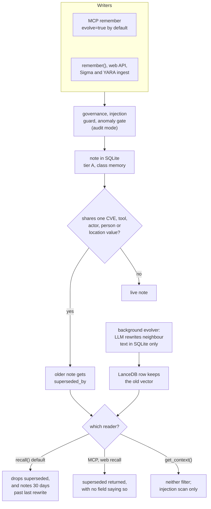

## 1. Executive Summary

ZettelForge is a Python memory library for cyber threat intelligence, with a
stdio MCP server and a FastAPI UI, over one SQLite file and a LanceDB table per
domain. It extracts CVEs, intrusion sets, tools and IOCs by regex, links them in
an SQLite knowledge graph, and blends vector, graph and entity-index recall
under a cross-encoder. The write path is well defended: governance, a
prompt-injection guard and a calibrated anomaly gate run before anything is
stored. The correction path is the weak part. A note supersedes an older one
when the two share a single CVE, tool or location value, and the MCP and web
recall surfaces then return the superseded note anyway, unlabelled.

Two defaults decide more than the README says. No writer sets a note's
persistence class, so every note carries the 30-day class, and `recall()`
hides it 30 days after its last rewrite; reads do not reset the clock. The
background evolver lets a model rewrite neighbouring notes in SQLite while
their LanceDB rows keep the old vectors. No capability mark is earned.
Supersession is a link with no rejected-value record, the epistemic tier is
`A` on every constructed note, and note mutations reach only a rotating
application log.

Multi-tenant auth, the TypeDB backend and OpenCTI sync are an enterprise
package discovered at import (`extensions.py:28-30`) and absent from this tree;
the report covers the community code. The repository moved from
`rolandpg/zettelforge`, which redirects to it, and the MCP manifest names the
old owner. No paper accompanies it, and the README's A-Mem link
([arXiv:2602.10715](https://arxiv.org/abs/2602.10715)) resolves to a different paper, Locomo-Plus; the evolver's
docstring carries A-Mem's correct id, [arXiv:2502.12110](https://arxiv.org/abs/2502.12110).

## 2. Mental Model

A memory is a `MemoryNote` (`note_schema.py:103-117`): raw text with a source
type and reference, regex entities, keywords, a fastembed vector, supersession
links, and metadata for domain, tier, confidence, TLP and persistence class.
Every write makes one note per call, or with `evolve=True` one note per
LLM-extracted fact. Notes are treated as true. Nothing is a candidate.

A note can hold four conditions, none of them a status column.

- **Live**: stored, indexed, `superseded_by` empty.
- **Superseded**: `superseded_by` names a later note. `mark_note_superseded`
  sets it, removes the old note's entity mappings and adds a `SUPERSEDES` edge
  (`memory_manager.py:1549-1577`). Its text, vector and LanceDB row stay.
- **Expired**: derived at read time from the persistence class and the later of
  `created_at` and `updated_at` (`note_schema.py:137-168`). Nothing is written.
- **Evolved**: a model replaced `content.raw`; the prior text is in
  `previous_raw`, one level deep, and `rollback` has no caller
  (`memory_evolver.py:153-212`).

Three actors move a note. The write path supersedes on entity overlap with no
model (`_check_supersession`, `memory_manager.py:1579-1650`). With `evolve=True`
an LLM decides ADD, UPDATE, DELETE or NOOP per fact, and UPDATE and DELETE both
supersede the nearest vector hit (`memory_updater.py:60-102`). The background
evolver rewrites neighbours. A note never dies: `delete_note` has no caller, and
neither the MCP server nor the web API exposes a delete.

The tier field is labelled epistemic, *"A (authoritative) | B (operational) |
C (support)"* (`note_schema.py:95`), and `NoteConstructor` sets `A` on every
note it builds (`note_constructor.py:65-74`); Sigma and YARA ingest pass `A`
too. `confidence` starts at 1.0 and is capped at 0.95 after an evolution.
`should_flag_for_review` (`note_schema.py:133-135`) has no caller.

## 3. Architecture

`MemoryManager` (`memory_manager.py:101-182`) is the whole system in one
process. It opens the SQLite backend, keeps a `MemoryStore` only for LanceDB
indexing, preloads the embedding model, and starts a daemon thread over an
in-process enrichment queue of 500 jobs. The MCP server (`mcp/server.py`) and
the web app (`web/app.py`) each hold one manager.

**Storage.** `sqlite_backend.py:42-145` creates `notes`, `kg_nodes`,
`kg_edges`, `entity_index` and `enrichment_jobs` in WAL mode, with
`synchronous=NORMAL`, whose header warns that the last transaction before an OS
crash can be lost. Vectors live in one LanceDB table per domain,
`notes_<domain>`, holding the id, the vector and the first 500 characters
(`memory_store.py:194-258`). A process-global JSONL knowledge graph is kept for
`ingest_relationship` (`memory_manager.py:1698-1702`). The default data
directory is `~/.amem` (`memory_store.py:32-37`).

**Models.** Embeddings are nomic-embed-text-v1.5-Q through fastembed's ONNX
runtime, in process. The reranker is a fastembed `TextCrossEncoder`
(`memory_manager.py:70-84`). Extraction, NER, evolution, intent fallback and
synthesis call an LLM through `llm_client.generate`, whose configured default
is Ollama on localhost with `qwen3.5:9b` (`config.default.yaml:211-219`). The
`ollama` client package is imported inside the provider (`ollama_provider.py:57`)
and is not a declared dependency in `pyproject.toml`.

**Background.** The enrichment thread runs causal-triple extraction, LLM NER
and neighbour evolution per note (`memory_manager.py:1306-1340`). A
consolidation thread starts when the shift detector fires
(`consolidation.py:432-480`). One LanceDB version-cleanup thread per table runs
hourly (`lance_maintenance.py:1-30`). An atexit hook drains the queue for at
most 10 seconds (`memory_manager.py:1480-1514`).

### Deployment and ergonomics

`pip install zettelforge` gives `remember` and `recall` with no service and no
API key; the embedding model, about 80 MB, downloads on first use. Extraction,
evolution and synthesis need an LLM; without one they log and fall back. The
web UI refuses non-loopback clients until `ZETTELFORGE_WEB_API_KEY` is set
(`web/app.py:156-180`), and `web/auth.py:15-27` is a single-tenant stub. The
store is SQLite with one column per field, readable and repairable with the
`sqlite3` shell, but a hand edit does not reach LanceDB.

## 4. Essential Implementation Paths

- **Direct write.** `remember` → `_remember_inner` (`memory_manager.py:184-511`):
  governance and the injection guard (`governance_validator.py:103-167`),
  `NoteConstructor.construct`, the anomaly gate (`memory_defense.py:213-239`),
  `write_note`, LanceDB indexing, regex entities and alias resolution, the
  consolidation observer, `_check_supersession`, heuristic graph edges, then up
  to three enrichment jobs.
- **Extraction write.** `remember_with_extraction`
  (`memory_manager.py:576-636`): `FactExtractor.extract` returns scored facts,
  those under importance 3 are dropped, and `MemoryUpdater` finds the three
  nearest vector hits, asks for an operation, and applies it.
  `remember_report` chunks at 3,000 characters and passes the publication
  date into the prompt context only (`:638-701`).
- **Recall.** `recall` → `_recall_inner` (`memory_manager.py:703-994`): intent
  classification, vector retrieval, a temporal date-string boost, graph
  retrieval over the store's own graph, blend, causal-edge additions for causal
  intent, entity-index augmentation, a cross-encoder over the head, then the
  superseded and expiry filters, cap at `k`, and access tracking.
- **Prompt context.** `get_context` → `VectorRetriever.get_memory_context`
  (`vector_retriever.py:356-405`): vector retrieval, an injection scan per
  note, Markdown formatting, truncation at four characters per budget token.
- **Correction.** `mark_note_superseded` (`memory_manager.py:1549-1577`), called
  from `_check_supersession` and from `MemoryUpdater.apply`.
- **Evolution.** `_run_evolution` → `MemoryEvolver.evolve_neighbors`
  (`memory_evolver.py:216-276`): five neighbours by `recall`, one LLM call each,
  `apply_evolution` on `evolve`.
- **Consolidation.** `ConsolidationEngine.consolidate`
  (`consolidation.py:204-339`).
- **MCP.** `handle_tool_call` (`mcp/server.py:37-144`): remember, recall,
  synthesize, entity, graph, stats and an enterprise-only sync.
- **Tests.** `tests/test_recall_integration.py`, `test_sqlite_integration.py`,
  `test_memory_updater.py`, `test_two_phase_e2e.py`, `test_memory_evolver.py`,
  `test_memory_defense.py`, `test_graph_scoping.py`.

## 5. Memory Data Model

The `notes` table carries one column per field (`sqlite_backend.py:43-80`):
content and its source, `previous_raw`, keywords, tags and entities as JSON,
the embedding as a JSON array, domain, tier, importance, confidence, access
count, TLP, STIX confidence, persistence class, TTL fields, supersession links,
`related`, `causal_chain`, version, `evolved_from` and `evolved_by`, and JSON
blobs for CVSS and detection-rule metadata. Ids are
`note_YYYYMMDD_HHMMSS_xxxx` (`sqlite_backend.py:387-389`).

`kg_edges` is unique on source, target, relationship and note id, with an
`edge_type` and a JSON property bag (`:99-110`). Heuristic edges carry
`first_observed` and the note's confidence (`memory_manager.py:1130-1255`).
`SUPERSEDES` edges carry a `timestamp` of the moment of supersession.

**Time.** `created_at` and `updated_at` are record time. The only
world-time inputs are a report's `published_date`, which becomes prompt text,
and STIX `first_seen`/`last_seen` in the ontology tables
(`ontology.py:78`), which no note column receives.

**Persistence class.** `is_expired` maps `knowledge` to never, `memory` to 30
days, `wisdom` to 90 and `intelligence` to 7 (`note_schema.py:144-149`).
`infer_persistence`, which would assign `knowledge` to CTI ingestion, has no
caller, and nothing assigns the field, so every note is `memory`. The anchor is
the later of `created_at` and `updated_at`; the comment says *"TTL resets on
access"* (`:163`), but access writes `last_accessed` through
`mark_access_dirty` (`sqlite_backend.py:493-504`). A note is refreshed only
when something rewrites it. The per-note `ttl` column has no reader.

**Scope.** `domain` is a caller-chosen label (`general`, `cti`, `incident`).
It names the LanceDB table and filters the vector arm (`vector_retriever.py:144-162`).
The graph stage takes no domain (`memory_manager.py:857-859`), and
`recall_entity` takes none either (`:1061-1078`), so both add notes from every
domain to a domain-filtered recall. Isolation between users is a separate data
directory per `MemoryManager`.

## 6. Retrieval Mechanics

**Arms.** The vector arm searches each domain table for `2k` hits, converts
distance to similarity, multiplies by an entity-overlap boost and an
exact-match boost, and keeps `k` (`vector_retriever.py:137-203`). Its
link expansion reads `links.related`, which nothing writes. The graph arm walks
two hops from the query's regex entities over the store's own graph. Entities
whose note fan-out exceeds `retrieval.entity_max_fanout` are dropped first, so a
LoCoMo speaker name in every session does not flood recall
(`memory_manager.py:996-1023`).

**Fusion.** Intent comes from keyword scores, with an LLM fallback when
ambiguous (`intent_classifier.py:140-186`). The policy table carries
`vector`, `entity_index`, `graph` and `temporal` weights per intent
(`:188-238`); `BlendedRetriever.blend` reads `vector` and `graph`
(`blended_retriever.py:59-60`). If the blend returns fewer notes than the
vector arm did, the vector list replaces it (`memory_manager.py:871-874`).
Causal intent then appends notes reached over causal edges, and every query
appends up to three entity-index notes per entity (`:876-918`).

**Rerank and filters.** The cross-encoder scores the first 8 results on their
first 256 characters, and the tail keeps blend order (`:920-943`). The
superseded and expiry filters run after the rerank and before the cap at `k`
(`:945-958`).

**Who gets which filter.** `recall()` defaults to `exclude_superseded=True`
and `include_expired=False`. The MCP `zettelforge_recall` tool and the web
`/api/recall` route both pass `exclude_superseded=False`
(`mcp/server.py:65`, `web/app.py:206`). Neither response includes
`superseded_by`, so the agent and the UI cannot tell a superseded note from a
live one. The LangChain retriever and synthesis use the default.
`get_context` calls the vector retriever directly and applies neither filter;
it drops notes the injection guard flags (`vector_retriever.py:367-386`).

**Synthesis.** `SynthesisGenerator._retrieve_notes` filters by tier
(`synthesis_generator.py:124`), defaulting to all three tiers (`:66`). The
config's `synthesis.tier_filter` of `["A", "B"]` (`config.py:222`) is
loaded and has no reader.

## 7. Write Mechanics

**Gates.** `GovernanceValidator.validate_remember` enforces a size limit, the
injection guard and optional Presidio PII redaction or blocking
(`governance_validator.py:103-167`). The anomaly gate then scores the candidate
against the domain's recent notes. It combines a MemSAD-style similarity score
with a weighted lexical Jensen-Shannon divergence, and flags anything above the
calibration mean plus 2.0 standard deviations (`memory_defense.py:183-191`).
It stays silent under 50 calibration notes and defaults to `audit` mode
(`config.default.yaml:410-420`). In `quarantine` mode the write raises and a
record, raw content included, is appended to `quarantine/memory_anomalies.jsonl`
(`memory_defense.py:241-271`). No code reads that file.

**Supersession.** `_check_supersession` collects every note sharing a value of
`cve`, `actor`, `tool`, `campaign`, `asset`, `person`, `location`,
`organization`, `event`, `activity` or `temporal` with the new note. It scores
each by shared-value count plus up to 1.0 for age, and supersedes the best at a
score of 1.0 (`memory_manager.py:1584-1648`). One shared value is enough.

On the regex path the live keys are a CVE, three named actors, seven named tools, an
`operation X` campaign, a dialogue speaker and 43 place names
(`entity_indexer.py:60-77`, `:175`, `:306-313`). So *"APT41 scanned for
CVE-2024-3094"* supersedes *"CVE-2024-3094 is the XZ Utils backdoor"*.
`intrusion_set` is not a key, so two APT28 notes do not collide. A comment at
`entity_indexer.py:171-172` records that wider speaker extraction
*"reshuffled supersession chains"* and cut LoCoMo accuracy from 11% to 5%.

**Extraction path.** With `evolve=True` only extracted facts are stored, up to
five per call with source refs `<ref>:extraction:<i>`; the submitted text is
not kept. When `generate` raises, `FactExtractor.extract` returns the first 500
characters as one fact (`fact_extractor.py:56-58`), and `decide` defaults to
ADD (`memory_updater.py:56-58`). An unreachable Ollama returns an empty string
instead, and the text is stored whole. A missing `ollama` package raises an
`ImportError` that `generate` re-raises (`llm_client.py:232-235`). Reading
these paths, an MCP `remember` on an install without that package keeps only
the first 500 characters; I did not run it to confirm.

**Evolution.** For each new note, five neighbours come from `recall` and one
LLM call each decides `evolve` or `keep`. On `evolve`, `apply_evolution`
copies the text to `previous_raw`, writes the model's text, re-embeds into the
note's SQLite row and rewrites it (`memory_evolver.py:153-188`). It does not
call `_index_in_lance`, so LanceDB keeps the old vector and the old 500
characters. The model's text bypasses the governance validator and PII
redaction that guarded the original. The injection guard runs on both inputs
(`:94-95`) and not on the output.

**Consolidation.** On a semantic shift, notes since the last run that share an
entity with another are checked for a negation-word mismatch; the older of each
pair is counted as contradicted (`consolidation.py:341-384`). The rest are set
to tier `A`, which every note is, and rewritten (`:294-305`). The count goes
into a log event and nothing else.

### Operational cost

The direct write is synchronous and model-free. Embedding, SQLite, LanceDB,
regex entities, supersession and heuristic edges run inline; the README cites
about 45 ms with fastembed, a figure I did not reproduce. A note is recallable
when `remember` returns. LLM work is deferred to the one enrichment thread:
causal triples for CTI domains or text over 200 characters, NER, and five
evolution calls once the store holds three notes. A queue past 500 jobs drops
the job and marks its ledger row failed (`memory_manager.py:1261-1288`).
Consolidation reads every note created since its last run. `get_context` is bounded
by `token_budget`; `recall` returns up to `k` notes, truncated per surface to
500 characters.

## 8. Agent Integration

The MCP server is hand-written stdio JSON-RPC (`mcp/server.py:268-337`) with
seven tools. `zettelforge_remember` defaults to domain `cti` and `evolve=True`
(`:46-58`). `zettelforge_recall` returns id, 500 characters, context,
entities, tier and confidence. `zettelforge_entity` and `zettelforge_graph`
expose the entity index and a capped graph walk. There is no forget, correct or
delete tool, so the agent can add and supersede and cannot remove. The
agent supplies the domain on every call, and any domain is accepted.

Integration is pull-only: nothing injects context at session start, and the
tool descriptions do not tell the model when to save. `get_context` is the
documented path for a host that wants injection
(`docs/how-to/integrate-llm-agent.md`). LangChain and CrewAI adapters wrap
`recall` and `synthesize`. The web UI has dashboard, search, ingest,
entities, graph, history, logs and configuration views. Its routes remember,
recall, synthesize, bulk-ingest and edit config, and none edits or removes a
note.

## 9. Reliability, Safety, and Trust

### Supersession that the agent's surface ignores

The correction mechanism and its main reader disagree. A single shared entity
value hides the older note from `recall()`, which a user calling the library
gets by default, and removes it from the entity index. The agent, through MCP,
sees it again with no marker. An analyst whose first note was wrongly
superseded loses it from LangChain and synthesis results; an agent asked to
prefer current intelligence gets both and cannot rank them. No test exercises
either surface's supersession behaviour.

### Expiry nobody set

Every note is in the 30-day class because nothing assigns another. A CTI report
remembered once and never rewritten drops out of `recall()` 30 days later, on
the MCP and web surfaces too, since neither passes `include_expired`. It
appears in `get_context` and `recall_entity`. The intent visible in
`infer_persistence` was that CTI ingestion never expires. The expiry tests
assert only that a list comes back (`tests/test_core.py:243-267`).

### Two stores that drift

An evolved note has new text in SQLite and the old vector in LanceDB, so it is
found by its old text and returned with its new text. `reindex_vector`
exists on the backend and updates SQLite only (`sqlite_backend.py:625-645`);
no caller uses it. A pending NER job for a note superseded meanwhile re-adds its
entity mappings, since `_run_llm_ner` does not check `superseded_by`
(`memory_manager.py:1386-1451`).

### Poisoning defences

This is the strongest part of the code. Every LLM prompt builder calls the
injection guard on its untrusted inputs and frames them as evidence, the write
path refuses matching text, and `get_context` drops stored notes that match.
The anomaly gate is real, calibrated per domain and configurable to block. It
ships in audit mode, its quarantine has no release path, and the guard is a
regex set a paraphrase can avoid (`prompt_injection_guard.py:31-90`).

### Audit

`log_file_activity` emits an OCSF 1001 event for each note create, update and
delete, with the note id and the backend method as actor
(`ocsf.py:267-297`). Those events go to `logs/zettelforge.log`, rotated at 10 MB
with nine backups (`log.py:89-97`). The separate `audit.log`, kept for 52
rotations, accepts only authentication, authorization, account and config
events (`log.py:20-25`, `:99-108`). It does receive one authorization event per
`remember`, with `actor="system"` and no note id (`memory_manager.py:260-266`).
No event records the text an evolution replaced.

### Marks

None is carried.

- **`tombstone`** — supersession is a `superseded_by` link on the record, and
  the updater's DELETE stores the contradicting fact as a new note. Nothing
  keyed on a rejected value stops extraction from adding it again.
- **`trust_state`** — `tier` is `A` on every note any writer constructs, and
  consolidation sets `A`. Synthesis can filter on it, so it is shaped like a
  state; it never varies. `confidence` is a float.
- **`bitemporal`** — `created_at` and `updated_at` are record time; a report's
  publication date reaches only prompt text.
- **`scope_enforced`** — `domain` is a topic label the caller picks, applied to
  the vector arm and not to the graph or entity arms. User isolation is a data
  directory per manager, a physical partition.
- **`audit_log`** — note mutations reach a rotating application log at INFO
  level, outside the store, with no prior content; the retained audit file
  takes no mutation event.
- **`human_review`** — no route or tool holds a note pending a person;
  `should_flag_for_review` has no caller, and the quarantine file has no
  reader.
- **`negative_eval`** — the exclusion cases can pass on an empty result; see
  section 10.

## 10. Tests, Evals, and Benchmarks

The suite has 846 pytest functions in 69 files. CI runs them with mock
embeddings, Ollama as the LLM provider, and a 67% coverage floor
(`.github/workflows/ci.yml:126-135`, `tests/conftest.py:8-13`). I did not run
them.

Coverage of the defences is direct. The anomaly gate is tested in audit and
quarantine modes, including the forensic record (`tests/test_memory_defense.py`),
and the evolver's evaluate, apply and rollback are tested with a mocked model
(`tests/test_memory_evolver.py`). The injection guard's wiring is tested by
checking that each module's source text contains the guard call
(`tests/test_prompt_injection_guard.py:61-93`). That asserts the line exists,
not that a hostile note is refused.

`negative_eval` is withheld because each exclusion case can pass on nothing.

- `test_recall_integration.py:45-54` asserts the superseded id is absent from
  `recall`, and never that the superseding note is present.
- `test_graph_scoping.py:96` asserts `all("APT28" not in ...)` over a result
  list it does not require to be non-empty.
- `test_sqlite_integration.py:113` asserts supersession only inside
  `if old_note.links.superseded_by:`, so it passes when supersession does not
  happen.

Adding `assert note_new.id in result_ids` to the first would earn the mark.

**Benchmarks.** `benchmarks/` holds harnesses and committed results for a CTI
retrieval set, LoCoMo, RAGAS, CTIBench and others. The README's CTI figure,
75.0%, recomputes from `cti_retrieval_results.json`: the per-category accuracies
over 5, 4, 5, 3 and 3 questions give 15 of 20, against eight ingested reports.
Its RAGAS 78.1% is `keyword_presence` over 100 LoCoMo samples at v2.0.0, scored
by `manual_fallback` (`ragas_results.json`). Its LoCoMo 22.0% appears in no
committed result file. `locomo_results.json`, at v2.7.0 with a keyword judge,
records 13.0% over 100 questions, and the 2026-06-09 session file records 11.0%.
I read these files and ran nothing.

## 11. For Your Own Build

### Steal

- **Calibrate a write-time anomaly score on the domain's own recent notes**,
  with audit, block and quarantine as one setting, and refuse to judge below a
  calibration floor rather than guess.
- **Drop high-fan-out entities before graph expansion.** An IDF-style cap on
  how many notes an entity points to keeps speaker names and boilerplate from
  flooding the candidate set.
- **Rerank a bounded head on truncated text** and leave the tail in fused
  order; the cost is fixed regardless of `k`.
- **Frame every untrusted input as evidence in the prompt**, and scan stored
  text again when it is formatted for injection, not only when it arrives.
- **Emit per-phase timings on every write event.** They make a latency
  regression attributable without a profiler.

### Avoid

- **Superseding on one shared entity value.** A CVE or a city is a topic, not
  an identity; supersession needs the same claim about the same subject.
- **One correction flag with different defaults per surface.** Put the
  predicate in the store's read method, or return the flag so the caller can
  see what it is looking at.
- **Rewriting text in one store and not the index beside it.** Every writer
  of content must re-index, or the index must be derived.
- **A lifecycle class with a reader and no writer.** A TTL filter fed by a
  default turns a default into a deletion policy.
- **Storing a truncation when the model is unavailable.** Fall back to the
  input, or refuse the write.

### Fit

This suits a single analyst or a small team who want CTI-aware entity
extraction, alias tables, Sigma and YARA ingest and graph-assisted recall on
one machine, with an LLM optional. The code treats both incoming and stored text as
hostile, and does so consistently. Walk away if notes must stay correct over
time: supersession fires on coincidence, the agent's surface ignores it, notes
expire on a default nobody chose, and nothing can be deleted. Walk away too if
you need tenants or an audit trail in the store; the first is in a package
outside this tree, and the second is a rotating log.

## 12. Open Questions

- Whether the enterprise package changes supersession, expiry or the MCP
  recall flags, or only adds backends.
- How often single-entity supersession fires on a real CTI corpus, and whether
  any user relies on the MCP recall seeing superseded notes.
- Whether the 30-day expiry of every note is intended; `infer_persistence`
  suggests it is not.
- What an MCP `remember` stores on a plain `pip install` with no `ollama`
  package; the reading says 500 characters, unconfirmed by a run.
- Which artifact the README's LoCoMo 22.0% comes from.

## Appendix: File Index

- Storage and schema: `src/zettelforge/sqlite_backend.py`, `note_schema.py`,
  `memory_store.py`, `storage_backend.py`, `enrichment_ledger.py`
- Write path: `memory_manager.py` (`_remember_inner`,
  `remember_with_extraction`, `_check_supersession`), `note_constructor.py`,
  `fact_extractor.py`, `memory_updater.py`, `entity_indexer.py`,
  `alias_resolver.py`
- Defences: `governance_validator.py`, `prompt_injection_guard.py`,
  `memory_defense.py`, `pii_validator.py`
- Retrieval: `vector_retriever.py`, `graph_retriever.py`,
  `blended_retriever.py`, `intent_classifier.py`, `synthesis_generator.py`
- Background: `memory_evolver.py`, `consolidation.py`, `lance_maintenance.py`
- Logging: `ocsf.py`, `log.py`, `telemetry.py`
- MCP, web, adapters: `mcp/server.py`, `web/app.py`, `web/auth.py`,
  `integrations/langchain_retriever.py`, `integrations/crewai.py`
- Tests and benchmarks: `tests/`, `benchmarks/`

### Recorded searches

Run from the repository root at the pinned commit with `/usr/bin/git grep`.

- **No caller of `delete_note`.**
  `git grep -n -E 'delete_note\(' -- src web` returns the two definitions,
  `sqlite_backend.py:481` and `storage_backend.py:74`.
- **No writer of the persistence class.**
  `git grep -n -E 'persistence_semantics|infer_persistence' -- src web` returns
  the schema default, the read in `is_expired`, the definition of
  `infer_persistence` and the SQLite column mapping; no assignment and no call.
- **No caller of `rollback`.**
  `git grep -n -E '\.rollback\(' -- src web` returns nothing;
  `git grep -n -E 'def rollback' -- src` returns `memory_evolver.py:190`.
- **No reader of the quarantine file.**
  `git grep -n -E 'memory_anomalies|quarantine_path' -- src web` returns the
  config field and the writer in `memory_defense.py`.
- **No validity time.**
  `git grep -n -i -E 'valid_(from|to|until)|validfrom|validto|valid_time|event_time|occurred_at|observed_at' -- src`
  returns nothing; `git grep -c -E 'created_at' -- src/zettelforge/note_schema.py`
  returns 2.
- **No writer of tier B or C.**
  `git grep -n -E 'tier[[:space:]]*=[[:space:]]*"[BC]"|tier="[BC]"' -- src web`
  returns nothing; `git grep -n -E 'Metadata\(' -- src` shows `tier="A"` in
  `note_constructor.py`, `sigma/ingest.py` and `yara/ingest.py`.
- **No caller of `should_flag_for_review`.**
  `git grep -n -E 'should_flag_for_review' -- src web` returns the definition.
- **No reader of `synthesis.tier_filter`.**
  `git grep -n -E 'synthesis\.tier_filter' -- src web` returns nothing;
  `config.py:222` declares it.
- **Ledger readers only in tests.**
  `git grep -n -E 'list_enrichment_jobs|count_enrichment_jobs_by_state' -- src web`
  returns the two definitions.
- **No writer of `links.related`.**
  `git grep -n -E 'links\.related' -- src web` returns the SQLite serialiser
  and four reads in `vector_retriever.py`.
- **Rewrites do not re-index LanceDB.**
  `git grep -n -E '_index_in_lance\(|reindex_vector\(' -- src web` returns the
  `remember` call at `memory_manager.py:396`, `MemoryStore.write`, the
  definitions and comments; no call from `rewrite_note` or the evolver.
- **The surfaces that skip supersession.**
  `git grep -n -E 'exclude_superseded=False' -- src web` returns
  `mcp/server.py:65` and `web/app.py:206`.
- **`ollama` is not declared.**
  `git grep -n -i 'ollama' -- pyproject.toml` returns nothing;
  `git grep -n -i 'fastembed' -- pyproject.toml` returns line 38.
- **No paper.**
  `git grep -n -i -E 'bibtex|@article|@misc|@inproceedings|doi\.org' -- .`
  returns one NIST URL inside the vendored ATT&CK JSON.

## History

**2026-11-05** — [`d1484ea66466bfadf7f61864300cbb00cab49877`](https://github.com/ThreatRecall/zettelforge/commit/d1484ea66466bfadf7f61864300cbb00cab49877). First reading, from a shallow clone of `master`; commit counts from the GitHub API. Screened first: one auto-run surface (`server.json`, an MCP Registry manifest), one execution point on pytest collection (`tests/conftest.py`), and `pyproject.toml` unpinned with no lockfile. MIT, no rider. Nothing installed, built or run. No marks: supersession is a record link, the tier never varies, and the exclusion tests can pass on an empty result ([section 9](#9-reliability-safety-and-trust)).
