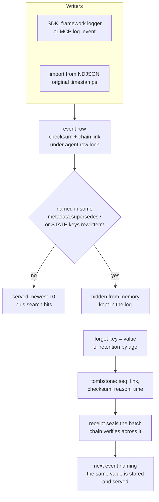

## 1. Executive Summary

ZizkaDB is a FastAPI service on Postgres that records each agent step as an
event linked to the step that caused it, hash-chains each agent's events, and
serves the log back as a prompt block through `context_for`. The record is the
strong part: scope comes from the credential on every read, every deletion
leaves a sealed tombstone, and tamper tests inject edits through raw SQL. The
memory on top is thin. Context is the ten newest events plus keyword or vector
hits, each value cut to 80 characters. Supersession is a link on the replacing
event, which import drops and raw metadata can aim at any event in the tenant.

The licence is AGPL-3.0 for the core API, the dashboard, the SDKs and the
integrations, and MIT for the MCP server under `mcp/` (`NOTICE`), with no
rider. Self-hosting runs one agent per install; several agents are a feature
of the hosted service, which this repository also serves. Nothing is extracted
or judged by a model: memory is whatever the application logged. Three marks
are earned, `scope_enforced`, `audit_log` and `negative_eval`. `tombstone` is
the instructive withholding. Forget selects rows by a value and then keeps
neither the value nor a digest of it, so the next event naming the same person
is stored and served.

## 2. Mental Model

A memory is an **event**: an agent name, an event type, a JSON `data` payload,
an optional parent event, a session, and metadata that may carry `importance`
in [0, 1] and `supersedes`, an earlier event's id (`core/api/events.py:24-36`).
Everything logged is eligible for recall. There is no extraction, no fact
layer and no status: a tool call, a user message and a stated preference are
the same kind of row.

An event is in one of three conditions, and only deletion is stored:

- **Served.** It exists and no later event hides it.
- **Hidden.** It stays in the log and leaves `context_for` and search, in two
  cases computed per read (`superseded_ids`, `core/services/memory_rank.py:24-61`).
  Either some event in the tenant carries its id in `metadata.supersedes`, or
  it is a `STATE_SET` all of whose keys a later `STATE_SET` or `STATE_DELETE`
  of the same agent rewrote. A `search` caller can ask for hidden events back
  with `include_superseded`.
- **Deleted.** `forget` or retention removed the row and left a tombstone of
  its sequence number, chain link and checksum, without content
  (`core/services/audit_chain.py:150-218`).

Nothing moves an event from served to doubted. The hidden state is derived
from links rather than written, which is why it does not count as a trust
state. Supersession is the only correction verb, and it is a write by whoever
holds a key for the agent.

The second mechanism, the hash chain, is about the record and not about
belief. It proves the log was not edited, reordered or silently shortened. It
says nothing about whether an event's content was true.

## 3. Architecture

`core/` is a FastAPI application whose routers sit under `/v1`, among them
events, sessions, agents, search and memory (`core/main.py:225-238`).
Postgres holds everything durable, with pgvector loaded for an `embedding`
column on `events` that the write path fills and no read queries
(`core/db/schema.sql:107`, `:252-255`). Vector search runs in Qdrant's
`agent_events` collection (`core/api/search.py:43-64`). Redis holds the
embedding cache, the suggestion cache and rate limits. A separate process,
`core/workers/embed_worker.py`, embeds pending events. The retention purge
runs as a task inside the API process (`core/main.py:143-150`).

Around it: a Next.js dashboard under `dashboard/` that views events, causal
chains, sessions and drift reports; Python and TypeScript SDKs that are HTTP
clients; LangChain, LangGraph, CrewAI and LiveKit packages that log framework
callbacks as events; and `mcp/`, a stdio MCP server that forwards each tool to
the REST API. A `suggestions` service asks Claude for improvement suggestions
from deterministic evidence and caches them in Redis. It writes no event and
is not memory.

### Deployment and ergonomics

The quickstart pulls one container holding Postgres, the API and the
dashboard. In development mode it binds both ports to `127.0.0.1` and accepts
the well-known key `zizkadb_dev_local`; the README says production mode
generates its own secrets and asks for an admin token. That container runs
without Qdrant, so search and `context_for` are keyword-only. Vector search
needs the compose stack with Postgres, Qdrant, Redis, the API, the worker and
the dashboard. A self-hosted install also needs `EMBEDDINGS_ENABLED=true`
(`core/services/entitlements.py:133-147`) and an OpenAI key or a local
embedding endpoint. No API key is needed to store anything locally.
Self-hosted installs accept one agent: the first agent name logged takes the
slot, and a second is refused (`core/services/agent_limits.py:1-24`).

The store is ordinary Postgres and readable with `psql`. Editing a row by hand
breaks its checksum and every later link, and `GET /v1/events/chain` reports
it, which is the point.

## 4. Essential Implementation Paths

- **Write.** `POST /v1/events` (`core/api/events.py:43-61`) checks the key's
  agent binding, then `write_event` (`core/services/event_write.py:105-200`)
  folds `supersedes` and `importance` into metadata and validates them. It
  redacts secret-named keys and caps the payload at 256 KiB. In one
  transaction, `_insert_event` (`:247-391`) bumps the agent row and takes its
  lock. It draws the sequence number and timestamp from Postgres, computes the
  v2 checksum, and records a head break if the agent's last link vanished. It
  then inserts the row with `chain_hash = sha256(prev + ":" + checksum)` and
  moves the agent's recorded head. Batches of up to 500 call the same function
  per event (`core/api/events.py:80-131`).
- **Embedding.** With `EMBED_SYNC` set, `_after_insert` embeds inline and
  upserts to Qdrant (`core/services/event_write.py:410-444`); otherwise the
  row is `pending`. The worker takes batches of 50 every two seconds, embeds,
  and re-checks under the per-event advisory lock that the row exists
  before writing the vector (`core/workers/embed_worker.py:26-72`, `:121`).
- **Context.** `POST /v1/memory/context` (`core/api/memory.py:57-208`), traced
  in section 6.
- **Search.** `POST /v1/search` (`core/api/search.py:67-161`): keyword,
  semantic or hybrid by reciprocal rank fusion at k = 60, then superseded ids
  removed.
- **Causality and time travel.** `GET /v1/events/{id}/why` walks
  `parent_event_id` with a recursive CTE to depth 50
  (`core/api/events.py:371-460`). `GET /v1/events/at` folds `STATE_SET` and
  `STATE_DELETE` events up to a timestamp into a key-value state, plus the
  newest other event (`:564-658`).
- **Correction.** A write with `supersedes`; `superseded_ids`
  (`core/services/memory_rank.py:24-61`) is the only reader.
- **Forget.** `DELETE /v1/memory/forget` (`core/api/memory.py:336-441`) selects
  ids whose `data->key` equals the value and takes the per-event advisory
  locks. It deletes the Qdrant points in up to three attempts and rolls the
  transaction back if they fail, then calls `delete_and_tombstone` (`:415`).
- **Retention.** `purge_expired` (`core/services/retention.py:40-93`) deletes
  per agent by age in batches of 1,000 with the same locks and tombstones.
- **Verification.** `GET /v1/events/chain` (`core/api/events.py:664-690`) runs
  `verify_chain` (`core/services/audit_chain.py:272`) over events and
  tombstones in sequence order, with an optional externally stored anchor.
- **Export and import.** NDJSON export by sequence; import of up to 1,000 lines
  keyed `import:<original id>` for idempotency, with parents remapped to new
  ids (`core/api/events.py:160-276`).

## 5. Memory Data Model

`events` (`core/db/schema.sql:100-122`) is the memory: `event_id`, `tenant_id`,
`agent_id`, `timestamp`, `event_type`, `data`, `embedding`, `parent_event_id`,
`session_id`, `sequence_no`, `checksum`, `metadata`, three indexing columns,
`idempotency_key` and `chain_hash`. The v2 checksum covers tenant, agent,
type, data, parent, session, timestamp, sequence number and metadata, so
`importance` and `supersedes` are inside it (`core/services/checksum.py:72-118`).
`parent_event_id` is a soft link: retention or forget may delete a parent.

`event_tombstones` (`:161-180`) holds one row per deleted chained event:
tenant, agent, event id, sequence number, chain hash, the deleted row's
checksum, a `reason` of `forget` or `retention`, `deleted_at`, and the
`receipt_id` sealing it. A receipt is a row in the same table with reason
`erasure_receipt`, a digest over its tombstones' links and their count.
`chain_head_breaks` (`:192-202`) records a write that found the agent's
recorded newest link missing or changed. No row records who erased.

**Scope** is two keys on every event. `tenant_id` is one per account or
project and comes from the credential. `agent_id` is a name; an API key binds
to the first agent it writes for, atomically, and is refused for any other
afterwards (`core/api/deps.py:67-95`).

**Time** is one field. `timestamp` is the database clock for a live write and
the original timestamp for an import (`core/services/event_write.py:322-334`).
`at()` answers what had been logged by a moment. After a forget it answers
with the erased events missing, so it is not a reconstruction of what was
known then.

There is no separation of episodic and semantic memory. A `STATE_SET` event
is the closest thing to a profile, and the only type with implicit
supersession.

## 6. Retrieval Mechanics

`context_for` assembles four steps (`core/api/memory.py:57-208`):

1. **Recent.** The agent's ten newest events by timestamp, optionally
   excluding the current session (`:78-88`).
2. **Relevant.** With embeddings on, a Qdrant search on the task text filtered
   by tenant and agent, rows fetched from Postgres (`:95-114`). Otherwise,
   Postgres full-text search with the `simple` configuration, every query word
   a prefix term joined by OR, ranked by `ts_rank_cd`
   (`core/services/keyword_search.py:30-73`).
3. **Filter and rank.** Superseded ids are computed over both lists and
   dropped. Relevant hits are rescored as relevance × (0.5 + importance) ×
   0.5^(age / 30 days) (`core/services/memory_rank.py:84-91`). Exact
   duplicates of type and data are merged (`core/api/memory.py:130-152`).
4. **Pack.** Recent events first, then relevant ones by score, as lines of
   `[Recent · 2026-11-04 10:12] tool_call: key='value', …` inside
   `max_tokens × 4` characters, default 2,000 tokens (`:159-189`).

Three properties follow from the code. **Recent events always come first**,
so the task-relevant arm gets whatever budget the ten newest leave, and the
packer stops at the first line that does not fit. **Each event shows at most
four keys, each value cut to 80 characters** (`_format_data`, `:476-483`); a
fact logged as one long `text` value reaches the prompt as its first 80
characters. **The superseded filter runs after the `LIMIT`**, so a
superseded recent event costs a slot rather than yielding to the next one.

`search` is the same machinery without the packing. Hybrid mode fetches twice
the limit from each arm and fuses by RRF (`core/api/search.py:92-121`). The
`why` chain is reachable over REST and MCP, and `context_for` does not use it:
causality is a debugging read, not a retrieval signal.

## 7. Write Mechanics

Writes are explicit and model-free. The application, a framework callback or
the MCP `log_event` tool posts whatever it chooses. Nothing distils, merges or
deduplicates, apart from an idempotency key that returns the first event on a
retry (`core/services/event_write.py:158-185`). Redaction runs before the
checksum. Values under secret-named keys become `[REDACTED]` by default, and
email, phone, card, IBAN and IPv4 patterns are opt-in through
`REDACT_PATTERNS` (`core/services/redaction.py:1-62`).

Correction appends. A new event names the old one in `supersedes`, and the
writer checks that the target is an earlier event of the same agent
(`:152-156`). Two writers reach the stored key without that check, and both
are traced in section 9. Contradictions are not detected: two events stating
different cities are both served unless the second names the first.

Deletion is by value or by age. `forget` matches a **top-level key of `data`
whose value is the given string**: `data->$2 = to_jsonb($3::text)`
(`core/api/memory.py:366-378`). A number stored as `123` does not match
`"123"`, a nested key does not match, and a value mentioned inside free text
does not match. The request model's own example key, `session_id`, names a
column this predicate does not read (`:49`).

### Operational cost

Every write is synchronous: one transaction holding the agent row lock, a
handful of statements and no model call. Writes for one agent are therefore
serialised. An event is keyword-searchable when the transaction commits. With
embeddings on, it reaches vector search within about one worker poll of two
seconds plus the embedding call, or inline under `EMBED_SYNC`. No pass rereads
the store except retention, which deletes by age every hour once a period is
set. The default context block is bounded at 8,000 characters. It is returned
to the caller, who decides where it sits in the prompt; the docstring's
example places it in the system message.

## 8. Agent Integration

The MCP server registers thirteen tools (`mcp/zizkadb_mcp/server.py:169-457`).
`log_event`, `search_memory`, `get_context`, `why`, `query_events`,
`time_travel`, `verify_chain`, `memory_diff` and `forget` are the memory
tools; the rest read drift and token reports or reset the local causal chain.
`log_event` fills `session_id` and `parent_id` from process-local state, so a
model's consecutive calls form a chain on their own
(`mcp/zizkadb_mcp/session_state.py`). It takes no `supersedes` or
`importance`, so an agent over MCP can add and erase memory but cannot
correct it.

The agent holds `forget`. Through MCP it can delete every event in its agent
whose data carries a given key and value. A tenant-wide forget requires a
dashboard session (`core/api/memory.py:350-354`).

The SDKs expose `context_for` and `context_for_full`, and the framework
packages only log. Nothing in the tree injects context automatically: the
application calls `context_for` and places the string. Adapting it to another
agent is a matter of posting events and calling one endpoint.

## 9. Reliability, Safety, and Trust

### Supersession has two unchecked writers

`write_event` validates `supersedes` only when it arrives as its own argument.
A caller who puts the same key inside `metadata` stores it untouched, because
`_memory_metadata` returns metadata unchanged when the argument is absent
(`core/services/event_write.py:203-217`). The reader then matches the
superseding event on tenant alone: `n.tenant_id = $1 AND
n.metadata->>'supersedes' = e.event_id::text` (`core/services/memory_rank.py:35-39`).
On a multi-agent tenant, a key bound to agent A can hide one of agent B's
events from B's context and search by naming its id. The event stays in the
log. Event ids are UUIDv4, so the attacker needs the id first.

Import is the second writer. `import_events` passes each line's metadata
through and assigns new ids (`core/api/events.py:251-261`), so an imported
`supersedes` names an id that does not exist in the new install. Every
explicit correction is lost on a move between self-host and Cloud, and the
superseded facts are served again beside their replacements. Implicit
`STATE_SET` supersession survives, because it is computed from order.

### Erasure keeps the trace and loses the subject

The deletion side is careful. Vectors go before rows, under the same advisory
lock the embed worker takes, so a worker mid-embedding cannot recreate a
forgotten vector. If Qdrant cannot be reached, nothing is deleted and the call
returns 503 (`core/api/memory.py:392-410`). Each deleted chained row leaves its
link and checksum, sealed by a receipt, so the chain verifies across it and an
erasure shows where it happened. The README states the cost: the kept checksum
lets someone with database access confirm a guessed event exactly.

What it does not keep is what was selected on. The value is logged only as the
first 12 hex digits of its SHA-256 (`:417-425`), and no table stores it, so
nothing stops the next event with `user_id = alice` from being stored and
served. Deleting an agent removes its events and its tombstones together
(`core/api/agents.py:364-371`), and deleting an account cascades from
`tenants` (`core/services/account.py:144`), so neither leaves a trace in the
store.

### The chain's threat model

The chain is unkeyed, and the module says so: anyone with write access to the
database can rebuild it end to end, and only a head recorded outside ZizkaDB
and passed back as an `anchor` detects that (`core/services/audit_chain.py:31-33`).
Within that model it is thorough. A write that finds its agent's recorded head
gone records a `chain_head_breaks` row before linking past the gap
(`:77-110`), and the verifier checks receipts against the tombstones they
name.

### Injection and privacy

Events are served verbatim, minus truncation, under an `=== Agent Memory ===`
header that labels nothing as untrusted. A logged tool result or user message
carrying an instruction returns in every later context whose recent window or
keyword match reaches it. The MCP server sends an install ping with an install
id, version, OS and mode to `db.zizka.ai` unless `ZIZKADB_TELEMETRY` is set
false, self-hosted included (`mcp/zizkadb_mcp/server.py:97-124`).

### Marks

Three are carried.

- **`scope_enforced`** — the tenant is resolved from the key's hash or the
  JWT, never from the body (`core/api/deps.py:161-187`). Every events query
  on the context, keyword, list, why, at and export paths carries it, and a
  bound key cannot name another agent. Qdrant queries filter on `tenant_id`
  and `agent_id` payloads the writers stamp. Dashboard sessions and the
  development key are tenant-wide by design. The supersedes predicate above
  is the one read that crosses agents.
- **`audit_log`** — the events table is the memory, and no path rewrites an
  event's content. Corrections are appended events, and forget and retention
  append tombstones with a reason, a time and a sealing receipt. The chain
  over them is verified on request. The UPDATEs in the tree touch only
  `embedding` and the index columns, which the checksum excludes. A tombstone
  carries no actor, and an agent or account delete removes the record with
  the events.
- **`negative_eval`** — see section 10.

Four are withheld.

- **`tombstone`** — `event_tombstones` is keyed on `event_id`, and the write
  path never reads it. Forget selects on a value and records the rows, not the
  value, so a re-logged value walks straight back in. That is a defensible
  GDPR choice, since keeping the value would keep the person. [Fireweed
  MCP](../fireweed-mcp/) shows the digest-keyed alternative.
- **`trust_state`** — no status field exists; `importance` is a ranking
  weight, and the hidden set is derived from links on each read.
- **`bitemporal`** — `timestamp` is the only time, and an import overwrites
  it with the original rather than adding a second.
- **`human_review`** — no event waits for anyone. The dashboard views and
  deletes, and the agent holds `forget` over MCP.

## 10. Tests, Evals, and Benchmarks

The core suite has 727 pytest functions in 71 files. 175 of them run against
a real Postgres, and `conftest.py` skips them unless `ZIZKADB_TEST_DATABASE_URL`
is set (`core/tests/conftest.py:32-42`). CI sets it against a
`pgvector/pgvector:pg16` service and runs `-m postgres` beside the unit suite
(`.github/workflows/ci.yml:47-90`). I ran none of them.

**`negative_eval` is earned on supersession.**
`test_explicit_supersedes_hides_the_old_fact`
(`core/tests/test_pg_memory_quality.py:28-42`) logs *user lives in Madrid*,
then *Berlin* superseding it. It asserts that keyword search returns exactly
the Berlin event, and that `include_superseded` returns both. The context
block must contain Berlin and not Madrid, and the table must hold two
rows. The case cannot pass on an empty result: the recent arm fetches both
events, and the positive half is asserted in the same response.

**The scope boundary is tested on a populated result too.**
`test_event_list_returns_only_the_callers_events`
(`core/tests/test_pg_tenant_isolation.py:76-89`) seeds two tenants under one
agent name and asserts each list equals its own two events. The scoped-key
case beside it shows the other agent's event reachable without the scope
before asserting a 404 with it (`:135-150`). Neither runs `context_for` or
search across tenants.

**The chain is tested by injecting the fault.** `test_pg_audit_chain.py`
edits a row's data, deletes a row, and blanks a chain hash through raw SQL,
and asserts the verifier names the problem and the sequence number
(`:41-72`). `test_pg_erasure_receipts.py` removes and moves sealed
tombstones and receipts with the chain recomputed and asserts each is caught.

Missing: a case for supersession through raw metadata or across agents, a
supersedes link surviving `export_events` and `import_events`, a forget of a
numeric or nested value, and any retrieval-quality measure. No benchmark is
committed, and no paper is associated with the project; `CITATION.cff` cites
the software.

## 11. For Your Own Build

### Steal

- **Delete the vector before the row, under the same lock the indexer takes.**
  Abort the deletion if the index is unreachable. A forget that half-succeeds
  is worse than one that fails, and the lock closes the race in which a worker
  recreates the vector it was embedding.
- **Make the erasure a link in the chain.** Keep the deleted row's link and
  checksum, seal each erasure with a digest over its tombstones, and the
  history stays verifiable without the content.
- **Record the head break before writing past it.** A write that finds its own
  last link gone is the one moment the store can notice an out-of-band
  deletion; storing that discrepancy makes it permanent evidence.
- **Bind the key to the scope on first use.** An agent key that claims its
  agent atomically and refuses every other gives per-agent isolation with no
  agent parameter to trust.

### Avoid

- **Validating a field on one argument while the stored key is reachable
  another way.** Validate the stored value, wherever it came from, or strip
  the reserved key from free-form metadata.
- **Correction links keyed on ids that an export renames.** Remap every id an
  event refers to on import, not only its parent, or the correction is lost on
  the first migration.
- **A forget predicate narrower than its documentation.** If the example says
  `session_id`, the predicate should read the column, and a typed value should
  match its string form.

### Fit

This suits a team that already wants an audit record of what its agents did,
for debugging or for Article 12 record-keeping, and would like the next run
to see a slice of it without a second store. It needs Postgres and nothing
else for keyword memory, and the integrity engineering is careful. Walk away
if you need memory that distils facts, reconciles contradictions or tells a
claim from a verified one. Every logged step is served as it was written,
cut to 80 characters a value. Self-hosting gives one agent, and anything
multi-agent means the hosted service or a code change.

## 12. Open Questions

- Whether the hosted service applies the same agent cap, retention and
  embedding defaults as the self-hosted code paths read here.
- How useful the ten-newest-first context is for agents whose recent events
  are tool chatter rather than facts.
- Whether `metadata.supersedes` is meant to be writable directly, and whether
  the import path is meant to carry supersession.
- How the hash chain performs on agents with millions of events, given that
  verification walks every link in pages of 2,000.

## Appendix: File Index

- Storage and schema: `core/db/schema.sql`, `core/db/connection.py`
  (`init_db` migrations), `core/services/checksum.py`
- Write path: `core/api/events.py`, `core/services/event_write.py`,
  `core/services/redaction.py`
- Retrieval and context: `core/api/memory.py`, `core/api/search.py`,
  `core/services/keyword_search.py`, `core/services/memory_rank.py`,
  `core/services/embeddings.py`
- Correction, erasure and chain: `core/services/audit_chain.py`,
  `core/services/retention.py`, `core/api/agents.py` (`delete_agent`)
- Scope: `core/api/deps.py`, `core/services/api_keys.py`,
  `core/services/agent_limits.py`
- Background: `core/workers/embed_worker.py`, `core/main.py` (retention task)
- MCP and SDKs: `mcp/zizkadb_mcp/server.py`, `mcp/zizkadb_mcp/session_state.py`,
  `sdk/python/zizkadb/client.py`, `sdk/typescript/src/index.ts`
- Tests: `core/tests/test_pg_memory_quality.py`,
  `core/tests/test_pg_tenant_isolation.py`, `core/tests/test_pg_audit_chain.py`,
  `core/tests/test_pg_erasure_receipts.py`, `core/tests/test_pg_retention_export.py`,
  `core/tests/conftest.py`

### Recorded searches

Run from the repository root at the pinned commit with `/usr/bin/git grep`.

- **The write path never reads tombstones.**
  `git grep -n 'event_tombstones' -- core ':!core/tests'` returns
  `schema.sql`, `connection.py`, `audit_chain.py`, the agent delete at
  `api/agents.py:370` and the metrics gauge at `api/metrics.py:68`; nothing in
  `event_write.py` or `api/events.py`.
- **Import does not carry supersession.**
  `git grep -n 'supersedes' -- core/api/events.py` returns lines 34, 59 and
  117, the single and batch write paths; nothing in `import_events` at
  218-276. `git grep -n -E 'supersed' -- core/tests/test_pg_retention_export.py`
  returns nothing, while `import_events` matches there five times.
- **No status on an event.**
  `git grep -n -i -E 'verified|candidate|rejected|quarantin|trust_?(level|state)' -- core/db/schema.sql core/services/memory_rank.py core/api/memory.py core/api/search.py core/services/event_write.py`
  returns one schema comment, *"Candidate for removal"*, on a Stripe column.
- **No validity time.**
  `git grep -n -i -E 'valid_(from|to|until|at)|validfrom|invalid_at|as_of' -- core ':!core/tests'`
  returns `invalid_tool_arguments` in `services/ai/config.py` only; adding
  `occurred_at` to the pattern returns six more lines, all the import timestamp.
- **The pgvector column is never queried.**
  `git grep -n -E '<=>|<->' -- core ':!core/tests'` returns nothing.
- **No review verb.**
  `git grep -n -i -E 'approve|pending_review|review_status|moderat' -- core dashboard/app mcp ':!core/tests'`
  returns nothing; adding `forget` to the pattern returns 55 lines.
- **Which statements mutate events.**
  `git grep -n -E 'DELETE FROM (events|event_tombstones|tenants)|UPDATE events' -- core ':!core/tests'`
  returns the tombstoning delete in `services/audit_chain.py:182`, the agent
  delete at `api/agents.py:364` and `:370`, the account delete at
  `services/account.py:144`, and five UPDATEs in `event_write.py` and
  `embed_worker.py`, all setting `embedding` or index columns.
- **No model call on the memory paths.**
  `git grep -l -i -E 'anthropic|openai|chat/completions|/v1/messages' -- core ':!core/tests'`
  lists the embedding, embedding-settings, pricing, entitlement and
  suggestion modules, `connection.py`, one migration and `CLAUDE.md`; not
  `event_write.py`, `api/events.py`, `api/memory.py` or `api/search.py`.
- **No automatic injection.**
  `git grep -n -E 'context_for|memory/context' -- integrations examples sdk/python/zizkadb/templates`
  returns nothing; the same pattern over `sdk/python/zizkadb/client.py`
  matches its two context methods.
- **The tenant is not a request field.**
  `git grep -n -E 'tenant_id[[:space:]]*:' -- core/api/events.py core/api/memory.py core/api/search.py`
  returns two function parameters, in `_delete_vectors` and `vector_search`,
  and no request-model field; `tenant["tenant_id"]` appears 15 times in the
  same files.
- **The context block labels nothing.**
  `git grep -n -i -E 'untrusted|do not follow|instruction' -- core/api/memory.py`
  returns nothing.
- **No paper.**
  `git grep -n -i -E 'arxiv|bibtex|@article|@misc|doi\.org' -- .` returns
  nothing.
- **No licence rider.**
  `git grep -n -i -E 'anthropic|machine learning|not (be )?used (for|to)' -- LICENSE mcp/LICENSE NOTICE`
  returns nothing.

## History

**2026-11-05** — [`0d3177d93d5754a769940ba53a0ed133aa157911`](https://github.com/ZIZKA-AI-SL/ZizkaDB/commit/0d3177d93d5754a769940ba53a0ed133aa157911). First reading, from a full clone, scoped to `core/` and `mcp/`. Screened first: two auto-run surfaces (`.cursor/rules/` and `.github/copilot-instructions.md`), three build-time execution points, 23 unpinned surfaces, and four dependency files inside the seven-day cooldown; `AGENTS.md`, `CLAUDE.md` and `GEMINI.md` were read as data. AGPL-3.0 with an MIT MCP server and no rider. Nothing was installed, built or run. Three marks: `scope_enforced`, `audit_log` and `negative_eval`; `tombstone` is withheld because forget records rows, not the value ([section 9](#9-reliability-safety-and-trust)).
